# Ordinary Web Agent skill picker evidence

Refs #6751. Synthetic mock sessions only; no real account, hub or model was used.

Captured from the real Web app at candidate `eb796930fe114000cc7ff60d054037d1948b508a`, based on `50f30b2f6a922877302e72400c2cfa71cfdafb08`.

The menu reuses ComposerPanel and context chips. Standard and Large are the supported text-size settings tested at 390 x 844 and 1365 x 900 in both themes. The browser scenario also checks identity, retry, loading/partial/unavailable catalogs and 44px removal.

## Claude / narrow / Standard

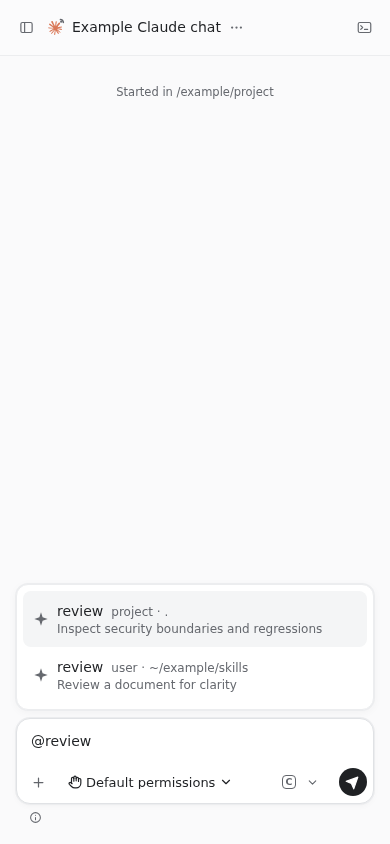

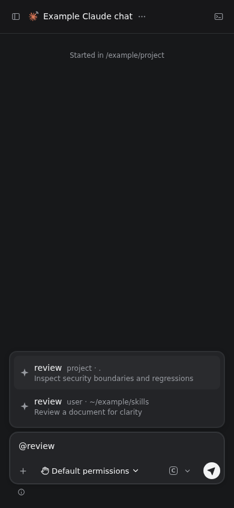

## Claude / narrow / Large

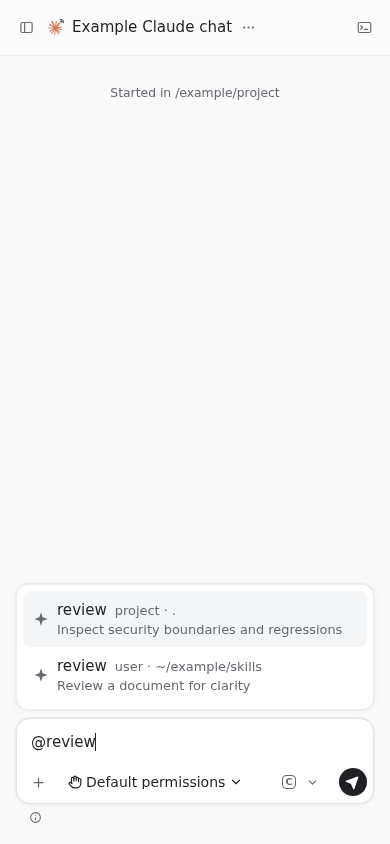

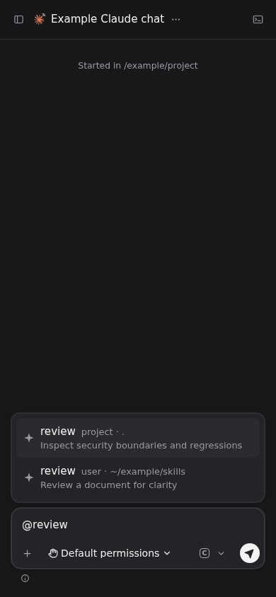

## Claude / wide / Standard

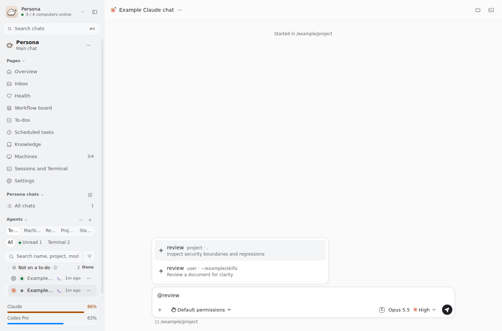

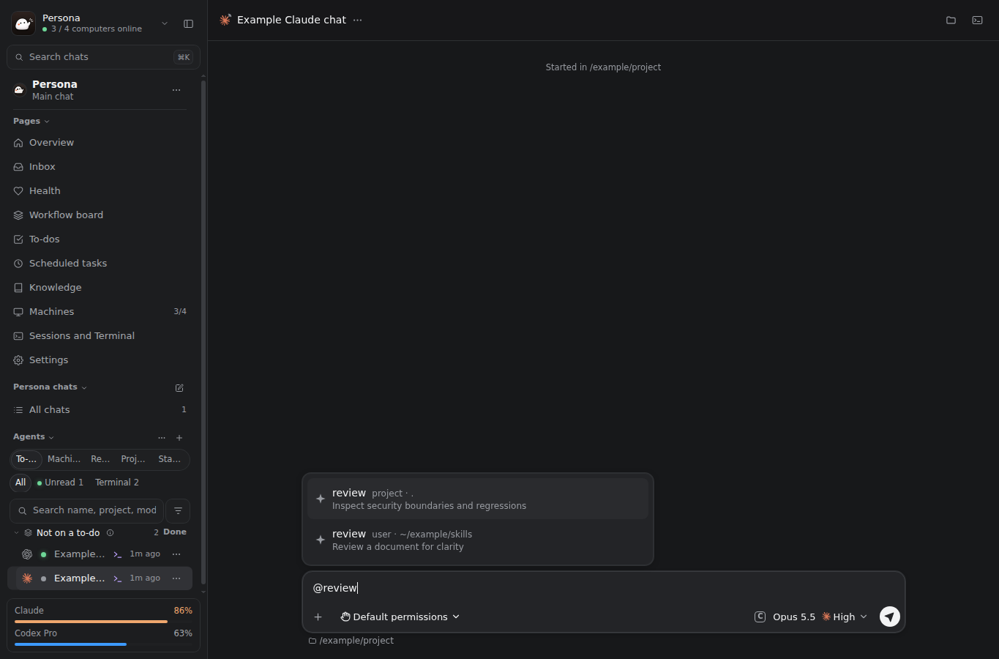

## Claude / wide / Large

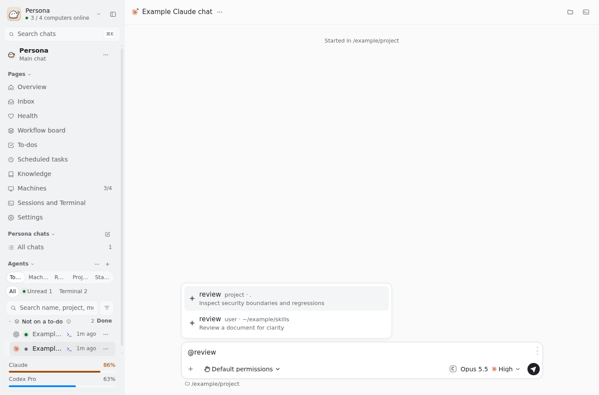

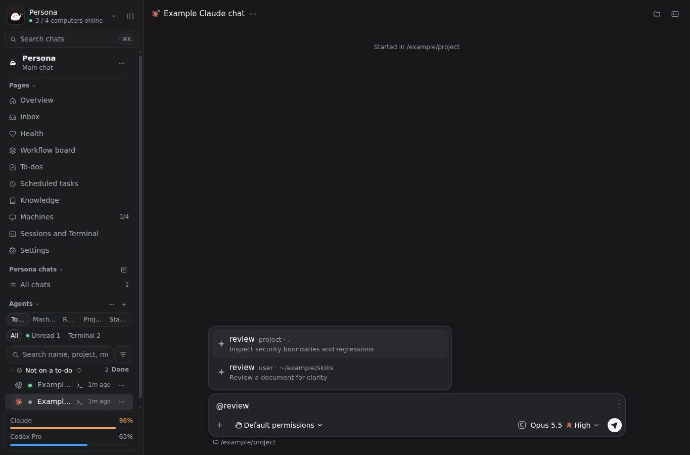

## Codex / narrow / Standard

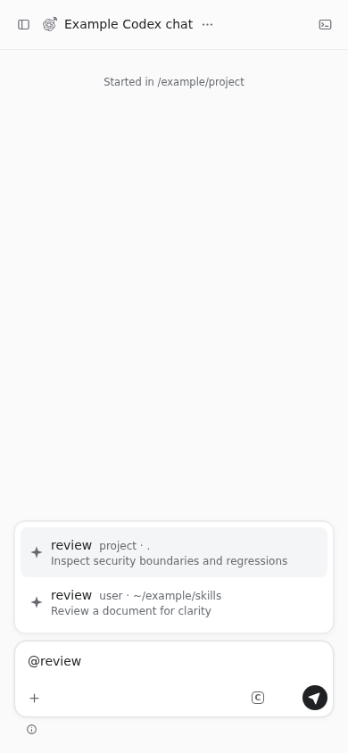

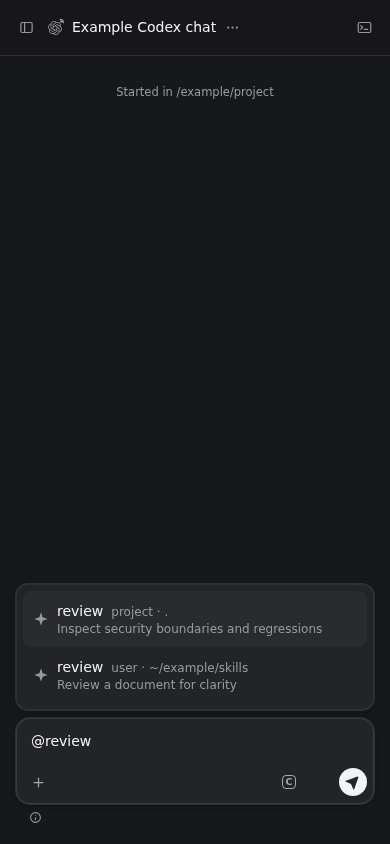

## Codex / narrow / Large

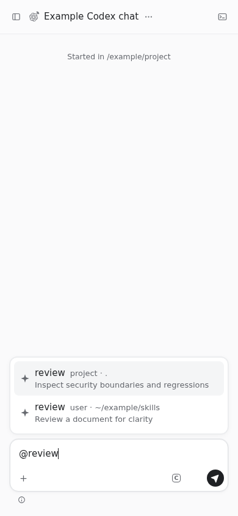

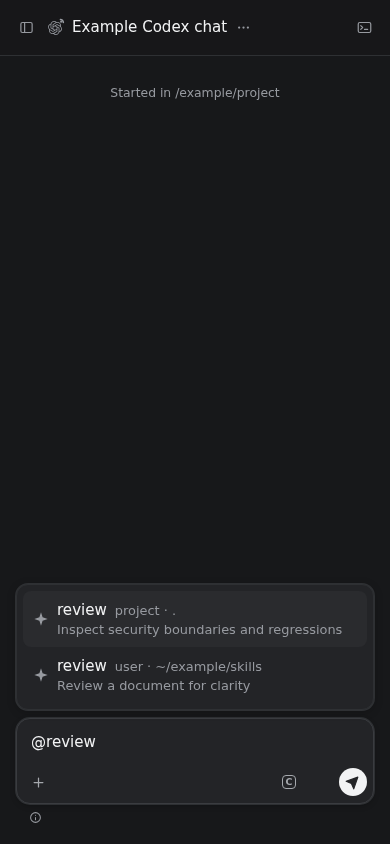

## Codex / wide / Standard

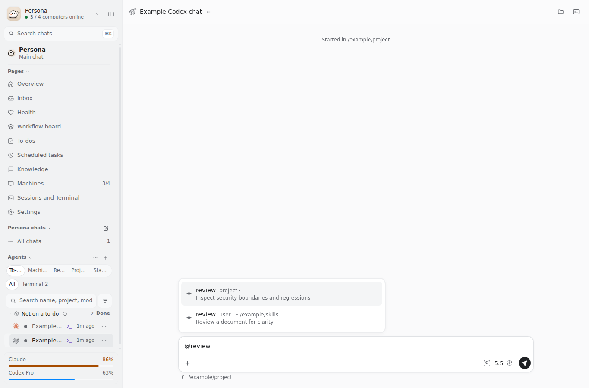

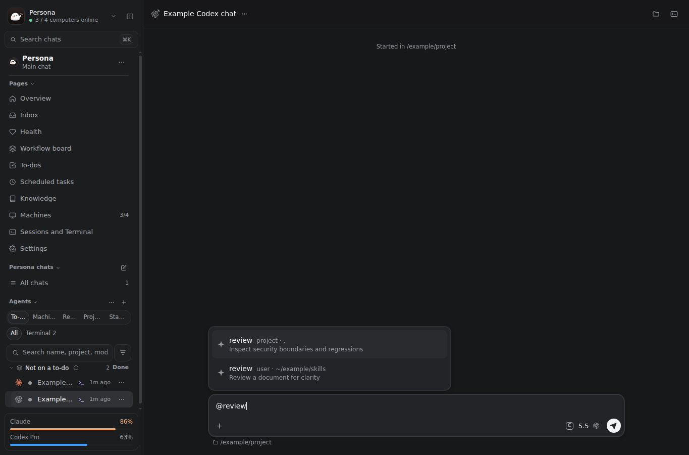

## Codex / wide / Large

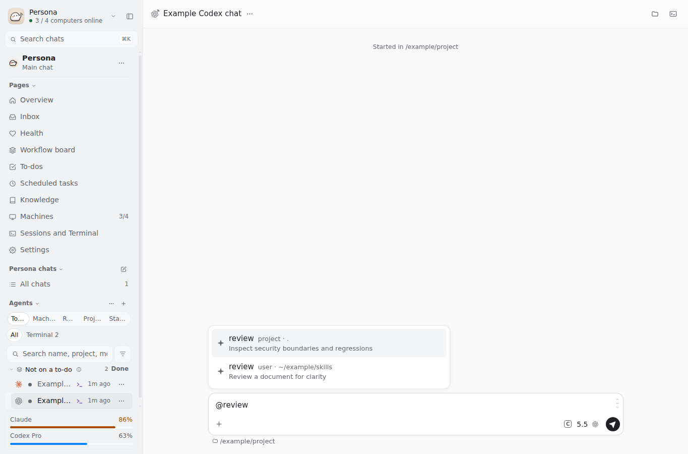

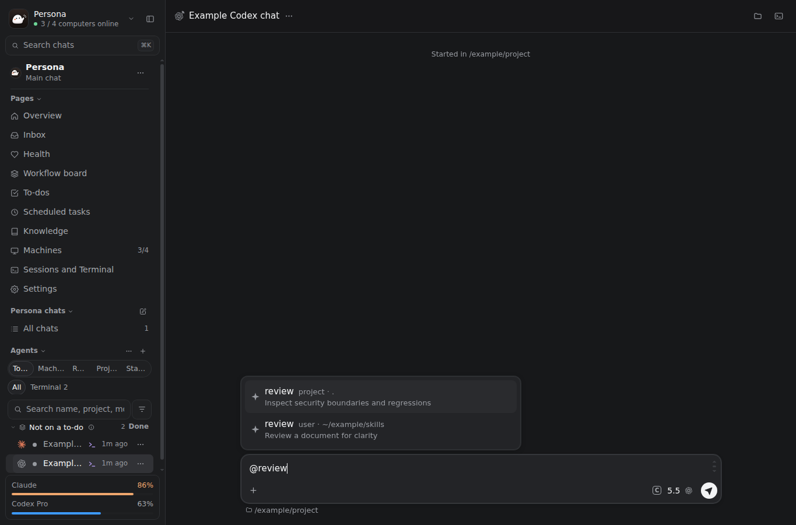

## Refused selection remains identifiable and fits the viewport

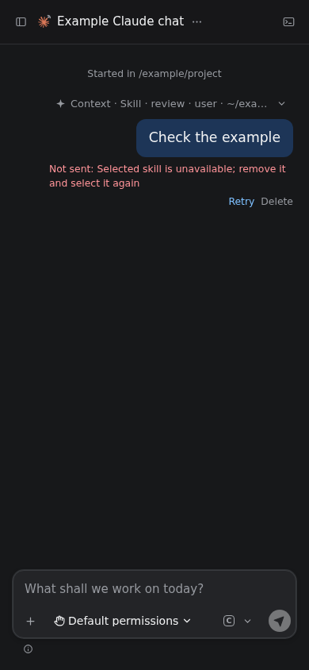
