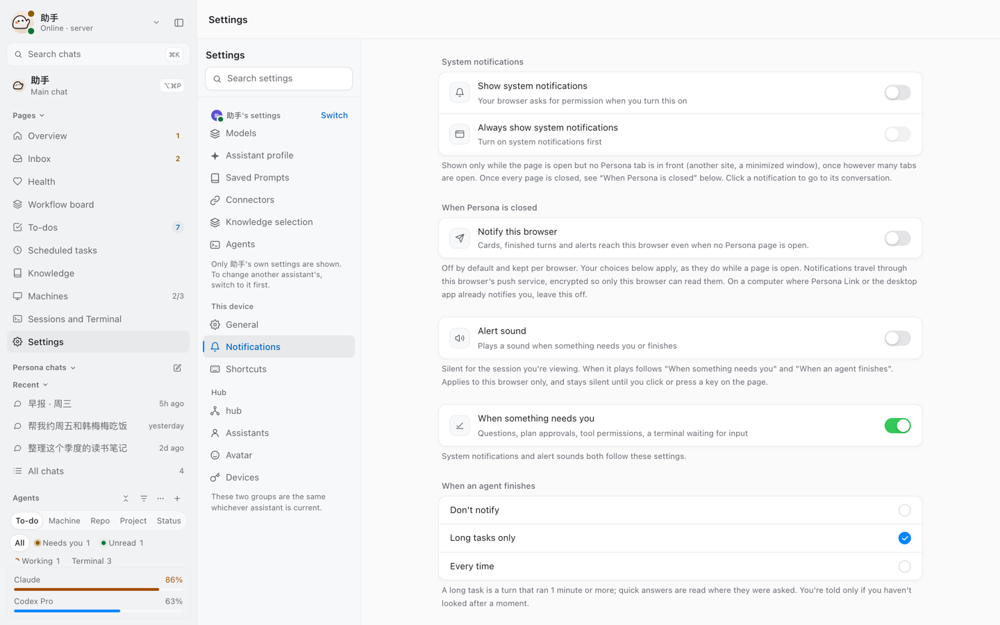
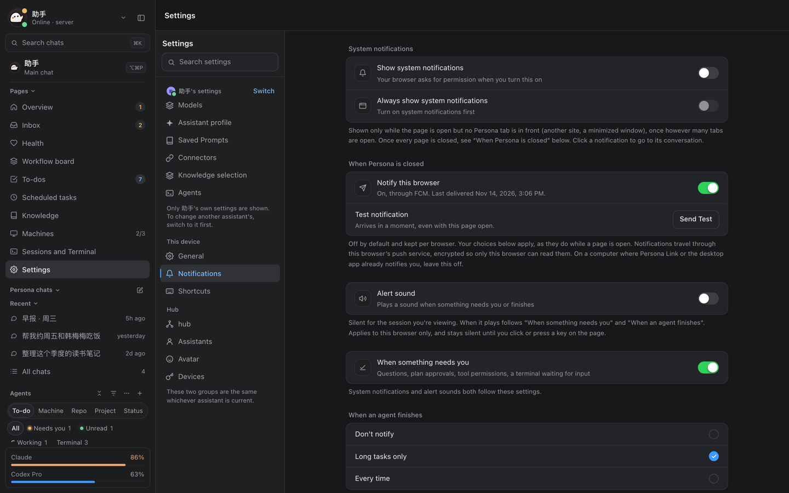
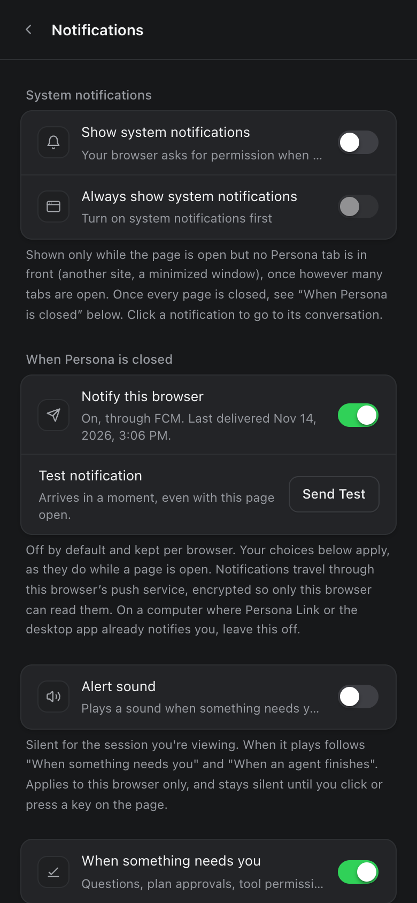

# Web app (`web/`)

Once an administrator turns on password sign-in in Admin › Devices, the web app asks only for the connection password, with no
hub address to fill in. A browser Worker checks the password over OPAQUE without uploading it, and after sign-in the browser keeps a
device token of its own. The earlier pairing-token entry is still one switch away. Password sign-in needs trusted HTTPS (loopback works
for development); self-signed deployments keep using the pairing entry. `npm run dev` and `npm run build` first compile the shared Go
OPAQUE client to WebAssembly, so building the web app needs Go too (the official distribution or Homebrew's, whose `LICENSE` sits beside
`GOROOT` rather than in it: `web/scripts/go-license.mjs`). The generated `/pake/client.wasm`, the Go runtime and
`/pake/THIRD_PARTY_NOTICES.txt` are deployed with the static site; no extra server process is needed.

Persona in the browser: Overview, Agents (Claude Code / Codex in herdr on each of your computers, plus terminal, files and Git), the Persona assistant (scheduled tasks, memory, knowledge base),
Inbox, machine monitoring and Settings. Features roughly match the phone app (gaps are listed in "Gaps versus the phone app" at the end; #297 and #433 were the two rounds that closed most of them). Visuals and interaction follow
[Beautiful UI](https://www.beautifului.dev/) (MIT, license in `THIRD_PARTY_NOTICES.md`): design tokens (`--ink` / `--surface` / `--line`…, light and dark sets),
keyframes and component grammar (Thinking's expandable trace, Tool Chips, Approval Card, Prompt Bar, Sidebar Nav's sliding highlight, Search, Task Rows, Insight Cards).
The components are rewritten from the site's React versions and wired to real data. They are not the site's demo components copied as is (those run their own demo animations and take no data).
Text tokens (`--ink`, `--ink-2`, `--ink-3`, `--accent-ink`) reach at least 4.5:1 (WCAG AA for small text) on the tested base backgrounds (page / canvas / surface / inset / hover / hover-2 / field).
`--ink-3` stays a step quieter than `--ink-2`; `src/ui/theme-contrast.test.ts` guards these pairs (#2804: dark `--ink-3` previously reached only 2.5–3.5:1).
Dropdowns keep the browser's native `<select>` and its popup, but not its arrow, which ignores the field's padding (#2314): `src/styles.css` gives every single-line
select the icon set's `chevron` (`--select-chevron`, drawn in `--ink-3`) 10 px inside its right edge, plus right padding that keeps the text clear of it. The rule is
unlayered so its padding wins over the `px-*` utilities; a select that draws its own arrow adds `appearance-none` and is left alone. `src/ui/select-chevron.test.tsx`
keeps the token equal to the icon and `--ink-3`.

## Assistant task rows (#2878)

An Assistant task's only card is its **Progress** tray row. Plan, execution, blocked progress, PR and acceptance update
that stable row; tapping it opens the task. The conversation, including historical task events, shows no
plan/task/receipt/review/report cards. A dispatch is a **hand-off card** for each Agent it started or took over (#5096, after
cindy's `SessionHandoffCard`; `views/assistant/Handoff.tsx`). Where a card or a row opens is Settings › General › Agent
preferences › **How Agents open**, kept by this browser (#5424, `lib/agent-open.ts`): the **side panel** beside the chat,
the default (over the chat on a phone-sized window), or the Agent's own **full page**
([unified-entry.md](../assistant/unified-entry.md), "Hand-off cards (web, #5096)").
What the user says straight to a task (its `routed` line) stays a bubble, **To "<title>"**. When every Agent of the task had
stopped, the hub starts a new Agent for it with that message (`new_agent`, `new_agent_machine`; `docs/assistant/todos.md`), and
the bubble has that new Agent's hand-off card under it (#4754, #5096).

The dock groups actions as **Pending / Progress / Agents**, with one bounded, scrollable tray open at a time. Pending
retains planning, permission/question and owner-acceptance flows; `Todo.ask` uses the existing Accept action and the captured
`asked_at`, so an in-flight old round cannot answer a newer one. Replies sent on the user's behalf remain separate,
individual Send actions. Approval, tray navigation and filters never send a draft. Agents retains its existing filtering,
TaskBoard and session/detail entry points. Quiet schedules have a separate Progress group.

**Since #3387 there are two entries, Needs you and In progress, each thing in one only**
([unified-entry.md](../assistant/unified-entry.md#needs-you-and-in-progress-each-thing-once-3387), `assistantEntries` in
`web/src/lib/assistant-entries.ts`, checked against `spec/fixtures/entries`). Needs you holds what the Pending and To start
entries held, plus the tasks Progress used to rank first and the hand-opened Agents that ask; In progress holds the other
open tasks and the hand-opened working Agents, which replaces the Agents entry. Finished tasks fold nowhere: the board has
them. The rest of this section describes the earlier three entries; the counting rule still holds for In progress.

Progress lists and counts the conversation's open tasks by **the To-dos page's rule** (#3331, `todoBucket` in
`web/src/lib/todo-triage.ts`, the same `countsAsOpen` as the page's "Not done"): working, waiting for the user, finished but
unseen and stopped between rounds count; a task shelved (no activity for 48 h, nothing running, not restored on this
browser) folds under one **Shelved N** line and is not counted; accepted (task_review accepted), deployed, done, cancelled
and old failed starts fold under **Closed N**. The main conversation watches every task, so its Progress has a row for
every to-do whatever its origin, and its count is the To-dos page's "Not done"; other conversations count only the tasks
they handed out. What needs the user sorts first (`todoRank`), each row leads with its status mark (`TaskMark`). A row
stays visible whatever its bucket — a parked task past 48 h still reads its parked line, a shelved one unfolds from
**Shelved N** — but the badge counts a to-do row only while `countsAsOpen` says the page counts it open; each task row
carries `data-counts-open` so the trays' open markers and the To-dos header are one number. Rows that are no to-do
(a hand-opened Agent, a plan waiting for Start, a draft card, the chat's own ask card) remain one item each as before.
Plan tasks waiting for Start are no to-dos yet: neither Progress nor the To-dos page lists or counts them. While a plan waits
a fourth entry, **To start N**, sits after Pending: its tray is the plan cards themselves (Start, Edit, Don't start), so a
plan is not lost in the chat; Pending no longer lists or counts those plans.

The three entries are the dock's old **All** / task capsules (#2999): `DOCK_CAPSULE` in `web/src/views/assistant/Tasks.tsx`
gives "All", the task pills and the entries one height (2 rem, 32 px at the default size), full capsule radius, 12 px side
padding and the 12.5 px type. Each entry is content-wide at the leading edge with an 8 px tone dot, its label and a count;
the row scrolls sideways when a large font no longer fits. The open tray is the selected capsule (`bg-ink text-surface`,
as the knowledge filters draw it) and keeps `aria-expanded` / `aria-controls`; there is no caret. An empty Pending is grey
but still opens "All caught up". Today's two entries are both drawn that way with nothing counted (no number on them): such
an In progress is grey too, not in its working blue, and still opens to its uncounted rows or "Nothing in progress". Esc closes an open tray from its entry, its header or its rows and hands the focus back to the
entry; it stops there, so it never reaches the chat's Esc that stops a working turn. Esc in a text field or a waiting card
in the tray is not the tray's: a card's goes back to the composer and leaves the tray open with what was typed in it.

The feed's additive `task_cards` upserts retain a stable plan/index identity before and after to-do binding, without
replacing or deleting audit events. Old/null/empty projections keep cached or legacy data. Current to-dos/sessions update
the row independently; reusing a to-do under another plan deduplicates by its current `plan_id`, and completion text never
keeps an earlier blocked report. Numeric meters use actual report steps or Agent plan counts, not estimates. Fields and
compatibility are in [the shared protocol](../protocol/protocol.md#tasks-and-the-chat-feed).

This change aligns task-row placement; existing web tool folding and turn-source presentation remain unchanged.

**Task-progress reply drafts (#3743).** Send is the only primary action; Later and Don't handle are secondary.
Later hides this card locally until the page reloads. Don't handle persists dismissal of this exact feed card, removes
it from Needs you without sending a reply, and offers Undo in the existing six-second toast (paused on hover/focus).
The task, its Agent and its Inbox item stay open; a new progress draft has a new card id and is still eligible.
The original card remains an audit record with a not-sent receipt. Dismiss and Undo use the card's manager and the
server-returned full feed item, not an optimistic completion of the task. Apple clients can use the same
[task draft API](../assistant/agent-work.md). `python3 web/e2e/dismiss-task-draft.py <preview URL> --shots <directory>`
drives the built client with synthetic data in Chinese, English and Japanese, wide/narrow light/dark. It checks
Dismiss, Undo, reload, new same-reference progress, and that no reply or task/Agent mutation was requested; `--cdp`
uses the shared browser and keeps the test pages open.

**The open tray's room (#4656).** An open Needs you / In progress tray follows the viewport instead of the old
`min(20rem, 40dvh)` box: while it is open, `styles.css` lets the chat dock (`DOCK_MAX`, 55% of the visible height otherwise)
take up to `--assistant-dock-open-max` (82% of `--kb-h`), the conversation above giving up the room, and the tray fills only
what its cards need. The tray is a column: its header (title, **All**, **Expand**, close) stays and only `[data-tray-list]`
scrolls, so a plan card's sticky Start row (`data-plan-actions`, with a hairline in the tray) sticks to the list's bottom edge
and never under the header. **Expand** (`data-expanded`) gives the dock the whole chat column (the conversation's scroller
goes to zero height, the composer and the entries stay); **Restore size**, closing the tray or switching entries gives the
room back. **All** opens the task board from its own chunk (`views/assistant/TaskBoard.tsx`), loaded when it opens, so neither
it nor `lib/task-board.ts` is part of the first screen. `python3 web/e2e/assistant-tray-room.py <preview URL> --shots <output directory>`
checks it against synthetic data with two plans waiting (five tasks with briefs), two asking Agents, a draft and 14 running
Agents, wide (1280×900) and phone (390×844), light and dark: the tray's height against the viewport, the header fixed while
the list scrolls, Start in reach, the composer on screen, expand and restore, and the board.

`python3 web/e2e/assistant-task-trays.py <preview URL> --shots <output directory>` runs the production-built client against
synthetic HTTP/WebSocket data in wide and phone widths, light/dark, including the entries' measured capsule height and
selected state, keyboard toggling, live same-row completion, owner decisions and proof that no draft was sent by approval. Its captures are browser screenshots, not a deployed-hub check.
`python3 web/e2e/handoff-cards.py <preview URL> --shots <output directory> [--mode panel|page|both]` checks the hand-off
cards the same way (#3700, #5096, #5424). It covers one task and a plan of three, at wide and phone width, light and dark,
with each setting, and the setting's row on the Settings page:
- Side panel: each card opens its Agent in the panel on the right (over the chat on a phone), the chat staying where it
  was and In progress closed; a task still starting opens its task panel; × brings the chat back;
- Full page: each card opens its Agent's page, with no side panel; "Came from Persona · click to return" brings the chat
  back; a task still starting opens its to-do.

A full Agent page or a non-main Persona conversation that belongs to an Inbox item shows **Back to “&lt;item title&gt;”**
(or **Back to this Inbox item** when its title is not loaded) in the same strip position. A hand-off strip takes
precedence; side panels, Team panels and the main conversation do not show this Inbox strip. The item is identified from data
already in the client, in this order: the current runtime session's `origin: "inbox"` and `origin_ref`; up to three
`origin: "spawned"` parent-session links, resolving each parent through the session or assistant-conversation lists; then
an exact computer-and-session match in an item's `chain` session link or `handling`, choosing the matching item with the
newest `updated_at`. The title comes from the Inbox list or loaded Done history. Opening a non-item route through
`openFromInbox` records the item's address in the new history entry: the strip goes Back when that address names the same
item, and otherwise pushes the item's route. ✕ dismisses the strip only for that mounted conversation page.

## Color hierarchy and quiet surfaces

Approvals, plan decisions, permissions and **Needs you** are routine work, not errors. This rule is shared with the Apple and Android clients:

- Reserve semantic red for actual errors, failed operations and destructive actions (delete, stop, revoke or explicitly unsafe changes). A normal approval never uses a red button or red banner.
- Approval and Needs you cards, rows, banners and counters use neutral `surface` / `inset` / `field` backgrounds, with small amber details. Other success, caution and AI statuses retain pale semantic tints. Sent-message bubbles use iOS Agents' pale blue; relayed messages keep neutral gray (#6451).
- `--attention` is the accessible amber for pending decisions; `--status-needs` and the default face's pending mark derive from it. Brand emphasis is `--accent-ink`. Do not use a literal color in a page.
- `--green-tint`, `--orange-tint` and `--ai-tint` are pale role colors; selected extension themes derive them with `color-mix` against `--surface`. `--red-tint` remains neutral inset and `--accent-tint` remains the neutral selected surface (`--hover-2`). Approval and Needs you surfaces must explicitly use neutral tokens, not status tints.
- Each action group has one solid primary action; other actions are secondary or text buttons. Permissions use **Allow** as primary, **Always allow** as secondary and **Deny** as text. Plans use **Approve** as primary and **Request changes** as text. A dangerous button uses `--danger-fill`, separate from readable red text in dark mode.
- Status text and small labels must meet WCAG AA 4.5:1 in both appearances; meaningful icons and outlines need 3:1. Keep labels and differing shapes so color is never the only signal. `src/ui/theme-contrast.test.ts` checks all built-in semantic text roles on all neutral surfaces and solid-action foregrounds.
- Content colors are separate from status: source logos, user-authored image annotations, syntax highlighting, charts and a code diff's added/deleted lines retain their meaning. Diff fills use `--diff-add-bg` / `--diff-del-bg`, never the status tint aliases. A repository label retains only a small color dot, not a colored chip fill. Near-full context is amber caution, not an error.

Browser verification uses only synthetic HTTP and WebSocket fixtures (no live hub):

```sh
cd web && npm ci && npm run build && npx vite preview --host 127.0.0.1 --port 51783 --strictPort
# In another terminal, with Playwright for Python and Chrome installed:
python3 web/e2e/visual_noise.py http://127.0.0.1:51783 --phase after --shots /tmp/persona-web-color-shots
```

The browser check opens Overview, permission/plan cards, green/orange/AI workflow statuses, the attention banner and a quoted Inbox message with an attachment in light and dark. It verifies neutral approval/attention fills, amber near-full context, and at least 4.5:1 for resolved sent-message body, quote, attachment and keyboard-focus colors. It clicks **Allow** and **Approve** to verify their request bodies. Compare `--phase before` against the frozen production baseline using the same driver, viewport, time and fixtures. Screenshots go on the PR, not into production assets.

## Running it

- **Hosted by the hub itself**: the hub serves `<hub data dir>/web` (default `~/.persona/web`) as a static site on the same port as the API (the hub's `listen`, default `:18660`, i.e. all interfaces).
  Same origin, so no CORS, and WebSocket and images use the same token. Without that directory, non-`/api/` paths still return 404.
  Paths that are not files all return `index.html` (front-end routes: `/` (Persona main chat), `/overview` (Overview), `/s/<machine>/<session>`, `/t/<machine>/<space>/<tab>[/<session>]` (one herdr tab, #1963), `/space/<machine>/<space name>` (space page, #2887), `/persona`, `/persona/<session>`, `/persona/new`, `/history`, `/inbox`, `/inbox/<item>`, `/messages`, `/messages/<chat>`, `/routines`,
  `/kb`, `/kb/<type>/<entry>`, `/workspace-board` (workspace board), `/machines`, `/machines/<machine>`, `/terminal`, `/terminal/<machine>/<terminal id>`, `/assistant` (assistant profile page), `/settings`, `/extension/<extension>/<page>` (an extension's full page));
  files under `/assets/` carry a content hash and are cached forever; `index.html` is not cached (`server/internal/hub/web.go`).
- **Precompressed assets**: the copy built into a published personad and the Docker image keeps each hashed text asset of 1 KB or more under `assets/`, and `third-party-licenses.txt` (490 KB plain, 52 KB gzipped), gzipped (`name.gz`, gzip -9 with no name or time, so builds are reproducible). `scripts/release/publish.sh`, `scripts/release/build_hub_release.py` and the `Dockerfile` run `go run ./internal/webasset/precompress internal/hub/webdist` (from `server/`) after copying the web client in; publish and build_hub_release first run the privacy scan on the plain copy, since gzip hides its strings from the scan of the binaries.
  The hub sends the stored bytes to a client that takes gzip (`Content-Encoding: gzip`, `Vary: Accept-Encoding`) and decompresses them for any other request (no gzip, `HEAD`, `Range`), with the same headers and bytes as the plain file. `assets/<name>.gz` itself is a 404, like a missing asset (`third-party-licenses.txt.gz` gets the app, like any path without a file); the licenses are not hashed, so they get no year-long `Cache-Control`. `index.html`, `sw.js`, the manifest, `admin/` and the other root files stay plain.
  **Brotli for the first screen**: `vite build` also writes `name.br` (brotli quality 11, sized by a hint, so reproducible) beside each file of 1 KB or more that a cold first screen loads: `main` and its static imports, and everything the `startup-preload` script lists (the shared, App and live-screen groups and both parts of every language's catalog; `brotliCopies` in `web/src/startup-preload.ts`). Go has no brotli encoder, so the build makes them and `precompress` leaves them as they are (`.br` is excluded by name, not by type). The built-in copy sends one as stored (`Content-Encoding: br`, `Vary: Accept-Encoding`) only to a `GET` that names `br` with a q above 0 (`*` does not count), with no `Range`; every other request gets the gzip or plain answer above. `assets/<name>.br` itself is a 404. Brotli alone takes a cold en first screen from about 756 KB (gzip -9) to about 629 KB (about 558 KB with the catalog changes under "Internationalization" below); the 27 copies add about 0.86 MB to every binary that embeds the web client, since brotli output does not compress again.
  The build fails when a language's cold App first screen (the page's own files, the shared and App groups and that language's startup catalog) measures over `FIRST_SCREEN_BUDGET` in `web/src/startup-preload.ts`; the comment beside it lists what each change allowed. The measure (`firstScreenBytes`) is what the hub sends to a browser that takes br (each file's `.br` copy, or the file when it has none), except that the content hashes in the file names a first-screen file imports and preloads (`./api-<hash>.js`) count as one fixed string. Those hashes change with any change to the files they name, a lazy chunk or a string off the first screen included, and they barely compress: counted as sent, such a change moved the total by tens of bytes either way while the first screen did not change (#5164). Likewise the minified names one file imports from another (`import{eu as a}from"./App-<hash>.js"`) count as one fixed string, keeping the local name, and each export list (`export{Yme as eu,…}`) as an empty one: Rollup names a chunk's exports by their place in it and sorts the list by name, so a lazy chunk that imports one more name from a first-screen chunk renamed all of them and moved the total by hundreds of bytes (#5331). The measure is about 7.5 KB under what is sent (ja 589,323 B against 596,791 B at c7164e477e), and only a change to what the first screen's code does moves it. Raise the budget on purpose, in the change that needs it.
  Every build prints each language's count and the room left in the fullest (`firstScreenRoom`), as a warning under 1 KB (`FIRST_SCREEN_LOW_ROOM`). The room is shared by every change in flight: two that each fit can land together and go over it, and `main` then fails to deploy (#5488, #5879, #7395). So a web PR runs `npm run build` again after merging the latest `origin/main`, just before it merges, and reads that line. The same build fails on a key the first screen's code names that the startup list leaves to the rest, naming it ("Internationalization" below), so a page never ships a bare key for the moment before the rest arrives. When the room runs low, take bytes off the first screen before raising the budget: a key the first screen reads in place of its whole namespace ("Internationalization" below), a class the page already uses in place of a new one, code it needs only on intent in a lazy chunk (#7418 gave back about 8.5 KB in each language this way).
  `<hub data dir>/web` (`deploy.sh web`) is unchanged: plain files, compressed as they are sent, and its `.br` copies are never sent (a 404 when asked for); a build that skips the step serves the same way. KaTeX ships only its woff2 fonts (the `katex-fonts` plugin in `web/vite.config.ts`): every browser the build targets (es2022) takes woff2.
- Deploy: `./scripts/deploy/deploy.sh web` (builds and uploads the web app only, no hub restart). Deploying the hub also deploys the web app: the web app and the Go binary are built first; if either fails to build, the build output is printed (including privacy-scan hits) and nothing is installed. The web app is uploaded after the hub restarts.
- Local development: `cd web && npm ci && npm run dev`. Vite proxies `/api` to `PERSONA_HUB_URL` (else `http://127.0.0.1:18660`; `eval "$(python3 ../scripts/persona_config.py env)"` sets it).
  Tests: `npm test` (vitest, runs every `*.test.ts(x)` under `src/`). Before any test, Vitest's `globalSetup` (`web/scripts/installed-deps.mjs`, also `npm run check:deps`) stops the run when an installed direct dependency isn't the version `package-lock.json` pins, and says to run `npm ci` (#4776): after merging a lock bump, the old packages would otherwise report failures that aren't in the code (#4753); type check: `npm run typecheck` (incremental: its state is in `node_modules/.cache/tsc/`, so the `tsc -b` that `npm run build` runs after it only checks what changed).
  End-to-end check of the sidebar entries (Persona opens the main chat, the two "+" buttons, old links, the narrow-screen drawer; Python Playwright driving the local Chrome): start the mock hub and `npx vite`, then run
  `python3 scripts/test/web_sidebar_e2e.py <web URL> [--shots <dir>]`; usage is at the top of the script. `--shots` also takes light / dark / narrow-screen screenshots.
  Leader conversations in the sidebar (#3623; a fresh browser, wide / phone width × light / dark: the Directions group by name, Other chats, New chat as the title's icon; a local pin after them under Pinned, 常驻 with counts then 全部对话, 取消常驻 ending a lead on the hub and 设为常驻 from the history page bringing it back, #4331; both menu items ask a second time before the hub call — the row first turns into 确认取消常驻 / 确认设为常驻 with a line saying what moves (#6214), and lead rows draw the ordinary chat icon, no pin glyph of their own; 最近 between them, the newest 5 other chats whoever opened them (the scheduled tasks' own chats stay out, #6228), the hub's own with their origin's mark, #4873, #5146, #5195): start the mock hub with `MOCK_LEADERS=1 MOCK_ORIGINS=1 MOCK_RECENT=1` and `npx vite`, then run `node web/e2e/leader-pins.mjs <web URL> [--shots <dir>] [--executable <chromium>]`.
  Suggested rules, the held-for-briefing mark and the purposes' descriptions (#5802, #5803, #5806; light / dark in English and once each in 简体中文 and 日本語: a line under the open plan, the decision and the passed-up question saying what Always stores; Always on each, with what was made said under the card and still there once the hub sent the card again without the suggestion; Not now saved on the hub; Settings listing the standing authorization; the held decision's card, its To-dos row, its page and the task panel's banner; each model purpose's description under its name with the background supervisor right after Main chat; then the tray at 390 wide in the same four, every line and result inside the screen with its buttons on one line; last a suggestion answered on another device, whose Always is a 404 that only clears the line): start the mock hub with `MOCK_TASKS=1 MOCK_TODO_ASKS=1 MOCK_RULE_SUGGESTIONS=1 MOCK_ASK_HELD=1 MOCK_SUPERVISE_LISTED=1` and `npx vite`, then run

  ```sh
  node web/e2e/rule-suggestions.mjs http://127.0.0.1:5992 --hub http://127.0.0.1:18992 --shots <directory>
  ```

  The mock's suggestion sentences and purpose descriptions are English in every language; the page's own words follow the language.

  Background supervisor (#5082; light / dark in English and once each in 简体中文 and 日本語: listed under 全部对话 › Scheduled and marked Built-in, never in the sidebar's 常驻 or 最近, a menu that only copies its id, its row opening its conversation; the switch in Settings › Assistant off by default with its sentence, saved on the hub and taken back; its purpose after Main chat in Model settings with what it is for, and its editor; the main chat's line for each review it made, which opens the task; then those lines at 390 wide in the same four, each inside itself and the screen with its verdict whole): start the mock hub with `MOCK_BACKGROUND_SUPERVISOR=1 MOCK_TASKS=1 MOCK_TASKS_REPORTS=1 MOCK_ORIGINS=1 MOCK_RECENT=1 MOCK_LEADERS=1` and `npx vite`, then run
  `node web/e2e/background-supervisor.mjs <web URL> [--shots <dir>] [--executable <chromium>]`.
  Direction tree (#4352; light / dark, and the sidebar at phone width: the sidebar's 常驻 rows folded with their counts and no 书记官 row, one opened to its tasks (state words) and one task to its agents, the fold kept after a reload, the disclosure's hit area 44×44 on a touch screen; To-dos by 常驻 with each direction's counts and 书记官 last; the Agents list with no 常驻 grouping, a choice saved before #6662 read as 待办): start the mock hub with `MOCK_LEADERS=1` and `npx vite`, then run `node web/e2e/direction-tree.mjs <web URL> [--shots <dir>] [--executable <chromium>]`.
  Personal agents sidebar visibility (#2934): with `MOCK_SESSIONS_LIST=1`, run `node web/e2e/personal-agents-visibility.mjs <web URL> --cdp <Chrome CDP URL> --shots <directory>`.
  It checks cold loading, missing/disabled/no-account setup, empty sessions and live appearance without a reload in light and dark using synthetic responses; the shared browser and pages stay open.
  End-to-end check of a waiting card taller than its box (#3112: a Feishu permission card with a very long command, an ask_user card with eight options; it keeps its full height, its Allow / Send stays on screen and can be hit, the wheel or a finger scrolls it to its last line, which can be picked; 1440×900, 1280×720, 390×844): the main chat's tray, where #2026 squeezed the card, with the mock hub's `MOCK_ASK_LONG=perm` or `=1` (default `--path /persona`); an agent's chat on a phone, where a clipping fold left the buttons out of sight, with `MOCK_ASK_LONG=agent` (two long cards, the second behind "1 more") and `--path /s/<machine>/<session>`. Start `npx vite` against it, install Playwright's browsers (`python3 -m playwright install chromium webkit`), then run `python3 scripts/test/web_card_scroll_e2e.py <web URL> [--path …] [--browser chromium|webkit|all] [--theme light|dark|both] [--shots <dir>]` (defaults: Chromium, light).
  End-to-end check of draft marks on sidebar rows (#5568: an Agent, a Persona chat and the main row show "Draft: <words>" once you leave them, not while you type, after a reload, not for whitespace, gone after clearing or sending; wide / phone width × light / dark): start the mock hub and `npx vite`, then run `python3 scripts/test/web_draft_rows_e2e.py <web URL> [--shots <dir>]`.
  End-to-end check of the settings entries (#2196: channels before connectors, old extension links still work, channels and connectors link to each other, narrow screen goes back to Settings): start the mock hub with `MOCK_CHANNELS=1 MOCK_EXTENSIONS=1`,
  run `python3 scripts/test/web_settings_entries_e2e.py <web URL> [--shots <dir>] [--cdp <Chrome CDP address>]`; it checks wide / narrow × light / dark, including 640 px and 320 px widths, sidebar geometry, independent scrolling in short windows, Tab/Enter activation, and category restoration after refresh (#2197). With `--cdp`, it leaves the shared browser and other tabs open.
  End-to-end check of Settings › Connectors › Records sent as you (#2412: the bottom-of-page entry, legacy link redirects and phone back navigation, the rows and their badges, a chat link, Load earlier, the connector chips and the empty state under one,
  the details with a text of exactly 4000 characters, and the empty / no database / no full access / older hub states; wide and phone width): start the mock hub with `MOCK_SENT=1` and `npx vite --host 127.0.0.1`, then run
  `python3 scripts/test/web_sent_e2e.py <web URL> --hub <mock hub URL> [--shots <dir>] [--inter <dir>] [--channel chrome]`; it switches the other states on the running mock with `GET /mock/sent?mode=empty|nodb|forbidden|old`.
  `--shots` takes the screenshots below in English, wide and phone width, light and dark; without `--channel` it drives Playwright's own Chromium (a Linux machine), and `--inter` points at the Inter font files a machine without Inter needs for the shots to look like the app.
  Engine host sets (#2576: the machine page's checklist, Make default, none enabled, Revert, Save sending `{hosts, default}`, New Agent's "Open in",
  "Also open in …"): start the mock hub with `MOCK_ENGINE_SETS=1`, then run
  `python3 scripts/test/web_engine_hosts_e2e.py <web URL> --hub <mock hub URL> [--shots <dir>]` (wide / narrow × light / dark).
  New agent's recent setups (#2134: two starts remembered, the cards with an offline and a Full access one, a tap filling every field without starting, the ⋯ removing one and clearing them): start the mock hub with `MOCK_MANAGERS=1` (else the MacBook is another manager's) and `npx vite`, then run
  `node web/e2e/recent-setups.mjs <web URL> --hub <mock hub URL> [--shots <dir>] [--channel msedge]` (wide / phone width × light / dark).
  A to-do's due date, reminder and priority (#1683: the Tasks list's line, the detail's editor, changes reaching the hub): start the mock hub and `npx vite`, then run
  `python3 scripts/test/web_todo_plan_e2e.py <web URL> --hub <mock hub URL> [--shots <dir>] [--channel chrome]` (wide / narrow × light / dark).
  The to-dos' calendar (#2029: List | Calendar kept in the address, the week / month / day, a block opening its to-do beside it, a click on the
  empty axis making one due there, the bar back to the list; a phone's week is the day; #2045: a to-do dragged to another time, onto the
  All day row and to another day of the month, by mouse and by a held touch, Escape and a failed save putting it back): start the mock hub and `npx vite`, then run
  `python3 scripts/test/web_todo_calendar_e2e.py <web URL> --hub <mock hub URL> [--shots <dir>] [--channel chrome]` (wide / narrow × light / dark).
  Archiving agents (Archive, Close… idle and busy, Close pane on an Agent's pane, Undo, a refused close, Archived agents' list / search / restore, the archived chat's notice): start the mock hub with `MOCK_AGENT_ARCHIVES=1 MOCK_MANAGERS=1` (else the MacBook's agents are another manager's and the list doesn't show them), then run
  `python3 scripts/test/web_agent_archives_e2e.py <web URL> --hub <mock hub URL> [--shots <dir>]` (wide / narrow × light / dark; `GET /mock/agent_archives?close=refuse|offline` picks how the next close ends).
  The "herdr is not running" notice row in the Agents list (#1916): the mock hub's `GET /mock/herdr?stopped=&start=` picks which machine is stopped and how starting goes;
  run `python3 scripts/test/web_herdr_notice_e2e.py <web URL> --hub <mock hub URL> [--shots <dir>] [--channel msedge]` (wide / narrow × light / dark).
  Dev server previews (#150: ⋯ › Preview opens the running server, the address bar, pick element → comment card, screenshot → message box, an address elsewhere offered in a new tab, Phone size, the servers menu, Start after confirming the command, and the empty / old node / no browser states): start the mock hub with `MOCK_PREVIEW=1` (`scripts/mock/mock_preview.py`; its `GET /mock/preview?mode=` switches the state), run
  `python3 scripts/test/web_preview_e2e.py <web URL> --hub <mock hub URL> [--shots <dir>] [--channel msedge | --executable <browser>]` (desktop light / dark, phone width light). The made-up page's pictures are drawn by the browser this computer has.
  End-to-end check of task **Retry** (#1396, #4145: the reason and **Retry** are said once, on the card; the failure receipt only points to the card; repeated clicks, failing again, offline; desktop / phone width × light / dark): start the mock hub with `MOCK_TASKS=1`,
  run `python3 scripts/test/web_task_retry_e2e.py <web URL> --hub <mock hub URL> [--shots <dir>]` (the mock hub's `GET /mock/retry?mode=|fail|offline` restores the failed task and picks the retry outcome).
  End-to-end check of injected messages (#2360: task notifications and scheduled tasks render as one line, the text meant for the model is not shown, tapping opens the task / request): start the mock hub with `MOCK_TASKS=1 MOCK_INJECTED=1`,
  run `python3 scripts/test/web_injected_e2e.py <web URL> [--shots <dir>]` (desktop / phone width × light / dark).
  End-to-end check of the phone composer's grow-then-expand (#5688: at phone width the box grows to a line limit from the visible height with no button, then stops, scrolls and shows Expand at the text's top right; Expand opens the draft full screen, collapsing keeps text and caret, deleting under the limit hides the button; desktop unchanged): start the mock hub and `npx vite`, then
  run `python3 scripts/test/web_composer_expand_e2e.py <web URL> [--shots <dir>]` (phone width × light / dark, plus a desktop check).
  End-to-end check of quotes (#2427: the quote bar, the input stays empty, × cancels, it is still sent as a `> ` block, quote cards in bubbles and history expand): start the mock hub with `MOCK_QUOTE=1`,
  run `python3 scripts/test/web_quote_e2e.py <web URL> [--shots <dir>]` (desktop / phone width × light / dark; `--before` takes only the same shots before the change; for quotes on task cards add `--tasks` and start the mock hub with `MOCK_TASKS=1`).
  End-to-end check of comments (#2437: selecting text shows **Comment**, the C key, writing a comment in the card, highlights and numbers follow scrolling, Esc cancels, the sent block and the comment card in the bubble; the line-number gutter + / drag-select in files and Git diffs, writing a comment, the card jumps back to the spot, the sent message carries the location and code; desktop / phone width × light / dark): start the mock hub with `MOCK_FILES=1` (for the terminal view also add `MOCK_TERMINAL_STREAM=1 MOCK_TERMINAL_CONTROL=1 MOCK_TERMINAL_PANES=1`),
  run `python3 scripts/test/web_comments_e2e.py <web URL> [--only transcript|code|diff] [--shots <dir>]` (the browser is the installed Chrome, or the one `PERSONA_E2E_CHROMIUM` points to).
  End-to-end check of the Review panel (#151, [review](review.md): ⋯ › Review changes against the branch, the Git panel's Review on the uncommitted changes, comments on a line and a range kept as drafts across a reload, deleting one, one straight to the message box, hidden lines read from the file, a big file loaded on its own, Send review and Add to message box, since a commit, and the clean / not a repository / old node / no default branch states; wide × light / dark, phone light): start the mock hub with `MOCK_FILES=1 MOCK_REVIEW=1` and `npx vite`, then
  run `python3 scripts/test/web_review_e2e.py <web URL> --hub <mock hub URL> [--shots <dir>] [--channel msedge | --executable <path>]` (the mock hub's `GET /mock/review?mode=1|clean|nogit|outdated|nodefault|slow` switches what it answers and lists the requests).
  End-to-end check of scheduled-task "push when done" (#2570: the two options on the edit page when the hub has `task_push`; choosing **Only when it alerts** hides **Continue the original chat** and saves `push`; the marker in the list; switching back to **Every run**; desktop / phone width × light / dark): start the mock hub and `npx vite`, then run
  `python3 scripts/test/web_task_push_e2e.py <web URL> --hub <mock hub URL> [--shots <dir>]`; usage is at the top of the script.
  End-to-end check of cron scheduled tasks (#4399: the list shows the expression, the hub's words and the next run; the editor's **Cron** rule when the hub has `task_cron`, the hub's preview as you type, a refused expression holding Save back, the examples, saving `cron`; desktop / phone width × light / dark): start the mock hub with `MOCK_CRON=1` and `npx vite`, then run
  `node web/e2e/task-cron.mjs <web URL> --hub <mock hub URL> [--shots <dir>]`; usage is at the top of the script.
  End-to-end check of status marks / fold counts / segmented slider (#3559: each status's shape and glow, the spinning arc, counts on folded machine rows, session header / terminal tree / command palette, the slider halfway through its move, reduced motion; light / dark × wide / 390; Python Playwright): start the mock hub with `MOCK_AGENT_MARKS=1 MOCK_TERMINAL_STREAM=1 MOCK_TERMINAL_CONTROL=1 MOCK_TERMINAL_PANES=1`, serve the web app with `npx vite`, then run
  `python3 scripts/test/web_status_visuals_e2e.py <web URL> --hub <mock hub URL> [--shots <dir>]`.
  End-to-end check of visual polish (#3475: with reduced motion the spinner and the working dot still spin / breathe at 2.4 s while other animations are suppressed; counts on sidebar machine rows and workspace rows align on the right edge, ⋯ sits over the count and appears only on hover / keyboard focus, always on touch screens; the context bar shows amber caution at ≥ 90%; the toast's error icon and close button; light / dark × wide / 390 drawer × reduced motion on / off, plus one touch screen): start the mock hub with `MOCK_SPLIT_TABS=1 MOCK_SOURCES=1 MOCK_CONTEXT_DANGER=1`, serve the web app with `npx vite` (the toast check imports the app's own modules from it),
  run `python3 scripts/test/web_visual_polish_e2e.py <web URL> [--shots <dir>]`.
  End-to-end check of dropdown arrows (#2314: every select on Settings › Agents / General / Persona / Models draws the chevron inside its right padding and no native arrow, its text starts at the left padding, and Machines › Usage's filter pills keep only their own arrow; wide / 390 × light / dark, Chrome and WebKit): start the mock hub and `npx vite`, then run
  `python3 scripts/test/web_select_chevron_e2e.py <web URL> [--browser chromium|webkit|all] [--shots <dir>]` (Playwright for Python with Pillow).
  End-to-end check of folding sidebar groups (**Other agents** folds / unfolds / stays after reload, every group can fold under all five grouping modes, the arrow is always shown on touch screens, #1417): start the mock hub with `MOCK_SOURCES=1`, then run
  `python3 scripts/test/web_sidebar_fold_e2e.py <web URL> [--shots <dir>]`.
  End-to-end check of collapsing the sidebar to an icon rail (#2524: the button and Ctrl+Alt+B, persists after reload, page / Agents / status groups fold and persist, narrow screens still use the drawer): start the mock hub with `MOCK_SOURCES=1`,
  serve the web app with `npx vite preview` (the dev server occasionally breaks module loading on reload), run `python3 scripts/test/web_sidebar_collapse_e2e.py <web URL> [--shots <dir>]`.
  End-to-end check that the chat stays at the latest message (first open, reload, switching in the sidebar, content arriving in chunks, the input growing taller, not pulled back after scrolling up, paging on a slow network; main chat and Agent chats, wide and narrow; #1340):
  start the mock hub with `MOCK_TASKS=1 MOCK_LONG_ASSISTANT=1 MOCK_LONG_HISTORY=1`, then run `python3 scripts/test/web_chat_scroll_e2e.py <web URL> [--hub <mock hub URL>] [--shots <dir>]`.
  End-to-end check of voice chat (#2273, "Voice chat" below: the composer's entry, the bar from Connecting to Listening, captions in the order said, a run sending → working with **Stop <agent>**, the upstream paused and back, the question card marked **Asking by voice**, a refusal with **Clear and send**, an instruction the user-speech gate held back with **Send anyway** (#5904, the mock's `/mock/voice2?unprompted=1`), the orb interrupting the voice and its queued audio stopped, 20 ms PCM16 frames reaching the mock (all-zero while muted, sound again after Unmute) at 50 a second all along, a passive end with **Continue** and the resume it sends, **End**, and the explanation a plain-HTTP page gets; agent chat and main conversation × en / zh-Hans × light / dark, plus phone width):
  start the mock hub with `MOCK_VOICE=1 MOCK_VOICE_PACE=0.5 MOCK_ENDPOINTS=1` and `--tls-port 0`, serve the web app against it with `npx vite` (or `npx vite preview` after a build), then run
  `node web/e2e/voice.mjs <web URL> --hub <mock hub URL> --shots <dir> [--quick]` (usage at the top of the script; `--quick` is one run).
  Run it once more with the mock at its real pace (`MOCK_VOICE_PACE=1`, the default): each call is then held until the uplink has been watched for 40 seconds, past the 30 seconds after which Chrome moves a silent audio context to a slower sink, the muted window included (docs/lessons/voice.md, "The capture context must never look silent").
  End-to-end check of the user-input rail (#2060): start an isolated mock hub and Vite against it, then run
  `node web/e2e/user-navigation.mjs <loopback web URL> <artifact directory>`. It verifies right-edge scroll highlighting, hover/drag previews, click/release positioning, keyboard and Tab access, complete idle fade, narrow desktops and full reachability of a 240-input loaded window in light/dark. It never forwards writes or uses a real conversation.
  Full-history navigation (#2338) uses the server's temporary `items?user_inputs=1` count/position mode, not the latest `turns=2` transcript page or its cache. Every server position has a navigable tick; the existing moving window bounds the DOM in very large conversations. Unloaded inputs show ordinal preview labels and do not fetch bodies on hover. A selected unloaded input loads ordinary earlier pages before positioning its row, preserving contiguous history and live coverage; conversation/history changes fence late results. Idle marks remain equally short, with color-only current emphasis. #2071's richer index/target-window API is a separate task and becomes authoritative when merged; this minimal adapter will migrate to it rather than compete with it.
  `node web/e2e/user-history-navigation.mjs <loopback web URL> <artifact directory>` checks a synthetic 36-input conversation whose initial transcript contains only two inputs: server total, tick count, unchanged idle widths and loading/positioning the oldest target in light/dark.
  End-to-end check that new content shows up in a chat without reloading (#3036: new replies appear in the chat view, after switching terminal ⇄ chat several times, when pushed while on the terminal page, and after the page refetches because the `history` token changed): start the mock hub with `MOCK_TERMINAL_STREAM=1 MOCK_TERMINAL_CONTROL=1 MOCK_TERMINAL_PANES=1` (`GET /mock/say?user=…&text=…[&history=<token>]` adds a reply to every chat a page is subscribed to and can also change `history`), run `python3 scripts/test/web_chat_live_e2e.py <web URL> --hub <mock hub URL> [--shots <dir>]`.
  End-to-end check of the main chat's task dock ("All N" is the same height as the pills with top and bottom edges aligned; the pill row has no scrollbar but still scrolls sideways; Chrome runs with always-visible scrollbars, WebKit optional): start the mock hub with
  `MOCK_TASKS=1 MOCK_TASKS_DOCK=pair|many`, then run `python3 scripts/test/web_task_dock_e2e.py <web URL> [--browser chromium|webkit|all] [--shots <dir>]`.
  End-to-end check that opening a task with a pending question in the side panel does not push the whole page up (#1282: cards in the panel fold like on a narrow screen, the bottom area has a max height, focusing the input does not scroll ancestors; the side panel is the default of Settings › How Agents open, #5424): start the mock hub with
  `MOCK_TASKS=1 MOCK_TASKS_DOCK=many`, then run `python3 scripts/test/web_panel_focus_e2e.py <web URL> [--size 1280x800] [--shots <dir>]`.
  End-to-end check that a waiting card's answer buttons stay in view when the card is taller than the space above the input (#2017: a permission card opened on its raw parameters, a long command, wide layout, light and dark; a rejected second card keeps its receipt at full height):
  start the mock hub with `MOCK_ASSISTANT_CARDS=long` (a fresh hub per run: the check answers a card), then run `python3 scripts/test/web_card_actions_e2e.py <web URL> [--size 1280x800] [--shots <dir>]`.
  **HTML cards** (#4215, `src/ui/HtmlCard.tsx`, `src/lib/html-runtime/`; the design and its security in `../assistant/assistant-views.md` "Security boundaries each platform must verify"): an assistant card's `html` component runs in QuickJS in a worker and draws, through the page's allowlist, into a frame that is an opaque origin running only its own script. It runs where the hub has `assistant_html_bridge` (`WEB_HTML_RUNTIME_VERIFIED` in `src/lib/assistant-html.ts` is on since both browsers passed the security check); on a hub without it, and outside an assistant conversation, the card shows its words. The frame is as tall as what the card draws (`frame.js` reports its height; between 44 px and the component's `height`, 320 by default, past which it scrolls inside), and a stopped card is as tall as its words. A card runs while it is on screen and is torn down a second after it leaves; at most 2 run at phone width and 4 on a wide screen, the rest waiting with **Run**. Its header says **A page the assistant drew** and has **Stop** / **Run again**; a card stopped for taking too long, too much memory or drawing too much says which. `persona.reply` and `persona.open` ask in a native dialog showing the whole text or address, one at a time, nothing for 10 s after a refusal and at most 3 per run (`judge` in `lib/html-bridge.ts`). Only the card's wiring is on the first screen (about 130 B; the bridge's rules are in `lib/html-bridge.ts` so they stay out of it): the card, the runtime's worker (one file, served with a CSP that lets it load nothing, `server/internal/hub/web.go`) and QuickJS's WebAssembly (about 199 KB brotli) load with the first html card, and its strings are the `ui-htmlcard` namespace. Dev page: `html-runtime-lab.html` (one card at a time, a fake hub); `assistant-cards.html?html=run` shows the shared example running. Security check, Chromium and WebKit: `(cd web && npx vite --port 5997 --strictPort &)`, then `node web/e2e/html-runtime-security.mjs http://127.0.0.1:5997 [--browser chromium|webkit|all] [--channel msedge] [--only <case>]`.
  End-to-end check of installing as an app (Chrome considers it installable, the service worker takes over, the cache holds only the shell and assets, it opens offline, the install row in Settings, theme-color follows light / dark):
  the service worker only runs in a build, so first `npm run build`, serve it with `npx vite preview` (not `vite`) against the mock hub, then run `python3 scripts/test/web_pwa_e2e.py <web URL> [--shots <dir>]`.
  End-to-end check of a sign-in layer in front of the hub (#2508: a cross-origin 302, a same-origin 302 to a sign-in sub-path, a 200 sign-in page; the worker must hand each to the browser and never cache it, a running page must reload into the sign-in once, offline must still show the cached shell): `npm run build`, then `node web/e2e/edge-auth.mjs [artifact-dir]` (real `sw.js`, a loopback server playing the edge, Chrome).
  End-to-end check of terminal mouse input (#2441: click / drag / middle and right button / ctrl and alt modifiers reach the hub as `terminal_input.mouse`, Shift selects text and Shift+right-click opens the menu, **Select locally**, nothing is sent in view-only mode, the scroll wheel is unchanged):
  start the mock hub with `MOCK_TERMINAL_STREAM=1 MOCK_TERMINAL_CONTROL=1 MOCK_TERMINAL_PANES=1`, then run `python3 scripts/test/web_terminal_mouse_e2e.py <web URL> --hub <mock hub URL> [--shots <dir>]`.
  End-to-end check of Claude Code's ultracode switch (#3428: the row in the model panel's flyout of the model that runs (the composer's model pill, then that row's Customize, #5032) on / queued here or elsewhere / with the node's reason (still usable) and the Claude quota under it, the workflow mark on the model pill, the sidebar row (none on an offline one) and a Codex thread's pill at "ultra", the resume line's **Turn back on** and ×, a message held back while a change is queued and sent again, **New agent**'s switch off each time and grayed on a computer whose Claude Code is too old, the composer row and resume line in English / Japanese at 360 / 390 px, reduced motion; wide / 390 × light / dark): start a fresh mock hub with `MOCK_MANAGERS=1 MOCK_ULTRACODE=1` for each run (by default the MacBook these agents run on is another manager's, and its agents are not in the sidebar),
  run `python3 scripts/test/web_ultracode_e2e.py <web URL> --hub <mock hub URL> [--shots <dir>] [--channel chrome]` (`GET /mock/ultracode` lists the requests and messages, `?reset=1` puts the switches back).
  End-to-end check of making an avatar from an image (#2404: the Upload card last in the picker and as big as a look, Delete on the uploaded look on keyboard focus and hover, always on a touch screen, a made-up picture cropped by drag, slider and wheel, a hub refusal shown as it is, the upload's body (a square PNG of at most 1024 px, the trimmed name, `choose`), the new look chosen, Delete asking first and bringing the default back, no Upload card without `look_uploads`; 1280 / 390 × light / dark): start the mock hub with `MOCK_LOOK_UPLOADS=demo` and `npx vite` against it,
  run `python3 scripts/test/web_avatar_upload_e2e.py <web URL> [--shots <dir>] [--lang en|zh-Hans|ja]` (Playwright for Python and the installed Chrome).

## Subpaths (#2563)

The hub often does not get its own port but sits under a subpath of an existing site: a reverse proxy strips the prefix from `https://<domain>/<prefix>/` and forwards to the hub's plaintext port,
and `hub.json`'s `public_url` is set to `https://<domain>/<prefix>` (the app and `node --dial` both append `/api/v1/…` to it, and pairing links use it too). The web app works this way as well:

- **The proxy sends `X-Forwarded-Prefix: /<prefix>`**. When the hub returns `index.html`, it rewrites `<base href="/" />` to `<base href="/<prefix>/" />`
  (`forwardedPrefix` / `withBase` in `server/internal/hub/web.go`). Only prefixes that start with `/`, have only letters, digits and `-._~` in each segment, contain no `.` / `..` segment, and are at most 256 bytes are accepted;
  anything else (quotes, angle brackets, spaces, control characters, percent escapes…) is ignored and treated as the root path. Without the header, behavior is exactly as before.
  The same `index.html` returns different content depending on this header, so it carries `Vary: X-Forwarded-Prefix` (it was already `no-cache`; `Last-Modified` and 304 work as before). Only `index.html` is changed; other files are served as is.
- **The web app reads the prefix from `<base>`** (`BASE` in `src/lib/base.ts`, an empty string at the root path): the API (`lib/api.ts`), WebSocket (`lib/store.ts`),
  images / file downloads / thumbnails / avatars / avatar packs / Lark document media (`imageURL`, `fileDownloadURL`, `fileThumbURL`, `agentAvatarURL`, `personaFileURL`, the Inbox's `withToken`, `feishu-doc`'s `mediaURL`),
  the live screen page and its WebSocket (`/screen/<machine>`), and front-end routes all add it. Routing: `href()` produces prefixed URLs, `parse()` reads the path with the prefix removed (`useRoute` calls `stripBase` first),
  and string arguments like `navigate("/settings?…")` are in-app paths without the prefix. Links to the hub's own pages (`/s/…`, `/todos?id=…`) open inside the app only if they are within the prefix.
  An address that is no page of the app (mistyped, an older version's, or a link missing the part that names the thing, such as `/s/<machine>`) parses as `not-found` and shows **Page not found** with **Go to Overview**, keeping the address (`views/NotFound.tsx`, a lazy page whose words are the `not-found` namespace); it used to draw Overview under the wrong address. A link to one thing that isn't there says so too: a to-do link (`/todos?id=…`) whose to-do the loaded list doesn't have says it in a toast once and drops the id (not the first to-do shown under it), except while the list can't tell (the current assistant offline, whose to-dos the merged list leaves out, or a hub without to-dos), when the link is kept; a knowledge entry the hub answers 404 for says **Entry not found** in the shared empty state with **Back to list**, under a header naming its list, in place of the entry's page (its id as the title, buttons that can't be used, a red box); a personal Agent's conversation (`/a/<id>`) the hub answers 404 for says **Conversation not found** once, in the empty state under the list's name, with the way back to the list and no message box left loading. An inbox item that is gone already said so.
  When writing new code: build `/api/…` URLs only through the functions above (or prepend `BASE`), use `href(route)` for in-site links, and never hard-code `"/xxx"`.
- **The bundle uses relative paths** (`base: "./"` in `vite.config.ts`): `index.html` references `./assets/…`, and icons and the manifest use relative URLs too, all relative to `<base>`;
  reloading a deep path (`/<prefix>/s/<machine>/<session>`) works. `manifest.webmanifest`'s `start_url` / `scope` / icons / shortcuts are all relative (`id` stays `/`, so existing installs are unchanged).
- **No external script ahead of the first paint**: the build inlines `public/compatibility-bootstrap.js` (the legacy theme copy) into both
  `index.html` and `admin/index.html` (`compat-bootstrap.ts`, #2673). As a file it was a parser-blocking request the service worker passes on and
  the hub has checked again on every load (a 304 at best), so every load waited a round trip to the hub, even when the worker served the kept shell
  because the hub was slow or offline. Keep new `<head>` scripts inline.
- **No service worker under a subpath** (`lib/pwa.ts`): its rules and cache are written for the root path. The PWA can still be added to the home screen, just without the offline shell.
- **The admin UI (`/admin`) is root-only**: it does not read the prefix and cannot be opened through a subpath. The admin UI restricts access by source address ([admin.md](../operations/admin.md)) and should not be exposed through a public proxy anyway;
  access the hub's port directly on the hub machine or the LAN.
- **One hub per origin**: login (`localStorage`) is stored per origin, so two hubs under two prefixes on the same domain log each other out. The **Switch** hub list can remember prefixed URLs.

nginx example (replace `hub.example.com`, `/persona/` and the port with your own; `map` goes in the `http` block, `location` in the 443 `server` block):

```nginx
map $http_upgrade $connection_upgrade { default upgrade; '' close; }

location = /persona { return 301 /persona/; }
location /persona/ {
    proxy_pass http://127.0.0.1:18660/;          # the trailing / strips the prefix
    proxy_set_header X-Forwarded-Prefix /persona;
    proxy_set_header Host $host;
    proxy_set_header X-Forwarded-For $proxy_add_x_forwarded_for;
    proxy_set_header X-Forwarded-Proto $scheme;
    proxy_http_version 1.1;
    proxy_set_header Upgrade $http_upgrade;      # WebSocket
    proxy_set_header Connection $connection_upgrade;
    proxy_buffering off;
    proxy_read_timeout 1h;
}
```

In `hub.json`: `"public_url": "https://hub.example.com/persona"`. To verify: open `https://hub.example.com/persona/` in the browser; in the developer tools every request (including `/api/v1/ws`) should be under `/persona/`.

## Sign-in

The sign-in page does not teach the command line (#3356, `docs/assistant/onboarding.md` 4.2). The first choice is **Sign in with your signed-in phone**: it tells you to open **Settings › Devices › Connect a new device › Browser** on a device that is already signed in;
phones / tablets scan the code with the camera and sign in directly, and on a computer you click **Copy sign-in link** and open it or paste it here. The second choice is the **Paste a sign-in or pairing link** box.
The box for pasting the hub's master token, and the `personad hub pair --legacy` / `jq` recipes, are tucked into **Advanced: sign in with the hub's master key**, collapsed by default, which says plainly "this is the hub's master key".
**Don't have a hub yet?** expands into an in-page explanation (what a hub is, what to do if you install it yourself, who to ask if someone else installed it). It does not link to GitHub docs: the web app cannot read the site URL from the build config (`publish.site_url`).

A pairing token the web app receives is first exchanged for its own device token (`POST /api/v1/auth/tokens`, `kind: web`, role full; older hubs store it as `other`). From then on only its own token is used,
and the pairing token is not kept in the browser; **Settings › Devices** can revoke it on its own. You can also paste a `jd_` device token directly.
Only a 404 from the exchange route permits the legacy fallback of keeping the original token for an older hub. A 401 rejects an invalid or already-used link; server and network failures leave sign-in unsuccessful and show an error so the user can retry. A failed exchange never replaces the browser's existing credentials.
**One browser, one device**: the device name carries the sign-in date ("Web (Chrome · Mac · Nov 6)"). The id of this browser's device is kept in `localStorage` under
`persona.tokenId`, next to its token. When exchanging a token, the id this browser still has is sent as `replaces`, and the hub revokes that device (only `kind: web` ones), so the device list no longer piles up devices with the same name;
**Disconnect this browser** revokes it and clears both, and one it signed out of without the hub revoking it is sent as `replaces` at the next sign-in here (below). A browser whose site data was cleared cannot be recognized and gets a new device as before, told apart by date.
For browsers signed in before the upgrade, the hub stored `other` (the same kind as the Mac desktop app's credential, so they cannot be told apart), and the first sign-in again does not replace it; older same-named devices have to be revoked by hand in **Settings › Devices**.
Each form says what went wrong under its own button (the link form's under it, the master key's under **Connect** inside **Advanced**), where the eye is after pressing it, and editing that form's field takes its error away (`views/Login.tsx`); before, the master key's error appeared under the link form, about 300px away on a phone.
A credential the hub stops taking while the page is open (revoked in **Settings › Devices**, or a hub that forgot it) refuses the socket's handshake, and a browser can't read why a WebSocket handshake failed. So after an attempt that closed without a hello, once the health probe shows the hub itself answered (`probeEdge`'s `answered`, `lib/edge-auth.ts`), the page reads `GET /api/v1/machines` once (`probeCredential` in `lib/store.ts`): a 401 goes through `api()` to the sign-in page with "This browser was signed out", instead of retrying for up to a minute as if the hub were out of reach. A hub that is really out of reach, or a proxy's 502/503/504 for a hub that is down (a health answer of 500 or more is not the hub's), is asked nothing more; any other answer changes nothing and the socket keeps retrying.
Step one of the sign-in page sends the user to **Settings › Devices › Connect a new device › Browser** on a signed-in device: the web app and iOS have this entry; Android gets it from the onboarding PR for connecting new devices on Android (`docs/assistant/onboarding.md` section 7, step 16). Until then, only Android users have to go through **Advanced**.
**Sign in by link** (2026-10-31): opening `<hub address>/?token=<hub token>` (any page path works; `#token=` is also accepted, and is not sent to the server) signs you in directly, no pasting.
On page load the token is first wiped from the address bar (`history.replaceState`, before React renders), so it is not in history, bookmarks or copied links; then it is exchanged for this browser's own
device token as usual. If this browser is already signed in (the link is opened again), the existing token is reused and no extra device token is created. If the token is wrong, the page stays on sign-in with a message.
The hub's access log records only the path, not the query string. Note that the link itself carries full access: don't post it in group chats or store it where others can see it; if it leaks, rotate the token on the hub machine.
A signed-in browser can generate such a sign-in link for another device in **Settings › Devices › Connect a new device** (a one-time temporary code, 10 minutes); see "Settings" below.
The token is stored in `localStorage`. `` cannot send request headers, so images use `?token=` (the hub already accepts it, and the log does not record query strings).
**Disconnect this browser…** (the top-left menu, and **Settings › General › This browser**; #1873, `src/lib/disconnect.ts`, `src/views/DisconnectBrowser.tsx`; the ellipsis because it opens a step) asks first: a dialog
(`src/views/DisconnectConfirm.tsx`, a chunk of its own loaded at idle) says this browser will be signed out and the hub will take back its access, so using Persona here again takes pairing this browser again; **Cancel** revokes nothing (audit item 20).
The dialog sits behind `OverlayBoundary` (`views/LazyOverlay.tsx`): when its chunk won't load (the hub was redeployed, or it is offline), the page that asked stays as it was, nothing is revoked, a toast says reloading should fix it, and the next Disconnect tries the chunk again.
**Disconnect** there revokes this token before signing out:
`DELETE /api/v1/auth/tokens/<id>`, with the id from sign-in, or for a pasted device token the `current` id `GET /api/v1/auth/tokens` names. The dialog's **Disconnect** button is busy meanwhile (its Cancel is disabled), and the revoke gives up after 15 seconds.
A 404 (no such device) or 401 (the hub no longer takes it) leaves nothing valid behind and signs out as a success. Any other failure (hub restarting, network down, 500 / 503, the time running out) does not sign out:
a dialog says the token wasn't revoked and why, with **Try again**, **Sign out anyway** and **Cancel**. Signing out anyway keeps the id in `localStorage` (`persona.unrevokedTokenId`), and the next sign-in in this browser sends it as `replaces`, so the hub takes it off then (when it is a `kind: web` one).
When there is nothing this browser can revoke (it is signed in with the hub's own token, or the hub has no device tokens), a dialog says so and signs out only on **Sign out**.

**Security**: the page itself needs no auth (it is just static files); all data sits behind `/api/` and needs the token. The hub speaks plain HTTP by default, so the token is visible on the network:
use it only on the intranet / VPN, and put an HTTPS reverse proxy in front before exposing it to the internet.

## Pages

- **Workflow board** (`/workspace-board`, #1646): off by default, turned on in Settings › hub › Agents (the switch is stored on the hub, the same for every browser, #2475). When off, the sidebar has no entry; opening the URL directly shows **Workflow board is off** with a button to Settings, and it neither reads the board nor polls the discovery API. When on, enter from the sidebar, bind an existing workspace or a real directory on an online machine, and manage columns, card order, pinning and archiving by hand; the detail view links Agents in the same directory and opens files, Git, or explicitly creates a new Agent. Cards and column state are stored in Postgres; Agent state does not move cards between columns, and cards stay when offline. Operations, permissions, upgrades and sources: see [Workspace board](workspace-board.md).

- **Terminal** (`/terminal`, `/terminal/<machine>/<terminal id>`, `src/views/terminal/TerminalPage.tsx`, `src/lib/terminals.ts`, `docs/integrations/terminal.md` section 19): open a terminal without starting an Agent.
  **Sessions | Terminals** (#4754, `src/lib/terminal-list.ts`): the list column of the Sessions and Terminal page starts with a switch (the shared `Segmented`) between the sessions list and **Terminals**, every plain terminal of every online computer at the column's full height (it replaced the folded "Standalone shells" section capped at 35% under the sessions). The address says which list shows (`/terminal?view=terminals`, also after an open terminal: `/terminal/<machine>/<terminal id>?view=terminals`); without it the page shows the one this browser chose last (`persona.terminal.list`), so the sidebar entry lands there; the sessions on a fresh browser, beside an open session (the work view), and on a hub without `terminal_panes`. Switching keeps an open terminal open (the address is replaced, so Back leaves the page). ⌘K has **Open terminals**.
  In **Terminals** each pane opens on the right as before (its `pane:` address), where it can be typed into. A plain pane's second line starts with the program in front of it when the node says (`foreground`: `zsh`, `vim`, `npm`; not repeated when it is the title). A pane a stopped Agent left (`agent_session`) is **Finished: <that Agent's title>** (a short id when this computer no longer lists the Agent). A computer with any of those has **Close finished terminals**: it asks the computer what it would close (`POST /machines/{mid}/panes/close_finished` with `preview`), shows a confirmation listing them (with how many stay open because a program runs in them), **Close terminals** in red and **Cancel**, then closes exactly the listed panes (`panes`), says how many closed and reads the list again (`views/terminal/CloseFinished.tsx`). Nothing closes them on a timer.
  Machine → herdr space → tab → pane, read for each online computer every 8 seconds while the page is in front (`src/lib/terminal-panes.ts`); a reply equal to the one shown, or the same failure again, keeps what is shown, so an unchanged layout builds no tree and redraws nothing (#6291). Agents have a status dot, plain shells a terminal icon. Clicking a plain shell pane opens it as a terminal on the right (full page on narrow screens); it is the same `TerminalPanel` as **Side panel › Terminal**, with the same take-over / view-only / key bar / history. Clicking an **Agent's pane** (or Enter in Jump To) goes to its session page with the terminal view in the middle (**Terminal ⇄ chat**, #2419); old `/terminal/<machine>/<Agent session id>` links still open.
  The terminal has two UIs, switched by "Single pane / Full UI" in its header (default full UI; see **Side panel › Terminal** below).
  The "+" next to a space creates a new shell tab (`POST /machines/{mid}/panes`, without stealing focus on the computer). The input above the list is Jump To (title / directory / branch / machine, ↑ ↓ Enter). The 2 most recently opened terminals on each machine stay attached, so switching shows content immediately.
  Machines / workspaces / tabs all fold, and every node has a context menu ("Node menu"). When the browser tab goes to the background, only the terminal being viewed is kept; leaving the page releases all of them. A pane terminal is that computer's shell, so only full devices can open it (watch tokens and extension tokens cannot). For screenshots use the mock hub with `MOCK_TERMINAL_STREAM=1 MOCK_TERMINAL_CONTROL=1 MOCK_TERMINAL_PANES=1`.
  Why the route is a full page and not a side panel: a side panel sits next to a chat, and without a chat there is nothing to sit next to; a full page has a URL, so it can be bookmarked and navigated back and forward.

- **Sidebar** (always visible on wide screens, a drawer on narrow screens; both are the same component): on a hub without a roster, the product header shows connection status and online-computer count; with a displayable current assistant, the header shows that assistant's status instead. ⌘K search (sessions, terminal panes, Inbox and pages; `>` runs commands, see "Shortcuts and command palette"). Persona chats are found by what was said in them too, through the manager's `GET /api/v1/assistant/search` when the hub lists `assistant_search` (#6283, `lib/assistant-search.ts`, `docs/protocol/protocol.md` ("Assistant chat search (#6282)")): the local matches (title, last message) show at once and the manager's results merge in 200 ms after the last key, a newer query cancelling the older; a chat found by a message shows that sentence with the match marked as its second line, starting a few characters before the match (8 at phone width, 20 wider: `SNIPPET_LEAD`, #7045; the manager's snippet starts up to 40 before it), and opens at it (`/persona/<id>?at=<item>`), one found by its title opens as usual; an archived chat comes from the result itself; thoughts, tools and hidden tags are never found. Without the feature, or on a 404 from the current assistant's manager, ⌘K matches titles and last messages as before. The main chat is the top row of the left column, **Persona** (the app logo `AppMark`, bold; opens the main chat, shows a status dot or count while working / needing you, with a chat menu on ⋯ / right-click). A divider separates it from the pages below. The row and its divider are pinned (`position: sticky`) at the top of the sidebar's scrolling list, under the search box: the pages, chats and Agents scroll beneath it, and once the list is scrolled a short fog fades the rows going under the divider (#5581). The pinned row has its own hover fill (the gliding highlight passes under the pinned box), the list's `scroll-padding-top` (48px, 64px on a coarse pointer where the row is 44px tall) keeps a row reached with Tab from stopping under it, and keeping the open row in view counts the pinned box as covered. Its shortcut (**Open Persona**, Mod+Alt+P by default) is shown on the right of the row like ⌘K on the search box, follows a rebinding, disappears when cleared or turned off, and is hidden on touch screens and below 640px; in the narrow drawer the shortcut also closes the drawer, as a tap on the row does. A user who had already bound Mod+Alt+P to another command keeps it, and Open Persona then starts with no chord (stored user chords win over defaults added later); the folded rail has it in the Persona icon's tooltip. It stays visible when Pages or Persona chats is collapsed, appears from first load and only once, consistent across clients with iOS #2004, #5109; previously it was the first Persona chats row, #2824),
  followed by Overview / Inbox (the **Needs you** count) / Todos / Scheduled / Knowledge base / Machines / Terminal (only when the hub has `terminal_panes`) / (extension pages, see "UI slots" under "Settings") / Settings. Below that is **Persona chats** (常驻 first, then **最近** with the 5 most recent of the user's other chats (a setting, #5146; default 5 since #6228), ending with **All chats**;
  **New chat** is the compose icon at the right end of the group's title (tooltip "New chat", lit while `/persona/new` is open), folded or not, as the phone's sidebar has it at the top right; it opens a one-off new chat `/persona/new`. It lives with the chats it makes: #2303 moved it under search, above the main chat, which split the new one from the list it joins (#3231); until the owner's feedback of 2026-11-11 it was also the group's first, labeled row, which made the group read as a list of unrelated rows. The icon rail has its icon, a phone's chat header has the button because its sidebar is a drawer, and ⌘K has **New conversation**; each row's ⋯ / right-click offers Pin / Unpin, **Rename…**, Archive and Copy session ID, plus **End…** while the chat is running (click again in the menu to confirm, `POST /sessions/{mid}/{sid}/close`),
  matching the long-press menu in the iOS sidebar (#2988, `views/ConversationMenu.tsx`). Persona chats are the main conversation (the row above) and the leader conversations (`assistant.leaders`, [unified-entry.md](../assistant/unified-entry.md) "Leader conversations"), titled **常驻** (en **Pinned**; the code keeps the names leader / direction), then **最近** (en **Recent**, #4873): the most recently active conversations that are neither the main one nor 常驻, whoever opened them except the scheduled tasks' own chats, which keep their Scheduled Tasks entry and All chats (`lib/conversation-origins.ts` `recentConversations`; no heading when there are none). The heading folds the group and the choice is kept in this browser (`fold:recent-chats`, #6228, default open; the open conversation's row still shows while folded), as many as Settings › General › Appearance › **Recent chats in the sidebar** says (5 / 10 / 15 / 25, default 5 since #6228 — the same number iOS and Android list; `lib/sidebar-recent.ts`, this browser only; a count stored before the change keeps working, so an explicit choice is never reset); when more are left the list ends with **Show N more**, which adds that many again each time, and **Show less** goes back; how far it is open is kept in this browser (`persona.sidebar-recent.more`), so a reload keeps it, then one **全部对话** row (the history page) for every chat (#4331; the old Pinned, Other chats and Automatic rows are gone, and the word 置顶 is not used for chats). Each lead shows in the hub's order under its direction's name (`name` from the tree, or `GET /api/v1/assistant/leaders` on a hub without it, `lib/direction-names.ts`; the title until it answers) and, at its end, what waits on you: **等你 N** (the direction tree's `counts.needs_you`, `GET /api/v1/assistant/directions/tree`, nothing when 0); while its own conversation is idle and anything under it runs (the tree's `running`: an Agent of its tasks at work, #6626) its leading icon is the working `StatusMark` arc, the same as for its own turn, and that arc is the only way the row says working (no 在做 N beside it; its own needs-you / unread state still wins). Folded, the section's title keeps the arc while any lead has something running and the leads' 等你 N added up (`totalCounts`). A conversation's ⋯ / right-click (and the history page's ⋯) has **设为常驻** / **取消常驻**, the hub's `POST /api/v1/assistant/directions/{id}/make` / `…/end` (the ended lead's tasks keep their supervisor). The hub's `directions` message makes the page read the tree again (also on every hello), and a leader list that changed updates an open sidebar at once: a leader made or ended by the secretary, another device or an offer appears or goes without a reload (#4331: a sixth leader once stayed hidden until the page reloaded). While an individual conversation is working, its leading chat / pin icon becomes the orange `StatusMark`, then returns when work ends; its timestamp stays in place (#5862). The Persona row's ⋯ / right-click is the main chat's menu, with only Copy session ID and **End…**), then **Personal agents** and Agents (the "+" right of the title creates a new Agent; it is also in the ⌘K palette).
  **Direction tree** (#4352, [unified-entry.md](../assistant/unified-entry.md)): the web reads the hub's tree of pinned directions (常驻) from `GET /api/v1/assistant/directions/tree` (`lib/direction-tree.ts`, the only module that reads and holds it: read on every `hello` that did not resume, again on each `{"type":"directions"}` push, readers asking while a read is out share it and the first screen waits for the hello's read; the sidebar's 常驻 names and counts, `lib/direction-names.ts`, are taken from it, so a change costs one GET): each leader's open tasks with the hub's `counts` and each task's state, then its agents and their sub-agents; the secretary's group, **书记官**, holds the tasks no leader supervises. The web never groups or ranks tasks itself, and a hub without the route (404), or a first read that fails, offers nothing new. The To-dos page gets a third grouping, **常驻** (status / folder / 常驻, offered only with a leader; `persona.todos.grouping`), one section per direction in the tree's order with what it has going as the sidebar shows it (`DirectionCountsText`, #6626: the working arc while `running`, then 「等你 N」 in the needs-you tone, `countsLabel` / `sidebar.leader_needs_you`; nothing when neither; never 「在做 N」, the tasks under it say their own state) and the page's own to-do rows, then, when some open to-dos are in no section (the hub nests a worker's to-do under its leader's Agent instead of listing it), one line saying how many and that grouping by status shows every to-do. The filter by due date (#3740) narrows the rows inside each 常驻 section as it does the status sections (a direction it empties drops out, and a filter that leaves nothing shows its own empty state), while its sort does not apply there: a section keeps the tree's order, which the hub sets by state. The Agents list had a grouping **常驻** too (`AgentGrouping` `direction`) until #6662: the sidebar's 常驻 rows below unfold to the same tree, so it repeated them, and it listed every agent outside a direction as "Not on a to-do", on a to-do or not. A task row under a 常驻 row shows its state word (等你 in the needs-you tone, 待验收 / 卡住 / 在做 in `text-orange`: on the web the working and caution tones are the one `--orange`, DS-31 in `docs/design/DESIGN_SYSTEM.md`, so the word tells them apart). In the sidebar each 常驻 row (the lead's own row above, unchanged) gets a chevron at its leading edge, leading like every fold in the tree under it (`views/SidebarDirections.tsx`, a button with `aria-expanded`; #6214 its label and hover title say the action in words — 「展开/收起「<name>」的在办任务」, switching with the state — it is 10px with a hover fill so it never reads as a dead glyph, keeps a 44×44 hit area on a touch screen through `touch-hit`; a lead with no task gets an invisible spacer instead, so nothing announces a fold that cannot open). The lead row keeps its 「等你 N」 visible on hover and gives the ⋯ menu its own reserved end slot (`SessionRow keepTrailing`), so hovering removes no information and the menu never overlaps the counts: folded by default and remembered per lead on this browser (`fold:direction:<id>`), opened it lists the lead's tasks from the same tree, each opening its to-do card and showing its state word in its tone, each with its own chevron (folded by default, labelled 「<task>的 Agent」 apart from the task's link) to its agents, which open their sessions, and an agent with sub-agents folds to them; a lead the tree does not list keeps the plain row. Opening an agent elsewhere does not unfold a 常驻 row: its agent rows are copies of the Agents list's, registered under their own keys (`d:<lead>:s:<machine>/<session>`), so the Agents list's row keeps the highlight, the scroll-to and its own fold. The secretary's group has no sidebar row: the main chat's row is the secretary, and its tasks stay in the To-dos grouping.  **Why Persona is the default landing page** (#1239): it matches iOS (the app opens on the assistant, Agents is the second tab), and the main chat has its own task dock and **Needs you** (#930),
  so things to handle are visible and can be delegated right there; Overview is more of an Agents dashboard and moved to `/overview`. The main chat has a single entry: `/`, the old `/persona`, `/persona` and `/persona/<main chat id>` all select the Persona row.
  **最近** under **Persona chats** lists every chat by last activity whoever opened it (#4873, #5195), except the main chat, 常驻 and the background supervisor. A chat the hub opened itself (Inbox AI twin, scheduled tasks, Lark /agent, chat spin-offs, extensions; the session's `origin`, #3264) carries its origin's mark after the title (`OriginMark`, `ui/ChannelMark.tsx`: the icon and name of its **All chats** filter, `autoOrigin` in `lib/conversation-origins.ts`), on its All chats row too. **All chats** opens on All; `/history/<origin>` filters it, switchable with "All · Mine · Inbox · …" at the top; the folded "Automatic N" row went with #4331.
  For screenshots use the mock hub with `MOCK_LEADERS=1 MOCK_ORIGINS=1 MOCK_RECENT=1`. The rules are in `docs/protocol/protocol.md` ("Origin of assistant chats").
  The **Persona chats** list and the new-chat page's top bar no longer list **Main chat** again. The main chat's top-bar title is always "Persona" (avatar on the left), with no subtitle line (like the iOS Persona top bar), and its menu has no **Rename…** (#1313);
  side chats still show the chat title + "launcher · how long ago". When there is no main chat yet, `/` is the new-chat page, and the first message carries `main: true` to start the main chat.
  Sending the first message turns the new-chat page into the chat's own layout at once, as ChatGPT and Claude on the web do (#1697): the chat's top bar (**New chat** until the hub names it, as the chat page and the sidebar call an untitled chat, and "launcher · just now"), the message as a bubble at the top, **Preparing** under it (**Still starting <launcher>…** after 8 seconds), and the box docked at the bottom, disabled until the chat opens. The box slides down rather than jumping, and when the chat itself takes over nothing moves. A refused start goes back to the new-chat page with the words and pictures in the box under the failure card (`Starter` in `views/PersonaAssistant.tsx`).
  The main chat's ⋯ menu also has **Compact context** and **New main chat…** (only when the hub's `features` include `assistant_compact` / `assistant_main_new`, #1727, `lib/compaction.ts`):
  while compacting, a **Compacting context…** line shows above the input; when done, **Context compacted** shows briefly; on failure the reason is shown and can be dismissed (it only reports changes seen on this page or just finished, not old ones every time you open it).
  Creating a new one asks for confirmation (**Bring a summary of the old chat** is on by default); on success it returns to the new-chat page at `/`, and the old one appears under **All chats › Archived** as "Old main chat · until <month day>".
  **Clear context** (#5095, user-requested alignment with Cindy's `/clear`; hub feature `assistant_main_clear`, `lib/main-clear.ts`): the main chat's ⋯ menu has it between **Compact context** and **New main chat…**, and its `/` list has `/clear` (the main chat's only command; other Persona chats have none). Sending `/clear` alone clears instead of going to Persona; anything more is a message, and so is an edit of the last message to `/clear` (its rewind already ran). On the cleared page `/clear` is listed and does nothing (there is nothing to clear, and it never becomes the new chat's first message). Neither asks first: nothing is deleted, the old chat goes to **All chats › Archived** as with New main chat (`DESIGN_SYSTEM.md` 4.4, the reversible rung). A running turn does not block it (the hub stops it). The page clears in place: the same top bar, an empty middle and the box docked at the bottom, not the centered new-chat page, and the first message starts the new main chat right there (`Starter` with `cleared`). Only the tab that cleared keeps that layout, for the manager it cleared; a reload, another manager, or another device's empty main chat shows the ordinary new-chat page. Until the new chat starts, the top bar has no ⋯ (its items act on a chat) and the box shows the new chat's launcher chip.
  In every chat, a compaction is drawn as a divider "Content above compacted · manual · N×10k tokens before compaction", and `/compact`'s **Compact context** and "Continued from compacted context" fold into that line (hover to see the original text).
  **The currently open row** (#2283): always has the `--hover-2` background (one step darker than the hover `--hover`, visible in both light and dark) and `aria-current="page"`; the sliding hover highlight only follows the mouse and no longer takes the current row's background with it.
  Besides being measured when the sidebar re-renders, the sliding highlight's position is re-measured when the list layout changes (#2476, `useGlide`): a `ResizeObserver` watches the list, its sections and every row, plus the end of fold animations and scrolling in the list, measuring at most once per frame;
  the highlight covers only the visible part of the row (`lib/glide.ts` intersects the row with every enclosing `overflow: hidden` box). When the row goes into a folded group, has zero height or disappears, it fades out, and when it reappears it slides over from where it was.
  When **Recent (not running)** has more than 8 entries or there are more than 5 personal Agents and the current session is further down, it is appended after them. **最近** under Persona chats lists its setting's count (#4873, #5146): an older chat opened from **All chats**, ⌘K, the Inbox or a link joins it once it is among the most recently active that are shown.
  Its group (including ones folded by default) expands once when it opens; after that it can still be folded by hand, and the saved fold state does not change. The list scrolls it to the middle, and until the user scrolls, clicks or presses a key, it scrolls back if content loading above pushes it out of view.
  The current row's ⋯ (Agents) and pin button (personal Agents) are always shown, without hovering; the row end reserves room for them, so hints and badges no longer move aside.
  **The whole sidebar collapses into an icon rail** (#2524, wide screens only): the button right of the account row at the top, or ⌘⌥B / Ctrl+Alt+B, collapses it into a 56px column of icons (expand button, search, New chat, Persona, each page, new Agent, connection status at the bottom).
  The current page has a background, and page counts become small dots on the icon corners (the count is in the accessibility label and tooltip). An icon rail rather than hiding it entirely: pages are still one click away and the expand button is always on screen, so the collapsed state can safely be remembered;
  once collapsed, sessions and the Agents list are found with ⌘K. ⌘B is already the right panel and ⌘⇧B is the browser's bookmarks bar, so it uses Moshi's ⌘⌥B (changeable in Settings). Narrow screens still use the full drawer and ignore this state.
  The focus stays on the column: the rail is drawn in place of the sidebar (and back), so the button pressed goes away; pressed with the focus on it, or ⌘⌥B pressed with the focus anywhere in the column (`data-sidebar-column`), the collapse button drawn in its place takes the focus (`toggleSidebarColumn(keepFocus)` / `takeFocusHandoff` in `lib/layout.ts`), so Tab goes on from there instead of from the page's start.
  **The sidebar's width** (#6466; wide screens only, `views/SidebarResize.tsx`): drag the sidebar's right edge to make it 240–480px wide (default 284; below 240 the Agents filters no longer fit on one row). The width is kept in this browser (`localStorage` key `persona.sidebarWidth`, kept across reloads, other tabs follow); double-click the edge or press Enter on it to go back to the default.
  The edge is reachable with Tab: ← / → narrow / widen it by 16px, Home / End go to the narrowest / widest. It uses the same handle as the side panel's edge (`ui/ResizeHandle.tsx`: a mouse, finger or pen drags it with the pointer captured, and text is not selected meanwhile). However wide it is remembered, the page keeps at least 440px beside it, plus 360px for an open side panel; it gives way as the window narrows (never below the default) and returns to the remembered width when there is room again.
  While dragging, the width is written to the column's `--sidebar-w` CSS variable directly, so the app shell is not re-rendered on every move; the store is written only when the drag ends. The icon rail and the narrow-screen drawer keep their own fixed widths and have no handle.
  The shared handle prevents the pointer-down default action so a navigation link under a moving edge cannot start a native browser drag and cancel resizing; it focuses itself explicitly to keep keyboard resizing available.
  **The sidebar's pages** (#5026, `lib/sidebar-pages.ts`, `views/settings/SidebarPages.tsx`): with many extensions installed the **Pages** group keeps growing, so the pages can be arranged.
  In **Settings › General › Sidebar pages**, drag a row (or use its ↑ / ↓) to reorder, and use its switch to keep it in the sidebar or put it under **More**; **Reset** forgets every choice. **Settings** always stays in the sidebar (it is where this is changed).
  Pages put away sit in a **More · N** row at the end of **Pages**: folded by default, it opens in place, opens by itself while one of its pages is the current page, and when folded shows a dot if a page inside has a badge. The icon rail and the phone drawer's grid show a **⋯** instead,
  which opens a menu of those pages (the last row, **Arrange sidebar…**, goes to settings; picking a page in the drawer closes the drawer like any other page). Pages nobody has arranged: built-in pages stay in the sidebar; extension pages (`nav_page`) take at most 3 places (`EXTENSION_CAP`) and later ones go under **More**,
  so installing more extensions doesn't make the list longer; pages switched on by hand count toward the 3. A page the saved order doesn't know yet goes right before the page that follows it by default (a new extension's page still lands before **Settings**). ⌘K **Go to** still lists every page.
  Stored only in this browser (`localStorage` `sidebar.pages`, like pinned conversations), so phone and laptop can differ. iOS and Android don't have it yet (separate PRs); the retired native Mac app had no such setting.
  **Every sidebar group can fold** (#1417): **Pages** (Overview…Settings; the heading was added in #2524) and the whole Agents block ("+" stays on the title row; the grouping segments fold with the block) can fold too.
  These two do not follow "Fold / unfold all groups", so their headings stay visible when everything is folded. Persona chats, personal Agents, pinned, starting, every group under every grouping mode, idle spaces, **Other agents** and **Recent (not running)** all use the same
  `Section` (`folded` / `onToggle` are required): clicking the heading folds / unfolds, the fold state is stored in this browser (`localStorage` `fold:<key>`) and survives reload; on touch screens without hover the fold arrow is always shown.
  Right of the heading is the count; when folded it is replaced by status dots for the "needs you / done, not seen / working" items inside, so folding never hides what needs attention.
  **A folded group holds no rows, and a long open one draws them a part at a time** (the web usability audit of 2026-11-14, #7440): every sidebar fold (`Collapse` with `sidebarFold`, lazy unless it says otherwise) mounts its rows when it opens and drops them once it has closed, so a folded group of 400 Agents costs its heading. Before, every row stayed mounted under the fold, inert: about 8,800 elements in the sidebar and as many on the phone's Agents page, laid out again on every page switch. A group of the complete list with more than `windowHead + windowPart` rows (50, `src/ui/list-metrics.ts`) is drawn by `views/WindowedRows.tsx` under every grouping: Not on a to-do and a to-do's Agents, a status, a space, Other agents, Idle spaces, Recent (not running), a repository's or worktree's sessions, the chat-list view, and By machine a computer's workspaces, a workspace's tabs and its Other. It draws its first 30 rows and its last row always (so the previous-row shortcut from the first row wraps round to the list's real last row), then parts of 20 while they are within a screen of the list's view (an `IntersectionObserver` rooted at the scroller marked `data-row-scroller`, the sidebar's rows or the Agents page), the part holding the open Agent or the keyboard focus and the two beside it always, and for each other part one empty box of its last drawn height (never drawn: the first rows' average). The rows stay in the list's flow, so sticky headings, folds and their animation, the open row's highlight and scroll into view, Tab and the next / previous row shortcut work as before; and every row is a keyed sibling of the others under one parent, with a hidden mark (`data-rows-part`, no box) where each drawn part starts, so a row keeps its element (its focus, a menu anchored on it, its badge's animation) when an Agent comes or goes above it or the list grows past 50. A list growing past 50 keeps drawing the parts holding the rows it had and lets the observer add the rest, so 10 rows becoming 400 in one update never draw all 400. A list of 50 rows or fewer is drawn as it was. The code is part of the sidebar's own, not a chunk of its own: a chunk that failed to download (a redeploy under an open page, offline) would have blanked the whole app, which has no error boundary around the sidebar. Groups that are not drawn when **Collapse all** / **Expand all** goes out (under a folded group, in a part out of view) take the last one they missed when they are drawn, unless they were folded or opened since (`src/lib/fold-all.ts`, `FoldMissed`); a group drawn for the first time with nothing missed around it keeps its own fold. What a group missed is kept for this visit only: a group not drawn again before a reload shows, after it, the fold it had stored before that Collapse all / Expand all (before #7440 every group was mounted and stored each fold-all at once); Expand all still opens the stored folds of spaces and tab groups (below). Group headings and the pinned Persona row take their heights from a `ResizeObserver` (`SidebarGroup`, `useStickyTop`), not from a layout read when they mount. With 400 Agents at 390 × 844, 4× CPU, a production build's sidebar went from about 8,800 elements to 560 (By to-do, Not on a to-do folded) and from about 8,060 to 1,190 (By machine, the 400-tab workspace open); switching between Overview and Agents went from long tasks of 230–320 ms to none under both, and the longest task of a cold start from 167–171 ms to 74–104 ms on `/agents` and from 231–235 ms to 108–114 ms on `/overview`, where the app's own startup takes 83–88 ms with no extra Agents (`web/e2e/sidebar-many-agents.mjs`, measured against main at 70abf2b3ed). The paged list is bounded and virtualized on its own (below).
  The fold-all button on the Agents title row (the chevrons left of ⋯, `GroupFoldButton`: corners in for Collapse all, out for Expand all) is **Collapse all** / **Expand all** (#3027, matching the app's list settings; before #6447 the ⋯ repeated them): they only touch groups in the Agents block (`useFolded` subscribes per block via `FoldScope`),
  and **Expand all** also switches saved manual folds of spaces and tab groups not currently drawn (`fold:space:*`, `fold:tree:*`) to expanded, so they stay open after changing the grouping or expanding an outer level.
  They act on the list under the controls only (#6447, `agentsFoldAction` in `src/lib/sidebar-api.ts`): Collapse all folds every group to its heading, and the grouping segments, quick filters and the title row's Filter stay; Expand all opens the groups again. With the block folded under its title (a click on **Agents**), Expand all opens it and every group in it. The chat-list view, and a list with no groups (a grouping still loading, nothing listed), have nothing to fold to, so the button is not shown there. A click always changes what is on screen; on hover or keyboard focus a tooltip under the button names the action (Collapse all / Expand all), with no second line.
  **Other agents** (Agents not in any space, such as Codex or DSH sessions) follow the space rule for their default: folded when there are more than 3 and none needs attention (seen, waiting), otherwise expanded.
  They are not always folded like **Idle Spaces**, because for people who do not use herdr every Agent is in this group, and always folding it would hide the working ones too. iOS has no such group; Agents outside spaces are grouped into one space per computer, which can also be folded.
  Machine telemetry pushes keep the sidebar's grouping inputs unchanged (#3059, `lib/sidebar-machines.ts`): load, memory and a refreshed last-seen timestamp do not rebuild the To-do tree. Computer names, hub labels, online status and first-connection state still update the rows; engine notices also use the latest computer name. The filter/grouping bars, account row and closed dialogs skip unchanged parent pushes. Usage meters and notices retain their own live subscriptions.
  **Paging hubs** (#6362, #6662): one grouping bar, **To-do / Machine / Repo / Project / Status** (待办 / 机器 / 仓库 / 项目 / 状态; the complete list's `GroupingBar` in both views, its title "Agents" too), whether the list below is paged or complete, so a pin or an unpin changes nothing above the list. The bounded, virtualized list draws every grouping but **By repo**, whose worktree level needs every session, and **By to-do** only on a hub with `sessions_todo` (`docs/protocol/protocol.md` "Sessions by to-do"); any session or workspace pin, or several assistants, select the complete list, as do By repo and, on an older hub, By to-do. Outside the sidebar the Machines page, a computer's page and a space's page read the complete list too, to count and list a computer's Agents, which such a hub pushes none of (web audit item 3); with several assistants Overview does, for the current assistant's Agents. That list's first read is the heavy one (`summary=0`, 200 rows a page; the 8,356-row test fixture is about 7.6 MB), later reads ask only for what changed, and readers share one copy, released a second after the last leaves. A lighter per-computer count from the hub would spare those pages the first read; Overview with one assistant reads none and leaves a computer's count out while the paged list has more pages. The default is By to-do; a "By pinned" choice saved before #6662 reads as By to-do, an absent or unknown one too. The chips under the bar are the complete list's quick filters on both too (All / Needs you / Unread / Working / Waiting in the background / Lark group / Terminal and the botmux switch, one `persona.agentFilter`): the paged list selects them with `state`, `waiting`, `pane_source` and `exclude_pane_source` (`sessions_quick_filters`, `docs/protocol/protocol.md` "Quick filters") and counts them from one read of the list without the chip; a hub without that feature keeps its state chips (… / Seen / Not running).
  The grouping shortcut switches a mounted list at once; pin updates are reactive, and removing the last pin returns to paging under the same bar and grouping. Before #6662 the paged list had its own "Recently updated / Computer / Project / Space / Repo" control, and any saved grouping or pin swapped the whole block for the complete list's, By to-do included (the owner's report: unpinning the last conversation turned the to-dos into another set of tabs).
  A hidden tab still gets every `sessions_list` hint; the paged list's reads on them (each open section's rows, the groups' counts or catalog, a filtered list and its counts) wait while it is hidden, and one read each follows when it is shown again (`onShownHint`, `lib/shown-hints.ts`, #7167), as the open chat's row (`lib/runtime-session.ts`) already did. A shown tab follows every hint as before. The root list (`runtimeSessions`) still reads on each hint while hidden, because the tab title's "Needs you" count, the badges and the notifications (`lib/attention-signals.ts`) come from it.
  The fallback keeps a complete copy of the collection, so pinned and grouped rows beyond the first page are included (`lib/complete-sessions.ts`, #3759): its first read takes complete pages (`GET /sessions?summary=0&limit=200`, following `next_cursor`), and each later read only `since` its revision (changed and removed rows). Complete pages are read again only after `409 revision_expired` (a hub restart), when the copy was released, or from a hub that answers the paging query with its whole legacy list. Before #3759 every hint read the whole list again (about 17 times a minute, hundreds of KB each). It refreshes on session invalidation/reconnect events, except a `sessions_list` hint whose `revision` the copy already holds,
  keeps the last complete result while loading and retries failed reads after five seconds. Consumers share a credential-scoped snapshot, request and cooldown; a one-second grace after the last unmount permits sidebar/Agents-page handoff, then releases everything. Reset or credential changes invalidate immediately. Other views keep their bounded transport.
  Normal invalidations coalesce into one trailing read no sooner than three seconds after the previous request finishes; new hints do not postpone that deadline. Initial reads and reconnects bypass the throttle, and quiet failure retries retain their five-second delay. A delta that changes nothing leaves the published snapshot as it is.
  Local row edits remain visible during refresh; marking fallback-only rows as seen sends each requested identity even when the detail cache has never loaded it.
  Paged state chips keep the last successful counts during refresh, scope changes and transient failures; a successful zero count still takes effect.
  The paged list's controls use the same components as the complete list, with no native `<select>` / `<datalist>`. In the sidebar its grouping is the bar above (`PagedSessionList`'s `grouping` prop: the bar first, then the quick filters (`grouping.quick`, the complete list's `FilterBar`), then the search, as the complete list orders them, no value pill, and a search lists its matches flat); elsewhere (the Terminal page's session browser) "Recently updated / Machine / Repo / Project" is its own segmented control (personal agents: "Recently updated / Account"), named as the sidebar names the same things since #6662 (its Repo is the hub's catalog project, a repository across computers; its Project the space), the state chips match the quick filters (state mark + count), and picking a value is a pill that opens the design system's menu (radio rows, the busiest groups first, a count at the row's end; a project shows its folder name with the full path under it, a Windows computer's path read by its own separator, `baseName` in `lib/format.ts`). The menu is as wide as its pill, so it follows the sidebar as it is dragged wider or narrower, and never narrower than a menu is elsewhere (`SESSION_LIST_METRICS.pickMenuMin`). On a hub without the catalog (below) Space adds a "computer" pill before it. Personal agents' provider filter is a `SearchField`.
  **Browse by draws the list in that structure** (#6348, `views/agents/GroupedSessions.tsx`, `lib/session-groups.ts`; the sidebar's By to-do and By status too, #6662: a section per open to-do with Agents, read with `todo=<id>`, every one open, those with an Agent that needs you first, then the To-dos page's order (`sortTodos`), its rows without the to-do tag the heading already says, and **Not on a to-do** (`todo=none`) last, folded; a section per state in the quick filters' order, the first three open, no needs-you badge beside a state's own count): with Computer, Project or Space chosen and no value picked in the pill, the list is one folding section per group, the busiest first, each heading with its count and, while any do, how many of its sessions need you (the Earlier header's badge). The first three sections start open (`SESSION_LIST_METRICS.groupsOpen`), and so does the one holding the open conversation; the rest are folded, and what someone folds or opens is kept in this browser (`fold:sessions-by:<list>:<dimension>:<group>`). In the sidebar the Agents title row is the complete list's (#6662): **Collapse all / Expand all** folds and opens these sections as it does the complete list's groups (each opened one reads its rows, the cost of asking for all), the **⋯** holds the complete list's sorts and the archived Agents, one choice for both (`persona.agentSort`), and **+** starts an Agent; before, the paged list had an archive icon of its own, no fold-all and no sort. The hub pages the rows newest first either way, so here a sort orders only the sections: under **Recently updated** the computers and projects (spaces) come by their newest Agent, as far as the root list's newest page tells (the hub reads no group's time; the groups with nothing on it keep their order after those, and the sessions in no space stay last), while to-dos keep the To-dos page's order, as in the complete list. An open section lists its newest six sessions, then **Load more** shows the rest of the page it has read and reads on, 50 at a time. It is a quiet line in the look of the sidebar's own "Show N more" (`ShowMoreRow` in `views/SidebarSection.tsx`), never a button pill (#6662, the owner's report), as are the flat list's **Load more** and the more groups' line. It reads only rows (`SessionList` with `counts: false`) and stops when it is folded, so a list of sixty projects costs one read for the groups until someone opens one. "Expand all" does not open these sections for the same reason. The sections reuse the sidebar's own heading (`views/SidebarSection.tsx`: `Section`, `SidebarGroup`, `GroupCount`, passed on by `SidebarParts`). Their code is a chunk of its own (`lazyPage`), loaded when a Browse by is chosen or was the last time, and the groups are read while it loads: the first screen, whose default is the flat list, carries the read and the pill only (`FIRST_SCREEN_BUDGET`). Picking a value in the pill lists that one group as the flat, virtualized list, as before; Recently updated is the one flat list. The chosen Browse by is kept in this browser (`persona.agentBrowseBy`, `persona.personalBrowseBy`). A row under a heading leaves out what the heading says (its computer, its space, its project's folder), and under a project that is on several computers it says which one before its title, as a tab's name comes before its agent's. **Active within** applies to the flat list only and is not offered while the list is drawn by group.
  The groups' numbers follow the search and the state chip, so a heading's count is the number of rows its section lists; narrowed to a state, the needs-you badge is not drawn (the count is of that state). Computers (and every group on a hub without the catalog) come from the counts the list already reads when no state narrows them, else from one more counts read; their badge is one more read with `state=needs_you`, made only while the scope has such sessions. The catalog names projects and spaces and counts their waiting sessions in one read. These reads are made at most once per 1.5 s however many hints arrive (`SESSION_LIST_METRICS.groupsRefresh`); an open section follows every hint, as the flat list does.
  **Projects and spaces from the hub's catalog** (`sessions_catalog`, `docs/protocol/protocol.md` "Projects and spaces"): when the hub advertises it, Project and Space read `GET /sessions?catalog=1` with the search and the state. A repository checked out on several computers, or in several directories, is one project: its section, and its row in the pill's menu, list its remote and each directory with its computer (`MacBook · ~/code/app`, the count beside it when there are several), and its sessions are read with one `place` filter of all its directories, newest first across computers. A directory with no remote goes by its folder's name, a Windows path by its own separator, so `Notes` on two computers is one project too. A space is one computer's and is named by its `space_name`, with its computer beside the name when the list spans several. The sessions in no directory (**No folder**) and in no space (**No space**) are one last section each, read by the catalog's empty-id places. While the hub is still asking computers what their directories hold (`pending`), the catalog is read again after a second, then half as long again each time up to ten seconds, until it is settled. Without the catalog (an older hub, personal agents) the groups are the count maps' keys: a project is a path, a space an id.
  **Active within** (#4236, `lib/session-activity.ts`): beside the session count, a menu keeps the sessions active in the past 24 hours, 7 days or 30 days in view; the default, **Any time**, folds nothing. With a window chosen, the rows last active before it (by `updated_at`, the key the list is sorted by) go into one **Earlier** group at the end, folded by default (`fold:sessions-earlier`, the fold remembered in this browser; it opens by itself while one of its sessions is open). Its header counts the sessions before the window (the list's `total` minus the recent rows) and how many of them need you (the scope's `state.needs_you` count minus the recent ones, the Needs you chip's rule), so a folded group never hides waiting work. Nothing leaves the list: filters, counts and the total stay the hub's, and only while Earlier is folded does the list stop reading further pages. The window is kept in this browser (`persona.agentActiveWindow`) and moves with the clock. The runtime list passes it; personal agents do not yet.
  **Side sessions under their parent** (#5935, `lib/side-sessions.ts`): a row that names a loaded row in `parent_agent_id` (a Claude desktop app's side chat, /btw question or spawned session) is drawn right under it, a level in with a line down its side (`SESSION_LIST_STYLE.nestedRow`, the sidebar tree's look for spawned agents), always open. A side session of a side session goes under the topmost loaded one, still one level in. Each group sits where its most recently active member is, so a quiet parent moves up with a side chat that just moved, and **Active within** takes a group's newest member's time, so Earlier never splits one. Only the order of the loaded rows changes: every row stays a row of its own with its state, and the total, the state chips and the Needs you count are the hub's as before. A side session whose parent is not loaded yet (a later page, another filter) is a row of its own until it is. Browse by sections nest the rows each shows the same way. `node web/e2e/side-sessions.mjs` checks it against the fake hub's `MOCK_SIDE_SESSIONS=1` (the order, the level, the total and the Needs you count) and takes the screenshots in `docs/web/screenshots/side-sessions/`.
  Every agent row in the sidebar ends with when its session was last active (`ago(updated_at)` in the narrow style, "16m ago" in English; the work-item row in `docs/design/DESIGN_SYSTEM.md` 3.4), after its hint, which gives way first; a row that also carries its marks (where it was opened, its to-do) leaves the hint to its tooltip, where at the row's end it would only squeeze the title. A row whose details line already shows the age does not show it twice, and a tab's row, whose end holds "N agents", shows it as before (offline or stateless, with nothing else at its end).
  Screenshot fixture: `MOCK_SESSIONS_LIST=1` enables paging in `scripts/mock/mock_hub.py`; seed pins through its existing `/api/v1/pins` endpoint. `MOCK_SESSIONS_CATALOG=1` adds the catalog, the `place` and `space` filters, a Windows PC, one repository checked out on two computers and a notes folder that is no repository on two; `MOCK_MANAGERS=1` keeps one assistant, since with several the sidebar reads the complete list. `node web/e2e/agents-paged-groupings.mjs <web URL> <artifact directory>` checks the sidebar's groupings over both views and saves light and dark screenshots (`web/e2e/README.md`). Captures of that fixture, all synthetic: [by computer](screenshots/agents-browse-by/light-computer.png), by project in [light](screenshots/agents-browse-by/light-project.png) and [dark](screenshots/agents-browse-by/dark-project.png), [the project menu](screenshots/agents-browse-by/light-project-menu.png), [by space](screenshots/agents-browse-by/dark-space.png), [a 240 px sidebar](screenshots/agents-browse-by/narrow-light-project.png) and [a phone](screenshots/agents-browse-by/phone-dark-project.png).
  **Child sessions fold into their parent** (#5120; the owner asked that this follow cindy, where a child Agent is never a task of its own and a worker's state shows on its lead's row): an Agent another Agent started (a Codex subagent, an Agent a Paseo Agent created) is never a row, a dock entry or a count of its own, in any grouping, filter, Pinned, Recent, Home, the Machines page, a space's or a computer's page, the chat header's same-space menu, Forward's list or the tab badge. The hub's manager says which listed session a child folds under (`folded_under`) and gives that session `children` (how many, how many working, how many need the user, by their own state; `docs/protocol/protocol.md` "Session hierarchy"); the lists go through `foldRows` (`lib/folded-rows.ts`, with `foldedState` in `lib/child-sessions.ts`), and a paging hub that advertises `sessions_hierarchy` is asked for `roots=1`, so its pages and counts already leave the children out and count each parent by its folded state.
  The parent's row shows its **folded state**, the most urgent of its own and its children's: one child waiting on the user makes it need you, one working makes it work (unless its own reply waits to be read or answered). Needing you because of a child, its second line says what that child waits for, and its pending count holds the child's cards. While children run, a line says **Subagents running: N** (N is the larger of the subagents the session reports itself and its working children, so a Paseo lead that also lists them as background agents counts them once). Clicking the row opens the parent. A child whose parent the list does not hold (archived, another computer, another filter) stays a row of its own. A child's card belongs to its parent everywhere: it is grouped and counted under the parent (the main chat's Needs you and In progress, the Inbox, notifications, the switcher) and its link opens the parent's page, where it is answered (chat page, "Subagents").
  Session list reads: `node web/e2e/session-list-reads.mjs <web URL> --hub <mock URL>` counts the page's `GET /sessions` by kind during a quiet minute and a minute of hints (`docs/operations/testing.md`, "Session list reads").
  The grouping bar described below is both views' (see "Paging hubs" above); the trees under it are the complete list's.
  Below the Agents title and above the quick filters is a row of segments "To-do / Machine / Repo / Project / Status" (the full name, "By to-do"…, is each segment's accessible name and hover hint, #2812; it used to be the "By machine ⌄" dropdown right of the title); one click switches, and ⌘E / Ctrl+E cycles in the same order. Browsers that never picked one default to by to-do (#2812, by machine before, #1963); by to-do shows "Loading…" until the first to-do list arrives, instead of drawing every Agent under "Not on a to-do" first and moving them afterwards. When that read fails and no to-dos are known (a 500, say), By to-do has nothing to group by: the list shows By status for now, with a line under the filters saying the to-dos could not be read, why, and **Retry** (`TodosUnread` in `views/Sidebar.tsx`); the stored choice stays By to-do and comes back once a read answers, and tapping the To-do segment meanwhile reads them again, as Retry does. The **Chat list** (the Filter menu's) is on no grouping and needs no to-dos: its rows are drawn at once, with no "Loading…" before the first to-do list and no word about a failed read. Before, the complete list put every Agent under "Not on a to-do" and the paged list named every section "To-do", with no word of the failure. The list never stays on "Loading…" or blank for a read that failed or a hub out of reach: on a page that has not reached the hub since it opened (the page's **Offline**, `lib/shell.ts` `unreachable`, one flag the page and the list both read, `useHubUnreachable` in `lib/store.ts`, so a list drawn while the socket tries again agrees with the page) the list says the hub can't be reached instead of "Loading…"; a failed read of the complete list (`useFullAgentSessions`'s `error`, read again by itself every 5 s) says it could not read the Agents list, why, and **Retry** (`retryFullAgentSessions`), where it used to draw nothing; and the paged list drawn by group shows its first read's failure with **Retry** where its sections stayed on "Loading…". Both lists say a failed read in the same words, that the Agents list could not be read and why (`ListError`, `ui/ListError.tsx`; the paged list's `failureText`), whichever one the hub's features choose. A list that had loaded keeps its rows when a later read fails. Once picked (#1836) it is remembered for next time; a hub without to-dos shows no "To-do" segment, and a by-to-do choice shows by machine for now. The choice and each group's fold state are saved in the current browser.
  The segments choose the grouping; the **⋯** on the right of the title row (**Agent list options**; before #2812 it shared the "By machine ⌄" dropdown with the groupings) holds sorting (and the archived Agents where the hub has them; with none of them it is not shown; the way back to the paged list it held went with #6662, as the bar now picks the view). Sorting (matching iOS / Mac `AgentSort`, `src/lib/agent-sort.ts`, stored in `persona.agentSort`): **State first** (default) keeps each group's own order; with **Recently updated**, Agents within each group are sorted by time only (working ones by `state_since`), and machines, spaces, tabs and repos are ordered by their newest Agent too (by repo, machines keep their original order, like iOS, so a whole section does not jump when another computer updates). By project, **Other agents** is sorted by time only; pinned spaces stay first and a repo's main worktree stays first; by to-do, only the Agents under each to-do are sorted by time. With **Recently updated** the **⋯** becomes a highlighted clock icon. By status hides sorting (the sections are the states).
  **Search and Filter** (#6589, after #4397 / #4439): the list has no search field of its own; the sidebar's **Search chats** (⌘K, the rail's icon, and on the phone's Agents page a search button beside +) is its search. ⌘K matches Agents with the list's matcher (`src/lib/agent-search.ts`, loaded with the opened palette alongside saved-query tools): the operators `machine:` / `host:`, `project:` / `repo:` / `cwd:`, `harness:` / `agent:`, `model:`, `state:`, `is:pinned`, `is:error`, `is:<state>`, `since:24h|7d|30d` (any of them keeps the results to Agent sessions), and plain words never become filters (#4397). Results are ordered by what matched: the session's name (starting with what was typed, then containing it), then its project or computer (with its space, tab and folder), then anything the list's Full text reads (its last line, what was asked, the branch, the model, an error), which shows the line that matched as the row's second line, the match marked; newest first among equals. **Filter Agents list** under the results (⇧↵) puts the query on the list in place (`src/lib/agent-list-filters.ts`): the list keeps its grouping, shows the matches, opens if it was folded under its title, and, where the sidebar is not on screen (a narrow screen, the rail), the Agents page opens. It is offered while the query finds an Agent; the hub's paged list (`sessions_list`) has no field either and takes the query's words as the hub's text search (`q`), with the same **Search: …** chip, so there a query with an operator is not offered (the hub reads no operators). **⌘K's Filter** (filter icon at the end of the field, `src/views/palette/AgentConditions.tsx`) holds the list's filter choices: Machine / Project / Status / Harness / Model (a page each, once it has two values), Pinned, Updated within (24 hours, 7 days, 30 days), Reset. A choice is written into the query as its operator (`machine:<id>`, `is:pinned`, `since:7d`…; one window at a time, a value with a space has no spelling and is not offered), choosing it again takes it out, the button shows how many operators the query has, and Reset takes them all out and leaves the words. The **Filter** button (filter icon) is on the title row between fold all and ⋯, tinted with the number of filters on (the applied query counts as one); its menu is #4439's: Search in, Pinned, Harness / Project / Model / Machine (a section once it has two values), Chat list, Search as Code, Reset. While something filters, one row of chips sits above the list: the query (**Search: …**, its text reopens ⌘K with it), the scope, Pinned, each facet value and `since:`, each with ×, then Reset, which clears them all, the query too; Search as Code's plan bar follows it while on. Why the title row and not the quick-filter row: that row holds state values and already wraps at the sidebar's 240 px; the title row holds the list's other menu buttons and stays when the block is folded.
  - **By machine** (following herdr's layout, `src/lib/herdr-tree.ts`): machine → Workspace (herdr's order, `space_index`) → Tab (`slot_index`). A session is an Agent pane; a lead's workers (the other Agents of a tab whose first pane is an Agent) are not listed, they are in the lead's Team panel (see "Team" below); plain shell panes are not listed.
    Machine rows have an online dot and the needs-you count, and offline machines fold by default. Workspace rows have a status dot and an Agent count (counting Agents like the machine row and quick filters; hover shows how many tabs), and ⋯ reuses the space menu. Tab rows show `#N` or the name, the title of the most urgent pane, and "N agents". Each level's status dot is the most urgent below it (needs you > working > done, not seen > seen).
    When a tab has several Agents (#2320, `docs/protocol/agent-states.md` "Several panes in one tab"), "N agents ›" at the row end expands into one row per Agent (with a status dot, Agent name and its own ⋯),
    ordered by pane position (`pane_index`; when missing, by the order herdr opened the panes, since pane ids are base-36 counters): the lead is on top, marked **Lead**, and panes it split off are indented beneath it on a thin line;
    when the top-left is a shell, the Agents are peers and unmarked. Expanded by default (so you can see at a glance which Agents belong together); clicking "N agents" folds it into one row. The fold state is kept in this browser keyed by `machine/space name/tab number` (no tab name: two tabs with the same name are tracked separately, a renamed tab (the hub renames `#2` to the task title) is still recognized, and numbers survive a herdr restart; hosts without numbers use the tab's id). Long tab names are truncated (to at most half the width) and never overlap "N agents".
    When folded, what is open is one of the Agents inside, and the tab row is highlighted (the sliding highlight and "scroll to the open row" land on it); only when expanded is it that Agent's own row: folded child rows are still in the fold container but do not register a position.
    Clicking a Tab goes to `/t/<machine>/<space>/<tab>`, selecting the most urgent pane by default; if the id changed after a herdr restart and it cannot open, it falls back to the session in the link; old `/s/` links open as usual. Hosts without a tab level (Paseo, botmux, runtime) list sessions directly under the space, and those not in a space go to **Other** under the machine.
    Folding and pinning are keyed by `machine/space name` (workspace ids change after a herdr restart).
    Spaces with `parent_space_id` (Orca child workspaces, #2073) hang under the parent space like in Orca's sidebar: after the parent's tabs there is an extra "N children" row, folded by default (`<machine/space name>/children`), with status dots for children needing attention when folded;
    the parent space's row sums the children's states (counts of needs you / working / done), and its own status dot and folded status dots include the children. When the parent has no running Agent (not in the list) or parent and child form a cycle, child spaces stay at the top level.
  - **By repo** (following Orca's "Projects" sidebar): the bar's **Repo** takes the complete list on a paging hub too (its worktree level needs every session, #6662); choosing it is remembered. `src/lib/workspace-catalog.ts` reads `/workspaces` independently of the board setting. The catalog is partitioned by credential generation and explicit default manager; stale reads cannot replace a new partition. A visible page re-reads it every 60 s (`CATALOG_POLL_MS`, as Apple, #4685 / #5168): each read asks every online computer live, worktrees change rarely, and creating, renaming or removing one here refreshes it at once (`refreshWorkspaceCatalog`), as does coming back into view. Hidden pages stop polling, unchanged reads share their objects, and failed discovery retains the last successful inventory.
    Catalog-backed rows retain empty workspaces, empty ancestors and folder containers. Project ownership and parent placement are independent: a same-machine, same-host child may appear beneath a parent from another project while keeping its own project metadata. Missing parents and cycles remain visible at the top level. Exact runtime workspace IDs and host bindings determine Agent placement; only unbound Agents may use an unambiguous deepest directory match. Compatibility `session-directory` rows never authorize host actions. Worktree and project totals count real Agents once; pinned Agents remain direct title-navigation candidates without duplicate rows or counts. Active filters hide unrelated empty workspaces but retain matching descendants' ancestors.
    A worktree disclosure folds its contents; its title opens the first direct Agent, including a pinned one, or selects an empty workspace. Selecting a workspace from another navigation surface reveals its ancestors without opening its own contents. Selection and fold identity survive rename and never carry into another credential or manager. The **N children** chip separately folds descendants; its status counts summarize direct child subtrees with Agents. Main checkouts keep their home marker and sort first.
    When discovery is unsupported, the existing session-only projection remains available. Host-reported `worktree`, `repo_root` and `branch` determine Git placement. A tree is labelled with its branch, else its folder (the main checkout: the repository's); when the host place names its sessions carry (`slot_name` without a `slot_id`: a Paseo workspace's title) agree on one, a linked tree takes that name instead, with the branch kept in its tooltip and its key still its path (#4497). The main checkout and Orca's trees keep their names. Trees are ordered by the name they show, then by their key (two workspaces can have one title). Older Orca sessions teach exact `<project id>::<worktree path>` identities and same-project parent edges; other sources may join known paths on complete directory segments, except below `.worktrees/`, `.claude/worktrees/` and `.herdr/worktrees/`. Without verified placement, the existing path inference supplies repo/worktree grouping. This fallback cannot recover empty catalog entries or cross-project parent relationships.
  - **By project** keeps the original herdr order (machine → workspace → tab); quiet spaces go into **Idle Spaces**. Spaces with a loop, background work or running subagents are never folded away.
  - **By status** matches iOS `AgentListOrder`: needs you → done, not seen → awaiting your reply → working → waiting to wake → muted → seen; only non-empty groups are shown, and seen is folded by default.
    Mutes come from the hub's `/mutes`; needs-you items are not demoted by muting, and ordinary seen items still go under seen. Agents with notifications turned on individually inside a project do not count as muted.
    Within a group, items are sorted by time descending, ties by session ID; working ones by `state_since` (falling back to `updated_at`), so they do not move with every line of output.
    Rows in status groups add project context, and the machine name when there are several machines.
  - **By to-do** (#6458): the top level is the open to-dos with Agents attached, each a row with its chevron, its to-do mark, its title (a click opens the to-do), its Agents' count and its state in the To-dos page's word (`todoStatusLabel`: Waiting, Follow up, Finished unseen… never Done for a to-do that is not), its Agents under it; then **Not on a to-do** (formerly **Unassigned**) and **Recent (not running)** as rows of the same kind, each with its own mark (layers, history), an ⓘ beside Not on a to-do's title (Recent (not running)'s name says what it holds, so it has none, #6447), its count and the most urgent of its Agents' states (Needs you > Working > Waiting in the background > Done; none when empty). Where that is Done the group says what its rows say instead (`agentGroupLabel` in `lib/todo-tree.ts`): **Unread** while one of its Agents finished and was not looked at yet, as By status and the quick filter call it, and **Not running** when every Agent in it stopped (Recent (not running)); before, both read Done over Agents the rest of the list called Unread or Not running. Every one of these rows is a sticky group heading (Collapse all reads them). There are no repository or folder rows anywhere in this grouping: those belong to **By repository** and **By project** (the old project › to-do › Agent tree, #2526, is gone; the Agents of a group are listed directly under it). Since #6591 **Not on a to-do** also holds the Agents opened by hand in a terminal, which had a group of their own before (**Opened in the terminal**, formerly **Started Manually**): both are on no to-do and filed the same way, and each such row still ends with the Terminal source mark, as everywhere. Both groups start folded, through `useFolded`, except one holding an Agent that needs the user (or the open one), and **Not on a to-do** with no to-do above it (it is the whole list). What a group holds and how to file its Agents (right-click a row, or its ⋯, › Link to to-do…) is behind its ⓘ (`ui/InfoTip.tsx`: the pointer resting on it, keyboard focus or a click), and is what an open, empty group says in its place; Not on a to-do stays listed while empty unless a quick filter or a search narrows the list or the list has no Agent at all; Recent (not running) is listed only with something in it, as under the other groupings. The rows that fold groups select no text: a press-and-drag over them used to leave the theme's grey `::selection` behind each line, which read as a stuck highlight (#6458). When the list has two or more kinds of host (herdr, botmux, Orca…), rows not in herdr carry a small host tag (`botmux`, inferred from the `pane_id` prefix); with only one kind it is hidden. Rules for pinning and muting match **By status**. Under other groupings, rows attached to a to-do show a to-do icon tag.
  - **Recent (not running)** is kept under all three groupings: offline sessions, or sessions whose machine is offline / no longer in the machine list, go only here and are not repeated in the live groups; the assistant is not mixed into Agents.
    Expanding shows 8 at first and can go up to the 40 most recent. Folded content leaves keyboard focus and the accessibility tree.
  - **Waiting in the background** (#6045, `Session.background_waiting`, `backgroundWaiting` in `src/lib/format.ts`): an Agent whose turn is over and whose background commands only wait (a check loop, `gh … --watch`; the node decides, `docs/protocol/agent-states.md`) is not Working. Its mark is a clock (the one the running bar says it with) in the faded `--status-waiting`, its header pill says "Waiting in the background", it has its own quick filter and its own group "By status" (after Working), the to-do tree ranks it between Working and Done, the folded tallies count it apart, and the chat draws its turn finished with a still bar: "Waiting in the background · <what it waits on>", timed from when it began waiting. `state` stays `working`, so where nothing reads the field it shows as Working.
  - **Quick filters** (#433, iOS `QuickFilterBar`, `src/lib/agent-filter.ts`): pills "All / Needs you / Unread / Working / Waiting in the background" with counts under the Agents title, below the grouping segments, showing only states that have Agents; they combine with all three groupings and are saved in the current browser. At the end of the filter row is a "botmux" toggle (#2786, shown when there are botmux sessions, and kept while hidden so it can be restored): one click hides / shows botmux sessions in the list (strikethrough means hidden); it combines with any filter and grouping and is saved in the current browser. **Lark group** contains only botmux sessions, so hiding them under **Lark group** returns to **All**, and picking **Lark group** while hidden shows them again. It only affects this list; **botmux · On / Off** in the machine page header (**Also show botmux sessions**) still decides whether that computer's botmux sessions are listed.
    Counts match iOS (muted unread / working items do not count, muted needs-you items do). Matches are recorded when a filter is selected, so opening an unread item and turning it seen does not make it jump out of the filter; clicking the pill again recomputes. With a filter on, **Recent** is hidden and idle spaces do not fold.
  - **Mark all as seen** (iOS `AppModel.markSeen`): the top row of the list when filtering **Unread**, the space heading's menu, and the right of Overview's **Unread** all confirm first; it marks them seen locally right away (WS `seen`, `POST …/seen` when disconnected).
  - **Pin** (`GET / PUT /pins`, keys as on iOS: `machine/space name`, `machine/session id`): a **Pin** section at the very top; pinned spaces come first in by-project grouping and never fold even when idle; local state changes first and is restored on failure.
  - **Row menu / space menu** (iOS `AgentRowMenu` / `SpaceMenuItems`, `src/views/AgentMenus.tsx`): the ⋯ shown when hovering an Agent row, or right-click (opens at the mouse position): live attach, pin, rename, mute notifications, **Hand back to Persona**, copy directory / resume command, close Agent… (the same confirmation dialog `CloseAgentDialog` as the chat's ⋯, #3405),
    followed by the group every node has (copy session ID / pane ID, new pane, Git, close pane; see "Node menu" below);
    a space heading's ⋯: **Open space page**, **Mark all as seen**, rename space, pin space, mute this space, followed by fold, new Agent, Git, copy path. On hover, hints and badges at the row end move aside so ⋯ does not cover half of them.
    **Hand back to Persona** (iOS `AgentHandoff`) sends this Agent's situation into the main chat as a context card, through the cross-page pending message (see "Persona" below); you jump there and see the bubble.
- **Todos** (`/todos`, `src/views/Todos.tsx`): list on the left, details on the right. The list is sorted by unfinished state (needs you > unread > working > to follow up > not started) and creation time, with completed ones at the bottom; each row shows the state, number of linked Agents, the last line of the most urgent Agent and the last update time (`updated_at`, as on iOS / Android, #2975). A filter button beside the search field filters by due date and orders rows inside each section, with a chip that clears the filter (#3740, `../assistant/todos.md` "List filter and sort"). Until the first load finishes it shows loading, and the header no counts rather than zeros (audit item 83); with no todos it shows an icon + **No to-dos** + an explanation + **New to-do**, and a different text when a search finds nothing. If the list is empty and the latest read failed, it instead shows **Couldn't load to-dos**, the shared request-error explanation and **Retry** (#5173), and hides the header counts until a read succeeds or a list is available. Retry reads only `/todos` and stays disabled until that read finishes; success clears the error, while a failed refresh keeps any existing list visible. The unsupported-hub (404) behavior is unchanged. The header's counts are the status sections' in every grouping, so switching the grouping changes no number ([todo-status-sop.md](../assistant/todo-status-sop.md) "Header count", audit item 12): by folder the folders hold what the sections place outside Done (a to-do ticked in the last day stays in its folder, struck through, with **Got it**, until it is seen; a folder with a to-do in Needs you says Needs you), and the folded **Done** at the bottom holds the Done section; by pinned direction the directions hold the open to-dos the hub's tree lists, a line counts the open ones it does not, the rest outside Done (closed in the last day, accepted, deployed, inactive) keep their status sections below the directions, as on Android, and the folded **Done** holds the Done section. On narrow screens (< 768px) the list and details take turns: clicking a row goes to details (URL gets `?id=`), and **Todos** at the top left goes back to the list. A row opened from the list puts the focus on that **Todos** button; Esc goes back as it does (not from a field being edited, nor under a dialog or a menu), and back on the list, by the button, Esc or the browser's Back, the list is scrolled where it was with the focus on that to-do's row, a to-do opened by a link too (audit item 74). Coming back to the page from another one (the browser's Back) brings the list's scroll back too (`lib/scroll-memory.ts`, audit item 88). On a wide window the details keep a page's reading width (760 px, `docs/design/DESIGN_SYSTEM.md` "Sizes"), centered (audit item 75). These and the date fields below are checked in Chrome by `web/e2e/todos-keyboard-layout.mjs` (`web/e2e/README.md`). Details let you edit the title and description in place, set the due date (and time), reminder, priority and project (a date or a time is saved once it is entered: on leaving the field, on Enter, or at once when picked from the browser's picker; never on each typed digit, once however soon the field is left after Enter, and no field is disabled while it saves, audit item 2), list currently linked Agents (click to open the chat; each row's × unlinks it, and for ones that failed to start it is **Remove**) and past participants; you can **Hand to agent** (open a new one or hand to an existing one, with a to-do context card and `todo_id`), complete / reopen, or delete. A task whose agent never started, still waiting on the owner (closed by the hub with its start error, in Needs you), reads open on its page as on its row (audit item 13): why it did not start in red, **Retry** when the hub can start it again from its plan (`POST /todos/{id}/retry`, the main chat's task card's Retry, `retryTask` in `lib/feed.ts`: one on its way at a time from either), **Hand to agent**, which reopens it only once it is handed over, and **Complete**, which closes it for good as its checkbox does. In **New to-do**, a decision's dialog and **Hand to agent**, ⌘↩ / Ctrl+↩ submits from the multi-line field, as in New Agent and Compose (audit item 70). A row's menu (#4429, `views/todo-row-menu.ts`; right click at the pointer, the menu key or Shift+F10 on a focused row) does the common ones without opening the to-do: **Complete to-do** / **Reopen to-do** (as its checkbox), **Priority** ▸ High / Normal / Low, **Due date** ▸ Today / Tomorrow / Next week (the first day of the calendar's week) / **Pick a date…** (a dialog) / No due date, a to-do due at a time keeping its time, **Remind me** ▸ In 1 hour / Tomorrow morning (9:00) / No reminder, **Hand to agent…** (open to-dos only, the same dialog) and **Delete to-do…**, which asks in the same confirmation dialog as the page's ⋯. Each acts on that row's to-do through `PATCH` / `DELETE /todos/{id}`, and the to-do open beside the list stays open; a save that fails says so in a toast. A right click on a row's PR link keeps the browser's menu. A Just finished row has **Got it** under its words (#5707, hub feature `todo_seen`): it goes to Done at once, with an Undo toast; opening one and leaving it does the same, silently (`lib/todo-seen.ts`, [todo-status-sop.md](../assistant/todo-status-sop.md) "Seen"). A **Topic** section shows the chat thread the to-do is bound to (#5279) with **Unbind** (the list row gets a chat mark); "Chat thread" in `../assistant/todos.md`. The chat page's ⋯ menu and session info show "To-do: X"; when the hub does not support the todo API (404), the entries are hidden.
  **Check completion** (#1373) appears in details for tasks created by the assistant (`origin` is present), including closed or reopened tasks. An explicit click reads the existing completion diagnostic once, with a visible wait of up to a minute and a half and a client deadline five seconds past the hub’s 90-second limit. The result belongs to that check: assessment, reason, check time, automatic-completion exclusions and any delivery blocker. It changes no task state, starts no agent and never replaces supervised review. **Check again** / **Retry check** are deliberate; there is no polling or automatic retry. Requests and local results belong to the task, its stamped manager (or the default) and the credential generation, and are retired on replacement or navigation. Route-level 404 means the hub needs an update; a task-specific 404 says the task is missing. Read-only access, sign-in, service, network and timeout failures show localized explanations.
  **Waiting for you** (#2056, `views/TodoAsk.tsx`): a to-do whose result waits on the user carries the hub's `ask` ("Waiting for the owner" in `../assistant/todos.md`), and the web shows it wherever the to-do is: under the status line of its row, on the main chat's task card, over its agent's chat in the task panel (the chat's `banner`), and as a **Needs you** box on its page. Each says the verdict line as the hub words it (it starts with its own ✅ / ⛔ / 🤔), "Recommended: …" for a decision that has one, and one button: **OK** on a row or a card and **Take recommendation** on the page for a decision, **Got it** for a conclusion that only tells, **Accept** for a deployed to-do's "Please verify". It posts `POST /todos/{id}/accept` with the ask's `asked_at`, the briefing's route (`acceptBrief`); clicks on it never open the row. Taken, it says so and the to-dos are read again (the ask is gone); an earlier round's 409 says **Already handled** and reads them again; any other failure (502 when the recommendation did not reach the agent) toasts the hub's reason and leaves the button to try again; a newer round offers it again. A decision that recommends nothing has no button: the page says to answer it in its conversation and, for a task from one, **Answer in chat** opens it. A stopped to-do with an open ask sorts and groups with **Awaiting review** (`awaitsReview` in `lib/todos.ts`). Screenshots: the mock hub with `MOCK_TASKS=1 MOCK_TODO_ASKS=1` (a decision on "检查 PR #42", a conclusion that cannot be done on the blog, the release notes' "Please verify"; Accept takes each off once, then 409).
  **A decision answered on its Needs you row** (#3804, `views/assistant/DecisionRow.tsx`): in the main chat's **Needs you** tray, a to-do whose `ask` is a decision with `options` (two or more) is a row that can be answered without opening the task. From top to bottom: the task's title (opens the task), the question (`question`, else the verdict line), the hub's one-line background (`background`: where it came from, when, where it stands; two lines at most on a narrow screen), one line per option saying what it leads to with a **Recommended** tag on the first, what happens when nobody answers (**Taken by default at 14:00** from `deadline` in the browser's time zone when `default` is `taken`, **Never taken by default** when it is `never`, nothing otherwise) with what waiting costs, then one line of buttons: the options in the hub's order, the first (the recommendation) the only solid one, **Other…** (opens the task, to answer in words) and **⋯**. Button text never wraps: the options that do not fit beside **Other…** and **⋯** move into the **⋯** menu (`useFitting` measures the row; the first always stays and, alone and still too wide, cuts its label), which also holds the hub's fixed `responses`, never drawn as buttons: **You decide**, **This isn't what I asked for**, **Tell me the background first**. An option posts `POST /todos/{id}/accept` with `{asked_at, option}`, a response `{asked_at, response}` (`acceptBrief` in `lib/feed.ts`); one answer is admitted at a time, the button spins and the rest are disabled; 409 says **Already handled**, any other failure toasts the hub's reason and leaves the buttons. The row is not part of the first screen: its code is a lazy import of the tray (the task's title on the row's surface until it is in) and its strings are the namespace `assistant-decisionrow`, which loads with the rest of the catalog. A decision that still waits after a fixed answer (`response`, after **Tell me the background first**) says **Sent back to Persona** above its buttons, which still work. An ask without `options` (an older hub, a conclusion, a "Please verify") keeps the row it had (`AcceptRow`). Browser check with synthetic hub traffic only, wide and phone width, light and dark, three languages: `node web/e2e/decision-row.mjs <loopback web URL> --shots <directory> [--chromium <executable>]`.
  **A task's brief** (#3822, `views/assistant/TaskBrief.tsx`, `lib/brief.ts`; "Briefs" in `../assistant/unified-entry.md`): what a task is held to, shown where the owner meets the task. On the **plan card**, under each task's chips, before **Start** confirms it, the brief is folded: **You asked on <date>: <their own words>** in two lines, or, when the owner did not ask, who started it and why (**Started by the assistant on <date>: <why>**; a leader conversation, a routine, Persona itself; **Started on <date>. Who asked for it was not recorded.** when the hub could not tell), then one line that counts the rest, **2 criteria · about 45 min · 1 out of bounds**, with the brief's one control beside it: **Show all** opens the whole request and the label / value rows in place, **Goal** (left out when it is the task's title), **Done when**, **Expected time** (**About 45 min**, **About 2.5 h**), **Out of bounds**; **Show less** folds them again. The brief must not put **Start** out of reach: the plan card's buttons (`data-plan-actions`) stay at the bottom edge of the tray the card scrolls in whenever the card is taller than it (several tasks, an opened brief), and a card that fits looks as it did. On the **to-do's page**, a **Brief** box above the criteria: the same first line (four lines before **Show all**), the goal and what is out of bounds; the criteria and the expected time stay in the review box under it (a task without one lists them in the brief). A brief made later says so plainly, **Reconstructed: the original request was not recorded**, and shows the **Hand-over prompt** labelled as that, never as the owner's words. While the task is open and past its clock (`overdue_at`), the box has an **Overdue** mark (the caution color with a clock, and a sentence: **Past its expected time since <date>. Its supervisor was told.**). The criteria themselves have one list, the review box's own (`ReviewChecklist`, each criterion's state and evidence from the supervision ledger, #3635); the brief does not draw a second one. Once the work ended against the brief (`brief.result` of this to-do, the to-do done), that box adds under its list only what the list cannot say: each criterion a scope change **dropped**, struck through with the change that dropped it (the undo mark and the word, not color alone), then **Also done**; nothing when no criterion was dropped and nothing else was done. Under the criteria, **Scope changes** (what changed, why, what it added and dropped, the expected time it left, **Approved by you** when the owner's message allowed it) and **Who worked on it** (the lineage, oldest first: the to-do's title, the Agent and computer, from when to when, **Stopped: <why>** or **Still going**, the page's own to-do marked **This task**); nothing for a task whose scope never changed and that nobody took over. A to-do without `brief` (not a task, or an older hub) looks as before. The review line and the done receipt are not drawn in the conversation (`FeedLineView` leaves them out), so the result has no feed item on the web; the receipt's `criteria` and the review's `result` are there for the clients that draw them. None of it is on the first screen: the code is a lazy import of the plan card and of the to-do's page, and the strings are the namespace `assistant-taskbrief`, which loads with the rest of the catalog. Mock: `MOCK_TASKS=1 MOCK_BRIEFS=1` (the open plan's task with a real brief; the widget fix with a real one taken over twice, one scope change and an overdue mark; the blog move with a reconstructed one; the release notes done with one criterion dropped by a scope change and something done beyond the brief). Browser check with synthetic hub traffic only, wide and phone width, light and dark, three languages (it also asserts that **Start** is inside what the tray shows, unscrolled, on a two-task plan with the briefs folded and with one open): `node web/e2e/task-brief.mjs <loopback web URL> --shots <directory> [--chromium <executable>]`.
  **Recommended setup on the briefing card** (#5085, `views/assistant/Brief.tsx`; "Recommended setup" in `../assistant/assistant.md`): on the first briefing of a week whose `brief` item carries `setup`, the card (the `brief` item of a routine with `facts` on, `../extensions/bots.md` ("Morning and evening briefings")) ends with one more section, **Recommended setup**: a line saying the numbers come from the last 7 days of Persona's own records unless a row names its own period, and that nothing was changed, then one row per mechanism with the hub's line as it came (its count, its cost, where it is turned on; in the hub's language, like the card's other rows). A row whose mechanism has a settings page here (Session triage's switches, the standing authorizations, the remembered kinds of task) has **Open settings**, which opens the assistant's settings page and calls nothing on the hub; the others say where in their text. The row for a lower tier of the background supervisor's model (`supervisor_tier`, #5805) has the same button, which opens the purpose **Background supervisor** in Model settings (`/settings?tab=models&purpose=assistant.supervise`) and changes nothing. No section without `setup` (every other briefing, an older hub). It is the card's existing section and row, with no new component; the strings are in the namespace `assistant-brief`.
  **List | Calendar** at the top right (#2029, `views/TodoCalendar.tsx`, the rules in `lib/todo-calendar.ts`): the calendar shows the to-dos with a due date by day, week or month, kept in the address (`/todos?view=calendar&mode=week&date=2026-11-09`, `&id=` the to-do open beside it) and the choice per browser (`persona.todos.view`, `persona.todos.calendar.mode`, `persona.todos.calendar.showDone`); `/todos` with no view opens the one last used. A block's top edge is its due moment, all-day ones sit in the row above the axis, overlapping blocks side by side, a red line at the moment; the month shows three lines a day ("N more"). Clicking a to-do opens its detail beside the calendar (on a phone instead of it, **Back to calendar**); dragging it moves it to another time or day and saves it at once (#2045: the axis snaps to the quarter hour, the All day row makes it all day, the month keeps its time; a touch drags after a press held still, Escape or a failed save puts it back); today's date is the filled accent badge of the design system's buttons (`--accent-ink` under `--surface`, at least 4.5:1 in light and dark, audit item 79); clicking the empty axis (or the all-day row) opens **New to-do** due there (snapped to the half hour), **New to-do** in the header due on the day shown. ← → turn the page, T is today. A phone's width has day and month only. Those without a due date are counted under it, with a link to the list. "Calendar" in `../assistant/todos.md`.
- **New Agent**: the model is picked with the model pill at the right of the first message box's bottom row, in the unified model panel ("New Agent's model choice (#5104)" below). Claude Code launchers have **Permission mode** (follow launcher / ask manually / auto-edit files / plan only / auto / allow everything; picking allow everything shows a red risk warning below), sent as `permission_mode` at launch and remembered per computer (`new.mode.<machine>`, as on iOS); not shown for Codex. The first message supports picking, pasting or dropping images or files; attachments are previewed locally first and can be removed. Images are sent with the message; other files are uploaded to the chosen computer in the background and their paths are put into the message.
  New Agent in a desktop app (#5480 Claude's desktop app, #5726 the Codex App; `lib/desktop-start.ts`, `views/NewAgentDesktop.tsx`, the same rules as iOS's `DesktopStart.swift`; the computer's side: `docs/integrations/claude-integration.md`, "New sessions in the desktop app"): when the launcher that runs (the one picked, or Model settings' default) has `source` `claude_desktop` or `codex_app`, a folder not picked in this opening (the last start's, filled in, does not count; a row, typing, a card or a page's own folder does) is a **Temporary session**: the row above the folder field says so, Start is ready, and the start carries no folder, which the computer turns into the app's scratch folder (the Codex App: a chat in no project, still with its required first message). **Use a temporary session** goes back from a folder picked. Browsing starts in the folder holding most of this computer's sessions of that app (`projectsFolder`, worked out when the computer or the launcher changes; the Codex App's own folders for chats in no project left out), and **New folder…** in the list's header names a folder in the one browsed, which the computer makes when the session starts. The engine host choice is not offered (the app is where it opens), the worktree switch is not offered for a temporary session, the last real folder stays remembered for the next start, and a recent setup of a temporary session reads **Temporary session**. Run agent here never lists these launchers (`launchableHere`). The parts and their words load only when such a launcher runs (namespace `newagent-desktop`), off the first screen. Tests: `lib/desktop-start.test.ts`, `views/NewAgent.desktop.test.tsx`.
  A launcher whose latest check failed is not in the list the hub sends (#4437; `docs/server/launcher-health.md` "In the App"), except `not_in_terminal` and the configured default, which still arrive with `health` (`#1643`, `lib/launcher-health.ts`): the model panel lists them as groups whose rows are off, with why under the group's name and **How to fix**;
  that opens the fix panel under the box (`LauncherBlockedHelp.tsx`: why, what to do, Details, **Add model provider** → the provider wizard, **Try anyway** picks that launcher with its default model), and a computer's first pick skips them; when what runs this time (the pick, or Model settings' default) can't start here, a line under the box says so, tagged "Used this time", with **How to fix**. Run agent here and a to-do's hand-off follow the same list (`docs/server/launcher-health.md` "In the App").
  Clicking **On** closes the dialog and opens a local session right away, with the first text and attachments visible immediately; the real session is created with `async:true` and then `/messages` is sent, without waiting for the remote launch to finish before navigating.
  **Starting** in the sidebar keeps the background task; it continues when you switch to other pages, and does not force-navigate you when done. On failure the content is kept and can be retried; once a real session exists, only the upload or send is retried.
  Creation and the first message each go through `apiOp` with an op id kept on the launch (`lib/new-agent.ts`): a gap (no network, a proxy's 502/503/504, a hub restart) is waited out and sent again with that id, so a lost answer starts nothing twice and asks nobody anything. Retry after a gap repeats the start unchanged, so the form stays closed. After a refusal the hub keeps its answer to the id, so Retry goes under new ids and the form can be edited.
  Only when the hub itself says it doesn't know how it went (`delivered: unknown`, a 5xx, `202 {"state":"unknown"}`) does it suggest checking the list / session, and Retry asks first and then goes under new ids. The first message can still be empty; Codex text launch is kept for compatibility, but its creation protocol does not support first-message attachments, which the UI states explicitly.
  Text drafts are saved in localStorage; attachments and background tasks live only in the current page's memory, so reloading the page does not restore unfinished tasks.
- **Overview**: **Needs you** (interaction cards for you to handle), **Stuck, take a look** (Agents that need you but have no card for you to handle; formerly "Stopped on the computer"), **Working** (with timers), and **Unread** (**Mark all as seen** on the right), one row each (Task Rows), with the computers below. The sentence at the top counts Agents ("5 agents need you"), while **Needs you** counts cards: when one Agent has several cards there is an extra gray line under the heading explaining it; **Stuck, take a look** also has an explanatory line (#2956).
  Rows are compact (#5599): the title alone on the first line, then the computer / space / tab as small tags and the latest words; a tag that only repeats the title (a tab named after the agent's first words) is left out, and a session's source is a tag rather than a prefix of the latest words. The page grows to 1920px on wide screens and its agent sections go into columns by container width (two from 60rem, three from 100rem; rows with one-tap answers from 84rem / 120rem); phones and narrow windows keep one column. For screenshots use the mock hub with `MOCK_OVERVIEW_DENSE=1` (many finished rows, long titles, tabs named after their titles, one untitled).
  After the initial load, if there are no computers and no Agents or interactions needing attention, the summary asks you to connect a computer first. The **All set** card becomes **No computers yet**, explains that a computer must connect to the hub before you can create an Agent, and offers **Open machines** (#3729). The overview header also hides **New agent** when there are no computers. Before the first load the summary says **Connecting to the hub…** while the socket is not connected and **Loading…** once it is (the hub's first answers are still on their way); with any existing computer, including an offline one, the usual overview and actions remain.
  On a hub that pages its Agents list (`sessions_list`) the socket pushes no sessions, so how many Agents there are is known only once the list they come from has been read over HTTP: the list's first pages with one assistant, the complete list (`useFullAgentSessions`) with several. Overview takes that status from the same source as its counts (`useScopedAgentListStatus` in `lib/current-assistant.ts`, over `useAgentListStatus` in `lib/sessions.ts`). Until then the summary says **Loading…**; when the read failed it says **Couldn't load what your agents are doing.** with **Retry** (which reads that list at once; the hub's next change of the list, and the complete list's own retry every 5 s, do too), and neither claims that nothing needs you nor shows **All set**. A read that the hub's next change of the list (or the 5 s retry) starts after a failure keeps the failure line and its Retry in place until one succeeds, so they never turn into **Loading…** under the pointer; **Retry** itself says **Loading…** until the answer, as the Agents list's Retry does (`retryFullAgentSessions`). The summary line holds one live region (`role="status"`), mounted throughout, with only its state in it (**Connecting to the hub…**, **Loading…** or the failure), so a screen reader hears the failure; the counts sentence that replaces it is plain text, so the counts are not read out again each time an Agent starts, stops or finishes. Meanwhile each computer's line leaves out its Agent count (its system name, or **Online**) rather than saying "0 agents", while **Needs you** still lists the cards, which come from their own read (web audit item 30). A computer's count also needs a list that holds every Agent: with one assistant the first pages hold only the newest Agents while the list has more pages (`hasMore`), so the line leaves the count out then too, rather than reading the complete list on the landing page; the Machines page counts every computer from the complete list. The summary is never an empty sentence: with no Agent needing you, working or unseen but cards waiting (a Persona conversation's, whose Agent is not counted), it says how many requests are waiting.
  Several Agents in the same herdr tab collapse into one row (#2320, `homeTaskGroups` in `lib/herdr-tree.ts`; since #5180 only peers, a tab whose first pane is a shell, as a lead's workers fold into the lead's row): placed under the most urgent state among them, titled with the lead's title (or the first pane's when there is no lead),
  with the latest line of the representative Agent below it (prefixed with the Agent name if it is not the lead). The row end has a status dot per Agent and "N agents" (only dots on narrow screens); clicking opens that tab on the representative pane.
  **Tasks in progress** (#6450, the web side of the Lark bot's `/tasks`, #5432) sits above **Working**: every open to-do, manual ones too, in the Tasks page's order and with its status read the same way (cards answered on the page count at once), each with its stage bar and PR link, a delivery held short of live and its agent count; a concern keeps the same neutral **Concern** tag as its To-dos row beside that status (#3582); six at most, then **See all ›** to the Tasks page; no section without open to-dos.
  Each **Unread** row has **Continue** (#6449, the web side of the Lark bot's "reply to the done card", #5438): it opens one line under the row and sends it to that Agent through the chat's outbox (`queueToSession`), so the chat shows the same message. The Agent is the one the row named when the line opened (in a tab of several, the placeholder names it). Sent, the row says so and moves to **Working** with the hub's next push; not sent, the line keeps the text and shows the outbox's reason, and sending it again is the outbox's Retry of that message (a changed line replaces it). Not offered on read-only sessions; an input method's Enter is not a send; Escape closes it and focus returns to the button.
  The representative is the one ranked first, by this group's ordering, among the Agents in that state: for working, the longest-running (timer and sorting follow it); for needs you / done not seen, the newest (time, preview and sorting follow it); ties go to the earlier pane.
  An Agent that already has an interaction card is counted in the cards above and no longer decides which group its tab goes into; when only cards are left, it does not say there is nothing that needs you.
  **Needs you** rows can answer simple things in place (#4090, the same scope as the quick buttons on iOS "Needs you" cards, `lib/quick-answers.ts`): permissions (that need no input) get Allow / Deny; single questions with one choice and at most 4 options, and terminal dialogs the hub read, get option buttons, and the row shows the tool and command. Plans, multi-question, multi-select, typed answers and MCP forms still open the chat. Answers go through the same `resolve` as chat cards; the button spins while sending; once answered the row says "Answered: …" in place for about 1.6 seconds before collapsing (so the next row does not slide up and get clicked by mistake); on failure the row and buttons stay and a toast gives the reason. While an answer to the card is on its way from anywhere (this row, its chat's card, a notification; #2793 `usePendingLine` in `lib/card-answer.ts`), the row's buttons are disabled, also after leaving Overview and coming back, and the row says which answer waits with the card's own line (**Sending: …** / **Sends when connected: …**).
  **Mark all as seen** still marks every done-but-not-seen Agent (the confirmation shows the actual count), including those collapsed into the **Stuck, take a look** and working rows: when there is an **Unread** group it sits right of that heading; when there is no such group but there are done-not-seen Agents, it sits right of the summary sentence at the top. Search (⌘K), todos, and groupings other than by machine in the sidebar / Agents page (by repo / project / status / to-do) still show one Agent per row.
- **Chat page** (`src/lib/turns.ts`, `src/lib/work-groups.ts`, `views/chat/`): the Persona main conversation, ordinary conversations and Agent sessions share one compact execution presentation (#2602), regardless of visual style or the page used to open the conversation.
  While a turn runs, tools, thinking and intermediate narration stay behind one **Working…** summary line with a timer, collapsed by default. Only the latest assistant text segment is visible outside it; a newer segment replaces that text in the same DOM slot. Streamed text supersedes the persisted latest text rather than adding a second answer.
  At completion the final result occupies that slot, and intermediate text/tools stay in one **Worked for Xs** summary (**Work details** when its times are unknown). Text length, headings, lists, tables and inline images do not exempt intermediate narration from folding. A manual open/close choice holds during the run; completion collapses the summary, and manual inspection remains available afterwards and after history reload. Even a single running tool can be opened. Open summaries fetch the hub's `fold_work` ranges by `from_seq` / `through_seq`, the inner summaries' too; folded summaries do not fetch them just to preview tools.
  **Inside an opened summary, cindy's timeline** (#5155, cindy's `createCompletedWorkGroup`, at the owner's request on 2026-11-12): when the summary holds intermediate narration, it opens to that narration in order, and each run of other steps between two pieces of it is an inner summary of its own (`timeline` in `lib/work-groups.ts`): **Worked for 12s** from the narration before it (or the turn's start) to the narration after it, else to its latest end, with **Read 1 file · Searched once** when that is all it did. The latest text is not in the summary (it is in the slot), so the steps on both sides of it are one run. While the turn runs, the last run with no words after it is **Working…** with its own clock; earlier runs are finished, though a call in them still without its result spins until the exchange ends, as rows always did. Without intermediate narration the summary holds its steps directly (cindy's single level); a text without words is no boundary. Inner summaries open together with the outer one, so opening it still shows every tool call (super rule 2), and each keeps its own open / closed choice after that (`nestedLineDefault`); the outer line, its key (`work-turn-<exchange>`), its collapsed default and the latest-text slot are unchanged. An inner summary is keyed by its first step (`work-<seq>`), the same from live to done; under an outer line without the exchange's key (a part before a compaction or a history gap), the first one is `work-run-…`. Compaction dividers and history gaps end a summary as before. Search, "Jump to the step that started it" and folded history open through both levels (`groupsHolding`, `nodeItemIds`, `foldsOf`). Screenshot fixture: `MOCK_WORK_TIMELINE=1` (an Agent session and the Persona main conversation, each with a finished and a live turn).
  Held back by super rule 2: cindy's running preview of the latest five activities, its narration in the open while the turn runs, and its inner summaries folded by default (exception requested in #5162).
  **A long summary opens a screenful at a time** (web usability audit 2026-11-14, item 90; `views/chat/work-budget.ts`): a finished summary's steps, its inner summaries' included, are drawn in order up to a budget that starts at 60 steps when it opens and grows by 60 whenever the page is idle (`requestIdleCallback`, at most 250 ms later; each batch its own interruptible render), so the tap is answered at once and a fold of 650 commands (about 8,000 elements) no longer blocks a phone for most of a second. Rows already drawn stay; steps a fetched fold brings in follow in the next batches. A live summary draws everything (its newest step shows at once), and stays that way after the run ends while it is open. A summary asked to show a row in it draws all of it at once, so the row is there to land on in the same update: a search hit inside it (`revealItem`, `useReveal`) and a jump to a call in it ("Jump to the step that started it", a subagent's or a child session's link: `seekCall` → `openToCall` → `openExpanded`, which the budget listens to through `onOpenedOutside`); ChatView's `jumpToCall` gives the row 40 frames to appear, which drawing batch by batch did not meet (MOCK_BIG, a dev build at 4x CPU throttling: step 600's row 52 frames after the jump opened the fold, now in the first). Measured on a production build at 4x CPU throttling (MOCK_BIG, 1440 x 900, five runs each): the long tasks after the tap went from 4–5 (256–515 ms in all, the longest 75–120 ms) to none in most runs and at most one of about 60 ms, and the slowest of the taps made during the next second from 88–120 ms to 48–56 ms.
  **Durations** (`workDuration`, cindy's `formatSessionDuration`) read `6s`, `1m 5s`, `2m` in every language (from each catalog), at least `1s`; from an hour on, the language's form with the minutes always kept: `1h 0m` / `1 小时 0 分` / `1時間0分`, `1d 2h 5m` / `1 天 2 小时 5 分` / `1日2時間5分`. Summaries, their clocks, subagent and workflow cards use it; the run bar keeps its own format (`lib/format.ts` `duration`).
  Tool-backed plan, subagent and workflow cards are inspectable inside the summary, a running subagent's card too (super rule 2; cindy keeps a running subagent's card and a workflow card in the open, which waits on the rule's amendment, #5047). Question and approval panels remain directly actionable. Compaction dividers and unloaded history gaps retain their boundaries. Browser regression: `node web/e2e/compact-execution.mjs <loopback web URL> <screenshot directory>` checks main/ordinary/Agent conversations at desktop and phone widths, light and dark, including live replacement, completion, manual inspection and reload using synthetic HTTP/WebSocket data only.
  - **Tool rows** (`ActionRow`): `[status][verb][argument][+N -N][›]` (an ASCII minus, as cindy's, also in the diff overlay's header); verbs are Edit / Create / Run / Read / Search / Visit / Call. Persona's own MCP tools (`mcp__persona__*`, #2896, the same table as iOS `PersonaToolNames`, `personaToolVerb` in `lib/turns.ts`) use their own verbs (read Agent chat, search knowledge base, remind, control computer…; `phone_*` / `mail_*` are "iPhone" / "Mail" + what was done); unmapped ones still read "Call Persona · <tool name>". Another server's MCP tool reads "Called <Server> · <Tool>" in words ("GitHub · Create issue", `toolDisplayName`); Claude Code's newer tools (task list, `SendMessage`, `Monitor`, `LSP`, worktrees, `Cron*`…) have done-form verbs of their own (`DONE`, iOS `ToolPresentation.knownVerb`), and any other call opens to its arguments as `key: value` lines rather than JSON (#2986). Bash uses its description as the whole line when it has one; file arguments are small chips with just the file name. Command-type rows expand in place (input, a divider in the tool ink at 20 %, output, untruncated); Edit / Write / MultiEdit open a diff overlay. A call that ran and failed keeps its red ✕ and red output (#4303), which cindy's rows do not have.
  - **Thoughts** (`ThinkingRow.tsx`, cindy's `ThinkingActivityRow`, #5155; loaded with an opened summary, off the first screen): a thought with words is one row in the tool rows' chrome (`ROW_CHROME`: the 16 px status slot with the sparkle at 13, the 18 px chevron slot), its words in italic in `--chat-secondary` and `text-thinking-ink`, on one line with the whole thought as the title; paired `**strong**` reads in medium weight and backtick code in monospace, as cindy's `ThinkingText` (`lib/thinking-text.ts`; nothing else is interpreted, and the title drops the markers). It opens in place to the whole text (`whitespace-pre-wrap`, top-aligned) only when it does not fit or has a line break (measured with a ResizeObserver), remembered per chat (`useExpanded`); a search hit opens it. The row is a `div` with the button role (Enter and Space toggle it), so opened words can be selected and copied, and a click that ends a selection does not fold it. A thought without words is no step at all (`work-groups.ts` leaves it out before grouping, as cindy draws none): Claude Code mostly writes thoughts without words, and "Thought for 1s" said nothing, so a turn of nothing else has no summary and such a thought never splits a run of rows. While the agent thinks, the last line of the innermost live summary shows **Thinking** + three dots + a clock (from live status), once.
  - **Plan** (`PlanCard`, TodoWrite, #5156: the owner asked on 2026-11-12 that the plan follow cindy's `InlinePlanCard` and `TodoListCard` exactly): one card per exchange, where its latest list of two or more items was written (`planCardStep`, the same rule as the pill's `latestPlan`, `isPlanList` in `lib/work-groups.ts`; the earlier updates and lists of one item are ordinary rows, each inspectable: cindy drops them, super rule 2 keeps every tool call inspectable; a plan update, row or card, keeps a group from being titled "Read N files"). A 12 px rounded (`rounded-xl`), bordered card whose head reads `› ☰ 2/5 · <the step in progress, else the last>` (done / total in monospace; the chevron turns down while it is open). It starts open on the whole list (`Collapse`, as every fold in the chat), not remembered: done steps a check in a circle, dimmed; the one in progress an arc on the same circle, its text medium, turning only while the turn runs and never with reduced motion; pending ones an empty circle. Clicking the head closes it to the head and a 2 px bar of how many are done. There is no side panel for the plan. Like every tool call it stays inside the folded summary (super rule 2; cindy draws it in the open, the exception is asked in #5162).
    While that card is out of view (scrolled away, or not drawn because its summary is folded), a pill above the input shows a still ring of how far along the current step is and "Step 3 of 5" (step / total, the same words in every language). Hovering it opens the whole list in a flyout above it, centered on the input's column (at least 220, at most 420 px wide, scrolling past 280 px; the step in progress semibold; drawn on the page's body so the box over the input does not clip it); leaving closes it. A click pins it open; a second click, a click outside or Esc closes it: pinned, it is a dialog on the overlay Escape stack (`useEscapeClose`), so Esc closes a menu or dialog opened over it first and never stops a running turn. Tab goes from the pill to the flyout's ✕. The pill keeps one place in the dock whether "Jump to bottom" sits beside it or the phone is on its side, so a pinned flyout stays. The ✕ (**Close Plan**) hides the pill for this plan until the plan changes (a step done, a new plan), kept per chat for the page's life, as cindy's. As in cindy, the pill is gone once every step is done, and once a later message of the user's started another turn (`latestPlan` `superseded`; what Persona typed in, another session's message, a supervision round or a queued message start none). The card and the pill load on demand, off the first screen (`views/chat/PlanCard.tsx`, taken lazily by `WorkGroup` and `ChatView`); what the chat reads on every render, the newest plan, whether its card is in view and Close Plan, is `views/chat/latest-plan.ts`. Screenshot fixture: `MOCK_PLAN_CARDS=1`.
  - **Subagents** (`SubagentCard` on the shared `TaskCard`, #5030: the owner asked that this part of the chat follow cindy's `AgentTaskCard` exactly): each Task / Agent call is one full-width card where it was launched, stacked in launch order; no grid and no "Running N agents" wrapper. A subagent is never a conversation of its own: no side panel, no page, no sidebar row.
    The card has two lines. First: a 20 px round avatar, the small word **Subagent**, the title (the call's description, else the subagent's, else its prompt, one line of at most 96 characters; "Subagent task" without any), and the status word with its mark: **Running** (spinner) / **Completed** / **Failed** (the only red one) / **Stopped**, then the chevron. Second, in the tertiary color: **Claude Code** (left out in a Persona conversation, whose reader does not work with the tool), a chip with the model it ran on as a short name ("Haiku 4.5", `modelChipLabel`; the node reads it from the subagent's own transcript, `Subagent.model`, and the model its call asked for is never shown in its place, so an older node shows no chip), "23.4k tokens" (`Subagent.tokens`), "12 tool uses" (`steps`), and how long it took; while it runs, "Running for 1m 5s", counted each second in its own leaf.
    The head opens the card in place, remembered per card under its call (`subagentCardKey`): what it was asked (one line of at most 260 characters), its latest result as plain text (Claude Code's `agentId` line and hand-back frame dropped; past 320 characters or 4 lines it shows 4 lines until **Show full result** / **Collapse result**; a report the hub cut keeps **View full text**), **Last tool: <name>** and **Output: <file>** (a background one's notice names it). Only the latest result shows: a background subagent's interim report until its final one. No list of recent steps.
    Like every tool call, a card sits in its exchange's folded summary, running or not (above). A background subagent's call returns at once with a launch receipt, which is never its result: its card stays **Running** until its report comes back as a notice. Status goes by the call's result (`lib/tasks.ts` `agentStatus`); a background one follows the session list. Subagents a subagent launched are not a tree: each is a card of its own among the exchange's steps by when it started (`withNestedSubagents`; status from the list alone).
    Old links to a subagent's conversation (`/s/<machine>/<parent>@<agent>`, an "agent" panel or a link in a message for one) open the parent's chat and bring that subagent's card into view, opened (`lib/subagent-link.ts`); a workflow agent's link, its run's card. cindy's **Stop** on a card and **Stop all** on the bar are not shown: the node cannot yet stop one subagent of a Claude Code running in a terminal (#5044).
    The screenshot fixture is `MOCK_SUBAGENT_CARDS=1` (finished and nested cards, a running background one, and a second chat whose turn ended while a background subagent runs); `scripts/test/web_chat_trace_e2e.py` checks them at desktop and phone widths, light and dark.
  - **Child sessions** (`ChildSessionCard` on the same `TaskCard`, #5120, after cindy): a session another Agent started (a Codex subagent, an Agent a Paseo Agent created; `folded_under` names this chat) is a subagent card in this chat, never a conversation of its own. Its parent's transcript names no call for it (a Codex parent's has only "Codex event" notices), so the card is built from the child's own row (`lib/use-child-sessions.ts`: the store's rows, or on a paging hub `GET /sessions?machine_id=&parent_session_id=&summary=1`, read only while the parent has `children`) and placed by when the child started (`started_at`, `lib/child-cards.ts`): in the exchange that was going on then, after the last step that started before it, inside that exchange's work summary (super rule 2). One that started after the last exchange goes into the latest; one that started before the loaded history shows once that history is loaded. Grandchildren are cards of their own, as nested subagents are.
    The card's lines are a subagent card's: **Subagent**, the child's title, its status (**Running** while it works or waits for you, **Failed** with a turn error, **Stopped** when interrupted, else **Completed**), then what runs it (Codex, Claude Code…; left out in a Persona conversation), a chip with its model and effort ("GPT-5.5 · High") and how long it took, or **Running for …**. A child row carries no token total, so no tokens show. Opened (remembered per card), it reads the child's transcript then, and only while open: what it was asked (its first message), its latest words (four lines until **Show full result**) and **Last tool: …**; the row's last words stand in while that loads. No link opens the child's own conversation.
    A child's requests (its approvals and questions; `folded_under` on the card) are on this chat's page with its own, answered there, each saying **From subagent · <its title>**. Old links to a child (`/s/<machine>/<child>`, an "agent" panel for one) open this chat with the child's card opened and in view, loading earlier history if the card is not placed yet. The screenshot fixture is `MOCK_CHILD_SESSIONS=1` (a Paseo lead with four created Agents, one waiting for you, one with a Codex subagent of its own, one done, one failed, and an Agent whose creator is not listed); `scripts/test/web_child_sessions_e2e.py` checks the list, the cards, the request and an old link at desktop and phone widths, light and dark, and with `--paged` on a paging hub.
  - **User bubbles** are right-aligned, at most 488 wide, and anything over 14 lines collapses to 10. Your own messages (input, dictation, quick commands) use iOS Agents' pale blue `--user-bubble` (`#dceaff` light, `#1d3557` dark, #2672 / #6451); messages forwarded from another Persona chat via conversation_send keep `--neutral-bubble` (`isOwnMessage` still controls alignment and actions in `lib/turns.ts`). Replies have no bubble; body text is 15 / 1.6, code blocks are highlighted with highlight.js (loaded on demand) and wrap. A table has the same kind of copy button as a code block (`web/src/ui/Markdown.tsx`): hidden until hover or keyboard focus, and shown on a screen with no hover. It puts tab-separated cells on the clipboard, so they paste into a spreadsheet as cells, and the table's HTML, so a document keeps the table. The button never covers header words (web usability audit 2026-11-14, item 77): the last header cell keeps room for it (`.md-table th:last-child`), and it sits on a cap the header row's height and `--inset` color with a short fade on its left, so the header words of a wide table scrolled under it fade out at the edge; the cap shows and hides with the button. The table's margins and scroll do not change. The button is placed from the table's ResizeObserver, so opening a long chat does not measure every table (#2905). Columns are as narrow as their words: headers never wrap and have no minimum width, a cell whose words fit on one line in about 5.5em (`cellFits`: a CJK, full-width or emoji character counts 1em, any other about half; never one with a line break or a picture) is marked `data-fit` and stays on one line with no minimum, and only longer cells keep the 7em minimum, so a squeezed table does not stack a sentence a word per line while a "#" column takes 28 px instead of 91.
  - **The hover bar beside your bubbles** (with a pointer: the time when it is not the latest, Copy message, Quote, Edit, ⋯): to the left of the bubble, 6 px away, where it fits inside what shows the chat; where a narrow window leaves a wide bubble no room there, the same buttons sit under the bubble, right-aligned, as a small floating bar (`rounded-control`, `bg-surface`, `shadow-hairline`) over what comes next (web usability audit 2026-11-14, item 73: at 390 px Copy and Quote sat at x = -50 and -24, and Tab focused them out of sight). Where it goes is measured when the pointer comes or focus moves into the bubble's row (`sideBarFits` in `views/chat/MessageActions.tsx`), not for every bubble as a chat opens, and only its classes change, so the button Tab reached keeps the focus. Hidden, the bar under a bubble takes no clicks (`pointer-events-none` until the bubble is hovered or the bar has the focus); a transparent bridge over its 4 px gap keeps the hover while the pointer goes down to it. The chat column is 880 wide; its items stand 14 px apart under 28 px of top padding, and an exchange's blocks 14 px apart too, as cindy's stream (`msg-stream-items gap-3.5`, `pt-7`; #5155).
  - **Model change divider** (#5034, `lib/model-change.ts`, `views/chat/ModelChangeDivider.tsx`, after cindy's model-only switch chip at the user's request, 2026-11-12): when an exchange's reply came from another model than the previous visible reply, a line across the chat with a centered chip `⇄ Opus 5.5 → Sonnet 4.5` (11 px, `--ink-3`, a `--line-strong` hairline and border, `bg-page/50`) stands between that exchange's message and its reply, as cindy puts it after the message that started the turn.
    The model is what the transcript says wrote the reply (`Item.model`: Claude Code's `message.model`, a Codex turn's `turn_context`; `../protocol/protocol.md`), never the model picker: a switch shows once the new model has answered, and only then. A reply's model is that of the exchange's latest assistant item that names one (its answer and every step, tool calls included, by `seq`), so work a fallback model did after the last words counts; a reply whose model is unknown (an older node, Claude Code's own `<synthetic>` lines such as API errors) gets no line and does not end the run, so the next known reply is compared with the last known one. Folded rounds (supervision, background) are not visible replies and are skipped; nothing is drawn inside an exchange, so a fallback halfway through a turn shows once, before that exchange's reply. Only the loaded pages are compared: the first exchange of a page after a switch gets its line once the older page is loaded.
    Names: Claude ids read as Claude Code names them (`claude-sonnet-4-5-20250929` → "Sonnet 4.5", `modelShort` capitalized), raw GPT ids as the model lists show them (`modelName`), any other id as it is. Models are compared by a canonical id: lowercase, without a gateway's vendor path (`vendor/glm-5.1`), Bedrock's region and vendor prefix and `-v1:0` suffix, Vertex's `@<date>` or a trailing `-YYYYMMDD`, so an alias, a pinned snapshot and Bedrock's or Vertex's form of one model are no change (`us.anthropic.claude-sonnet-4-5-20250929-v1:0` reads "Sonnet 4.5"); a `[1m]` suffix stays, as it names another model ("Opus 5.5 1M"). Two ids the chat names alike are one model too. Each id is worked out once (`modelIdentity`, at most 256 kept). The exchange's guessed height off screen ("Long chats") includes the divider (`MODEL_DIVIDER_HEIGHT`, 42.5 px as drawn, plus the 14 px gap). The ids are in the chip's hover text; screen readers hear "Model changed from … to …" (`role="separator"`). It is not a control. Deviation from cindy: names instead of raw ids, as Persona never shows raw model ids on primary screens.
    Mock: `MOCK_MODEL_CHANGE=1` gives the recipes agent two exchanges answered by Opus, then Sonnet.
  - **Engine switch divider** (#5054, `lib/engine-switch.ts`, `views/chat/EngineSwitchDivider.tsx`, after cindy's agent switch card at the user's request, 2026-11-12): above the first message the conversation's other engine got (its text carries the `<persona-context kind="engine-switch">` handoff block, "Switching an Agent between Claude Code and Codex" below), a line across the chat with a centered chip `⇄ Switched from Claude Code to Codex · 5.5 · Continued from summary ›`: the same row as the model change divider (two `--line-strong` hairlines, 11 px `--ink-3`, a `--line-strong` border, `bg-page/50`, padding 10 × 4), the model the new engine runs as the chat names models (its id on hover), a badge, **session resumed** when the conversation's earlier session of that engine was resumed (the block's `resumed="1"`), else **Continued from summary**, and a chevron that turns when open. The block is never a context chip, and that exchange gets no model change line (the next one is compared with it); only a block that moves between the two known engines (`from` and `to` are `claude` and `codex`, different) draws the divider, any other stays an ordinary context chip. The chip is a button ("View handoff context") when the block has text: it opens a panel under the line (a `rounded-card` box, `--line-strong` border, `bg-inset`, 16 × 12 padding; an 11 px medium title "Handoff — the context summary sent to the new engine at switch time (not part of the chat transcript; shown only here)", then the handoff in 12 / 1.55 monospace `--tool-ink`, at most 16 rem high and scrolling, selectable), open or closed remembered per divider; a handoff the hub cut for the page (over 24 KB) offers **View full text**. Screen readers hear "Switched from Claude Code to Codex" (`role="separator"` on the line) and the chip as a button with `aria-expanded`. Under 640 px the chip reads "Claude Code → Codex · <badge>" (no model), so the badge keeps room. Its folded height (`ENGINE_DIVIDER_HEIGHT`, 42.5 px) counts in the off-screen estimate. Deviations from cindy: the model's name rather than its raw monospace id (as the model change divider), the badge always shown (cindy shows it only on a resume or a fallback), the separator role on the line rather than around the button, and the narrow form.
  - **Live status and streaming**: while an Agent works, the run status bar above the input follows cindy's `RunningStatusBar` (#5312; the owner asked on 2026-11-12 that this part of the chat follow cindy, and where this doc said otherwise, cindy wins; layout and words in `docs/design/DESIGN_SYSTEM.md` "Run status bar"). It reads the status line the node takes off Claude's pane (`live` pushes, `docs/protocol/protocol.md` "Live status") and the turn's newest steps (`lib/run-step.ts`), and never shows Claude's spinner verb ("Frosting"), which says nothing of what happens.
    - **Left, a short state.** In an Agent session cindy's words: **Thinking…** while the status line says it thinks, a thought is the newest step or nothing came yet; **Generating…** while a reply streams or its words are the newest step; **Editing files…** for a running Edit, Write, MultiEdit or NotebookEdit (Codex's file changes arrive as Edit); **Searching the web…** for WebSearch; **Spawning a subagent…** for an Agent / Task call whose subagent has said nothing yet, then **Agent running…**; **<tool> running…** for any other running call, named as a permission card names it (`toolDisplayName`: "Bash", "GitHub · Create issue"; a long name truncates); **Compacting context…** with the layers mark while Claude's verb starts with "Compact"; **Working…** after a call came back. A call is running while it has no result, or, for a subagent launched in the foreground, until its call has a terminal result (`terminalCalls`). The #5602 line "2 subagents working — …" is gone: cindy has none, and the step names the subagent call instead.
      In a Persona conversation (super rules 0 and 4) cindy's plain phases instead: **Thinking…**, **Replying…** (a reply streaming), **Reading files…**, **Updating files…**, **Searching files…**, **Searching the web…**, **Reading web pages…**, **Organizing the conversation…** (compacting), else **Working…**; no tool names.
    - **Right, the time and the speed.** The time the turn has run (the status line's count, going on locally; without one, from the turn's start) in the work summary's format with cindy's status bar options (`workDuration` with `TICKING_DURATION`: `0s`, `59s`, `1m 0s`, `1m 5s`, `1h 0m`). It shows while a **Working…** line ticks in the chat too: cindy shows both, so #3534's rule of one clock on screen is dropped. Then, in an Agent session only, either the latest speed (**· 42 tok/s**) or the tokens written so far (**· ↓ 1.2k tok**), never both. Without a generation timer, the speed is measured from the status line's count (`lib/token-rate.ts`). Claude's line writes it exactly under 1k and to the hundred from there ("22.8k"), read about once a second, so above 1k it rises in steps of 100 every second or every few. Two rises close enough for one step at 10 tok/s (3 s for an exact count, 10 s in hundreds) are generation; a longer gap, or a call running (the turn's step), is a pause that counts for nothing, and measuring starts again at the rise after it, as it does after a page's first reading (when its count was reached is not known). A sample spans at least two rises and 3 s of generation (5 s once the count moves in hundreds, so a step landing up to a reading early or late moves it little): steady output of 25 to 120 tok/s reads within a fifth of the truth. Times are when each push arrived: the node's `at` is in whole seconds, too coarse for gaps of a second or two, and counts only when it carries fractions. The latest sample shows while it is under a minute old, no call runs and the count still moves (within that pause); otherwise the tokens show, and after a pause no speed shows until the next sample.
    - **The speed history.** The time and the speed together are a button (24 px tall, round, a hover fill). Hovering it for half a second shows cindy's card above it, its right edge on the button's: **Latest speed** large, a sparkline of the last 60 samples, then **Turn average** (measured tokens over measured time), **Output** and **Peak** (this turn's). A click pins the card with a ✕; ✕, Esc (it is a dialog then, so Esc does not stop the turn) or a second click close it, a click elsewhere does not, and a card closed by hand does not open again on the same hover. While the button is pointed at, focused or pinned it stays when the speed goes (its card's latest speed says "—"), so a call starting does not pull it from under the pointer or the keyboard; otherwise the tokens stand without a button. A pinned card keeps its button after the turn ends, until it is closed; closing it then gives the keyboard back to the composer (with a precise pointer). The history is kept per conversation while the page is open (the 20 most recent, as cindy's), so switching chats and back keeps the chart; a reload starts empty. The card loads on the first hover or click (`RunningSpeedCard.tsx`). It is never offered in a Persona conversation, while the hub is out of reach, or for background work.
    - **Done.** When the turn finishes (the session back to idle, not waiting on you, no failure, and the chat ending neither on a model error nor on the user's stop; `turnDone` in `lib/run-step.ts`) the bar says ✓ **Done** for its linger second (a 0.4 s pop, transform only; none with reduced motion), then fades out over 0.4 s. A turn that waits on you (a permission, a question, a plan), was stopped or was cut off keeps its last words for that second instead, as cindy says Done only when its host reports the turn done. It breathes once each time its words or count move, never just as time passes.
    When the turn is over and a subagent it launched in the background still runs (`background_working`, a running `background` subagent; `waitingOnSubagents`), the turn is drawn finished (its summary folded, the subagent's card running inside it), and the bar says **Background subtasks running, still consuming model usage…** with cindy's activity mark and no time and no tokens (the turn's would be left over); cindy's **Stop all** waits for a node that can stop a subagent (#5044). A running workflow's line comes first (#5030). Screenshots: the mock hub with `MOCK_WORK_TIMELINE=1 MOCK_LIVE_STATUS=steady` (the weather Agent runs a command with a steady count and pauses, the Persona conversation reads a web page); `MOCK_LIVE_STATUS=1` is the short run `scripts/test/web_stream_e2e.py` checks.
    An Agent's chat streams its reply too when its session sends `delta` (Claude sessions Persona started, a batch of whole lines at a time as Claude shows them; `docs/integrations/claude-integration.md` "Live replies (MessageDisplay)"), drawn as the main chat's are, with no new animation; a chat that gets none is unchanged. The live text is never the source: the reply's item replaces it. The node already sends only what the transcript lacks, again after each push; the page checks a delta against the agent's latest message only (its words at the end of the items, with nothing after them) and drops a whole copy of the message before that comes late (`lib/live-text.ts`), so an earlier message that begins alike never hides the next. Only the newest items (pushes, the first page, a pull) touch the live text: an older page or an opened fold never does, since the node sends nothing new while a tool runs. Its words stay still while a tool runs, in the single latest-text slot after the folded **Working…** line; the main chat keeps its own rule, any reply item ends its live text (`useTranscript` `assistant`). For screenshots use the mock hub with `MOCK_AGENT_LIVE=1` and `web/e2e/agent-live.mjs` (each run starts from the agent as the mock started it, `step=reset`).
    New replies fade in word by word (not when opening history, paging, or expanding fetched content). A stream's words keep to its average pace once it has run half a second (each word 1 / (0.8 × the words a millisecond so far) after the last, at most 600 ms behind): a burst of model output fills the time until the next instead of fading in at once and stopping (#6651). Deltas of the assistant's main chat are throttled (100–400 ms) and split into chunks at blank lines, recomputing only the last chunk (`ui/stream/chunks.ts`: no split inside code blocks or `$$` / `\[` formulas, nor when the next line is indented, a quote or a list item, including list items with no text yet like `2.` / `-`; a last line `2` that might become a list item is not split yet; tests compare chunked and whole-block HTML character by character, #1966), and unclosed Markdown is completed. **Settings › Appearance › Reply animation** and the system's reduced motion setting turn off the fade-in. When a reply moves within the chat and is remounted (the streaming-end item replaces it, the next reply joins the same section), it continues on its original fade timeline and already shown words do not fade again (`shownBefore` in `wordFade.ts`, #4107), and a word that has faded in keeps its span until its chunk is parsed again, so nothing is written to the page as each word ends (#2905); code highlighting and formulas load when the page is idle, showing monospace plain text until then, without changing size when they arrive; replies take them up in a transition only, so a reply drawn again for another reason before it commits stays plain (#2905).
  - **Scrolling**: at the bottom it follows new content; scrolling the wheel up, pulling down with a finger, scroll keys or dragging the scrollbar stops following at once; scrolling down to within 100 px of the bottom or hitting the bottom resumes it; sending yourself returns to the bottom; expanding a card pauses for 300 ms and keeps the clicked row in place.
    When not at the bottom, **Jump to bottom** appears (**New messages** when there is new content). Opening, reloading and switching from the sidebar all land on the latest message (#1340); scrolling to the top auto-loads the two earlier turns without the position jumping.
  - **Team** (#5180; the owner asked on 2026-11-12 that this follow cindy's Team exactly: `OrcaWorkerPanel`, `WorkerListToolbar`, `orcaPassiveReveal`). In a herdr tab with several Agents, the **lead** is the Agent in the tab's first pane (`pane_index` 0, the one the others were split from: a Claude Code agent team's lead, or the Agent panes were split off). The tab's other running Agents are its **workers**. The hub's manager folds them under the lead (`folded_under`, `folded_as: "worker"`, `children.workers`; `docs/protocol/protocol.md` "Session hierarchy"; `lib/team.ts`), so a worker is never a sidebar row, dock entry or count of its own, and the lead's row carries its state as a parent's does (above). A tab whose first pane is a shell has no lead: its Agents stay peers, each a chat of its own. The lead's page is an ordinary chat; there is no strip of pane tabs any more.
    - **The panel** (`views/chat/TeamPanel.tsx`, the side panel kind `team`). The lead's header has a **Team** button (`users`) at every width while it has workers, with the attention dot while one needs you and the panel is shut. The panel's header says "Workers: N · Running: M". Under it is a 32 px strip of the running workers in pane order: 24 px round pills with each worker's `StatusMark` and title, the hover text "Agent · title · state". The pill shown is filled; the strip scrolls sideways with ‹ › and faded ends, and arrow keys, Home and End move between pills. Under the strip is the shown worker's own conversation (`ChatView` `embedded`: no header, a phone's dock, Esc closes the panel), where it is read, answered, written to and stopped. It shows the worker last picked on this lead (this browser tab), else the first that needs you, else the first. With no worker running it says "Waiting for worker". Something the worker's conversation opens in the side panel (a file, a diff, its plan) takes the panel's place, as any panel replaces another (one at a time, "Side panels"), and the Team button brings the team back.
    - **When it opens by itself** (`teamReveal`, cindy's timing):
      - Arriving at a lead with workers, on a wide screen, opens it, unless it was closed on that lead in this browser before (`persona.team.panel`, the last 50 leads) or the page brought back another of the lead's panels ("Side panels", the panel kept with a session).
      - The first worker appearing while the page is on the lead (the team just started, a new intent) opens it on a wide screen even if it was closed.
      - The last worker going closes it, once none came back for 4 s (`TEAM_GONE_MS`): a list that misses the lead's pane for a push dissolves the fold for a moment, and that is no new team.
      - Closing it by hand (×, Esc, ⌘B, the button) is remembered for that lead; the panel closing by itself is not.
      - On a narrow screen the panel covers the page, as every side panel does there, so it opens by itself only for a link to a worker.
    - **Requests.** A worker's requests have the lead's page as their home. While the panel shows that worker (drawn: ⌘⇧↵, the middle alone, does not count), they are in its conversation and the lead's dock leaves them out; otherwise they are in the lead's dock, marked **From worker · <title>** (zh-Hans 来自子 Agent). They are counted once, under the lead.
    - **Links.** A link to a worker (`/s/<machine>/<worker>`, `/t/…/<worker>`, a worker's card in Needs you, the Inbox or a notification) opens the lead's page with the panel on that worker, at any width (`App.tsx` `workerTarget`, `askTeamWorker`). A tab opened without a pane whose most urgent one is a worker opens the lead, its panel as the lead's page decides.
    - **Left out from cindy**, as Persona has no such actions on a herdr tab: closing the panel does not end the team, and a pill has no create, edit or archive and no dropdown layout. A worker's own Codex subagents are cards in the lead's chat, as nested children are.
    - **Fixture.** `MOCK_TEAM=1` (with `MOCK_TAB_PANES`'s tab: a lead with three running workers, one waiting on a permission, and a stopped pane that stays a row); `scripts/test/web_team_e2e.py` checks the list, the panel, a worker's request and old links at desktop and phone widths, light and dark.
  - **Line-based rendering** (#433, `chatLines()` / `buildBlocks()` following iOS `ChatLines` and `ChatBlock.build`, `views/chat/Lines.tsx`): messages inserted while working join the current turn; a finished turn with several messages is also drawn message by message as back-and-forth (#2512); **Interrupted** is its own centered line; messages from other sessions are "From X" cards, and `/loop` wake-ups are a small strip.
    Task notifications, scheduled tasks and wake-ups the hub sends to the model (`docs/protocol/protocol.md` "Messages Persona injects", `lib/injected.ts`) are not user bubbles: a centered line "Task "x" finished" that opens the task; the scheduled-task line opens the task's request; they are not matched against pending messages.
  - **Background task wake-ups**: work done after a wake-up stays in its original turn; the agent's **newest** words are the answer, at the bottom (#3783, decided 2026-11-06: the longest stretch used to be the answer, so a long-running agent's latest progress was out of sight). Everything before the newest words, the work after each wake-up included, folds into the one work summary as in any exchange, never a second drawer (#2602, `views/chat/Lines.wake.test.tsx`).
    Task notifications (iOS `TaskNoteRow`, `lib/tasks.ts`) show category, description and a result pill, and can expand to show the command; **View output** opens in the side panel, and **Jump to the step that started it** opens the work groups that step is folded in, scrolls its row to the middle, lights it for a moment and stops following the end (#2719, `groupsHolding` in `lib/work-groups.ts`, `views/chat/jump.ts`; when the step is not in the loaded history it says to scroll up; acceptance script `scripts/test/web_task_jump_e2e.py`). The tool row of the step that started a background task carries a mark such as "Background · done".
  - **While you were away recaps**: several recaps fold into one line; click to read in full (newest on top). When the newest one is the last item in the chat, it expands at the end of the chat into a full card (`OpenRecapLine`, `openRecap`) on the same plane as the Agent's replies: scrolling up carries it away with the text, at the bottom it shows in full along with the recap, and expanding / collapsing grows or shrinks it in the flow (#1360: placed above the input it covered the last part of the reply). Clicking × or starting to type closes it, and closed ones are remembered in the browser (Agent chats only, as on iOS); older recaps folded in the same line stay as a small strip above the card, and after closing the whole line goes back to a strip (#870). End-to-end check: on the mock hub with `MOCK_RECAP_LONG=1`, run `scripts/test/web_recap_e2e.py <web URL> [--shots <dir>]` (desktop / phone width × light / dark; usage at the top of the script).
  - **API error cards** (`lib/api-errors.ts` following `APIErrorInfo`; #5157: cindy's `ErrorNotice` / `ErrorMessageCard`, at the owner's request, 2026-11-12, drawn by the shared `ui/ErrorNotice.tsx`): a neutral card (`bg-surface`, a 1 px `--line` border, 12 px corners, 12 px padding) with a 16 px red alert mark, the reason in plain words (13 / 20, `--ink`; "Could not complete the reply" when there is none) and under it whether it is a transient failure or needs you (12 / 20, `--ink-2`), then its actions: **Fix it** (Persona chats, below) and, on the banner below only, **Retry** when it can be retried (sends "continue"; hover text "Continue the current task") and **Edit last message** for the safeguards error. **Error details** (a quiet button with a chevron; **Hide details**) unfolds the request ID and session (each with copy), the time, the status code, how many times in a row, and the raw text in a 160 px scrolling well with **Copy raw text**. No red fill or red ring: red marks only the state. A subscription usage limit is the same card with its line ("Usage limit · resumes 15:00", `role="status"`) and the same red mark, as cindy shows a usage limit as an error banner. The action buttons are 28 px tall (`Button size="sm"`) with a 44 px touch target (`touch-hit`).
    **The error the chat stopped on** (#5313, cindy's `ErrorBanner`, the owner's requested alignment of 2026-11-12, `ErrorBanner` in `views/chat/Lines.tsx`): when the chat's last line is a model error (in the Persona conversation its last chat line; feed lines between do not count), not dismissed, with nothing on its way and the Agent not working, the card is drawn over the composer, the last thing in the dock, with its actions and a ✕ in its top end corner (cindy's 28 px round button, **Dismiss error**). Meanwhile the chat leaves that line out, so the error is said once. ✕ puts it back in the chat and is remembered in this browser per conversation (`persona.dismissedErrors`: the hub's sub-path, machine and session, holding the error's line id and count). **Retry** puts the banner away at once; the same error again after it folds into the line with a higher count (`foldAPIErrors`) and is a new banner. Once anything comes after the error, while the Agent works, or while the host's failure note (below) says why the turn stopped, the error is a record in the chat: the same card without Retry, Edit last message or ✕ (cindy's `ErrorMessageCard`); a Persona chat's record keeps its **Fix it** (the hub's word on the turn's error while it is the last line, else what its own text names), so a dismissed banner reads the same in the chat. A usage limit gets the banner too, with ✕ and no Retry. A Retry that did not go (the main conversation's setup gate, a row that cannot send, a refused launcher switch: nothing is left in the chat) brings the banner back, and while the setup gate holds sends it has no Retry. The banner is a `role="status"` region, since the transcript no longer holds the error; ✕ and Retry hand the keyboard back to the composer with a mouse or trackpad, not on a touch screen alone. When what sits over the composer is taller than its box (a phone on its side, the main conversation's setup card above it), a new banner is scrolled into view in that box once; the chat does not move, and a reader scrolling the box is left alone. Deviations from cindy: Esc does not dismiss it, since Esc twice in the composer already edits the last message; Retry's hover text says it continues the task (cindy's says it resends the last message, which Persona's Retry does not do). `ModelFallbackCard` is not a failure and keeps its look. Tests: `views/chat/ChatView.errorBanner.test.tsx`, `views/chat/Lines.apiError.test.tsx`.
  - **Changed files** (#5157, `views/chat/TurnChanges.tsx`: cindy's `TurnChangesCard`, at the owner's request, 2026-11-12): a finished Agent exchange that edited files ends with a card after its last words: a 36 px `--field` tile with the file-diff mark, **Changed 3 files** (14 px medium) with `+42 -7` under it (12 px mono, `--diff-add-fg` / `--diff-del-fg`), **Review** on the right; under a hairline, one 36 px row per file (44 on a touch screen): the file mark, its path relative to the session's folder (full path on hover), its own `+N -N` (each only when above zero); three rows, then **Show N more files** / **Show less**. The counts are the exchange's own successful Edit / Write / MultiEdit calls and Codex file changes (an Edit with a `diff`), the same numbers each call's row shows, summed per file (a newline at the end of a text ends its last line rather than starting another, as git counts, on a side whose other side is empty or ends in one too, so "foo" becoming "foo\n" still shows one line added), one row per file however its edits wrote the path (`./`, `../` and doubled slashes cleaned); subagents' edits are not in them. The card counts without building a diff (`lib/turn-changes.ts`: Myers' edit distance, no trace kept); a call's row draws its full diff only when opened. **Review** opens the session's Review panel at **Branch** (`docs/web/review.md`: the branch's commits and what is not committed, since an Agent often commits its edits before its turn ends), and a file row in the session's folder opens it scrolled to that file; when the review does not list the file (not a repository, or Git sees no change) or cannot be read, the row opens the file in the side panel instead, as a file outside the folder does. A panel already open takes the card's scope and file. On a hub without `git_review`, or a session without a folder, there is no Review and a row opens the file. Never in the Persona main conversation or another assistant conversation (super rules 0 and 4), never while the exchange runs, never in an opened supervision round, and never when the page starts inside the exchange (no message of the user's on it): edits before the page would be missing from the counts. The session's folder is read from the store, so a session row that comes in after the transcript updates the paths. Work the hub folded (`fold_work`, `docs/protocol/protocol.md` "Folded work") counts by its fold's `changes`, which the node works out the same way (`server/internal/transcript/fold_changes.go`; the cases both read are in `spec/fixtures/fold-changes/cases.json`), so the card is the same after a reload as when the turn ended; a fold an older node made has no `changes`, its edits are not on the page, and there is no card until the work row is opened. An edit whose text the hub clipped for good keeps its file in the list without counts, and the card's totals go. The exchange's guessed height off screen ("Long chats") includes the card folded (`turnChangesHeight`, plus the 12 px gap). Deviations from cindy: no **Undo** / **Reapply** (nothing in Persona applies or reverts a turn's patch), a plain file mark instead of file-type icons, and 评审 for Review in Chinese, the word the Review panel already uses. Mock: `MOCK_TURN_CHANGES=1` (five files, a Codex chat with two, the main conversation's Write without a card; with `MOCK_REVIEW=1` for Review); `MOCK_EDIT_DIFF=1`'s chat comes folded and draws its card from the fold.
  - **On a flaky link**: GET requests retry a connection failure or a proxy's 502/503/504 (one without a hub error code) twice with short backoff, inside the read's own time limit (`lib/api.ts`). **Stop** sends one `interrupt` under an op id, shows a spinner and takes no more presses (Esc included) until the session leaves working, or 15 s after the hub accepted it, since an agent can ignore a stop; a request that gets no answer fails after 95 s and frees the button. A failed background read of the session's metadata puts no banner over a chat whose session is known: `SessionDetailLoader` retries quietly with backoff (2 s doubling, at most a minute) and the banner appears only when there is no session to show. With the hub out of reach the running bar says **Disconnected** in front of the last state it knew, its clock (and the live work line's) stands still and it shows no speed (a pinned speed card closes), and **Delivering** becomes **Waiting for the hub to come back**.
  - **Loop and background tasks** (#5421, cindy's schedule badge and right-sidebar Background tasks tab, the owner's requested alignment of 2026-11-12): while a `/loop` drives the Agent, a 13 px loop mark sits before the Agent's mark in the top bar (hover: "Loop · every 30 minutes · next wake-up 11:57 (in 17 minutes)"); while it has background work (the loop, a background task or a workflow run listed in the last day) the top bar's right end has a **Background tasks** button (`list`) with the number running on it. The loop mark, the button, a workflow card in the chat and `/workflows` open the **Background tasks** side panel (see "Side panels"): the loop with **Stop loop** (it asks first, then sends the same sentence as iOS), the background tasks (how long each has run, its command, its output in the file panel) and the workflow runs.
  - **Background workflows** (#2935, #3434, `lib/workflows.ts`, `views/chat/WorkflowCard.tsx`): when the main turn is paused waiting for a Claude Code workflow, the second line of that sidebar row is "done/started+ · name · phase" (hover for the full text; the count rolls when it changes),
    the to-do card gets an extra line under its progress: "Background workflow "name" · phase i/n · done/started+ · elapsed", and the top bar's Background tasks button counts running workflows (a run is not double-counted with background tasks). Everything about workflows is drawn in the `ai` color (`--ai` / `--ai-tint`, the apps' `Theme.ai`) with the `workflow` mark, as on iOS and Android.
    Counts read `169/185+`: done of those started so far, `+` while the run runs (the script starts more as it goes), without it once it ended. The Background tasks button and the panel's Completed section keep an ended run for a day (the node's `workflowKeep`).
    - **The run's card in the chat** (`WorkflowCallCard`, #5030, after cindy's `AgentTaskCard`): the Workflow call that launched a run (`step.use.tool_use_id === run.tool_use_id`) is drawn as the run's task card (`TaskCard`, shared with the subagent cards) instead of a tool row (`isWorkflowStep` in `lib/work-groups.ts`).
      First line: the `workflow` mark, the run's name (no kind label) and its status word: Running (with a spinner), Completed, Failed or Stopped, only Failed in red (`workflowTaskStatus`: a `killed` run and a `stalled` one, silent for 30 minutes, read Stopped). Second line: "Workflow · 3.1M tokens · 1420 tool uses · 22m", the agents' summed `tokens` and `calls`, each left out when the hub does not say; while it runs the time is "Running for …", ticking each second in its own leaf.
      Under them "<phase> · done/total agents" (those back, done or failed, of those started; the phase only while it runs) and a strip of one square per agent in the order they started (`workflowStrip`): at most 40, then "+n"; the earlier agents the hub no longer lists are drawn from the run's counts. The squares use the progress bar's part colors.
      In an Agent's own chat the whole head opens the Background tasks side panel at the run's detail (cindy's "Open in the background tasks panel", #5421, `openBackgroundPanel` in `lib/background-panel.ts`); a panel mark ends the head instead of a chevron, and its label is "Open <name> in the background tasks panel". In a Persona chat, and in a chat drawn inside a panel (the Team panel's worker, `ChatContext.embedded`), the head opens the card in place instead, closed at first: what the run was for (and a failed run's error, whole), then the progress bar and the phase blocks; what the reader chose stays for the page's life.
      The Workflow step and its card stay inside the folded execution summary; they are inspectable after manual expansion, whether running or ended (#2602).
      When the hub folded the turn's work (`fold_work`), its folds are fetched only when the reader opens the summary, live or ended, whether the hub still lists the run or not: again each time the chat's transcript loads afresh, and a failed fetch shows a retry in the group (`WorkGroup`). No such run listed (an older hub, a run over a day old, one not read yet): the call's row as before, folding like any step.
      The agents' clocks tick every second only while their rows show (a card opened in place, or the panel's detail).
    - **Phase blocks** (a run's detail in the Background tasks panel, and a chat card opened in place): one block per phase (`phase_stats`; an older hub's are counted from the agents listed), its head "done/started" with `+` while more may start there, lit (`ai-tint`) while the run is in that phase. A block with agents running is open, one whose agents are all back is folded; the reader's click wins.
      The phase the run is in stays open between one agent and the next. A phase whose agents are back with some failed shows a red ✕ instead of the ✓.
      Agents are listed in the order they started (never reordered as they finish); at most 12 rows a block, running rows always shown, the quiet rest folded into "n more" placed where they are left out, which opens exactly those. The hub lists a run's newest 60 agents and drops the oldest as new ones start anywhere in the run: a block it cut into says "n earlier ones not listed" above its first row and shows its last 12 rows instead of its first, so its rows stay put as the cap moves on. Each row: status mark, label, (wide) model and latest tool, elapsed, its last words on hover. A row only reads: a workflow agent never opens as a conversation of its own (#5030, as in cindy's workflow tree).
      The run's progress bar has parts for done, running, failed (`agents_failed`, when the hub sends it) and stopped, each moved by `transform: translateX() scaleX()` (never `width`), with a legend and the tool-call count.
    - **Motion** (`ui/motion.ts`, the durations are set there): only when a value changes, never on the first draw, and not at all with `prefers-reduced-motion`: counts and times roll (`Rolling`), the lit phase moves to the next block and the ✓ of the one before fades in, a new agent fades in in place (opacity only), a finished run's chip changes color and its words fade in. No looping animation is added.
    - **A run's detail** (`WorkflowCard` in the Background tasks panel): always open. Head: mark, name, status chip, count, elapsed; below it "Now <phase>: <agent>" while it runs, its summary (and a failed run's error) once it ended; then the progress bar and the phase blocks, with "Show in chat" bringing the launching call into view (#2719's jump; on a narrow screen the panel closes first, since it covers the chat).
    - **The running bar**: while the hub says the turn is over and a workflow keeps the agent working (`background_working` with a run running), the turn is drawn finished and the bar says "Background workflow · <phase> · 169/185+" ("· 1 more" with other runs), timed from the workflow's `started_at` (it used to say "Running", timed from the turn's start). On a narrow bar the words before the count give way first; the count stays whole. Other background work (commands, Monitors, subagents) leaves the turn and the bar as they were.
      A hub from before #3127 sends no `background_working` (a current one leaves it out only when it is false, and sends each run's `tool_use_id` and each agent's `status`): there the bar says the same only while a workflow runs and no turn of the agent's own shows: no status line, no call it still waits on (a subagent launched in the foreground, whose call the bar names instead), and not the chat's ticking "Working…".
    Old hubs have no `workflows` field: the row and to-do card just say **Running in the background**, and runs are listed as ordinary background tasks. Screenshots and checks: the mock hub with `MOCK_WORKFLOWS=1|legacy MOCK_TASKS=1` + `scripts/test/web_workflows_e2e.py` (the Background tasks panel, the row and the task card),
    and `MOCK_WORKFLOW_CARDS=1` + `scripts/test/web_workflow_cards_e2e.py <web URL> --hub <mock hub URL> [--shots <dir>]` (the chat cards inside their summaries: running, completed, failed, a 185-agent run with its 40 squares and "+145", each opening the Background tasks panel at its run, a change before / during / after, reduced motion; the mock hub's `GET /mock/workflow?step=0..3` moves the small run on).
  - **Subagent** cards: see "Chat page" above (since #1963 there is no subagent tag strip under the top bar and no **All Subagents** dialog). For screenshots use the mock hub with `MOCK_SUBAGENT_CARDS=1 MOCK_WORK_GROUPS=1` (`scripts/test/web_chat_trace_e2e.py`).
  - **Message menu** (#433, iOS `MessageMenu`, `views/chat/MessageActions.tsx`): hovering shows "Copy / Quote / Edit as new" left of your own bubbles, and a finished turn's last reply has the reply bar under it (below); right-click shows every action of any message, replies included
    (with text selected, or when right-clicking a link / image / code block, it is still the browser's menu); long-press on touch screens shows the menu with an extra **Select text**, and a turn's last reply also has a compact copy button and a ⋯ under it that opens the same menu. Quoting does not write `> …` into the input: a quote bar appears above the input (left rule, light background, "Quoting <assistant name / Agent / me> · time" and a two-line summary with Markdown stripped; × cancels, quoting another replaces it), and the input stays as is and gets focus; for inputs that are not open, the quote is stored in `quote:<draft key>`. On send, the quote is still joined as a `> ` block before the body (`withQuoteBlock` in `lib/drafts.ts`), so the assistant and Agents on computers receive the same as before and the protocol is unchanged. A leading `> ` block in user bubbles (including history and merged bubbles) is drawn as a quote card at the top of the bubble (`views/chat/Quote.tsx`), at most three lines, with long ones expandable; editing a message with a quote puts the quote back in the quote bar and the body back in the input. Task finished / failed-to-start cards (`OutcomeReceipt` in `views/assistant/Tasks.tsx`, #2462) can also be copied and quoted: hovering shows "Copy / Quote" at the card's top right (not taking space below the card), and right-click / long-press show the same menu; the quote bar reads "Quoting task "title" · time" with the first two lines of what the Agent last said, and the first line of the sent `> ` block is `任务「标题」（todo id: …）` (literal text the code emits and parses: "Task "title" (todo id: …)"), which the bubble draws as the task title without showing the todo id. **Edit as new** puts that message back in the input to send as a new message (the original stays); if the input held other text, or the bar above it held quotes or comment cards, they are replaced at once and a toast offers **Undo**, which brings back that text, its quotes and comments and the caret (#2450). Share cards are not supported.
  - **Reply bar** (#5314, `views/chat/ReplyBar.tsx`): the owner's requested alignment with cindy's `MessageActionBar` (2026-11-12), in place of the hover bar every reply used to have. Only a finished turn's last reply has it, in Persona conversations and Agent sessions alike; narration inside an opened work summary and a reply still streaming have none, and their right-click / long-press menu keeps every action. While the chat is still at work (working, or a message of yours on its way or being answered), its last exchange's words get no bar either, even when a send draws that exchange finished for a moment (`busy` on `SegmentView`). In order: **Copy message** (a ✓ once copied instead of a toast, the copy icon again on the next hover), **Start a new session** where the session can branch (**Start a new chat** in a Persona conversation, the glossary's everyday word; the same branch as before, `forkAt` in `ChatView.tsx`), ⋯ **More message actions** (Quote, Forward, Use as context), then when the reply was written in cindy's words ("just now", "5 minutes ago", "3 days ago", from a week on the date and time as `clock()` writes them, "Nov 5, 14:30"; `lib/relative-time.ts`) with the exact time to the second as its tooltip, and after it what the exchange cost (**What it cost** below).
    24 × 24 round buttons 2 px apart with 14 px icons in `--ink-3` (`--ink` on `--hover-2` under the pointer), the time 12 px `--ink-3`. The pointer over the reply or keyboard focus (`:focus-visible`, so a click does not pin it) shows it; it stays 250 ms after the pointer leaves, then fades over 250 ms (`REPLY_BAR_LINGER_MS`, `REPLY_BAR_FADE_MS` in `ui/motion.ts`; at once with reduced motion), and an open ⋯ keeps it. The time is worked out again on each hover and every 30 s while the pointer stays, never on a timer otherwise. On touch screens the bar is hidden and the last reply has the copy + ⋯ row instead. Copy message writes the clipboard quietly; without the async clipboard (plain http) it copies the old way, toast included. The bar watches the pointer itself, so the reply around it never draws again, and its code and words load after the first screen (`startup-preload.ts`), its row kept meanwhile so the reply does not move.
    A turn that ended in a model API error or an interruption after its last words (`Segment.cut` in `lib/turns.ts`) says "This reply did not complete. Its content is for reference only." above them (13 px `--ink-2`, cindy's line for a failed attempt). Mock: `MOCK_REPLY_CUT=1|error` (the review chat's last turn interrupted, or ended by a model API error); `MOCK_WORK_TIMELINE=1` has narration in a work summary and a live turn, neither with a bar.
    **What it cost** (#5426, `web/src/views/chat/TurnUsage.tsx`, `web/src/lib/turn-usage.ts`, `web/src/lib/turn-cost.ts`; cindy's usage cell and `UsageCostPopover`, the owner's requested alignment, 2026-11-12): after the time, 6 px on, 12 px `--ink-3` like the time and half a pixel lower, an Agent session's finished exchange says **Worth $0.12** (cindy's words for an estimate, and Persona's cost always is one). On the chat's last reply, whose time stays on screen (#5285), it comes and goes with the pointer like the buttons, as cindy shows it only on hover. It is a button: its card opens 250 ms into a hover and stays while the pointer is on the card (gone 220 ms after it leaves), opens at keyboard focus, and a click pins it; Esc or a press anywhere else closes it, and the bar stays while it is open. The card is 320 px wide (12 px inside the screen's edges), under the text from its start and above it when the chat has no room below it (the last reply sits on the composer, which the card does not cover), at most 70% of the screen or 520 px high and scrolling inside: `--surface`, a `--line` border, 12 px radius, `shadow-overlay`, 16 px padding, 12 px `--ink-2` lines. In cindy's order: **Request details**; **Token value this turn: $0.12**; with two or more models **By model:** and **· Opus 5.5 $0.10** for each; **Tokens: 1.2M total · input 2 · output 3.4k**; **Cache breakdown: read 1.2M · write 9.0k · hit rate 99.3%** (without the rate when there was no input); **Time 1m 5s**; **Model: Opus 5.5** (or **2 models**) when there is no breakdown; cindy's **Suggestion: Cache hit rate is low; more context was billed again this turn**; and, without a cost, **Cost unavailable for this turn; showing usage only**. Without a cost the bar says the tokens (**23.4k tokens**), their lines in cindy's dark tooltip (`--tooltip-bg`, 13 px, at most 420 px wide, above the text's middle or below it without room), shown 500 ms into a hover or at keyboard focus and gone when the pointer leaves or on a click, never pinned by a pointer (a tap holds it on touch screens, below). An exchange whose items carry no usage (an older node) shows nothing.
      What each number is: *the usage* is every item of the exchange: its `usage` and a fold's `fold.usage`, tool results, Codex's `turn_duration` and a stopped turn's interruption notice (a line of its own after the exchange) included. A subagent's usage counts once, in the exchange that launched it, the work it did after being resumed later included: each report (an entry with an `id`) counts once across the loaded chat per id, model and speed, at the largest count of each kind any of its reports gives (a nested subagent reported under its parent's and on its own is one), in the earliest exchange that launched an item carrying it (the item's call, its task's call, or the call its task id was launched by); when none is on the page, where its first report is. Entries without an `id` count where they are (`lineUsage` in `web/src/lib/turns.ts`). *Input* is input not read from the cache. *Total* is input + output + cache reads + cache writes. *Hit rate* is cache reads ÷ (input + cache reads + cache writes). *Time* is the work summary's "Worked for", only when the exchange has exactly one summary (Persona has no generation-only timer, so no TPS). *Cost* is each model's tokens at the hub catalog's reference price per million (`POST /api/v1/launchers/catalog` with the ids without their wrappers, `bareModel`; asked once per id for the page, a model without a price remembered as such, a failed question asked again after a minute), a 1-hour cache write at its own price or else the cache write's. *The suggestion* needs at least 50,000 tokens of input with a hit rate under 20%, and never comes for the page's first exchange with usage (it may be the chat's first round, with nothing cached yet; this errs toward saying nothing).
      All or nothing: an exchange has a cost only when every model that used tokens has a price for every kind it used. A model without an id, the fast speed, a model the catalog has no price for, a cache kind without its price or a catalog out of reach all mean tokens instead, since a partial sum would read as the whole. The cost is an estimate at list prices, never a bill: a subscription or a gateway charges its own way.
      A Persona conversation (super rules 0 and 4) says only the cost, in plain words: **≈ $0.12** (约 $0.12, 約 $0.12), its card **About $0.12 for this reply, estimated at list prices** and each model's share when there were two or more; nothing about tokens, the cache or suggestions, and without a cost nothing at all. On a touch screen the text ends the reply's copy + ⋯ row (with a 44 px target): a tap opens the card pinned, the tokens' lines too (which have no hover there), and a second tap on the text or a press elsewhere closes it.
      Deviations from cindy: no TPS and the time is the work summary's; no per-session cost rows above the lines (cindy's `UsageCostDetails`); the tokens' text is a button, so the keyboard reaches it; nothing shows until the catalog has answered, so a reply never shows its tokens and then its cost. Mock: `MOCK_TURN_USAGE=1|multi|unpriced` (the Agent session "菜谱搜索按用时排序" on Opus 5.5, with a Sonnet 5.5 subagent, or on Haiku 5.5, which has no price; the main conversation's last exchange on the same models; their folded work carries `fold.usage`). The mock answers the catalog from the hub's `server/internal/assistant/models_catalog.json`: an exchange that wrote to the cache has a cost only where that file gives `cache_write` prices.
    Known limits: narration and a streaming reply have no actions the keyboard can reach, since their menu opens only on right-click or a long press (in cindy too only the closing reply has a bar); and when an exchange's last part is tools only (work resumed after a wake more than 30 minutes later), its earlier words get no bar (cindy has no closing reply then either).
    Not built: cindy's **Share as Image** (the web has no share card), **Delete this message** (the hub has no way to delete a message from a transcript) and **Copy current message link** (no address opens a chat at a message; Forward's jump to the original works within the page only).
  - **Forward and context** (#3899, #4528): the hover bar, right-click menu and touch long-press menu offer **Forward** on any message the transcript holds (your messages and replies, in Persona and Agent chats, read-only ones included; not a reply still streaming), in the place **Hand to Persona** had, and **Use as context** in any chat that can send. Empty messages offer neither. Beside your own bubbles, the hover bar keeps these two actions in **More** so they remain reachable in narrow chats; the reply bar has them in its ⋯ (**More message actions**). Forward is described under "Forwarding a message" below. **Use as context** adds the message as a `<persona-context kind="context" title="<chat title> · Message" url="">` chip above this conversation's composer, preserving its draft and sending the context with the next message; the title follows the interface language (English, Simplified Chinese or Japanese). It uses the message's own draft key even when another chat is open in a side panel; read-only chats offer no composer actions. The Agents list's row menu keeps its own **Hand to Persona** (the whole Agent, not one message).
  - **Comments** (#2437, Moshi's "Comment", `lib/comments.ts`, `views/chat/CommentCard.tsx`, `CommentMarks.tsx`, `views/session/files/LineComment.tsx`): comments are not a second quoting system but another kind of entry in the quote bar's list (above), with the same `lib/drafts.ts` storage (`quote:<draft key>`, one per input, surviving reload; single objects saved by older versions are still read) and the same send path. There is still at most one quote (quoting again replaces it), but there can be many comments, numbered in the order added.
    The entire quote/comment list is capped at one quarter of the dynamic viewport height and scrolls internally (#4549), so stacked or long notes leave the conversation visible. Cards keep their full content; opening or adding a comment reveals its note inside that list without moving the conversation. Short quotes retain their natural height. Browser regression: `node web/e2e/composer-quote-overflow.mjs <web origin> <artifact directory> [before|after]` uses invented conversations and intercepts all hub HTTP and WebSocket traffic, including when checking deployed assets.
    - **Selecting text in the chat**: select text in the chat (within one message, across paragraphs is fine) and a small "Comment  C" strip appears below the selection. Click it, or press C (when focus is not in the input), to add a comment card above the input: number, the two selected lines, and a comment box (Enter saves, Shift+Enter adds a line, Esc cancels; Esc on a new card removes it, on an existing card restores the old text; limit 4000 characters, with a counter shown past 3200). While the card exists, those words in the chat are marked with a light blue background and a numbered dot at the end (clicking the dot returns to that card's comment box). The position is recorded as "message id + text offset + the preceding 16 characters" (`lib/comment-marks.ts`), re-measured after the chat re-renders, streams or expands / folds, and follows the content when scrolling (marks are drawn inside the scroll area's own content); if the text changes it searches nearby by the preceding text, and if not found it is not marked. Marks disappear when the card is removed or sent. Clicking the card header returns to those words (scrolls there and flashes).
    - **Lines in files and Git diffs**: in the line-number gutter of the file viewer (code, source mode) and Git diffs (unstaged / staged / a file in a commit), the number turns into + when the pointer is on a line; click to select one line, hold and drag on line numbers or Shift-click to select several (tap to select one line on touch screens). A comment box appears below the code (titled `path:line · diff name`; Ctrl/⌘+Enter or **Add** puts it above the input, Esc cancels). Lines that already have comments show the card's number instead of the line number. Diff line numbers are the new file's; if only deleted lines are selected they are the old file's and `Side: old` is written. Which input the comment goes to: session panels (files, Git) go to that session's input; a file panel opened from a path in the chat has no session and goes to the most recently used input; read-only sources have no input, so the gutter shows no +. When adding a comment in the **Terminal** view, the hint strip includes **Show chat**.
    - **Sending**: code sent with a message is at most 60 lines (the rest is counted in `Truncated`); the format is in `docs/protocol/protocol.md` ("Quote and comment blocks at the start of messages"). In the user bubble, each comment is a card (number, location or original text, the first three lines of code, the comment); file / diff cards can be clicked to go back to the file or diff. Clicking a card goes back to the spot: files open at those lines (highlighted), diffs open at that line (the hint **That change is no longer in the diff** means the file is no longer among the changes).
  - **Rewind to here** (#2436, Moshi's Rewind to here; `lib/rewind.ts`, `rewindActions` in `MessageActions.tsx`): your message's ⋯ and context menu have "Rewind to here ▸ Rewind chat only / Rewind code and chat";
    the second is red and needs a second click on **Confirm code rewind**. While node runs Claude's `/rewind` in the terminal (up to about a minute) the row spins, and failure reasons are shown in the menu. On success **Conversation rewound** pops up,
    and that message goes back into the input (other text there is replaced, with **Undo** in a toast, as for Edit as new). The rewound turns are removed by node when reading the transcript (`docs/protocol/protocol.md` "Rewinding to a message"); `history` changes, and every web page with this session open refetches, rather than hiding them in the web app alone.
    Codex and Antigravity offer **Conversation only** when their node reports `capabilities.rewind`. Claude terminals also offer **Code and conversation**. The item shows its current reason while the runtime cannot rewind or the session is working, waiting for an answer, or offline. Assistant chats and subagents keep their existing restrictions.
    What must match is "the Nth identical message counting from the end" and "how many messages follow"; if they do not match, node changes nothing. Mock hub: `MOCK_REWIND=1` (four messages, two of them "continue"). iOS / Mac have it too (#2915, **Rewind** in the action bar, `docs/apple/ios.md`).
    **Edit last message** (#2945, #4503; `lib/edit-last-key.ts`, `editLastMessage` / `commitEdit` in `ChatView.tsx`): in an empty composer of an idle Claude Agent session, **↑** (as in Slack), or Esc twice within 500 ms, starts editing the last prompt; the safeguards API error card offers the same action instead of Retry. All three put the prompt's full text and quotes back into the box under an **Editing last message** bar (Enter rewinds the chat to before it and sends this · Esc cancels, and a ×). Nothing reaches the computer until the edit is sent: Esc or × gives back the empty box and changes nothing. A send first runs the same conversation-only rewind as Rewind chat only, for that exact message, then sends the edit; while the rewind runs the box is read-only with the edit in it. If the node refuses, nothing changed and the edit stays in the box. Claude puts the old prompt back into its own input box a moment after the rewind answers, sometimes after the node has already seen the box empty; a message typed before that would land glued after it (#4605, seen live). So the send waits `EDIT_SEND_SETTLE_MS` (1.5 s, box still read-only) and goes with `clear_draft` set to the old prompt: the node clears exactly that text before typing. If the node still does not take it (any refusal that delivered nothing, such as other text in Claude's box), the edit goes back into the composer unsent, with a toast saying why, instead of a failed bubble. If another message arrived in the meantime, nothing is rewound: the edit ends with a toast and the words stay as an ordinary draft. Leaving the chat or reloading also ends the edit and keeps the words as a draft.
    ↑ keeps its old jobs whenever no edit is on offer (Persona conversations, Codex and other agents, a working or waiting session, a prompt with pictures) and whenever the box holds anything (text, quotes, pictures, contexts, an upload). It also keeps them with Shift / Ctrl / Alt / ⌘, held-key repeats, input-method composition, the Ctrl+R search, the / and @ menus, and open dialogs or menus. Image-bearing, truncated, injected and cross-session prompts are not offered. Running sessions keep Esc to interrupt. Persona conversations have no rewind (the hub cannot cut a headless conversation back), so ↑ there stays the send history below.
    Mock: `MOCK_REWIND=safeguards`; browser acceptance: `node web/e2e/edit-last-message.mjs <web URL> --hub <mock hub URL> --out <directory> [--channel msedge]`.
  - **Image viewer** (`ImageViewer.tsx`): page left and right through all loaded images in the chat (←/→, arrows on both sides, swipe), n / m at the top, fitted to the screen (small images are enlarged too). Zoom (#1753, `lib/image-zoom.ts`, 1–6× like Android): mouse wheel, trackpad pinch and two-finger touch zoom around the pointer; when zoomed, drag to pan without leaving the edges; double-click / double-tap zooms in at that point (2.5×, up to the original size when the original is larger, at most 6×) or resets; `+` / `-` / `0` also work. While zoomed, swiping pans and clicking outside does not close (double-click resets); paging resets the zoom.
    **Edit** (`ImageEditor.tsx`, canvas; the edits, their geometry and history in `lib/image-edit.ts`; #4991, as iOS #4963): on black in both appearances, it opens on Box, as it always has. Box and Pen draw in 6 colors and 3 widths (Thin 2, Medium 3.5 (the default and the old width), Thick 7 px on screen, burned in at the same width relative to the picture as seen; Line width shows the chosen line, its menu a sample of each). Crop shows the whole turned picture with a frame whose corners and edges drag (within 22 px; inside moves it; at least 64 px; dimmed outside, thirds while dragged, the pointer's cursor naming the handle), a shape (Aspect ratio: Freeform, Original, Square, 4:3, 3:4, 16:9, 9:16), Rotate (a quarter to the left, the crop and its shape with it) and Reset. Undo and Redo between Cancel and Done (⌘Z, ⇧⌘Z, Ctrl+Y) step through every change: a mark, a crop let go, a turn, a shape, a reset, Clear. Done exports at the source's own resolution (white under transparency; JPEG when a PNG would pass 8 MB) and adds it to the input. The source is never changed: the composer keeps an edited picture's source, edits and history beside it (`Attachment.edited`), so a click on its tile opens it where the editor stopped, every step still undoable; removing or sending the picture drops them, and the viewer's Add to input hands them along too. The tools and Crop's buttons drop their words when a row has no room for them, and a button showing only its icon carries its name as `aria-label` and tooltip (Line width and Aspect ratio with the value chosen, "Aspect ratio: Freeform"); the dialog keeps "Edit image" as its name now that Undo and Redo sit where the title was. The menus open inside the editor (`Menu`'s `container`), dark like it. Browser check with screenshots and a recording: `node web/e2e/image-editor.mjs <web URL> --shots <dir> [--before] [--video <dir> --ffmpeg <ffmpeg>]` (against Vite and the mock hub, as its header says). Image attachments in the input can also be annotated with one click. **Copy** appears only on HTTPS / localhost (plain HTTP cannot write images to the clipboard).
  - **Why it is waiting, open in Lark** (#1752, iOS `AttentionNote`, `sessionPreview` / `externalLink` in `lib/format.ts`): when a session needs you and the hub includes `attention_reason` (the reason botmux raised its hand, `docs/integrations/engines.md` "botmux"),
    list rows (Overview, Machines page, the line under an Agent row's title in the sidebar, #3195) show the reason instead of the last line, and a hint above the input states the reason. With `external_url` (https only), the hint strip, the chat's ⋯ and **Session info** have **Open in Lark** (via `openLink`, new tab). List rows also include sessions in knowledge-base details. Without these two fields the UI is unchanged. For screenshots use the mock hub with `MOCK_BOTMUX=1`.
- **What the session is waiting for** (#1837, [agent-work.md](../assistant/agent-work.md)): for stopped sessions the hub has triaged, the list row's line becomes the work state: "✓ conclusion" when done, "waiting for what (wakes in N minutes)" when waiting;
  ones the hub will wait for on its behalf (auto-retry, scheduled wake-up) go under **Waiting**; when background tasks are still running the hub counts it as working (#2228). The switch is in **Settings › General › Session triage** (all off by default). For screenshots use the mock hub with `MOCK_WORK=1`.
- **Closeout** (#3612, [agent-work.md](../assistant/agent-work.md) "Closeout"; `lib/closeout.ts`, `views/chat/CloseoutCard.tsx`): a stopped agent whose session carries `work.closeout` opens with it as a card above the transcript, outside the scrolling chat and not part of any message. The card's head says the status (**Done**, **Not done**, **Blocked on: …**) and "The agent's own report"; clicking the head folds the details away. The details: what changed (`did`), the artifacts (`work.artifacts`: an http(s) reference is a link, a pull request reads "PR #12" as on a task's page; a branch, a commit or a path is text), **Merged** and **Deployed** each as what the agent said with the hub's finding beside it (`checked`), what it verified and what it still needs.
  A claim has three states that differ in words, mark and color: **Hub confirmed** (green, a check), the finding that contradicts it ("Hub found it isn't merged": the caution color on the caution tint with the warning mark, and the card's head takes the warning mark too), and **Not checked by the hub** (quiet text). The card shows while the session is not working; a new turn has no closeout yet. A session list's row carries no `did` or `verified`, so a card drawn from one has fewer lines until the session's own read arrives.
  While the card is there, the reply that carried the raw `<closeout …>…</closeout>` block (the last exchange's last words) is drawn without it: only the last block, the one the hub read, with the blank lines it leaves and a code fence that held nothing else; a reply that was only the block draws nothing. Without a parsed `work.closeout` the reply is drawn as written.
  List rows (`sessionPreview` in `lib/format.ts`) keep the hub's line and end with where the closeout stands: "merged · not deployed" as the agent said it, "merged ✓" where the hub confirmed it, "✗ says merged, isn't" where the hub found otherwise. When the hub gave the turn no line (it could not call it finished), the row speaks from the closeout ("Reported done", "Blocked on: …", "Not done: …") and never shows the raw block. It is one string, cut by the row like any other line.
  **Settings › Session triage** has **Ask for a closeout** (`closeout` on `GET/PUT /agents/triage`): off unless the hub says on, grayed while the main switch is off, saved with the whole set like the other switches, and switches this page does not draw go back to the hub as they came. **Ask for the status afterwards** (`closeout_ask`, #3616) sits under it and behaves the same way.
  Screenshots and check: the mock hub with `MOCK_CLOSEOUT=1` (four agents on the server: done with both claims confirmed, done with "merged" contradicted, blocked, and not done with a reply that is only the block), then `node web/e2e/closeout.mjs <web URL> [--shots <dir>] [--executable <chromium>]` (wide / 390 × light / dark, and the card in Chinese and Japanese; with `MOCK_ORPHANED=1 MOCK_TASKS=1` for the to-dos below).
- **Nobody is working on this** (#3618, [todos.md](../assistant/todos.md) "Nobody is working on this"; `orphanedLine` in `lib/todos.ts`): an open to-do the hub sends with `orphaned` says so, with the reason (closed after an error / closed / computer offline), where its supervision line is: the line under a to-do row's status (ahead of what its stopped agent last said), the main chat's task card and its In progress row, and the Overview's task card. The lead is in the caution color; a to-do with a card waiting for the user keeps saying its question. Screenshots: the mock hub with `MOCK_ORPHANED=1` (add `MOCK_TASKS=1` for the tasks).
- **Parked** (#3804, [todos.md](../assistant/todos.md) "Parked tasks"; `parkedLine` in `lib/supervision.ts`): a task its supervisor parked (`supervision.state` `parked` with `supervision.parked`) reads "Parked until <time> · <reason>" where its supervision line is: the main chat's In progress row (its state word is **Parked**), the line under a to-do row's status, and the task's page under its criteria, with a muted **Parked** chip. The time is in the browser's locale and zone (`formatDate`). It is listed In progress, never in Needs you for being parked and never folded under shelved (`assistantEntries`); an agent of it that asks something still puts it in Needs you. A closed to-do, or one without `parked`, is not parked. No new component or token. Mock: `MOCK_TASKS=1 MOCK_TASKS_PARKED=1` parks the blog migration task. Browser check with synthetic HTTP and WebSocket only: `node web/e2e/parked-task.mjs <web URL> --shots <dir> [--chromium <executable>]` (wide / 390, light / dark, and the row in Chinese and Japanese).
- **Suggested rules** (#5802, [unified-entry.md](../assistant/unified-entry.md) "A rule after the same answer three times"; `lib/rule-suggestion.ts`, `views/assistant/RuleSuggestionLine.tsx`): a card that carries the hub's `suggestion` (`RuleSuggestion`, `docs/protocol/protocol.md`) has one quiet line right under it: an open plan card (`TaskPlan.suggestion`), a decision's row in Needs you (`ask.suggestion`) and a question a supervisor passed up (`interaction.suggestion`, wherever the card is drawn). The line is the hub's sentence (what was noticed, the computer and the directory) followed by exactly what **Always** stores, in the page's words: the remembered kind of task (`plan_start`), the standing authorization with its action, its conditions and the words kept as the owner's (`standing_authorization`), or, for `delegate`, that Always stores no rule and turns nothing on and only puts the suggestion away for 30 days (no setting key and no file name there: the hub's own sentence says what the setting does). Two single-line buttons, **Always** and **Not now**, post to `/assistant/rule-suggestions/{id}/always` and `…/not-now` with the card's manager.
  - **After Always** the line becomes, in the same place under the card, what was made and where it is listed and removed (Settings › Assistant profile › Remembered auto-start rules, or › Standing authorizations) with **Open settings**; for `delegate`, that nothing was stored or turned on and that no app has a switch for it yet: it is turned on in the assistant's configuration file on the hub's computer, with the key in brackets (the words the Apple and Android apps use), and no button. The hub sends the card again without its `suggestion` once it is answered, so the page keeps the result by card (`ruleMade`: the plan's id, the question's id, the to-do's id with its ask's `asked_at`) and the line stays mounted for a card it was answered on (`underCard.made`); it is not drawn under the to-do's next decision. Kept in memory only: it is gone after a reload.
  - **Not now** says it is not suggested again for 30 days. A 404 (answered on another device, or no longer earned) clears the line and says nothing. A 403 (the hub takes the answer from a device with full access only) is an error toast, after which the line stays with both buttons off; 409 and 503 are an error toast and the line stays to try again. Under a question whose own controls are off (a session this device may not approve for), the line's buttons are off too.
  - **Answered suggestions** go at once from every card of the same hub and manager that carries the same id (`ruleAnswered`, keyed by the page's credential, the card's manager and the id: a suggestion's id is a hash of its kind and scope, so `delegate` has the same id on every hub and under every manager). That hides the copies the page held when it was answered and what arrives in the next 15 seconds; a copy the hub sends after that is a suggestion earned again and is drawn. An answer that comes back after the page signed in to another hub marks nothing.
  - Nothing is drawn without the field, for a suggestion without an id or a sentence, or for a `kind` the page has no words for. The line's code is in the decision row's chunk and loads with the first card that carries a suggestion, not with the first screen (`ruleLine` in `views/assistant/Tasks.tsx`; `underCard` in `views/chat/Interactions.tsx` is the slot the question card draws it from).
- **Decisions held for the briefing** (#5803, [todos.md](../assistant/todos.md) "Decisions that can wait"): a to-do whose `ask` says `for_briefing: true` was not pushed and comes with the next briefing. Its row in Needs you says **With the next briefing** where a folded row otherwise says Needs you (`foldedRow` in `views/assistant/Tasks.tsx`), and opened, its decision card says it with the definition written out beside it (nothing was pushed for it; it can be answered here any time), above the options (`views/assistant/BriefingMark.tsx`). The to-do's ask line carries the quiet mark under the verdict and the recommendation, with the definition on hover (`AskLine` in `views/TodoAsk.tsx`): that one line is the To-dos row, the task's card in the main chat and the ask banner of the task panel, so all three show it. The to-do's page writes the definition out under what it waits on (`HeldForBriefing` in `views/Todos.tsx`). An ask without the field (a pushed decision, an older hub) shows nothing. The label and the definition are `todos.ask_held` / `todos.ask_held_hint`, one pair for every place.
- **Background supervisor** (#5082, [unified-entry.md](../assistant/unified-entry.md) "Background supervisor"; `lib/background-supervisor.ts`): the hub's built-in conversation that follows up the tasks no leader supervises. The page knows it by `background_supervisor` on `GET /assistant` (its session id once the hub made it; a hub before #4927 sends none and nothing below shows). The hub makes it on first use, and replaces one that is gone, while the page is open: an assistant conversation of origin `task` with no `origin_ref` that the held answer neither names nor lists has `GET /assistant` read again, once for a conversation (`unnamedTaskConversations`, `syncAssistant` in `lib/store.ts`), so its row is the built-in one no longer than that request takes.
  - **Where it is listed**: with the scheduled tasks' chats, the web's place for conversations the hub opened by itself: **全部对话** › **Scheduled** (`lib/conversation-origins.ts`: the conversation the hub names is in the `task` group whatever origin its row carries). It is never among the sidebar's 常驻 or 最近 and never counted as a leader. Its row has the supervision mark, the hub's title (the hub names it in the owner's language; this page's own **Background supervisor** / 后台督办 / バックグラウンド監督 while it has none) and a **Built-in** pill, and its ⋯ only has **Copy session ID**: no 设为常驻, Rename, Archive or End (the hub refuses archiving it and making it a direction; `conversationMenuItems` with `builtIn`). Opening it shows its conversation as a scheduled task's chat is shown; its header's ⋯ has no Rename either. The title is the hub's, written once in the hub's language when it made the conversation, so a browser in another language shows that title beside this page's own words (the pill, the line in the main chat).
  - **The switch**: Settings › Assistant › Agent follow-up, first row, **The main chat supervises its own tasks** (`main_supervises_own_tasks` on `GET/PUT /assistant`, off by default) with one sentence under it: off means the background supervisor follows up and reviews the tasks Persona hands out, on means the main chat does that itself as before #4927. Saved at once like its neighbours, taken back with the hub's reason when refused, and no row on a hub that does not send the field. Under **Model settings** on the same page, **Background supervisor's model** opens its purpose.
  - **Its model**: Settings › Models lists the purpose `assistant.supervise` in Main chat's group (Persona chats · Background process), right after Main chat, which it follows, saying **Follows Main chat** until it has a record of its own. A hub since #5806 lists the purpose in its catalog, last of the built-in purposes (so the installed phone apps keep their order): the page moves that row up to right after its parent and asks nothing more for it (`catalogLists`, `withPurposeAfter` in `lib/model-config-execution.ts`). A hub before #5806 leaves the purpose out of the catalog and answers it by its own id, so only then does the page read `GET /model-config/purposes/assistant.supervise` after the catalog and put the answer right after Main chat; a hub that answers 404 gets no row, and any other failure of that request is the page's error, not a missing row (`docs/assistant/model-config.md` “The background supervisor in the catalog”). Its editor and saving are the same as any purpose's.
  - **What each purpose is for** (#5806): every row of Settings › Models shows the purpose's `description` (the hub's sentence, in the request's language, #5086) right under its name, before the model and the pill that says how it runs. A purpose the hub describes nothing for (a hub before #5086, an extension's purpose) shows none; the background supervisor alone falls back to the page's own sentence on such a hub (`purposeDescription`).
  - **In the main chat**: a `review` entry of the chat activity whose body has `by: "background"` is drawn as one line where it happened: the supervision mark, **Background supervisor**, the task (opens the task, as `openTask` does; the title the entry was written with once the page no longer lists the task), the verdict and the note, which opens in full when cut (`ReviewLine`). On a phone's width the reviewer and the task are cut with an ellipsis and the verdict and the note's arrow keep their room; nothing runs past the line. The main chat's own reviews stay out of the chat as before (their turn is in the transcript), and a `by` or a kind this page does not know draws nothing.
- **Agent follow-up** (Settings › Assistant, #3617, #4293, #4754 and #3618): **Follow up every agent Persona starts** (`agent_tasks` on `GET/PUT /assistant`, off by default), **Tell supervisors about new messages** (`inbox_signals`, off by default; [unified-entry.md](../assistant/unified-entry.md) "Supervision (#3124)"), **Stop idle Agents after** N hours (`idle_close_hours`, default 12, 0 to 8760, 0 is never; the Agent stops and its terminal stays, #4754; saved like the days below) and **Archive closed sessions after** N days (`archive_closed_days`, 0 to 3650, 0 is never; saved on Enter or when the field is left, anything else goes back to the saved number). Each row shows only when the hub sends its setting; a refused change goes back with the hub's reason.
  - **Queued messages** (`QueuePanel.tsx`, loaded on demand by `QueueStrip.tsx`; `POST …/queue {keep}`, which the hub forwards to node's `session.queue.edit`; #5327): drawn as cindy's pending queue at the owner's request, at the top of the composer's card, flush with its edges and a hairline above the input (`Composer`'s `top` slot). Rows are in send order, the top one next, without numbers (the labels carry them): one line each at 13 px, cut with an ellipsis and the whole message as a tooltip only when cut, muted until the row is hovered or focused. A hovered or focused row shows a drag handle on its left and, on the right, 20 px round buttons: **Send now** (↑, where the agent takes queued messages now; see below), **Edit** (the old **Pull back to edit**: takes it back to the end of the input and puts the focus there) and **Delete**; a screen without hover shows them always. Dragging the handle, or ↑ ↓ Home End on it, re-queues them all in the new order (a permutation of `keep`, `movedTo` in `lib/queue.ts`, #6088); the rows keep the new order until the hub's push shows it, and nothing else can be changed meanwhile. While a request is out its row shows a spinner where its buttons were and the others' buttons are disabled. Four rows or fewer show in full; five or more show the first three and **N more** / **Show less** under them (only the view: it never holds a message back). On a phone on its side (under 500 px tall) the queue keeps a folded one-line header, "N queued", in the line of the run's status, and opens the same rows under it: a deviation from cindy, whose fused panel would take most of the little height the chat has there. Copy is gone from the rows (cindy has none; the tooltip shows the words);
    a queued message is only Claude Code's text, with what it carried written into it (`[Image #n]` placeholders, the `<attached_images>` block's `path:` lines, `<persona-file>` / `<persona-context>` tags; `parseQueued` in `lib/queue.ts`, #3032), so a row shows the words with a mark per kind of attachment (the attachments in words when nothing was typed), and **Edit** puts the words under what is typed, the photos back in the tray (read from the session's machine by path; one it no longer has goes in as its path, with a toast), the contexts back on their chips and a file or video in as its path, as this composer sends files; the stand-in words a message with no words went with ("See the images" and the apps' versions, in each language) are left out;
    messages already in the queue are no longer also shown as "sending" bubbles, and one taken back or deleted drops its sending bubble too.
    A Persona chat's queue (#4342) offers the same for the user's own messages: the hub's answer to a take-back carries the message's photos, which go
    back in the tray, and Send now's tooltip says the step it is on stops or goes on in the background. Its queue holds only the words, so a
    row has the photo mark when this browser sent the message with photos. Messages from other conversations come last (`queued_relayed`),
    as cindy's rows from another sender: a send mark and **Another chat** in bold before the words, whose tooltip says they arrive when the chat is free (its turn ended and the owner not talking in it, `docs/assistant/assistant.md` "Messages from the system wait for the owner"); they have no handle and no buttons. A Claude takes queued messages at its next step (Claude Code gives a queued message to the running turn at the next tool boundary), and **Send now** (#6088) gives it the whole queue at once, which its tooltip says with what happens, at one press (no confirmation since #7155, `DESIGN_SYSTEM.md` 4.4): `POST …/queue/send-now`, Claude Code's own send-now, so a command it runs goes on in the background and a reply it is writing starts again with the message. A failure (nothing queued any more, a Claude Code without send-now, not sure it went) is a toast with the hub's reason.
  - **The toolbar** (#5324; it follows cindy's composer at the owner's request, 2026-11-12, built with Persona's tokens): left, a bare round **+** (30 px, no frame until hover or while open, as the model pill; a spinner while a file uploads; tooltip **More actions**) and the **permission picker**; right, the model pill, a second **Stop** while the Agent works and something is typed, voice, and one dark 28 px round button: **Send** (a filled plane), **Queue message** while the Agent works or needs you (the message waits in its queue, `Session.queued`), **Stop** (a small square in the same shell, not red) while it works and nothing is typed, round voice in an empty box of an idle Agent, or the main conversation's not-ready button as a pill. A button it can't press is faded to 40%. There is no @ or / button: typing them opens their menus.
  - **The + / @ panel** (`ComposerPanel.tsx`, lazy, its words in `chat-composerpanel`; `lib/mentions.ts`): **+** opens it over the box, growing up from the +, with a search box on top that has the keys (↑ ↓ move, Enter picks, Esc or Backspace in an empty search closes it and puts the caret back in the box, a click outside closes it; on a touch screen alone the keyboard goes down and the search box waits for a tap, so no key lands in the covered box; opening it closes the `/` palette, one panel at a time; turning the box off closes it); typing `@` in the input opens the same panel above the box, filtered by the text after `@`, the keys staying in the input. 480 px wide and never wider than the composer, 12 px corners, rows of 44 px (icon, name, the folder or computer on the right in 12 px). An empty query shows **Add** first — **Add files or images…** (**Add images…** where the chat has no computer: images attach, other files upload to the session's computer, `docs/protocol/protocol.md` "Sending files") and **Plan mode** as a check row where the session has modes — then up to three of each resource; a typed query lists the matching resources first and an Add row after them only when one of its words starts with the query (so `@a` + Enter picks `api.ts`, not the file picker); with an `@` and nothing after it, a line under the rows says **Type a keyword to search files and sessions**. The resources: files this chat's tools have used, the first level of the session directory (type `/` to go down level by level, `/machines/{mid}/fs`; from the +, picking a folder opens it in the search box), the hub's workspaces in Persona's conversations, other sessions;
    picking a file inserts `@path ` (from the +, at the caret); picking a session or a workspace inserts no text but adds a context pill (sent with the message as `<persona-context>`); picking an Add row from a typed `@` removes the `@` first. An @ inside an email address does not pop it up. When tool steps are folded (`fold_work`), files in unexpanded steps are not in the list.
    Assistant and ordinary Claude Code/Codex Agent conversations offer **skills** (Web only): name/description matching, a skill icon, description and source on each row, and the existing keyboard/pointer selection. A skill becomes a removable context chip, not `@name` text. Duplicate names keep distinct opaque identities. The catalog is read once per panel opening/environment, not per keystroke; manager/computer/session/launcher/profile changes invalidate rows and late responses cannot repopulate another environment.
    Ordinary Agent catalogs use `GET /sessions/{mid}/{sid}/skills`: the machine manager and node derive the actual session environment; the client supplies no directory or launcher override. Claude terminal sessions use exact-file instructions under existing permissions. Codex uses its owning app-server for both `skills/list` and native typed skill input on `turn/start` or `turn/steer`, without opening another conversation. A missing/ambiguous launcher, offline node, unsupported runtime, pending launcher switch or old node makes skill selection unavailable. Message bubbles retain their 488 px cap and fit within the chat column on narrow screens, including long skill-source labels in failed messages.
    A partial catalog is labeled as verified local skills, not a complete inventory; loading and failures have quiet status lines without blocking other references or normal chat. Draft storage, send history, Edit, queue pullback and retry preserve the explicit reference. Switching environments keeps the draft and explains that selections need reselecting; unavailable/deleted references fail before delivery without name substitution. Task routing cannot redirect a selected assistant skill to an unrelated task Agent. Delivery and discovery boundaries are documented in [assistant.md](../assistant/assistant.md#explicit-skill-mentions-web-only-5357).
    The base `ComposerPanel` stays idle-preloaded. Its execution catalog request and skill row details load with `AssistantComposerPanel` on opening, while the shared row selection/focus behavior stays in the base panel. Recall search (`HistorySearch`, `lib/send-history-search.ts`) and expanded context bodies (`ContextDetails`) also load on their existing disclosure intent rather than adding skill-aware history work to startup; the first-screen and idle budgets are unchanged.
    What cindy's panel offers and what Persona's does:

    | cindy | Persona |
    | --- | --- |
    | Add files, images, or videos… | **Add files or images…** (**Add images…** without a computer) |
    | Plan mode (check row) | **Plan mode**, where the session has modes |
    | Files and folders | the files this chat's tools touched and the session's folder |
    | Task | other Agent sessions, as context |
    | (none) | the hub's workspaces, in Persona's conversations |
    | Browser tab, App window, plugins and plugin resources, Message or delegate, reference directories, new goal, collaboration | left out: no Persona counterpart |

    Deviations from cindy (#5324): an empty query shows up to three of each resource, the files too (cindy lists no files until something is typed); a row's right side says where it is (folder, computer and path, agent and folder), not what kind it is ("Task"); the search box stays above the rows and the "Type a keyword…" line below them instead of scrolling with them; there is no error-with-Retry or "Searching…" state (a folder that can't be read just gives no rows, as before); on a touch screen alone the search box is not focused on opening; the active row follows the pointer only when it moves. The permission picker's menu is Persona's shared `Menu` (32 px rows, 14 px symbols, no heading) rather than cindy's own rows; Auto-review takes Persona's `mode-acts` tone rather than cindy's blue; the picker keeps only its symbol under a 300 px composer; leaving Plan mode never goes into Full access, and going into it from a Full access the agent can't come back to asks first in a dialog. The round button keeps Persona's names, **Send** and **Interrupt** (cindy's "Send message" and "Stop generating"), and adds cindy's **Queue message**.

  - **Under the box** (#5324): where the chat comes from and its folder at the left, in muted 12 px with a folder mark, truncating, the full values on hover (cindy's working-folder line; a Persona conversation shows no folder), the context meter at the right. At phone width the line is an ⓘ button that lists them (#3533).
  - Interaction cards (questions / plans / permissions / terminal dialogs / MCP forms and links) sit above the input, styled as an Approval Card; **Leave to computer**, a text button on its own row under the card's body (Android's words), hands the request back to the computer's terminal (`dismiss`): one click, no confirmation, and the card turns into a **Handed back to the computer** receipt naming the request for 20 seconds, as an answer does (the hub answers that card only with 410 afterwards, so there is nothing to undo; #2450).
    A card has at most one answer on its way (#2793, `answerCard` in `lib/card-answer.ts`, shared by the card, Overview's quick answers and notification buttons): the same answer again shares that request, a different one is refused with "An answer to this card is already being sent" without a request (a retry keeps its op id and body, and the first may have reached the hub). While it is on its way (through a gap, up to `OP_OFFLINE_MS` while the hub is away) the card, also after leaving the chat and coming back, keeps every answer and **Leave to computer** disabled and its footer says **Sending: Allowed** once it has taken half a second (one delivered at once shows no line), or **Sends when connected: Allowed** at once while the hub can't be reached; delivery leaves the usual receipt, a failure the usual toast and an answerable card. Reproduce with the mock hub: `GET /mock/down?s=60` plus failing `/api/**` in the browser, then `GET /mock/resolved`.
    MCP forms and links (`ElicitationCard`, validation in `lib/elicitation.ts`): submit / decline / cancel are `action: accept / decline / cancel`;
    forms are drawn from a schema subset (text, number, yes / no, single / multi-select enums, email, date, password; required / optional, default values, clear this field);
    anything outside the subset (`pattern`, objects, unknown formats…) can only be declined / cancelled or handed back to the computer. URL mode shows the MCP server and target host, and **Continue** is available only after opening that link from the card.
    Details shared with Android: MCP server names go through `mcpServerLabel` (Persona's own shows as Persona, `plugin_` is stripped); links are `<a target="_blank" rel="noopener noreferrer">`,
    so the other page cannot reach this page and does not receive the hub's address (Referer); empty required fields are marked **Fill this in** from the start; password fields note that they are not saved;
    number fields request a numeric keypad only when the value cannot be negative (phone numeric keypads have no minus sign); while a card is unanswered, entered values (except passwords) and opened links are kept in memory by id,
    so on narrow screens, when the previous card is answered and this one is redrawn in a new position, they are still there; they are dropped when the card ends.
    The hub pushes these cards only when the WebSocket's `client_hello.features` includes `elicitation`, and REST `/interactions` is matched to that connection by the same `X-Persona-Client` ([protocol.md](../protocol/protocol.md) "MCP elicitation").
    The assistant's password card (`SecretRunCard`, [assistant.md](../assistant/assistant.md) "Password card"): the computer, the purpose and each command verbatim (the hub's summary when `tool_input` has no commands), a password input, **Decline** and **Run** (enabled once something other than spaces is typed, and only when the card shows what runs); no ×.
    No `<form>`, and Enter only takes the focus off the input. The input has no name and `autocomplete="one-time-code"`: Chrome's password parser skips such fields, so it neither offers to save the password nor suggests a generated one (`new-password` would); the 1Password, LastPass and Bitwarden ignore attributes keep those extensions off it.
    The password lives only in the card's state: emptied as Run sends it, on Decline, when the card's id changes and before the input leaves the page (Firefox offers to save a removed formless password field that still holds a value).
    `answerCard` sends only `{allow: false}` or `{allow: true, values: {password}}` for it, and the answered receipt keeps each value only as `<redacted>`, as the hub's history does; quick answers, notifications and attention signals never allow it (`needsFieldValues`).
    Questions the assistant sees first (#544, [assistant.md](../assistant/assistant.md) "Assistant answers questions first"; `Delegated.tsx`, `lib/delegate.ts`): a card with `delegating: true` is drawn in gray under **Assistant is looking** and can still be answered (the first answer wins).
    It makes no sound or notification: for those, a session whose only cards are like this counts as working (`lib/attention.ts` `lookingOnly`), and when the hub sends the card again without `delegating` it rings like a new card. The hub still counts the card among the session's pending cards, so the lists, Home's **Needs you** and the tab's count show the session as needing you meanwhile.
    `delegate` is shown as **What the assistant found**; when `recommend` is a choice's own label (several questions joined with `；`) that choice is tagged **Assistant's pick** instead of repeating it as a line.
    `interaction_resolved` with `answered_by: "assistant"` leaves an **Answered by the assistant** card (answer, reason, **Change answer**) until it is collapsed; **Change answer** (the agent gets it as a message, so only sessions that take messages have it) sends only the questions you changed to `POST /interactions/{id}/reanswer`, and `interaction_reanswered` marks it **You changed it** with the assistant's original answer.
    **Session info** lists the session's questions the assistant answered (`GET /interactions/history`, filtered to `answered_by: "assistant"`), each with **Change answer**. The history keeps the assistant's answer: a change is known only to pages that saw it (`interaction_reanswered`, kept in memory), so after a reload it shows the assistant's answer again.
    If you answer a looking card just as the assistant does, the hub keeps whichever came first; when it was the assistant's, the card turns into **Answered by the assistant**, from the push or from the hub's `already` reply to your answer (`lib/store.ts` `keepDelegated`).
  - **Answering a card from the keyboard** (#1720, `lib/card-keys.ts`, the "Focus the waiting card" shortcut): the shortcut (Mod+Alt+Enter by default) moves keyboard focus to the first waiting card that this page can answer; then digits 1–9 pick an option (a question's choices, a terminal dialog's options, a multi-select's boxes; a "type something" option's digit opens its field), a bare Enter runs the focused control — native button activation — or, when the card itself has focus, its main action (Allow, Approve with edits, send the answer, submit ticks), and Esc hands focus back to the composer. **Esc never answers**: denying, rejecting, declining and handing back stay an explicit press of their button (or Enter while that button is focused, which is the button's own activation). Key hints — digit badges on the options and an Enter badge by the main action — show only while the card has keyboard focus; a card at rest looks exactly as before. Nothing happens while typing in a text field (a digit in an answer field is a character) or during IME composition, and chords (anything with Ctrl / ⌘ / Alt, Shift too for digits and Enter) are never the card's; keys pressed while one of the card's own controls has focus belong to that control, not the card. A session this page cannot approve keeps its card pointer-only (its keys stand down with its buttons). The password card takes only Esc — no digit types into its field, no key runs its commands; MCP forms take only Esc (they answer field by field).
  - Sending does not lock the box: a message shows as a sending bubble at once, the box is free for the next one and Stop stays available, and the chat posts one conversation's messages one at a time in the order they were sent (`inSendOrder` in `lib/outbox.ts`; the node takes them in the order they arrive; a POST still open after six minutes has hung and stops holding the later ones). A message waiting its turn keeps its bubble however long that takes, and a message for a task the conversation is routed to waits its turn too, because the first one uses up the route. The health page's box is off while a conversation starts, so a second message cannot start a second one. Before the chat has this session's metadata the box takes typing and says it is connecting; only the main conversation may already send. Every other chat, assistant conversations included, waits for its row and refuses to send until then, because the node would start an Agent for an id nobody has; a failed message's Retry is hidden meanwhile, and one kept from before a reload comes back only once its chat is known and the hub's first page has answered whether it went in (a cached page cannot). When the hub answers that the session no longer exists, the box says so instead of Connecting and sending stays refused. With nothing of it in this browser (no row, no cached lines, no message kept here: a stale or mistyped link), the header says **Conversation not found** instead of its id and the notice says it can't be found, with Retry and the way back (**Back to main chat** for a Persona conversation, **Back to Overview** for an Agent's; `NotFoundNotice`); one with something of it here keeps its title and says what is cached can still be read. After a send the focus returns to the box only with a precise pointer and if it has not gone elsewhere.
  - The shared input grows to six wrapped text lines on phone and desktop (#5645), then scrolls internally; the
    existing phone-only Expand button still opens the same draft and caret in the full-screen editor. A very short
    visible viewport may cap it earlier using the dock's 35% input share to keep Send reachable. A 390 × 844 phone,
    including a 500px keyboard-sized visible viewport, shows six lines; the former 22% cap showed only four there.
    Manual draft scrolling stays where the user left it until input or caret movement; no scroll timer was added.
    `node web/e2e/composer-growth-scroll.mjs <origin> <artifacts> after` runs the real app against a fully intercepted
    synthetic mock hub in light/dark, at 390 × 844 and 1280 × 900, checking growth, idle/manual scrolling and the editor.
  - Input (Prompt Bar): Enter sends, Shift+Enter adds a line, Enter does not send during IME composition; `/` commands (the app's quick messages; `/clear` confirms first; since #2978 filtered by session capabilities, as on iOS: `/model` only for Claude in herdr panes that can switch models, `/clear` only for Claude in a pane that is not working and does not need you; none for Codex / compatible Codex forks / read-only sources, `lib/composer-commands.ts`);
    the `/` palette (#5325, `views/chat/SlashPalette.tsx`, a chunk of its own; cindy's slash command palette, at the owner's request, 2026-11-12): a lone `/word` in the box opens a 320 px panel at the composer's left edge, one 36 px row per command (44 px on a touch screen), the command without its slash on the left and, in 12 px muted text on the right, where it comes from: nothing for Persona's own commands (Continue, Commit, Report, the main conversation's `/clear`), the agent's name for its own slash commands (`/compact`, `/context`, `/model`, `/loop`, an Agent's `/clear`: Claude Code, Codex in a Codex session; `agentCommands`), **Saved** for one of your saved prompts (after the chat's own commands; "Saved prompts" below), the extension's name for a quick prompt.
    The focused row's description is in a 280 px card 8 px to the panel's right, level with the row and never lower than the panel's bottom, to its left when the window has no room on the right, and a line inside the panel under the rows when it has room on neither side, as on a phone (there the keyboard leaves little height, and a card above the panel would push the rows off the top); a command that types words (Persona's text commands, quick prompts) adds **Types: “…”** there.
    Ranked as cindy ranks (`rankCommands`): the name equal to what follows the slash, then starting with it, then containing it, each in the list's order; commands whose description contains it come after every name hit, so a word in the user's language still finds an English command. At most 25 rows; **No matching commands** when nothing matches, and Enter then sends the words as they are, since the list holds only a few of the agent's commands. ↑ ↓ (wrapping), Enter / Tab pick; Esc or a press outside the composer closes it; hovering a row focuses it, a click picks it and the box keeps the focus; no key hint line. Each row carries its description for screen readers (`aria-describedby`); the card is drawn only.
    Deviations from cindy: a click picks rather than a mousedown (a tap's click would land on whatever lay under the closed palette), rows grow to 44 px on touch screens, and the panel enters with Persona's `pop-in`;
    `/loop` (#1586, `lib/loop-command.ts`, not in the app yet): picking it fills in `/loop `; when the draft is `/loop …`, a line below the input says what it will do ("Repeat every 10 minutes: …", "Repeat at a pace Claude decides: …") or what is still missing,
    and it is sent to Claude Code as is; only Claude Agents have it, not Codex / compatible Codex forks sessions;
    paste / drop / pick images as attachments (up to 4 at a time, as on iOS / Android; ones still being read count too, so pasting twice in a row cannot exceed it; extras get **Up to 4 at a time**); other files are uploaded to the session's computer and the path is inserted at the cursor (`docs/protocol/protocol.md` "Sending files");
    Claude's reply suggestions (#2978, like iOS SuggestionPill): when the input is empty, has no attachments / quotes, and the Agent is neither working nor needing you (not waiting on a question / plan / approval card), a suggestion strip appears above the input; click to fill it in (cursor at the end), and the arrow on the right is **Send now**. On desktop the placeholder also shows the suggestion and Tab fills it in. Since #4644 the strip also shows the manager's `suggest.next` suggestion in assistant conversations and Codex or other runtime sessions (when Settings › Persona › **Suggest the next message** is on), and a `suggestion_risky` one has no arrow: it can only be filled in (`docs/assistant/assistant.md` "Next-message suggestions").
    While the Agent is working or needs you, the placeholder is **Add more (queued until it finishes)** (like iOS `status.isActive`).
    When the host reports "stopped on error" (`failure_reason`, an error botmux will not continue from on its own) and the session is not working and does not need you, the error notice above appears over the input (`FailureNote`, #5313, in place of the error banner, so one card says why the turn stopped): the reason (with the leading ⚠️ removed), **Retry** (sends only "continue", leaves the input text alone, and collapses immediately; the dismissal is remembered on the chat page and does not pop up again after a detour through "needs you" until a new reason appears), and **Open in Lark** when there is a Lark thread; list previews show this reason too (like iOS FailureNote / listPreview).
    While the Agent is working (or a message just sent is waiting for its turn to start, which the run bar already shows as Working…; once the hub takes that interrupt the wait ends at once; #2450) and you are not typing, the round send button becomes Stop (with something typed, Stop sits left of voice and Send queues, #5324), and Esc interrupts too; Persona chats (including the main chat) behave the same (#1467: assistant chats used to have no interrupt, although the hub and node supported it: claude -p ends the process and the next message continues from the transcript). Drafts are stored per session in localStorage.
  - **Send history and Ctrl+R search** (#2434, `lib/send-history.ts`, `views/chat/useSendHistory.ts`, `HistorySearch.tsx`, modeled on Moshi; only on devices with a precise pointer, not touch screens): each session remembers the last 100 sent messages in this browser (`persona.sent.<session>`, recorded only on successful send, duplicates moved to the end; not uploaded).
    When the input is empty or showing a history entry, ↑ gets older ones and ↓ newer ones (going past the newest returns to an empty box; multi-line entries only page when the cursor is on the first / last line, otherwise arrow keys belong to the input). Where Edit last message is on offer (above, #4503), the first ↑ from an empty box edits the last message instead. A second ↑ before anything is changed goes on to the older sent messages and ends the edit, and ↓ goes back to an empty box, so ↑ still shows the same texts in the same order. Ctrl+R in the input (also ⌃ on Mac; ⌘R is still reload) opens a `^R` search panel above the input:
    words are split on spaces and each must appear (case-insensitive), newest first, at most 100 results, with candidates from the history of **all sessions**; ↑↓ / Ctrl+R / Ctrl+P move up, Ctrl+S / Ctrl+N move down, Enter or Tab put the selection in the input (without sending), Esc or Ctrl+G cancel; with no matches it shows **No matching messages**. No key counts during IME composition. The input's tooltip mentions these two keys, and ↑ editing where it is on offer.
  - **Search in chat** (#2977, matching Android's `ChatSearchScreen`, parity N26; `lib/chat-search.ts`, the matching in `lib/chat-search-match.ts` (loaded with the panel), `views/chat/ChatSearch.tsx`, `search-reveal.ts`): **Search in chat** in the chat's ⋯
    searches this session's **loaded** records: body text, quoted contexts (**Quoted**), thinking, tool names, tool input (strings in arguments) and output, system events (notifications, background tasks, recaps); literal, case-insensitive matching, newest first, grouped by category, with hits highlighted,
    What of each item is searched is the shared rule in `spec/fixtures/chat-search` (#6281, `docs/design/proposals/assistant-search.md`): what the chat can show, never a hidden tag. Your words without the tags contexts, files, photos and view errors travel in, and without a card answer's `<persona-action>` tag (the bubble hides it too, an HTML card's answer included); a quoted context's title and text as **Quoted**; a file's name; a message Persona injected for the model as the line (and detail) the chat shows, never its words for the model; a reply's card as its fallback text, never its JSON. Snippets are cut from that text only. Android still searches the raw user text until #6285.
    The work the hub folded is searched too, without opening it: while the panel is open, the loaded folds' steps are fetched (`views/chat/useFoldSearch.ts`, the requests a fold's own opening makes, two at a time, newest first, up to 4 MB of text a chat, kept while the chat is open), with **Searching folded steps…** at the bottom meanwhile and **Some folded steps couldn't be searched.** when one failed or the budget ran out; going to such a hit opens its fold into the chat first. **Opening a chat at a message** (`?at=<item id>` on `/persona/<id>`, a search hit's, and a forward card's original, #3899): once the transcript is in, a message it holds is brought into view and ringed as a hit; one further up is paged back for as "Load earlier and keep searching" pages (waiting first while the chat is still filling the screen, up to 20 pages a go, a few goes; another landing or another chat stops it), and one not reached leaves the chat where it opened with **This message is further up in the chat.** (`ChatView.tsx`, #6283). Browser check: start the mock hub with `MOCK_CHAT_SEARCH=1` (a Persona conversation whose marker words each sit in one place: the title, your words, a reply, a thought, a tool output folded and not, early history, a quoted context, a card's answer, an injected message) and Vite against it, then `node web/e2e/chat-search.mjs <web URL> <screenshot directory> [Chromium]`.
    at most 100 results (beyond that it says "Showing only the first 100 hits"); it searches 200 ms after you stop typing. The top reads "N hits, M turns loaded"; with no input / no hits it shows an empty state with a description of the searchable scope.
    **Load earlier and keep searching** at the bottom pages back through the chat's own pagination (at most 20 pages at a time, with **Stop**; failures, no progress, or records being updated all give a reason; at the start it says **This is the start of the chat**), and the chat stays in place while paging.
    Clicking a hit closes the panel, expands the work row, tool row (input and output) or thinking that contains it, scrolls there and shows a blue frame for 3 seconds, on what it marks (your bubble itself, not its row; a reply at its own width, just outside its text, unless it holds a code block, a table or a card, #6426); **Back to where you were** floats at the top and returns to the position when search was opened, folding back the rows expanded for it (if you were at the bottom, back to the bottom).
    Unexpanded work records (not yet fetched by `fold_work`) and truncated full text are out of scope, as noted at the bottom of the panel.
  - Sends carry `client_msg_id`; when rejected (`input_draft`), a dialog shows the text in the computer's input box, and where it can be cleared offers **Clear and send** (resent with the same id, with `clear_draft`).
  - Other Agents in the same space are in the "Same space N" menu, opened from the first row of ⋯ at every width (#3576; #5421: cindy's top bar has no such button); each row shows a status dot and text label (needs you / working / done, not seen / seen), in fixed tab order; states update with pushes and do not rely on color alone. ⋯ has a red dot when one of them needs you.
    The current Agent keeps a check mark; long titles are truncated to one line, hover shows the full title and state, and the menu on narrow screens never exceeds the viewport.
  - **The top bar** (#5421, cindy's `SessionContentHeader`, the owner's requested alignment of 2026-11-12; `Header` in `views/chat/ChatView.tsx`): one line, 56 px like every page header (cindy's is 46 px; Persona's page headers and side panels line up at 56). Left to right:
    - the pin mark (13 px, `--ink-3`) while the Agent is pinned, and the loop mark while a `/loop` drives it (above);
    - the Agent's mark (`SessionMark`, 14 px) with cindy's signal arc at its upper right (`AgentMark` `remote`): an Agent always runs on one of your computers, never in this page, so the mark always carries it. Its hover says **Agent runs on {computer}** (cindy's words) and its accessible name says which Agent as well ("Claude Code. Agent runs on …"); while that computer is offline the mark dims to 75 % and says **Agent runs on {computer}, which is offline. It continues once that computer is back**;
    - the title, 14 px medium, truncating. A double-click renames it in place (cindy's `SessionRenameInput`: a 28 px field up to 288 px, at most 40 % of the window): Enter or leaving the field saves the title alone (`POST …/rename {title}`); the new title shows at once and the old one comes back if the save fails (with the error as a toast). Esc cancels without stopping the Agent; an empty or unchanged title saves nothing. ⋯ **Rename…** opens the dialog, which has the herdr tab's name as well;
    - ⋯ (**More actions**, 28 px, 15 px icon, `--ink-3`), right after the title;
    - the git branch (`session.branch`: a 12 px branch mark and the name, `--ink-3`, at most 176 px), from 800 px of header width; hover "Branch: …". It does not open anything, as cindy's.

    The right end holds the side panels' buttons and the terminal view, where cindy's right sidebar opens: **Background tasks** (above), **Team** (a lead, see "Team"), **Files** (from 640 px; on a phone in ⋯) and one button to the other view (see "Terminal ⇄ chat"); a Persona conversation keeps New chat (narrow) and the page's own buttons.
    The top bar has no state, second line, model, permission mode, goal or Same space button. The state is the running status bar's above the composer and the sidebar row's; the source and folder are under the composer, the computer is the mark's hover, the space, tab and linked to-do are in ⋯ and **Session info**; the model is the composer's pill, the permission mode its picker (and Session info); the goal is a bar over the composer (below); the space's other Agents are a row of ⋯.
    On a narrow page whose middle is the shell's switch (the main chat), the title row is hidden and ⋯ moves to the right end.
  - **Goal** (#5421, cindy's `GoalIndicator`; `views/chat/GoalBar.tsx`): an Agent with a `/goal` has one line right over the composer, the dock's last item: a 12 px line on the chip fill with a hairline, the goal mark, its status (medium), the objective's first line (truncating) and what it has spent (from 640 px). Blocked, out of usage or out of budget draw the mark, status and border red. A click opens the goal's dialog (all of it, the latest check's reason, how to set or clear one).
  - ⋯ of the top bar: the space's other Agents, share, the linked to-do (open, unlink, change; or link one), live attach, the terminal (switches to the terminal view; click again for chat) / files / Git / Review / preview, Stop, Open in Lark, **Search in chat**, **Session info** (`/info`: run, usage, location; copy ID and resume command),
    rename (the herdr tab name and Claude's session name in two fields, sending only what changed, as on iOS; a session without a terminal, such as Paseo's, renames its title alone where its row's `capabilities.rename` says so, `sessionCanRename` in `src/lib/format.ts`, #6294), rename space (`/machines/{mid}/spaces/{wid}/rename`),
    mute / unmute notifications (`PUT /mutes`; the Agent's own switch layers on the space mute: when the space is muted, turning it on individually goes into `allowed`, `src/lib/session-actions.ts`),
    copy session ID / directory / resume command, close Agent (confirms first); sessions that are not running can delete the chat (confirms first, only removes it from the list, `docs/protocol/protocol.md` DELETE `/sessions/{mid}/{sid}`).
  - **Permission picker** (#5324, `PermissionPicker.tsx`, cindy's): right after the +, where the mode can be switched (a Claude Code session while it runs; a Persona conversation whatever its state, #2416). A bare 30 px chip: the mode's symbol (a raised hand, code, a list, sparkles, a warning triangle), its name and a chevron, framed on hover or while its menu is open; **Full access** in red and **Auto-review** in its mode tone; the mode's description is its tooltip; in a composer under 300 px (a 320 px phone) only the symbol stays. While the mode is not reported yet (Claude Code before its first prompt, when it can already be changed), the chip names no mode: the raised hand and **Permission mode** (权限模式; 権限モード), no tooltip, its menu checks no row and any mode can be picked (#5756, as iOS #5596). The names: **Default permissions**, **Auto accept edits**, **Plan mode**, **Auto-review**, **Full access** (默认权限, 允许编辑, 计划模式, 自动审批, 完全访问; デフォルト権限, 編集を自動承認, 計画モード, 自動レビュー, フルアクセス); the descriptions stay Persona's. Its menu (300 px) is the header's rows (`modeMenuItems`) without Plan mode, each with its symbol, its name and a check on the current one, the description as the row's tooltip (#5584 put it under the name; cindy shows it on hover). Plan mode is the + panel's check row: while the session plans the chip says **Plan mode**, and unchecking goes back to the mode this page saw before it (else Default permissions; never into Full access, which only the picker chooses). `POST …/modes`, drawn at once and put back on failure. Full access is not in the list unless that Claude can reach it: it was started with `--dangerously-skip-permissions`, `--allow-dangerously-skip-permissions` or `--permission-mode bypassPermissions` (`bypass_available` on the session, #1379), or is in it now; elsewhere it is shown disabled with its reason. Going into it asks again ("Switch to Full access", with the warning) before the node presses shift+tab to it, and leaving it where it can't come back asks too (the + panel's Plan mode row asks in a dialog). The model and thinking effort are the **model pill** at the right of the toolbar ("Model pill and model panel" below, #5032).
    Each option in the permission-mode menu shows its name with its explanation wrapped on a second line (#5584). A menu row's sentence goes in `MenuItem.detail`, not `hint`. `hint` is a short note that never wraps, at the end of the row, and a sentence there pushed the name off the row, ran past the menu's edge and squeezed the current option's check into a stray glyph (the check now never shrinks). The explanation is the row's `aria-describedby`. Rows that are one choice of a set set `MenuItem.radio`: they are `menuitemradio` with `aria-checked`, so screen readers say which is selected. Toggles and filters that set only `checked` stay plain `menuitem`s. A menu above its button is measured at its final width, because wrapped rows make it taller and it would otherwise cover the button. `scripts/test/web_mode_menu_e2e.py` checks in a real browser that no row is clipped.
    Switching a running Claude Code session's model (#2434) goes through the model pill and its panel (#5032, "Model pill and model panel" below): typing just `/model` in the input and pressing Enter does not send but opens the panel (Agents without model switching send as usual). Typing `/permissions` (#6476, `lib/permissions-command.ts`, Persona's own command, offered wherever the permission picker is: an Agent with modes while it runs, every Persona conversation; never Codex, compatible CLIs or read-only sources) and pressing Enter, or picking it in the palette, opens the permission picker's menu with all five modes, Plan mode and Auto included (the chip's own click still leaves Plan mode to the + panel); a pick switches the running session through `POST …/modes` without a restart or Shift+Tab at the computer. Full access on a terminal Claude Code that cannot reach it with Shift+Tab (`bypass_available` false) is offered too, saying **Restarts the session to apply it once this turn ends**, and asks first: the node restarts the session in it ("Full access by a restart" in `docs/integrations/claude-integration.md`); while it waits the row has `bypass_pending`, the chip keeps the mode it still runs in and says on hover that the session restarts once the turn ends. A Persona conversation's Full access row says **Takes effect from the next message**. On receiving `model`, node types `/model <id>` into Claude Code's input along the same safe path as sending messages: it reads the screen first and refuses, typing nothing, if a dialog is open (`dialog_open`) or the input has a draft (`input_draft`);
    it also refuses while the Agent is working. After typing it reads the screen again to confirm `Set model to` appeared, and reports an error otherwise rather than treating it as success. The model id accepts a single word (letters, digits and `._:/@[]-`), never a command or arguments. Note: newer Claude Code's `/model <id>` also saves the chosen model as the default for new sessions (the output in the local transcript is "Set model to `…` and saved as your default for new sessions"); there is no way to change only this session. In the older iOS / Mac layout, the thinking-effort tag menu can also pick a model, through the same `modes {"model"}` (#3119).
  - Sending bubbles show `<persona-context>` as a quote card, the same as in the record (it used to expose the raw tag).
  - `seen` is sent when the page opens, when it returns to the foreground, and when a turn ends while the chat is on screen in a tab in front (a background tab marks nothing). The agent shows seen at once, before the hub answers: like the app's `SeenOutbox` (#1588, `lib/seen-outbox.ts`), each mark is held until a list from the hub shows it recorded (a later `seen_at`), a new turn ends, or the agent works or needs you again, and lists that still say Unread meanwhile are drawn seen (the store's rows and the paged sidebar's rows alike). A socket `seen` not recorded within 5 seconds goes again over `POST …/seen`, one sent while the socket was down goes over HTTP, and what was not answered goes again after the next hello; marks are dropped after 10 minutes. Subagent transcripts mark nothing.
- **Persona**: `/` (and the old `/persona`) is the main chat, `/persona/new` is a new chat (suggestions + Prompt Bar, `POST /api/v1/assistant/conversations`; the input can send files to the assistant's computer and @ other sessions as context, #2978, like iOS StarterComposer), and `/persona/<id>` is one chat; the headless assistant's `delta` streams in character by character.
  - **Avatar** (#433, `lib/persona.ts`, `views/assistant/Persona.tsx`, `docs/apple/persona.md`): the hub's `/personas` avatar packs; which one is chosen is stored in the current browser. It is used for the large icon on the new-chat page, the state-dependent dot left of the chat top-bar title
    (states as in iOS `personaState`; the browser plays the APNG itself, and with reduced motion the first frame is drawn on a canvas), the header of Settings › Assistant, and the "Ask xxx…" placeholder. With the default avatar (or an old hub, or no pack), everything looks as before;
    the avatar's colors do not change the web app's tokens. It is chosen in Settings › Avatar and on the profile page.
  - **Avatar from an image** (#2404, `views/assistant/LookUpload.tsx`, `lib/look-upload.ts`, `docs/apple/persona.md` "Uploading an image"): on a hub with the `look_uploads` feature the picker ends with an **Upload** card (none on an older hub).
    Its dialog takes a PNG, JPEG, WebP or GIF (picked or dropped), decoded upright (`createImageBitmap` with `imageOrientation: "from-image"`; a GIF's first frame), and a square crop with the avatar's circle over it: drag to move, the slider,
    the wheel (about the pointer) or a pinch to zoom, the arrow keys and + / − from the keyboard; the crop never leaves the image nor gets under 64 px. The crop box draws the crop itself into a canvas at its own resolution, so what it shows is what is sent.
    A name (1–40 characters, counted as the hub counts) and an optional description (up to 80). **Upload** draws the crop at its own size, at most 1024 px, as a PNG (a JPEG on white past 6 MB) and sends it with `choose: true` over XHR so the footer shows the bytes sent,
    then "Making the avatar…" while the hub works; a second click sends nothing, and a refusal is shown as the hub words it. Cancel, or leaving the page under the dialog, stops a request still going out. The answer's look is listed (before the extensions' looks) and chosen at once; the `personas` and `look` pushes that follow change nothing, and a list read that left before the upload or a delete is dropped for a new one.
    The choice in an upload's or a delete's answer is taken only when no other came since the request left (the hub pushes its own `look` before it answers): when another device chose meanwhile, the look on screen stays and a fresh read of `/looks` settles it.
    Uploaded looks (`"uploaded": true`) say the user's description, or "Your image", where others show their colors, and have **Delete** in the card's corner (on hover and keyboard focus, always on touch screens). It asks first, says when the look is the current one that Persona goes back to the default, and takes the hub's `current` from `DELETE /looks/uploads/{id}`.
  - **Profile page** (`/assistant`, `views/assistant/Profile.tsx`, following `AssistantProfileView`): avatar, name, where it runs, online / next item, up next (scheduled tasks), avatar, proactive work / knowing you / runs on, access.
    Entries: **Data** at the top right of the new-chat page, and **Details** in the chat's ⋯ menu (the ⋯ menu also has knowledge base, back to main chat, copy info).
  - **Switching models in a chat** (#5033): the composer's model pill and its panel, as in an Agent's chat ("Model pill and model panel" below). The pick holds from the next message and stays with the conversation on every device (`model_pick`, kept on the hub); on an older hub it lives only on this page, sent with each message as before. On the new-chat page the pill picks the launcher, model and effort the new chat starts with.
  - **Cross-page pending messages** (`lib/outbox.ts`, the store's `outbox`, following iOS's outbox): **Ask Persona** in the knowledge base, **Hand to AI** in the Inbox, **Hand back to Persona** in Agents, and the first message on the new-chat page jump there first and show the bubble right away;
    it disappears once the same message appears in the record (delivered ones wait at most 60 seconds). Failed ones stay with the reason and offer **Retry** (same `client_msg_id`) / **Delete**, and **Clear and send** when the computer's input has text that can be cleared.
    A failed one's message menu (right click, a long press on touch screens, ⋯ in the hover bar) ends in **Delete** in red as well, and has no Rewind (#4626, as the apps' long press). Delete drops the entry and its kept copy and sends nothing; the toast's **Undo** puts it back where it was (`discardOutbox` returns the undo, `deleteFailed` in `OutboxBubbles.tsx`).
    A message from the chat's own composer that fails joins them (`keepFailed`, #1122), as in the apps: it stays in the chat as a failed bubble and the box stays empty, and a failed message sits right before the first message sent after it (`placeFailed`, like the apps' `ChatLines.placeFailed`), so the chat reads in the order things were written.
    The text of messages still sending, failed, or accepted but waiting for their transcript copy is kept in this browser per message (`outbox-msg:<mid>/<sid>/<id>`); pictures are not kept. Acceptance keeps the saved entry until its transcript copy arrives (#2792). A direct conversation link reads its assistant metadata over HTTP without waiting for the socket to reconnect. After a reload, once the transcript is in, accepted messages return as sent bubbles still pending their copy, with the original `client_msg_id` and no automatic resend. A kept message found in the transcript by id or words is removed from storage instead of drawn twice. Accepted entries keep their acceptance time across reloads, separately from the original send time used to match an untagged copy: the existing 60-second grace bounds the wait, expired entries are removed on restore, and a timer expires sent outbox bubbles even when no new transcript arrives.
    Unconfirmed and failed messages still return as failed bubbles (`restoreOutbox`) with the reason they failed, or saying the page closed before they were confirmed. These entries are restored only on the first visit to each conversation per page: later transcript updates must not turn another tab's active send into a failed bubble with Retry. Accepted entries can still be restored on later visits. Retry reuses the same `client_msg_id`, so the hub takes it once (a failed attempt the hub had already answered gets a new id, as before). A failed one that the transcript turns out to have after all (`delivered: unknown`, then a line tied to its `client_msg_id`) goes, the line being its copy.
- **All chats** (`/history`, `src/views/assistant/History.tsx`): all of the assistant's chats, main chat pinned on top, the rest grouped into today / yesterday / last 7 days / earlier; search titles and last lines, and with `assistant_search` what was said in them (#6283, the same merge as ⌘K above: a row found by a message shows that sentence, match marked, in place of the last line and opens at it; the placeholder reads **Search chats**; **Still going through older chats; some may not show yet.** under the box while the manager's index catches up; the origin chips narrow the manager's results too);
  row menu: rename, copy ID, archive / unarchive (the main chat cannot be archived); the **Archived** section is folded by default (`GET /assistant?archived=1`).
  A failed read says so with **Retry** in place of the list when the page has nothing else to show; when it already lists chats from the sidebar's data it shows one line instead (some chats, such as archived ones, may be missing) with **Retry**, never the error over the list. It reads again on a hello: always after a failed read, otherwise when the hub could not resume (#4954).
- **Scheduled tasks** (`/routines`, `src/views/assistant/Routines.tsx`, `docs/assistant/assistant.md` "Scheduled tasks"): two sections, scheduled tasks and one-off follow-ups, with a toggle at the row end to enable / disable directly. Under each row are up to three chat entries (the task's own chat first, then ones from run records, excluding the chat the task came from), labeled with the time of the most recent run into it ("Chat n" when the run records lack it); clicking opens that chat. The main chat and chats the user opened do not count (even if the task ran into them before) (in the sidebar they are under **Automatic**, #2824);
  the edit popover changes repeat, prompt and run mode (allow everything confirms first), with save / delete / run now (jumps to that chat) / new chat next time. Right-clicking a row (or the menu key) gives "Run now / Edit / Delete", like the Mac context menu; on the web, delete needs a second click in the menu to confirm (Mac deletes directly), and the note under one-off follow-ups mentions right-click only when there is a mouse (hover) (#2975); **New** can start from a template, and the popover only has "Cancel / Add";
  the right column has **Up next** and run records grouped by day. The real hub's `PUT /assistant/tasks/{id}` replaces fields wholesale, so even the toggle sends the full task;
  if run history fails to load, including on refresh, show "Couldn't load run history: <reason>" and **Retry** while keeping the task list visible. Retry reloads both tasks and run history; success clears the error and shows the records or the normal empty state (#4494).
  Times of day are written one way on the whole page, 24-hour in every language (`hm` / `clockLabel` in `src/lib/routines.ts`): a daily rule ("Every weekday at 09:00") reads like its next and last run, Up next, the run history and the hub's cron words. The editor's hints for a daily time and a cron expression name the time zone the hub reads them in (`timezone` from `/assistant`, as the list's footer does), and say "your time zone" only when the hub names none. A new task says what is missing (in red, beside Add) only once a field has changed; until then Add is just disabled. Its hints use everyday words (no tool names) and name the permission option as the menu above them does.
  launcher and thinking effort are sent only if changed this time (so values stored by unified model config are not overwritten, `docs/assistant/model-config.md`), and when the hub has unified model config there is a link to it.
- **Inbox** (`/inbox`, `/inbox/<item>`, `src/views/inbox/`, `src/lib/inbox.ts`, `docs/assistant/inbox.md`): Lark, mail, cloud docs, Moments and connectors (GitHub, Telegram, Messages, extensions) in one list,
  in four sections: needs you / FYI (mark all seen) / folded (clear all) / done (collapsed, can be moved back), grouped by source or time with Select and Mark as Done (`docs/assistant/inbox.md` "Grouping and selection"); filters: all / Lark / each mail account / each connector with items | @me / DMs / groups / mail / Agent; search titles, senders, content, summaries and where the matter happens.
  - **Filtered empty list, loading and failed reads** (web usability audit items 15 and 84): when chips, a folder or the search leave nothing open, the list says so in a neutral empty state (the filter mark and "Nothing open matches these filters", or the search mark and "No matches") with **Clear filters** / **Clear search**, which clears the chips, folder and search; the green check and "All caught up" are only for an unfiltered list with nothing open, since the chips are kept on this device and a list left filtered opens filtered. **Clean up all** then names the filters without a count ("Lark · Mail") instead of "Nothing to do", and while the list loads or after a failed read it shows no scope at all. A failed read over waiting agents keeps its red line with its own **Retry** beside it (`InboxList.filtered-empty.test.tsx`).
  - **Keyboard** (audit items 71 and 74): **Select** and **Done** are one button that changes its label, so the focus stays on it; when selecting ends elsewhere (Esc on a row's tick, Mark as Done in the bar) the focus comes back to Select. On a narrow page, where the opened item takes the list's place, opening a row by keyboard moves the focus to the item's title (a heading that takes the focus, with the accent ring; the item's pane while it loads), Esc goes back to the list as ‹ does (not over a dialog or menu, nor in a text field, and not on a wide page where the list is beside the item), and ‹, Esc or the browser's Back puts the focus back on the row it was opened from. When that row has moved (**Done** in the item's header files it under Done), the focus goes to the row now in its place and the list stays where it was. A wide page, with the list beside the item, keeps the focus where it is both ways (`Inbox.keyboard.test.tsx`; the shared rule is `docs/design/DESIGN_SYSTEM.md` "3.5 Navigation"). **Clear filters** / **Clear search** hand the focus to the **All** chip, since the button goes with the empty state.
  - **Long lists** (audit item 34): a run of rows (a group's, or a section's without groups) mounts its first 20 rows at once and 20 more each time the page is idle until all are there (`Rows` in `InboxList.tsx`), so 300 notices no longer build some 7,000 elements before the Inbox shows. The opened item's row is there from the start and stays once it is, so the focus can come back to it. A returned view that puts its scroll position back (the browser's Back into the Inbox from another page, or to another item's entry) still mounts every row at once, as before, since the rows above the saved position must be there to restore it. `ui/use-clamped.ts` measures a clamped text when it mounts, when its fold, box or words change, not after every render; a caller whose text is a plain string passes it, so new words are measured before the page paints (the others are told by a `MutationObserver`). `e2e/inbox-keyboard-long-list.mjs` checks these in a browser.
  - **Row metadata and current state** (#6611, `rowMeta` and `nowText` in `src/lib/inbox-now.ts`, rules and shared cases in `spec/fixtures/inbox/row.json` and `now.json`): with `where`, the row's third line reads `where · sender: preview`, names a direct chat's person once, and leaves no separator or colon for an empty sender or preview; without `where`, the old line stays unchanged. Every known `now` key adds its state line, including FYI, folded and done rows, and a suggestion's confirmation state replaces the suggestion title and first-line preview. Waiting uses a still clock; queued / looking / Agent-working states use the existing spinner; states that need the user reuse `StatusMark`; done states use a check; FYI and folded have no leading icon. A missing or unknown key keeps the old state words and marks, including the suggestion preview.
  - **Back from an item** (#3329, `lib/inbox-nav.ts`): an item opened from the list, or from an item opened that way (another row beside it on a wide screen, a related item, a line of its chain or thread), records in its history entry how many entries back the list is, as Settings' `FROM_LIST` does.
    **‹** and **Done** go back that far, so the list comes back as the browser's Back would bring it and Back afterwards does not reopen the item; a menu open over the item closes on the way. An item reached any other way (a link, a notification, ⌘K) has no list under it: ‹ and Done replace its entry with `/inbox`.
    Returning to an item's history entry after leaving the Inbox also restores the list's search text, manually opened or closed sections and scroll position, and that item's expanded handling chain; a fresh Inbox navigation starts clean.
  - **Waiting-for-triage banner** (#1773, `views/inbox/TriageBanner.tsx`, text from `triageBanner` in `lib/inbox.ts`, rules in `docs/assistant/inbox.md` "Waiting-for-triage banner"): the list response's `triage` is stored in the Inbox store,
    and a `bg-orange-tint` banner (`role="status"`, clock icon) sits below the filters and above the first section; **Set up** opens `/settings?tab=model-config&purpose=inbox.triage` (the web app is always a full-access device, so the button is always there).
    For screenshots use the mock hub with `MOCK_INBOX_TRIAGE=unconfigured`, `behind:8:飞书` or `error:7:飞书,邮件,GitHub` (mock values; 飞书 = Lark, 邮件 = mail).
  - **Sources not read this round** (#1849, `views/inbox/UnreadNotice.tsx`, lines from `triageUnread` in `lib/inbox.ts`): when `triage.sources[]` has a `read_error`, a quiet neutral notice (`bg-field`, `role="status"`, info icon)
    sits under the triage banner, separate from it (it shows while triage is `ok` and nothing waits), one line per source: "name: the hub's `read_reason`" (the source id without a name; "Not read this round; the list may be incomplete" without a reason).
    Not dismissable; it goes with the next good read. Same lines and place as Android's `InboxUnreadNotice`. For screenshots use the mock hub with `MOCK_INBOX_UNREAD=示例聊天:timeout:这一轮没读到：超时了,GitHub:rate_limited` (mock values; 示例聊天 = Example chat).
  - **Connector items** (#1324, the list is fetched with `?sources=all` and drawn from each item's `connector` block, without knowing the specific source): the tag is `connector.label`, the second line "example-org/example-repo#12 · who: content", and the avatar corner has the connector's own logo (GitHub, Telegram) or a gray generic mark.
    Details (`ConnectorThread.tsx`) first read `/connectors/<id>/thread`: GitHub PRs / issues are drawn as a GitHub timeline (state, branches, labels, description, comments, reviews, inline code comments with diffs, CI results and failure logs);
    chat-type ones (Telegram) are drawn as bubbles (images, stickers and video covers via `/connectors/<id>/media`; voice and files are only described), with older messages loadable; when the thread page has a reply action (`chat.reply`), there is an input at the bottom using `thread/reply` (chats can quote a message).
    When the thread page cannot be read (things like CI failures that are not threads, rate limits, connectors without threads), it shows the content the hub collected (`context` from `GET /inbox/<item>`) and "Open in X"; on rate limit / unavailability a sentence above gives the reason.
    Only `can_reply` items have **AI draft reply** (replies go through `/inbox/<item>/reply`, and the dialog states where the reply goes and who can see it); items that cannot be replied to but have `open_url` get **Reply in Telegram** / **Reply in Messages** instead (`sms:` carries the reply the card shows: the kept edit, else the AI twin's draft); with neither, there is only **Hand to AI**. The handed-to-AI title is "connector name · title", and the body includes its link.
  **Mute** (#2968, `docs/assistant/inbox.md` "Mute"): right-clicking a row gives "Done / Move back" plus what this item can mute (the item's `mutes`: mute this repo / chat / sender, with the name on the right),
  and the item page has a mute button next to the title (the same set). Clicking moves this item and the open items it covers in the same source to done first, `POST /inbox/mutes`, restored on failure. **Muted** in the list's ⋯ opens a dialog,
  newest first, each row with **Unmute** (`DELETE /inbox/mutes/<id>`); when empty it explains how to mute. For screenshots use the mock hub with `MOCK_MUTES=1 MOCK_GITHUB_INBOX=1`.
  - **Events, timeline, suggestions** (Inbox evolution phase 1, `lib/inbox-events.ts`, `views/inbox/InboxEvent.tsx`, rules in `docs/assistant/inbox.md`): when the hub adds `status`, `urgent`, `recap`, `handling`, `suggestion`, `chain` and `related` to items, and the follow-up fields `where`, `follow` and `now`:
    the list gets an extra **Active** section (between needs you and FYI, sectioned by `status`, falling back to `tier` as before; this section cannot collapse; the sidebar badge counts only needs-you items, meaning `status: action`, including urgent items but not active ones). Without a known `now` key, the marker line under the row keeps its legacy forms: active items say "AI is looking / Agent is working / waiting for their reply",
    urgent items (`urgent`, still being looked at, no suggestion yet) say **AI is preparing a suggestion**, failed handling says **AI didn't finish**, and items with a suggestion say "Suggested reply / Suggested Agent / Conclusion" plus the suggestion's first line.
    The detail header's small line is `rowMeta` (where · who: newest words) without a time when `where` is present, and the existing `sourceLine` plus the time without it, the time right after the words ("Lark · DM · 08:29", audit item 60) and kept whole while the words are cut. **View original** / **Handling** sits at the right end of this small line, truncating the small line first on a phone. On an event with a separate original page it switches between those pages; on an embedded chat or mail event it expands or collapses the original. Details default to the event view: the current state's sentence (`nowText`; **Conversation** keeps its link on that line) or the legacy handling state and failure reason, then the suggestion card, then ✦ summary and recap (`recap`). Suggestion buttons are reply "Reject · Edit · Send", Agent "Reject · Edit · Start",
    conclusion "Reject · Got it", and items that need your judgment (`handback`) "Reject · Edit · Confirm". **Edit** expands text editing and **Say something** in the card: after editing, confirm runs the edited version; filling in **Say something** hands it back to the handling chat for a new suggestion (`instruct`).
    An open item without a suggestion also offers **Say something** beside its state; `now: failed`, or failed handling on an older hub, offers **Try again** instead. Custom words and the localized retry instruction both use `POST /inbox/<item>/suggestion {version: 0, action: "instruct", text, client_id}` with the item's manager header. Success replaces the item and shows the existing receipt; `409 suggestion_stale` replaces it from the response or reloads it and says **Suggestion updated**, while another failure keeps the words typed.
    Suggestion actions go through the same route with the shown suggestion's version, and the returned item replaces the local one; an old suggestion is never sent.
    Below that is **Timeline**: the three newest entries by default, with "Expand all (N)" for all of them (oldest on top) only when more are hidden. Icons follow `via` (the source's brand or generic mark, assistant, Agent or user), with the old kind icons when it is absent and a generic icon for an unknown kind. Agent and Agent-stopped steps use the shared `agents` code glyph (`</>`), not the robot. The shared decision for `reported` is the web / Android `chat-circle` glyph from `spec/icons/meanings.json`, set apart by a localized **Assistant says** tag and secondary text. An unbranded source step uses the generic source `link` (mail keeps its envelope, and a branded source keeps its brand), so it does not share reported's bubble. After the tag it shows its trimmed `detail`, falling back to `text` only when `detail` is empty; the row can still expand to the full detail, as other kinds do. Agent steps linked to a session show its current `stateName(stateOf(session))` from the session list when it is available, but only on the newest Agent or Agent-stopped step linking that session; earlier Agent steps and processing-conversation steps show no live state. Each row is "time · icon · text": `source` opens the original (Lark chats jump to `position`, mail opens the message `uid`, `url` opens in the app),
    `session` opens that chat, `item` opens that item; rows without a link expand in place to show the basis / original words / the messages received (rows with both a link and content expand with the small arrow on the right). Further down is **Related** (`related`, opens that item) and leads.
    **Trail** names a to-do or Agent-session ancestor from the local to-do / session list; if its title is unavailable only the kind word appears, never its raw id. Every ancestor / child pair whose lower end is an existing Inbox item has **Not the same matter**: it sends `PUT /inbox/<lower item>/parent` with a literal `null` body (the nearest ancestor's lower end is this item; a farther one's is the ancestor directly below it), without a confirmation, then shows the existing toast and rereads the tree. **Same matter as…** at the bottom of a nonempty Trail and in the detail's header actions opens the lazy-loaded item picker (the existing centered dialog / phone bottom sheet): on phones it is in the ⋯ menu with Pin, Mute and Folder; on wider screens it is the link button beside them. The More-menu entry works on done items too. The picker offers open items of the same manager except this item or anything under it, newest first, searches titles and `where`, and shows each title over `rowMeta`. Picking one sends the same endpoint for this item with the bare body `{"kind":"inbox","id":<chosen id>}`, toasts **Linked to “…”**, closes the picker and rereads the tree. Both actions name the item's manager and toast the existing error text on failure, except that a 409 on linking (a loop, or a trail too deep) toasts **This link isn't possible. Choose something else.**; neither writes a handling-chain entry.
    With `now`, the detail's state sentence comes from its shared key, including done and FYI items. A done item with a processing conversation keeps **Conversation** on that state line; an older done item with no `now` gets a conversation-only line when it has one, and otherwise keeps its previous presentation. **Say something** / **Try again** remain open-item actions only, and a done item never reuses preparing, looking, Agent-working or waiting words left in its old handling record. Without `now`, rows and details of items archived by a manager after reading (`done_by: "manager"`) keep the legacy **Handled by manager** words; **Done** chain entries (`done`: you marked it done / the manager read it, no action needed) use a check mark and have no link. FYI conclusions stay in FYI until **Got it** archives them. The follow-up `{time}` format (today, tomorrow, a later date, another year) is checked in all three languages against `spec/fixtures/inbox/time.json`.
    A chat item's original is its chat (#3262), and a mail item's original is its message (#5471), including when an extension offers an `inbox_item` page for that source. These originals start collapsed and unmounted: the event fills the detail, with **View original** in the header's small line and, while collapsed, on a row below the event. Expanding restores the event above the original, as tall as it needs up to 40% of the pane (then it scrolls, its bottom fading while there is more); the row gives way to the original itself and **Hide original** in the header collapses it again. Opening the event alone therefore does not report chat messages read or load and mark a mail read: only the expanded original can do so under the existing visibility rules. Expansion is remembered on the browser history entry, so Back restores it while a fresh visit starts collapsed. A chain entry with a `position` or `uid` expands the original first, then scrolls that chat to the position or loads that mail without switching pages; an older mail offers **View latest message** to return. The expanded chat opens at the first new message with its composer and keeps the header's Pin action, and the expanded mail loads its latest message. For every other event, **View original** or a chain's source entry replaces the event with the item's own original body (cloud doc…) in a same-address history entry. Browser Back or a phone's back gesture returns to the event; **Handling** closes the original and takes that entry back off. **‹** and **Done** still return to the list, and opening another item takes over the original's entry without leaving a dead page behind. When there is a suggestion, the AI twin's draft (the copy the hub mirrors for old apps) is no longer drawn as a separate draft card, and the button is just **AI draft reply**.
    Old hubs lack these fields: the list, rows and details otherwise keep their existing presentation, with the done-item conversation link described above. For screenshots use the mock hub with `MOCK_INBOX_EVENTS=1` (`scripts/mock/inbox_events.json`, one item per state; `GET /mock/inbox_events/bump?id=<item>` swaps in a new suggestion version to see **Suggestion updated**; `MOCK_INBOX_EVENTS=legacy` is the same items without the new fields). `MOCK_INBOX_SHOWCASE=1` serves the shared `spec/fixtures/inbox/showcase.json` scenario for the cross-client list and detail screenshots, including its `sessions` and their online example computer in the ordinary session and machine lists for the newest Agent step's live state; its item times stay fixed, so the client fixes its clock to `now_clock`. Without the switch none of its items, sessions or example computer are added.
  Agents waiting on you (pending interactions, except muted ones) come first under needs you, and clicking opens that chat. Hovering a row shows "Done / Move back" (the web has no swipe-left); local state changes first and is restored on failure.
  Rows the AI twin has drafted get a draft card below (send / edit); while handling it says "AI twin is handling: …".
  The card shows and sends what the draft dialog kept (#2793, `unsentReplies` / `droppedChanges` in `lib/inbox.ts`, read through `useUnsentReply` / `useDroppedChanges`): an edit or a Rewrite closed with Esc or a click outside replaces the AI's text, proposed status changes unticked there are left off, and the card says **Edited**; **Cancel** in the dialog drops both, and a failed send puts both back. With a mouse or trackpad the dialog opens with the caret at the end of the reply (once a draft still being written is in), so typing edits it at once; a touch screen alone keeps the focus on the dialog so the keyboard does not cover the draft (audit item 16). Wide layouts show list on the left and details on the right; narrow ones cover the list with details. The switch is based on the page's own width (container queries), so an open side panel does not squeeze it.
  Details: an item without event fields uses its extension connector's `inbox_item` body when one is offered (see "UI slots" under "Settings" below); event items use the web's event and original bodies instead. On the extension page, **View in chat** opens the item's own source in a same-address history entry, so browser Back or the page's back button returns to the extension page with its state kept. Everything else is as before.
  Lark chats (stop at the first new message with a **New messages** divider, can load older / newer, refresh when a `lark` push matches; no group settings, since we are not building a second Lark);
  - **Lark chat parity with iOS** (#2974, `lib/lark-chat.ts`, `inbox/LarkExtras.tsx`): images open in the web image viewer (`chat/ImageViewer.tsx`: switch between loaded images in the same chat, zoom, download);
    files are cards (type, name, size) that download under the original name; voice plays in the page (play / pause, duration); video plays in place from the cover (browser's built-in controls), with a hint to watch it in Lark when it cannot play.
    Card buttons are drawn below the card (including overflow menu options), as on the phone: icon-only buttons are drawn as is (the accessible name comes from the hint text, or **Card button** without one), and buttons that do nothing are drawn disabled. Link buttons open a new tab; callback buttons are pressed as yourself (`POST /lark/messages/{id}/card-actions/{action}`); success shows "Submitted "…"", and after 1.2 seconds the page around that message's position is re-read (`around=<position>`) and merged into the current window, with the spinner running until the re-read is done; failures explain why; switching chats cancels the re-read.
    In group chats (except topic groups), typing @ in the input pops up members (`GET …/members?q=`, reusing `ui/LarkPeoplePicker.tsx`, with **Everyone** first); sends and quoted replies carry `mentions` (only those whose `@name` is still in the text), and retries after failure carry the same set.
    Your own messages show read receipts next to the time (`POST …/read-states`): "Read / Unread" in DMs; in groups a ring filled by the read ratio, a check mark when everyone has read. It only asks about your own messages visible on screen (tracked as they enter and leave the viewport, like the phone's onAppear / onDisappear), asks again when messages are added or removed or a push hits this chat (reaction and send-state changes do not count), at most 100 messages per request and once per 3 seconds; fully read messages are not asked again, and after an old hub returns 404 it stops asking for this session.
    Reactions are shown below messages (yours highlighted, hover shows who reacted); one click adds / removes, shown immediately and rolled back on failure. **Sticker** in the hover bar opens the reaction picker (quick reactions + all emoji, `/lark/reactions/quick`, `/lark/emojis`). On a touch screen the message and topic card bars are a ⋯ in the same corner that folds their buttons out (`MessageBar` in `views/inbox/InboxParts.tsx`), and a connector thread's **Reply** stays visible.
    Clicking someone else's avatar shows a profile card (`GET /lark/users/{id}?feed_id=`: name, group nickname / English name, status, signature, department and other fields); **Message** opens a DM (`POST /lark/users/{id}/chat`), which opens in a dialog (read state is not reported inside the dialog).
    The input saves drafts per chat and Lark account (text, quote, @ list, in `localStorage` `persona.lark-draft.<account>:<chat>`); they survive switching away and back, and are cleared once sent. For screenshots use the mock hub with `MOCK_LARK=1`.
  - **Auto-loading older messages when scrolling up, and back to latest** (#2893, `lib/lark-history.ts`, following iOS `LarkHistoryPaging` #1033 and back-to-latest #1034): in ordinary group chats / DMs, scrolling within half a screen of the top automatically requests the previous page (one page at a time; short pages that do not fill a screen keep requesting),
    and on prepend `scrollTop` is corrected by the content height difference so the message being read does not move. It stops on failure, empty / duplicate pages or cursor loops, with a clickable blue line at the top to retry (account switch and sign-out each have their own wording); late responses after switching chat / window are not merged. Topic groups still use the **Earlier messages** button.
    When more than a screen away from the latest, or when the window is not at the latest (after jumping via Pin), **Back to latest** floats at the bottom: if the window is at the latest it scrolls to the bottom; otherwise it first switches back to the latest 80 messages this page remembered and then quietly re-reads the latest page (merged if it connects; if there is a gap, replaced only if still at the bottom); only when nothing was remembered does it wait for the hub (the button spins).
    **First unread** floats at the top while the first unread message lies above the screen and has not been on it since the window last moved (after **Back to latest**, or a chat opened at a link or an @me); **You were mentioned** shows for an unread @me, above or below, until it has been on screen. Each scrolls to its message when the window holds it, and otherwise replaces the window with the page around it (`around=<position>`), as a Pin does; the @me is lit up when it lands.
    A chat opened at a message (a link, an inbox item's @me or first new message) lights that message up; the **New messages** line goes only where the window shows what came before the first unread message.
    When sitting at the latest message, new messages follow to the bottom. End-to-end check: on the mock hub with `MOCK_LARK_HISTORY=1`, run `scripts/test/web_lark_history_e2e.py <web URL> --hub <mock hub URL> [--shots <dir>]`.
  Mail HTML goes in a sandboxed iframe that disallows scripts (`allow-same-origin` is only for measuring height and intercepting links); cloud docs list the lines that mention me with a status menu (`/doc/status`); Moments shows posts and comments.
  Action bar: ✦ summary, **AI draft reply** (draft, **Ask AI to revise** rewrites, send goes through `/reply`), **Hand to AI** (Persona's main chat by default, the item's own manager's: `handOffToMain` in `lib/inbox.ts` posts `/inbox/<item>/handoff` with one `client_id` per attempt (the same text again after no answer or `assistant_in_doubt` reuses it), then opens the conversation it went to, which may write back to the item ([inbox.md](../assistant/inbox.md) "Item actions"); an older hub or manager (404 / 405) gets `askPersonaOf` in `lib/outbox.ts` instead, which reads that manager's main conversation, opens it and sends, or starts it with the message when there is none; a new Persona chat with that manager; or one of the 8 most recent running Agents. **New agent…** (#5933), first of the Agents and there with none running, opens New agent over the dialog: the item as the card over the first message (`handOffContext`, the `<persona-context>` an Agent gets; `ForwardBar` shows it as forwarded from "Lark · <title>", display only) and the ask, or the first preset, as the message (`openNewAgent({forwards: [item], prompt, onStarted})`); nothing is sent before its Start, and Cancel leaves the dialog as it was. `onStarted` (`lib/new-agent-started.ts` `whenStarted`, loaded with the dialog: once the launch is ready) remembers that Agent for the source (`rememberHandOff`) and files the item only when the box was checked. After a new chat or Agent has accepted the hand-off, a second `/inbox/<item>/handoff` call records its session, kind and title with a fresh `client_id` and no `text`; an old hub's 400 is ignored, and recording never delays closing or navigation. "Also mark as done" is off for every target until the user sets it; checked, the item is filed once the message got there. When the hand-off fails, the manager can't be read or the conversation can't start, the dialog stays open with the reason).
  Sidebar badge = the number of unhandled needs-you items (including ones not yet triaged); re-fetched on `inbox` pushes and reconnects.
  - **Lark read when visible** (#433, `lib/lark-read.ts`, following iOS `LarkPager.readReport`): a message counts as seen only when at least half of it is in the list, the page is in the foreground, the first screen has been positioned, and no dialog covers it; 450 ms after the last one is seen, reports are merged and sent
    (`POST /lark/conversations/{id}/read`: position + `badge_count` + ids of others' unread messages); going to the background / leaving reports immediately. Reports only move forward; failures are retried next time; topic groups do not report.
    When opened from the Inbox, what is seen on the first screen is also reported (from this item's first new message), per the 2026-10-31 decision in `docs/assistant/inbox.md` (the iOS code still has the old behavior of not reporting the first screen).
  - **Compose / reply** (`ComposeDialog.tsx`, `lib/mail.ts`, `POST /mail/send`): **New email** in the top bar, **Reply** in mail details (Re: subject, In-Reply-To / References, quoting the first 40 lines); plain text, no attachments (as on iOS);
    To, Cc and Bcc accept the same address lists; at least one parsed recipient is required, and every entered address must be valid. Cancel discards the matching manager/item draft, while Esc / clicking outside or unmounting keeps edits, including Bcc-only edits (in page memory only). A failed send retains them for retry; success clears them. `references` is sent as the hub's string.
  - **Opening mail marks it read**: unhandled, unread mail sends `POST /mail/messages/{aid}/{uid}/flags {seen:true}` on open; failures are ignored (as on iOS).
  - **Translation** (`lib/translate.ts`): with translation on, opening mail that is not in the target language sends `POST /translate/mail`, the body is replaced by the translation, with "Translated to… · Show original" above it; translations the hub prepared in advance (`translations[target]`) are used directly in list rows and titles.
    In Lark chats chosen in Settings, foreign-language messages from others get a translation line below (`POST /translate`, batched). The tab keeps the 2000 chat translations read last, never dropping one a line on screen shows, and the 50 mail translations asked last; a dropped one is asked again when it shows again. Language detection uses the writing system + common words (the browser has no equivalent of iOS NaturalLanguage), so Latin-script languages may be confused with each other.
  - **Lark topic groups** (#2903, `inbox/LarkTopicCard.tsx`, `lib/lark-topic-replies.ts`, following iOS `LarkTopicCard` and `LarkTopicReplies`): one card per topic (avatar, name, time, body),
    without merging consecutive posts by the same person as chats do; anything taller than 320 px is folded (fade + "Expand / Collapse"). The latest two replies show below the card ("name: one-line summary"), with "View N earlier replies" above when there are more;
    a card is read only 200 ms after entering the viewport (`GET /lark/messages/{topic}/thread?limit=3`), at most 3 topics at a time, remembered by reply count at read time and re-read when the count changes; failed reads offer **Retry**. Until read, two lines of space are reserved so the card does not grow when replies arrive.
    Clicking a reply preview shows all replies in the **Thread** dialog (older ones loadable); reactions are not supported. For screenshots use the mock hub with `MOCK_LARK_TOPIC=1` (the Inbox item "版本发布", mock data, "Release").
  - **Lark summary cards** (#3032, `inbox/LarkSummaryCard.tsx`, `lib/lark-summary.ts`, following iOS `LarkSummaryCards.swift`): cards the Lark gateway summarizes itself (the card part's `metadata.variant`) are drawn by type; those without `variant` are drawn as generic cards as before.
    Merged forwards (`merge-forward`) show a title, the first four previews ("name: content"; recalled / encrypted ones get a single phrase) and "Chat history · N messages"; clicking opens a dialog with all forwarded messages (avatar, name, time, content, drawn the same way as in chats);
    group / personal cards (`share-group` / `share-user`) show avatar, name and fields, with the card kind at the bottom and disbanded groups marked; meetings, calendar events, polls, tasks, red packets and so on show a left color bar, icon or image, eyebrow, title, status, description, poll options, field table and footer; ISO times in fields are shown in local time, and meeting numbers can be copied.
    For screenshots use the mock hub with `MOCK_LARK=1` (the chat history and video meeting in the Inbox item "设计评审", mock data, "Design review").
  - **Sending images and files in Lark chats** (#2902, `lib/lark-attachments.ts`, `inbox/LarkComposer.tsx`, `inbox/LarkOutbox.ts`, following iOS `LarkAttachment`, `docs/extensions/lark-attachments.md`): the paperclip left of the input appears only when the hub's Lark extension declares `lark_attachments`;
    pick, paste or drop into the chat; previews show above the input and can be removed, at most 4 at a time. Files are 1 byte to 100 MiB; static images are converted to JPEG in the browser (longest edge 2560, metadata stripped), while animated images, vector images and ones the browser cannot draw (HEIC in most browsers) are sent as files.
    Text is sent first, then each attachment in turn (`POST …/images` is JSON + base64, `POST …/files` is raw bytes), each with its own `client_id`; the local copy is drawn right away and replaced when the hub's message with the same `client_id` comes back.
    When quoting a message, attachments carry `reply_to`; expanded topics have a reply box underneath (text goes through `replies` with `thread: true`, attachments carry `reply_to` + `thread` / `thread_root`). Both require the extension to declare `lark_attachment_reply`: without it, sending attachments with a quote shows "Update the Lark extension on the hub…", sends nothing and keeps the content in the input, and the topic reply box offers no attachments.
    Failed ones can be clicked to resend with the same `client_id`; if a file upload breaks halfway (timeout, disconnect, 5xx, unreadable receipt), it says **Send result unknown** and only offers **Check result** (re-reads the latest page and looks for the `client_id`) and **Remove local copy**, never re-uploading automatically. The outbox lives only in this page's memory and is not restored on reload.
  - **Pins in Lark chats** (#1327, `lib/lark-pins.ts`, `inbox/LarkPins.tsx`, following iOS `LarkChatPins`, `docs/extensions/lark-migration.md` "Pinned messages in chats"): the pin button in the Lark details header opens the pin list (a dialog),
    `GET /lark/conversations/{id}/pins` paged by cursor, auto-loading near the bottom. The Lark gateway marks pins as read when the list is read, so it is read only when opening the list, after changing a pin, or on a `lark` push for this chat while the list is open; no prefetch, page memory only.
    Clicking an entry first calls `GET …/pin-messages/{message}` to confirm it can be located, then closes the list: ordinary messages switch the chat to the page around it, scroll to it and flash; replies in a topic open in the **Thread** dialog (topic head + replies, that one highlighted); if it cannot be found, the list stays open and the chat position does not change.
    "Pin" in the message hover bar (from the hub's `can_pin`; not offered for recalled / deleted / sending messages) confirms first, then `POST …/pins` with the current Lark account; entries with `can_unpin` can be removed from the list (inline confirmation).
    Unknown write results (timeout, `lark_pin_result_unknown`) are not retried; the list is re-read first. Switching account / signing out clears and stops it. Old hubs (404 / 405 without this route) prompt to upgrade the hub, an old Lark gateway's 426 prompts to upgrade the Lark gateway, and a missing original message is not misreported.
  - **Anti-recall, edit history** (#2900, `lib/lark-display.ts`, `inbox/LarkEditHistory.tsx`, `settings/LarkDisplaySettings.tsx`, following iOS #933, `docs/extensions/lark-migration.md` "Message Tweaks display"):
    `GET /lark/message-display` is read when a chat opens, when the page returns to the foreground, and on `lark` pushes carrying `settings_changed` (one per Lark account, page memory only); if not read, read failed or there is no account, both switches are treated as off.
    With anti-recall on and the original retained by the Lark gateway (`retained`), recalled messages, quotes and pin summaries show the original marked **Withdrawn**; system messages and ones not retained still just say recalled. The hover bar still offers no reply / pin (the recalled mark still governs write actions).
    With edit history on and `edit_history` present, **Edited** is clickable and a dialog lists old versions; encrypted old versions show only `olk.publicParts` (the web app does not decrypt). Topic cards in topic groups also show retained originals under anti-recall, but **Edited** on cards cannot open the history yet. Both switches are in **Settings › Connectors › Lark › Message display**; writes carry the account and old value, and conflicts / unknown results are not retried: the settings are cleared until the user clicks **Reload**.
    The section title describes its purpose first: **消息显示（风灵月影）** in Chinese, retaining the original name in parentheses; **Message display** in English; **メッセージ表示** in Japanese. Inbox hints use the same settings title as the current UI language (#3595).
- **Messages** (`/messages`, `/messages/<chat>`, `src/views/messages/`, `src/lib/lark-chats.ts`, `docs/extensions/lark-migration.md` ("Entry point")): the narrow exception from #392.
  The sidebar shows **Messages** only when this browser has turned on **Settings › Connectors › Lark › Show Messages on Home** (off by default, stored in `localStorage` `lark.homeMessages`, local like on iOS, not synced to the hub); the hub's features must also include `lark` (#1530).
  Browse all DMs and group chats: `GET /lark/conversations?scope=chats&account_bound=1` (60 per page, more loaded when scrolling to the bottom) and `GET /lark/pinned?account_bound=1` (a row of pinned avatars, with order and unread counts from the server);
  opening one reuses the Inbox's Lark chat page (`LarkThread`: message flow, replies, read when visible, pins). Search only covers loaded chats.
  Where a chat opens (`entryOf` in `lib/lark-history.ts`, as Feishu, iOS `LarkChatView.load` and Android `larkListTarget` do): an unread chat around its first unread message, the one after the row's `read_position`, under the **New messages** line; a chat with nothing unread, a topic group or a row with no read position at the newest.
  The position is taken from the row once as the chat opens (reading moves it); a chat the loaded pages do not hold (a link, a reload) is looked for in up to 20 more pages first (`LarkChatsStore.find`). An unread @me past the read position (`mention_position`) is kept for **You were mentioned**. After a `lark` push, the loaded page window is re-read and replaced only if the whole batch succeeds (chats you left disappear at this point); on failure the old list stays;
  when the hub says the account changed, the old account's rows are dropped immediately and late responses are not merged. The list lives only in this tab's memory and is not persisted. Wide / narrow layout as in the Inbox; the top right goes to Lark settings. When off, opening this URL only suggests turning it on in Settings.
  No contacts, workplace or similar pages (we are not building a second Lark).
  Multiple Lark accounts (#1321, `lib/lark-accounts.ts`, `docs/extensions/feishu.md` "Multiple accounts"): a row of account buttons below the search box (with unread counts), one list per account, the choice remembered in this browser
  (`localStorage` `lark.account`); all requests for another account's chats and Inbox items carry `ol_account`, and the chat header reads "Group chat · <name>".
- **Knowledge base** (`/kb`, `/kb/<type>`, `/kb/<type>/<entry>`, `src/views/knowledge/`, `src/lib/kb.ts`, `docs/assistant/knowledge.md`): type pills, tag filters, projects split into key / other active / completed / not a project;
  the type pills carry no count, so nothing changes their width: they paint at once, stay put while a type loads and when another is picked (a count on the selected pill used to re-wrap the row and move the pills after it), and each section under them says how many it holds (check: `web/e2e/knowledge-kind-chips.mjs`). The iOS app still shows the count on its selected pill; the web dropped it because the count was the only thing that changed a pill's width. An empty type says where its entries come from: recordings from the phone, events from a connected calendar, topics from the background curation, the rest from Lark and email chats; under a tag it says to clear the filter to see the rest instead.
  full-text search merged per entry (up to two hits, in bold). Entry page: Agents working on it, timeline, profile, links, code directories, the last 7 days of messages (view a single day in a dialog), directory path;
  **Tag** changes importance / relevance / tags / project type and status, and **Ask Persona** sends it into the main chat (opening a new one if there is none). Wide / narrow layout as in the Inbox; when the entry page covers the list, the list is not unmounted, so scrolling and search are kept.
  **Topics** (#3783, `docs/assistant/knowledge.md` "Topics") list in one section, importance set by hand first, then the most points; a row shows its point count. A topic's page shows its knowledge points instead of the profile rendered from them (`knowledge/TopicPoints.tsx`): the points directly under the topic, then a section per subtopic with its own subtopics as headings, each point with its kind (pitfalls and open questions in the warning tone), its reason or cause, its sources by name (opening them; a source the detail does not name is left out rather than shown as an id) and the day it was last confirmed.
  **Knowledge map** (`/kb/map`, the header's **Knowledge map** button, `knowledge/KnowledgeMap.tsx`, `src/lib/kb-map.ts`): a two-sided mind map in two views. **Topics** (the default): a branch per topic, biggest first, the six biggest open onto their subtopics and the rest closed, a topic's subtopics from its points' paths, more than three loose points beside subtopics under one closed **Other**. **Projects**: active projects to the right by importance, done and paused ones to the left, each with the curated summary's sections (goal and current state open), the main chat's goal, role and its own timeline notes by day, code folders and related chats and people. A tap selects (the side panel: counts, a topic's kinds and points, a point's reason, sources and day, a project's goal, summary and notes), a double tap or the round toggle opens and closes; nodes are buttons in the tab order (Enter selects, the arrow keys open and close). Pinch zooms around the fingers (ctrl+wheel, Safari's gesture events, two touches), with a zoom bar. The first paint fits the map (not below 65%) and centers the root once that zoom is drawn. With no topics yet the page says the background curation fills it in, or, with `kb_topics` off, that it is off and where to turn it on. Settings › Knowledge has the **Organize knowledge points by topic** switch (`settings/KnowledgeTopics.tsx`, `PUT /api/v1/assistant {kb_topics}`, on unless turned off) above the selection, inside its assistant picker. To look at them in a browser, `MOCK_KB_TOPICS=1` gives the mock hub five topics of fictional points over its example projects and chats.
  **Confirmed facts** shows your explicit corrections separately from the inferred profile for projects, chats, people, docs, meetings, events and recordings. Add or edit the text; remove all text and save to clear it. Cancel discards the draft without writing; ⌘↩ / Ctrl+↩ in the box saves as **Save** does (audit item 70). Saving sends only the confirmed facts, preserving text and newlines as entered and leaving tagging, locks and the inferred profile alone.
  A failed save keeps the draft for retry. After saving, the page reloads authoritative detail; if that read fails, **Retry refresh** repeats only the read and explains that the facts were already saved. Drafts and delayed results belong to the requested entry, authenticated credentials and default manager, and are discarded when that identity changes.
  **Remove relationship** appears beside explicit metadata-backed related entries. Confirming names both entries and preserves their records, content, tags and confirmed facts. Provenance links, such as a document's source chat, remain navigation-only. Project links to documents, meetings, events and recordings are removed by updating the linked item's project list.
  **Minutes** (a recording that is a meeting, `docs/assistant/meeting-minutes.md`) sits under the recording's facts: the title, time, place and attendees, then key points, decisions, action items and open questions. Each item's clock time scrolls the transcript to its line and highlights it; an item that cites a meeting photo shows the photo instead (see the photos below).
  Minutes that carry an overview (#6563, `docs/assistant/meeting-minutes.md` "Summary card (#6563)") read as one summary card instead (`knowledge/MinutesOverview.tsx`, read and cleaned by `src/lib/minutes-overview.ts`): the headline (or the title) with the time, place and attendees on one line, **Core conclusions** on the AI tint, then the points and decisions as topic cards under their group headings, two to a row in the page's column (a card alone in its row takes all of it) and one on a phone, each card tinted by its group, its key figures in bold, a decision marked with a flag and the word **Decision**, folded after 4 lines (**Show N more**, whose name for a screen reader names its topic), then the action items, the open questions and a note that AI wrote it. The times, photos and to-do buttons work as in the other layout; minutes whose overview is missing or unusable look exactly as before. Design and tokens: `docs/design/DESIGN_SYSTEM.md` "Minutes cards (#5026)".
  Each action item has **Add to to-dos**, and the remaining ones have **Add all**. Both go through `POST /api/v1/recordings/{id}/minutes/todos`; an item already added shows **Added**. **Copy** copies the minutes' Markdown. **Regenerate** (or **Make minutes** on a complete recording that has none) asks the hub to write them again.
  While they are being written the section says so and the page re-reads the detail every few seconds. Screenshots and browser checks with fixtures: `web/e2e/recording-minutes.mjs`.
  **Day recap** (an all-day recording, `meta.kind: day`, #4741, `knowledge/RecordingDayRecap.tsx`, contract in `docs/assistant/day-recap.md`) takes the place of the minutes: the recap's summary, how far it read ("So far, up to HH:MM" until it is final), the time not recorded with its reasons, the timeline by morning, afternoon and evening (each entry's clock range and title, meetings with a **Meeting** pill and a link to the meeting's entry, points whose clock time scrolls the transcript like the minutes'), and the suggested to-dos with the minutes' **Add to to-dos** / **Add all** (`POST …/minutes/todos`, answered with the recap). Clocks are in the recording's `tz` when the browser knows it. **Write now**, **Update** and **Regenerate** ask the hub through `POST …/minutes`; a day recording never offers **Make minutes**, and its **Profile** section is hidden while the recap shows the same summary. Screenshots and browser checks with fixtures: `web/e2e/recording-day-recap.mjs`.
  A trimmed recording (`meta.trimmed_at`, #3780: its transcript expired with `recording_days` and only the minutes are kept) says so above the minutes, with “kept until you delete them” for `minutes_days: 0` (forever by default), or the day they go when `GET /assistant` has a positive `minutes_days` (its start plus those days), offers no **Regenerate**, keeps **Copy** and the to-do buttons, and the transcript section says the transcript expired.
  A meeting Persona attends (#2981, `docs/assistant/meeting-minutes.md` "Attending a meeting") adds two rows to the facts: **Persona** with its role (Listener or Participant) and **Attending session**, which opens that session's chat (a Persona conversation, an Agent, or the main chat when none was named; plain text when the page does not know the main chat).
  **Questions in the meeting** (`knowledge/RecordingAsks.tsx`) lists what was asked on the phone, oldest first: the question (typed, or heard in the room), its time, the answer or why there is none, whether it was meant to be read aloud, and the earlier meetings and projects it drew on, each opening its entry. A line above says how the attending session follows: live, catching up (`fed` below `next`), or the hub's `problem` (an unknown one as "Persona can't follow this meeting right now"). It reads `GET /api/v1/recordings/{id}/live` with the detail's credentials and manager, every 5 seconds while the recording is still being made and the page is shown, once afterwards; only for a recording with a role, or a meeting on a hub that lists `meeting_attendance` (asks outlive a role turned off), and only shown with a role or with questions. A `404` or `410` hides it without a word. It is read-only: asking stays on the phone. Screenshots and browser checks with fixtures: `web/e2e/recording-attendance.mjs`.
  On a hub that lists `meeting_conversation` (#3862, `docs/assistant/meeting-minutes.md` "Meeting conversation (#3862)", `knowledge/RecordingConversation.tsx`, `src/lib/meeting-thread.ts`), every meeting as #2981 counts them (`kind: meeting` or minutes asked for) gets **Private meeting** under its facts: a switch for `PUT /api/v1/recordings/{id}/private`, on while there is no mark (no mark counts as private), with a line saying what each value means and the hub's error under it. A room meeting (`room` in `detail.meta`) shows no **Attending session** row and no **Questions in the meeting**: its **Conversation** section has the room's state in one line (an unknown state as starting, each `problem` in words), then the one thread: the room's items oldest first (Persona joined, batches folded to "N lines from the meeting", the end batch as "The meeting ended", heard questions as "What was just said (m:ss)", the owner's questions marked typed or spoken, each with "Answering…" or why it got no answer while its ask is pending or failed, the answers), **After the meeting**, and the follow-up's items with its seed folded as the meeting's material. A batch holding only questions answered from the meeting's material is left out of the thread. A room that never came up shows the asks instead, and one that went unavailable after it started adds, after its thread, those answered from the material and those not answered whose message never went into the room; once the room is deleted the thread starts at the follow-up. While the meeting runs (the hub's `409 meeting_running` rule) the section is read-only. Afterwards a composer, **Talk about this meeting**, sends the follow-up's first message (`POST …/followup`, the same `id` again after a lost answer or a `2xx` without `followup`, such as the receipt's `202` while the first call still runs, a new one after a definite answer or other words) and opens that conversation; once the follow-up exists the section offers **Continue in the conversation** instead, since the chat page already is the full composer. Phase 6 ("Phase 6: talk about this meeting", no flag of its own) offers the same composer on any other recording but an all-day one (kind `day`, whose page is its day recap, as the iPhone has it; a follow-up made for one still shows its thread) once it has ended (that rule again) and has something to talk about (`chars` or a transcript line, or minutes; a trimmed one only its minutes, as the hub's `409 no_material` counts them), and only once `GET …/live` has answered for it (`offersTalk`): `hello.features` describes the default manager, so a recording of another manager's knowledge base whose manager has no `…/live` (a `404`) gets no composer: a note or a #2981 meeting gets a **Conversation** section with no room state, only the composer, then its follow-up as the thread; a #2981 meeting's asks stay under **Questions in the meeting** and never repeat in the thread. Such a recording also reads `GET …/live` and its `meeting_live` events, so a follow-up made on the phone joins the thread; one with nothing to talk about, or an all-day one with no follow-up or room in `detail.meta`, reads nothing. It reads `GET …/live` once, then on a `meeting_live` event of this recording and manager only the parts whose revision is newer (`?parts=`), everything again after a reconnect, and every 5 seconds while a room meeting runs (a #2981 meeting's are read by **Questions in the meeting**); without `meeting_conversation` it reads no thread, even one `detail.meta` names; each thread is one page of the conversation's items (`turns=400`), read again when its parts or its transcript move. Browser checks and screenshots with fixtures: `web/e2e/recording-conversation.mjs`.
  On a hub that also lists `meeting_photos` (#3862 phase 3, `docs/assistant/meeting-minutes.md` "Phase 3: photos", `knowledge/RecordingPhotos.tsx`), a recording whose `kind` is `meeting` reads its photos with `GET /api/v1/recordings/{id}/photos` (the detail's credentials and manager) after its first `GET …/live` and after a reconnect's, then only when a `meeting_live` event of this recording and manager or a poll's `…/live` names a newer `photos` revision (never `?parts=photos`: that part has no field), and counts a revision as read only once its list read succeeds, so a failed read is tried again on the next event. Every successful list read that follows a change of the photos (an event's, a poll's or a reconnect's newer `photos` revision; also the first list read when an event came before it, but not the page's first) reads the detail again, since the hub may have taken a deleted photo's items out of the minutes or be making them again; a detail read that fails (or that another read took the place of) is tried again on the next poll, reconnect or event of the recording, one at a time. Each image is `GET …/photos/{n}`, which an `` can't fetch (it sends no bearer token or manager header): the page reads the bytes (`apiBlob`), at most three at a time, shows them from object URLs, reads a failed one again with the next list and lets each URL go when its photo leaves the list or the page; an image that arrives after a list read without its photo is dropped. **Photos** (under **Conversation**, only while the list has photos) shows each one oldest first: its thumbnail (opening the image viewer), its number and clock time, the owner's caption, the room's note, the text the phone recognized in it folded, and **Used in the minutes** for a cited one; a trimmed recording says only the photos the minutes use are kept. In the thread, a room message whose `client_msg_id` is `photo-<id>` (its image and its text) is one entry resolved by that id in the list: the thumbnail and the room's note, or **Photo removed** with no thumbnail once a successful list lacks it (never the room's own copy of the image), or only **Photo** until a list is read. The line withdrawing a deleted photo (`photo-withdrawn-<id>`) and the `meeting_photo_note` calls are not shown, and neither a photo's text nor that line counts as a batch or the meeting's end. A minutes item citing a photo (`"photo": n`) shows its thumbnail and time in place of the transcript time and goes to the photo under **Photos** (scrolled to, focused and highlighted like a transcript line), **Photo removed** when a successful list lacks it (also on a trimmed recording), or the photo's number and time while no list has been read; the copied Markdown stays the hub's. The web deletes no photos. Without `meeting_photos` nothing of this is read: a room's photo entries say only **Photo**.
  On a hub that also lists `meeting_live_view` (#3862 phase 2, `docs/assistant/meeting-minutes.md` "Phase 2: live view", `knowledge/RecordingLiveView.tsx`), a room meeting shows **Topics** and **Live** above its **Conversation** while Persona attends it (its `room` starting, ready or unavailable; an unknown state reads as starting) and the recording is partial (not complete, not trimmed); a room that is `none` (Persona off from the start), `ended` (as soon as a read of the `room` part says so, before the detail is read again) or `deleted`, a #2981 meeting, a complete recording and a hub without the flag show neither and read no lines. A room that comes to attend after the page's first read (`none` turning `starting`) has its topics and lines read at once. **Topics** are the room's (`topics` of `GET …/live`, read defensively in `lib/kb.ts`: no title, no topic; an unknown state, and a second `current`, read as open), one chip each in the room's order: a done one with a check in the secondary ink, the current one tinted and led by **Now**, the open ones plain; each state is in words for screen readers and in the tooltip, with the clock time the topic began and the room's note. The current topic's start and note are a line of text under the chips; the other topics' are read to screen readers in their chip and shown in its tooltip. **Topics** shows only once the room set one (a room started before it had `meeting_topics_set` never does). **Live** is the newest lines of the live log at their clock time, the newest last, in a scrolling box of its own (`role="log"`, named by its heading, reached with Tab and drawn with the accent focus ring, a plain list inside) that follows the newest while it is scrolled to its end; the page keeps the newest 200 (`LIVE_KEEP`), and once it skipped earlier lines (a read that started past its own next position, to keep within the 200) or let them go (more than 200 read) the box says earlier lines are in the transcript; a blank position before the first line shown says nothing. The page keeps its own next position in the live log and the newest length it heard of (`revs.lines` of a read or an event): the first whole read takes no `from` (so a long meeting is not read from its first line), then lines are read with `?parts=lines&from=n`, `n` the page's next position but never more than 200 behind the newest length, again at once while `more` or a longer length says there are more and the last read brought any; a position without words still moves it on. A `meeting_live` event of this recording and manager reads `lines` and `topics` only when newer (`?parts=lines,topics&from=n`), and the 5-second poll's whole read adds `?from=n` once a position is known. `detail.meta` never carries either.
  Before removal, the confirmation explains that the entire affected relationship list on each entry becomes protected against automatic changes, including additions or removals of other relationships in those lists. Only the applicable removal delta is sent.
  Both authoritative details must confirm that the relationship is absent and both lists are protected under your ownership before success is shown. A rejected write can have partially changed the records: refresh both ends and keep the original correction available for idempotent retry even if its row disappears. Closing the dialog keeps an unfinished correction visible with a **Review correction** action, including after its related row disappears. If reading either end fails, retry verification first. An accepted request with failed or unchanged readback offers read-only verification, including when an older hub silently ignores the delta. Navigation, manager replacement and credential replacement retire the operation's controls and delayed results.
  When there is no cached list for the selected type and tag, the type pills and tag filter show at once with **Loading** under them until the list arrives; the pills carry no count, so nothing above the list moves when it arrives (#4047 held the pills back until the count came; audit item 63 removed the count instead).
  Cached lists, including empty ones, appear immediately and refresh in the background. If the initial request fails, keep the type links and retry action available; search remains usable while the list loads. The loaded layout stays unchanged.
  `<persona-context>` attributes are written in the order `kind`, `title`, `url`: iOS parsing requires this order, otherwise the card does not show on the phone.
- **Archived agents** (`/agents/archived`, `src/views/agents/AgentArchives.tsx`, `src/lib/agent-archives.ts`; the hub's `agent_session_archives`, `docs/protocol/protocol.md` "Agent session archives"): an Agent session's ⋯ (row menu, right click, the chat's ⋯) has **Archive** and **Close…** (#7125: one item where **Close agent…** and **Archive and close…** used to be). With archives on the hub they replace **Delete chat**, which stays only for an older hub without them (the hub's delete route is unchanged for other clients).
  **Archive** takes the row out of the Agents list at once (no confirmation: it is reversible); the toast offers Undo. Every runtime archives (Claude Code, Codex, the Codex App, Orca, Paseo, DSH, opencode, pi…); the assistant's conversations archive in **All chats** instead. A busy agent (working, starting, waiting for an answer, background work, running subagents or workflows) shows the item disabled with the reason, and the hub refuses it too (409 `agent_busy`, said in this page's words). A finished turn awaiting the user's reply can be archived.
  **Close…** always asks first (`src/views/chat/CloseAgentDialog.tsx`, its own chunk loaded at idle). An agent that is not busy is archived and closed: its tab and process on its computer (`POST …/archive?close=1`, the node's `session.retire`) go, the transcript stays, the toast offers Undo, restoring reopens nothing, and the Agent is stopped: **Resume** on its terminal page runs it again (a message no longer does, #4754). That needs the hub's `agent_session_archive_close` and an agent the node can bring back after closing (Claude Code; Codex or a compatible CLI that Persona started; not a runtime's or the Codex App's session); otherwise **Close…** only closes it (`POST …/close`), as **Close agent…** did. A busy agent (working, waiting for an answer, a `/loop`, queued messages, a server it runs) is not greyed out: the dialog says in one line what closing interrupts, and **Close anyway** closes it through `POST …/close` without archiving (the hub refuses to archive a busy agent; a closed session archives itself later, "Closed sessions archive themselves" in `docs/assistant/todos.md`). When the computer does not close it (offline, refused, failed), the session stays archived and the toast says it is still open there and why; when the hub refuses the archive as busy (409), the dialog stays open and offers **Close anyway**. Only a busy agent whose node offers no plain close (`capabilities.close` false) shows **Close…** greyed out, saying why. The worktree option (remove the agent's Persona worktree) is off by default.
  **Close pane** sits with the pane's own actions (**New pane**, Git), not at the bottom of the menu. On a pane with an agent the store knows (the row menu, the Agents tree, the Terminal page, the command palette) it opens the same **Close…** dialog (`openCloseAgent` in `src/lib/close-agent.ts`, mounted by `src/views/CloseAgentHost.tsx`), so a busy agent is never closed without the warning; a plain shell's pane closes after the menu's second click as before.
  The page lists what the hub archived (`GET /sessions/archived`), newest activity first, with search (title, folder, computer, agent, last words); **Restore** (`POST …/unarchive`) puts it back in the Agents list. A row opens the chat, read from its transcript, with an **Archived** notice and **Restore** above it (also the chat ⋯'s **Restore**); sending a message there brings it back (a stopped Agent's comes back with its **Resume**, "Terminal ⇄ chat"). Entry point: **Archived agents** in the Agents heading's ⋯ (the paged list's too, #6662; before, it had an archive button of its own). Its header's ‹ (**Back to Agents**, every width) returns to the Agents list (`/agents`) in the grouping and filter this browser keeps; before, a phone had only the sidebar button to get back. Without the feature (an older hub) the page says the hub needs an update.
- **Personal agents** (`/a`, `/a/<entire id encoded>`, `src/lib/agents.ts`, `src/views/agents/`): personal Agents paired through the Lark gateway (`/api/v1/agents/*`,
  `docs/protocol/protocol.md`). **Personal agents** in the sidebar are grouped by provider, sorted by recency within groups, with unread counts, and filterable when there are more than 6 sessions; `/a` is the full list with search.
  A row's ⋯ / right click has **Remove from list** (`POST …/hide`): the row leaves at once, the toast offers Undo, and a new message brings it back by itself; `/a` ends with a folded **Removed (N)** with **Restore** (`GET /agents/hidden`, `POST …/unhide`). The gateway keeps the conversation.
  Session page: opening sends `POST …/read`; **Loading earlier messages** uses `nextCursor`, deduplicated by `externalId` and sorted by `position`; tool calls are folded, unknown blocks are shown as raw JSON.
  Sends carry a new UUID `clientId` and can be retried on failure (same `clientId`, the hub is idempotent); persisted messages have no `clientId`, so local bubbles converge by text + time; with `canSend=false` the input is disabled.
  On WS `{"type":"agents","session_ids":[...]}` the list refreshes, and an open session re-fetches its latest page when its id matches (or the list is empty).

  Verification image removed; see the associated PR.

- **Settings** (`/settings`, opened from the sidebar or top-left menu, `src/views/Settings.tsx`): categories are shown according to the hub's capabilities, using the same endpoints as the App's settings. Channels is its own category immediately before Connectors (#2196); Settings has no "Meet Persona" entry, and the profile page is still opened from the chat menu.
  Categories come in three groups, in this order (`NAV_GROUPS` in `settings/nav.ts`, `settings/SettingsGroups.tsx`; [managers.md](../assistant/managers.md) "The current assistant"):
  **"<name>'s settings"** (the current assistant's avatar with its status, its name, and **Switch**, which opens the sidebar's list of assistants: the same rows from `views/AssistantSwitcher.tsx` `useAssistantList`, shown with one assistant too, not on a hub without a roster): Models, Assistant profile (`?tab=persona`: About me, memory, skills, scheduled tasks, where it runs, then session triage), Channels, Connectors, Extensions, Knowledge selection and Agents (Claude Code / Codex on its computers), under the line "Only <name>'s own settings are shown. To change another assistant's, switch to it first.";
  **This device**: General (appearance, sidebar pages, translation, agent preferences, the hubs this browser knows and This browser), Notifications, Shortcuts;
  **Hub**: This hub (version, updates, the workflow board's switch, extension download mirrors), Assistants (the roster), Avatar (Persona's look, the hub's) and Devices, under "These two groups are the same whichever assistant is current."
  The first group's pages read and write the current assistant only, with no picker of their own: the configuration editors follow the pick (`settings/ConfigurationManager.tsx`; only the hub's download mirrors keep a picker, `pick`), the merged lists (connectors, extensions) show its items only (the hub leaves an offline one's connectors out of its list, so Connectors and Extensions then show `OfflineState`, as the inbox does), Channels and the market ask it by name, Agents lists its computers, and what else those pages ask of its manager (model providers, session triage, mail accounts, the chat connector's whole route (`/lark`: accounts, status and message display; an assistant without it shows "not set up"), the chat bot, records sent as you) is pinned to it while one of them is open (`ASSISTANT_PREFIXES` in `Settings.tsx`). Another assistant made current reads the open page again (its content is keyed by the pick), and an item open there (a connector, an extension, a channel, a model purpose; `<id>@<manager>` of the last one) goes back to its list.
  On wide screens (640 px and up), the groups are a vertical left sidebar with a search box above them; the sidebar and the right-hand content region scroll independently, even in short windows (#2197). The search box filters categories by label and hint and matches the pages' group headings and their settings by the label each row shows (Language, Theme color, Time zone, Quiet hours, Continue after errors, Add provider; `SEARCH_INDEX` in `settings/search.ts`, in the page's own words, so every language finds them; audit item 18). It covers every fixed row label of General, Assistant profile (with session triage), Notifications, Shortcuts (each command by its name), This hub and Knowledge selection, which `settings/search.test.ts` reads from those pages' source and checks in English, Chinese and Japanese; an agent's own settings by their names under its section ("Agents › Claude Code › Thinking effort"), Model configuration's thinking effort, Devices' tokens and Revoke, an extension's secrets and a market's token. A row a page draws only sometimes (a hub without the setting, a switch that is off) is found by its group. Matching ignores case and spaces ("timezone" finds "Time zone"). A result wraps rather than cutting the setting's name. Picking a "page › group" result opens that page and scrolls to the group, highlighting it briefly; a setting's result scrolls its row to the middle and highlights that row, waiting up to 3 seconds for a page that draws it after a read. Enter in the box opens the first result (not while an input method is composing, nor the Enter that confirms its text, which Safari sends with keyCode 229), and Esc clears what was typed. Category buttons are keyboard-focusable, Enter activates them, `aria-current="page"` marks the selection, and `aria-controls` points to the named, keyboard-scrollable content region. The list pages — Channels, Connectors and Extensions — show their list beside the open item's details from 900 px up; narrower, they keep the list-then-detail-with-Back flow. Beside an open item, the list marks that item's row (`aria-current`, the selected tint; an address without `@manager` is the current assistant's copy, as the item's page reads it, `settings/open-beside.ts`) and, in its narrow column, puts each row's state under its name, in the small meta size, so the name has the row's width (an extension's description gives way there); a list on its own marks nothing and keeps its layout (audit item 68). Colors, spacing and corner radii reuse the web design tokens in both themes.
  The existing query routes remain unchanged: `/settings` opens General on wide screens, `?tab=<category>` selects a category, and nested item/manager parameters still open their corresponding settings. Refreshing or sharing a category URL restores it. Below 640 px, `/settings` shows the grouped category list; choosing a category pushes its detail page, and Back returns to the list. On an item's page (a connector, Records sent as you, a channel, an extension, the market catalog) the top bar's Back steps out to the item's category and is named for it (**Back to Connectors**), so that page draws no Back of its own (audit item 64). A page inside an extension's or the market's steps to the page its own Back went to, which it no longer draws: a page an extension draws and a market extension opened as another assistant's upgrade to the extension (**Back**), a market's extension and the list of markets to the catalog (**Back to Extension marketplace**; `itemParent` in `Settings.tsx`). The Lark bot's settings are a dialog over the Connectors list (`?tab=connectors&connector=feishu-bot`), not a page, so there the top bar's Back goes to the Settings list. A shared detail link also has a Back to Settings button; there is no forced phone sidebar.
  At every width, an item opened from its category's page (an extension, a channel, a connector, Records sent as you) pushes its own entry (#2800, `FROM_SUB` in `settings/nav.ts`): browser Back returns to the category's page, a second Back leaves the category as before (on a phone, to the list). The page's own Back (**‹ Extensions**; on a phone the top bar's) goes back to that entry, so Back afterwards does not reopen the item; moving between items or between categories replaces the entry and adds none. So another category picked from an item's page takes the item's entry, and Back from it returns to the item's category's page (from an extension under Notifications, to the extension list). A model purpose opens in a dialog and stays on the category's entry.
  **Records sent as you** is a secondary page under **Connectors**, entered from a row after the connector list, not a top-level category (#2412). Its URL is `/settings?tab=connectors&connector=-sent`; both `/settings?tab=sent` and `/settings/sent` replace the current URL with it. Back returns to Connectors at every width, and the page keeps the full content area rather than a split connector-detail layout. Settings search finds the entry by its label or explanation and scrolls to the bottom row. This placement groups connector and extension sends with their sources; iOS and Android should follow this hierarchy when their settings navigation is aligned.
  Failed reads in Devices, Model providers, hub, Assistant profile, and the Avatar page's picker show a **Retry** button beside the error (#4493). While loading, the button is disabled or replaced by a loading state; success clears the error without switching categories or reloading the page.
  Hub retries only reload version status and update history; they do not check for or install updates. Assistant retries reload its state, scheduled tasks, and memory. The avatar picker uses the shared `refreshPersonas` function, which deduplicates concurrent reads.
  General contains appearance (Match system / Light / Dark, theme color, text size; see "Theme color and text size" below), sidebar pages, translation, agent preferences, the hubs this browser knows, and this browser (hub address, hub name, linked hubs, disconnect). A row's explanation there wraps instead of being cut at one line (`Row`'s `wrapHint`), and on a phone the language menu and the recent chats' choices sit under their sentences (the language menu at the row's width), and a theme color's name and a sidebar page's name wrap, so nothing there is cut in any language (audit item 17). Where the assistant runs is on the Assistant profile (models are on the Model configuration tab, #1291); the avatar has its own page under Hub.
  Assistant (`settings/AssistantSettings.tsx`): On its own (opens scheduled tasks), About me (`PUT /assistant {notes}`, saved on Save or leaving),
  Memory (`/assistant/memory`: titles first use the Chinese titles from the MEMORY.md index; view / edit the whole file / delete, with a read-only index), Skills (`GET /skills`, skills on the computer running the assistant, read-only, `settings/Skills.tsx`), and Runs on (read-only; no model entry, models are under Model configuration › Main chat).
  **Repositories** (#5330, Web only, `settings/Repositories.tsx`) manages the current assistant's saved references on demand.
  Local preview immediately parses HTTP(S)/SSH links and repository subpages into a canonical web root, explicitly
  unconfirmed until Check existence and save obtains matching provider metadata. No preview request or button is needed. Inconclusive checks
  stay unsaved with the server's reason. Name, comma-separated aliases and purpose are optional; descriptive edits
  preserve the verification time without probing again. Unbind confirms the exact canonical URL and offers the shared
  Undo toast, restoring the original record. Empty/loading/pending/success/failure states remain distinct; refresh
  never probes a remote. Every request captures its manager and credential generation, rejecting late/out-of-scope
  responses. These references grant no access and specify no machine or checkout. Network policy and API/MCP
  contracts are in [Repository references](../assistant/managers.md#repository-references).
  Browser acceptance uses only synthetic repository replies over the existing mock hub. Start it with `PORT=25434`,
  point Vite at `PERSONA_HUB_URL=http://127.0.0.1:25434` on port 25435, and open
  `http://127.0.0.1:25435/settings?tab=persona` in a fresh tab. From the repository root run
  `browser-use < web/e2e/repositories-browser.py`. It exercises empty/preview/pending/save, descriptive editing,
  inconclusive identity changes, unbind/Undo and a 390-pixel layout, capturing light/dark screenshots outside Git
  (`REPOSITORY_EVIDENCE_DIR`, default `/tmp/persona-repositories-evidence`). Inspect those images; the fixture is
  Web rendering/interaction evidence, not proof of provider availability or model tool choice.
  Starting tasks includes **Remembered auto-start rules** for the current assistant (#4418). Manage reads its rules on demand; each row shows the computer, complete directory and read-only or edit access. A rule the manager marks ambiguous shows its unresolved location and opaque identifier instead of claiming a parsed directory. Removal confirms that exact rule and sends its returned key, URL encoded, to the existing DELETE endpoint. An unconfirmed removal stays available for retry, even if a subsequent list omits it or the page is reopened in the same credential generation. A user may dismiss that local warning without claiming the rule was removed; a later list that returns the rule shows it again. Failed reads keep earlier rows and offer refresh; 403, 404 and 503 remain distinct. An empty response says only that no rules were returned, since an older manager can answer empty on a storage read failure. Another matching plan can remember a rule again; other automatic-start policies remain independent. No default changes.
  Meetings (#2981) picks `meeting_attendance_default` (Off / Listener / Participant), the role a meeting recording on the phone starts with; its footer says answers use only this meeting's material until private meetings can be marked (#3862). It is there only when `GET /assistant` has the field (a hub or manager that attends meetings), is saved with `PUT /assistant` and, like the default permissions, counts only once the answer names this manager and echoes the role; otherwise the toast says the assistant did not confirm it.
  Recordings (#3780 / #3862) has **Keep recordings** (`recording_days`, 14 by default, 1–365) and **Keep meeting minutes** (`minutes_days`, forever by default: `0`, or 1–3650), shown only when `GET /assistant` has them. Minutes use the existing settings select for **Forever** or a finite duration (the option names 365 days when leaving Forever); finite durations show the existing numeric field. The select saves immediately; each numeric field is saved on Enter or leaving the field, only as a whole number within its bounds (the row says the bounds otherwise), and counts once the answer names this manager and echoes the days in effect (for the minutes, `0` stays forever; positive days are never fewer than the recordings'); the field then shows the hub's value again. Browser checks and light/dark screenshots, including the largest app text size, use `web/e2e/recording-retention.mjs`. Its footer says that older recordings leave the phone too and that minutes outlive their transcript; from a manager without `minutes_days` (one from before #3780, which deletes the minutes with the recording) it says the minutes go with the recording instead.
  Claude Code and Codex (`settings/AgentSettings.tsx`): pick an online computer; allowlisted settings (toggle / dropdown / text) are immediately `PUT` when changed. "Apply to all online machines" is on by default.
  Each row's ⋯ restores the default (clearing a text field is also null) or pushes to all online machines; failures roll back.
  Claude Code also has **Live replies** for the shown computer (`settings/LiveReplies.tsx`, #1309): one switch, on by default, `GET` / `PUT /machines/{mid}/claude-live-replies {"on"}`, sent to every online computer too while "Change all online machines" is on; a refused change on the shown one goes back, an older hub (404) shows no group. Its footer says what it gains and costs: the web and the iPhone and Mac apps show replies sooner (the Apple apps draw an Agent's live text since #1309's Apple part, `docs/apple/ios.md` "An agent's live reply"), the computer's terminal shows them a few lines at a time, the hub keeps the switch (not `~/.claude/settings.json`, which the "Machines" group's footer is about), and the change reaches sessions started after it (`docs/integrations/claude-integration.md` "Live replies (MessageDisplay)"). The row is the shared `Row` with `wrapHint` (its hint wraps), and a failed read is `RowFailed` (`settings/SettingsParts.tsx`).
  Connectors (`settings/Connectors.tsx`): mail (list, add IMAP / Lark mail, delete; Gmail can only be added on the phone, because its Google authorization client is an iOS client and the callback is a custom scheme only the App can receive;
  Outlook sign-in is also on the phone (Microsoft callback `persona-mail-oauth://outlook`); the web Outlook entry says so and lets you enter this hub's client ID first (`GET` / `PUT /mail/oauth/microsoft/config`, steps and callback address match iOS, #2968).
  Account rows label Gmail / Outlook / Lark by `provider`; the second line for oauth2 distinguishes "Gmail · Sign in with Google" from "Outlook · Sign in with Microsoft"),
  Lark (`/lark/status`, read-only), Lark bot (`settings/FeishuBot.tsx`, logic in `lib/feishu-bot.ts`, `docs/extensions/bots.md`; one status row opens a dialog (`?tab=connectors&connector=feishu-bot` opens it directly): with no app, **Scan to create with Lark** first (the channel's bind step, #5818); toggle, app credentials with "Verify and save" folded under Advanced,
  pairing code and countdown (refresh every 3 seconds while waiting for pairing), test message, confirmation before unpairing, six "What it can do" toggles, Agents chatted with in Lark, and how to create a bot; matches iOS `FeishuBotView`).
  When the hub has `connectors`, More connectors appears below (`settings/HubConnector.tsx`, logic in `lib/connectors.ts`, `&connector=<id>` goes straight to details, #1324):
  GitHub, Telegram, Messages, and extension-provided connectors, one row each (mark, name, status dot, account). Details match iOS `HubConnectorView`: status, sign-in source, last sync, error (gray for rate limiting), and steps for fixing it.
  Those that support sign-in here (`login`) have a "Sync X" toggle, step-by-step sign-in (fill in the fields supplied by the hub, with password inputs for `secret`; GitHub device codes are displayed large and can be copied, with automatic polling at `interval`; WeChat and other `kind: qr` steps draw the hub's QR code, offer Save QR code, and poll at `interval`. The QR code is shared with the Channels page via `settings/LoginSteps.tsx`; when only the matrix is missing, show a copyable link. Steps that cannot be rendered (unknown `kind`, neither matrix nor link, no fields) explain why and what to do next, and offer Start over rather than leaving a disabled Next button, #1693), inclusion in Knowledge / Inbox,
  delete stored knowledge content, sign out, and delete stored data (all require confirmation). On first open, if the process has not reported capabilities yet, poll every second for at most 15 seconds. GitHub also has a sign-in source (gh on your computers or device code, `/connectors/github/auth`),
  missing scopes and their consequences when permissions are insufficient, and Inbox options (CI failure tier, muted repositories, `PUT …/github/settings {options}`). Messages (iMessage) matches iOS `MessagesConnectorView`: beyond status, there is a Hand to Persona toggle (`ai` from `GET /imessage`, immediately `PUT /imessage/settings {ai}` on change, with explanatory text that follows the toggle), and Delete messages stored on the hub (only enabled when the toggle is off, confirmation first, `DELETE /imessage/data`, reports how many chats, people, and Inbox items were deleted; this group is hidden on old hubs without `ai`, #2898). Chat browsing is phone-only; This iPhone only exists on the phone.
  hub (`settings/HubSettings.tsx`, logic in `lib/hub-update.ts`, `docs/operations/hub-update.md` ("In the App")): version, channel, last checked, check for updates, new version and release notes, notices for a rollback / a version auto-update will not install,
  Update hub; while waiting for idle it lists busy Agents and offers Update now… (confirmation first). Docker deployments show the image and commands to change (copyable). Auto-update toggle, initial confirmation that it is on, personad versions on your computers, update history.
  It refreshes on `hub_update` pushes; old hubs without this endpoint show only an explanatory line.
  Assistants (the roster of managers; the interface says assistant, [managers.md](../assistant/managers.md) "The current assistant"; `settings/ManagersSettings.tsx`, logic in `lib/managers.ts`, `?tab=managers`): one row per manager with its name, a Default badge, a status dot with online / offline · last synced … / installing · code expires in n minutes, and where it runs (host · OS · the hub's own / service / container / standalone).
  Its details show status, where it runs, version, and connected since / last synced, with Rename, Make default, Install elsewhere (warns that the old install stops; for a pending install it is New install code) and Delete (confirmed in place; greyed out with the reason for the hub's own and the default manager; Cancel install while installing).
  New assistant (`views/ManagerInstall.tsx`, also opened from the sidebar's switcher) asks for a name, then shows the install code with an m:ss countdown (New install code once it expires); when the hub answers with `commands`, two copyable commands, Install as a service and Use Docker, else the code and a short note.
  The page's `client_hello` asks for `managers`, and the list reloads on `{"type":"managers"}`. An old hub (`/api/v1/managers` 404) only shows that the hub needs an upgrade. Screenshots use the mock hub with `MOCK_MANAGER_COMMANDS=1`.
  Each manager's details also have **Notifications** (a switch with a note under it): this browser's `muted_managers` in its device prefs (`lib/notify.ts` `saveManagerPush`, optimistic, back on failure); not shown for one still installing or by a hub whose prefs have no `muted_managers`.
  A manager the hub marks `needs_update` has a **Needs update** badge (the caution pill) in its row and its status, and its details say to update personad where it runs; a never-installed manager whose new code gets `404 no_manager` (gone 7 days after its code expired) is made again under the same name (`renewCode`).
  The roster (`lib/managers.ts`) is read as soon as the page is signed in (`watchRoster`, from `App.tsx`) and again on every hello and `{"type":"managers"}`. Until it answers (or fails: an old hub, or one away), the default is a placeholder, the hub's own `assistant` (`lib/manager-choice.ts` `defaultKnown`), and what goes by the default waits or is evaluated again once it is known or moves (`onDefaultManager`, `useKnownDefault`): an inbox item's page, an extension link without `@manager` and the extension sections of a computer stamped with a manager show Loading meanwhile; the sidebar's extension badges and the workflow board's switch take no push meanwhile and are read again; the assistant page keeps what it read with no header as the default's (it is not drawn empty again, nor kept as the hub's own assistant's when that is not the default).
  The current assistant ([managers.md](../assistant/managers.md) "The current assistant"): whenever the hub supplies a roster with a displayable current assistant, including with one installed assistant, the desktop sidebar's and phone drawer's head (`views/AssistantSwitcher.tsx`, in place of the Persona row with the connection's state) shows the current assistant's avatar (`ui/AssistantAvatar.tsx`: a disc with the name's first character, colored by `lib/managers.ts` `avatarColor`; the web has no per-assistant picture) with its status dot, its name and "Online · <computer>" / "Offline · last synced …"; while the hub is out of reach the line and its dot say that instead. The head button's `aria-describedby` references the visible status line so a screen reader hears the same state. It opens a menu (`ui/atoms.tsx` `Menu`, whose rows take a `lead`, a `tag` and a `badge` for this): the installed assistants as radio rows (the default first, with a Default tag only when more than one assistant is installed, the current one checked, the others' counts, an offline one's whole row faded but still chosen), the ones still installing (a click opens the install code dialog: the code this page was given while it lasts, else a new one), **New assistant** and **Manage assistants…** (`/settings?tab=managers`), and under a divider what the row held before: Appearance (its three looks as rows under a small title, not a submenu, which on a narrow screen would open over the rows under it), the other hubs, Settings and Disconnect. The menu scrolls: at 200% zoom and at the largest text size every row can be reached and chosen (`scripts/test/web_managers_e2e.py`). The dialogs for a new assistant and its install code are `views/ManagerInstall.tsx`, shared with Settings › Assistants, so New assistant is available outside Settings too. For display only, web remembers the last header id and name per hub, including when the current assistant is the default. A reload or transient roster-read failure reuses that identity rather than flashing the product header; it does not change the pick or enable manager behavior. Only an unsupported-roster 404 clears this display cache. When the roster route is unsupported (404), the roster is empty, or no current assistant identity can be shown, web uses the earlier product row (AppMark, Persona, connection/computer status), the 220 px product menu and its Appearance heading, with the original other-hubs/Settings/Disconnect controls. `ASSISTANT_MENU_WIDTH` is 264 px with a displayable assistant identity and 220 px with the product header. Showing this identity does not change behavior: `multiManager` still gates filtering, badges, extra requests, `X-Persona-Manager`, `?manager=` and `needs_you` reads, which all stay off with one installed assistant or no roster. Pending installs do not enable multi-manager behavior; offline installed assistants count toward `multiManager`, and behavior with multiple installed assistants is unchanged.
  The pick is `lib/manager-choice.ts` (`chooseManager`, `useShownManager`), kept in `localStorage` under `persona.currentManager` (with the proxy prefix where a hub is served under one, so each hub of an origin has its own), only while it is another assistant than the default: following the default stores no pick (the separate display cache above still remembers its header id and name). It is read before the roster, so a reload asks the picked assistant from the first request, and `setRoster` puts it back to the default when its manager is gone or not installed (an older hub without a roster: also). `switchAssistant` picks, shows a toast and leaves a page about one thing of the assistant left behind for that thing's list (`lib/persona-nav.ts` `routeAfterSwitch`: a conversation or an agent goes to the main conversation, a computer to Machines, an inbox item, knowledge entry or to-do to its list; a list page stays and shows the new one's).
  Counts: `lib/manager-attention.ts` `managerBadges`, the definition in [managers.md](../assistant/managers.md) "The current assistant": each installed assistant's sessions that are not a quiet task's and not muted (`lib/session-actions.ts` `isMuted`, the Inbox waiting list's rule) with a pending card or in Needs you, once each, a card on no session by itself, plus its `inbox_needs_you`; with several assistants it reads the complete list of agents (`useFullAgentSessions`, also on a hub with the paged list), with one it reads nothing. A screen reader hears each count as what it counts ("3 things waiting for you", the `Menu` row's `badgeLabel`). A `managers` push reads the roster again; one that comes while a read is out reads once more after it (`lib/managers.ts` `loadRoster`). A mark on the head's avatar says another assistant has something waiting.
  Pages: `lib/current-assistant.ts` `useScope` / `useScoped…` filter what the pages list by each item's `manager` (none or unknown: the default's; one assistant: nothing is filtered): the sidebar's Agents block and the phone's Agents page (with several assistants always the full list, since the hub's paged list can't be asked for one manager's), the pages' counts in the sidebar, the phone's Agents badge, Overview, Machines, the inbox (its list, badge, Done history, Muted and Rules, which ask the current assistant by name; the mail chips are the accounts its items name; a new mail from the page's Compose uses the current assistant's mail accounts and is sent through it, `useMailAccounts({ manager })` under its `ItemManager`) and To-dos (a new to-do names the current assistant, `currentHeaders`). The main conversation's header is titled with the current assistant's name only while `multiManager` is true (`useAssistantTitle`); with one installed assistant it stays Persona, and messages keep their existing identity with no roster attribution, even though the switcher is visible. Scheduled tasks, About me and All chats use the assistant's routes, and the knowledge base's routes (`/kb…`, `/kb-search`, `/recordings…`) name the pick too (`managerHeaderFor`); an entry's page (`views/knowledge/KBDetail.tsx`) is keyed by the assistant it reads (the pick, else the roster's default once known) and names it on everything it reads and writes (the tags, confirmed facts, relationships, minutes, a chat's days, a post), so its edits go where it was read from and another assistant made current opens it again. A page opened by its address for another assistant's thing (an inbox item with `?manager=`, a to-do, a computer, an agent) opens that thing and leaves the pick alone. Only the switcher and a pick leaving the roster change the pick (`chooseManager`): doing something to another assistant's item does not. Hand to AI, an inbox chat's summary and `askPersonaOf` start or use the item's manager's conversation and open it (`lib/outbox.ts` `adoptConversation` notes its manager and computer for this tab). With several assistants a conversation's address names the computer it runs on and, when another manager's than the default, that manager (`/persona/<id>?machine=<computer>&manager=<id>`, `lib/conversation-page.ts` `conversationPage`; without a known computer, a to-do's origin, only the manager, the default's too), on every link that makes one (hand-offs, an inbox item's or a card's conversation, the palette, a to-do's origin, the sidebar's chats, All chats, scheduled tasks' runs, a branch, a link to one); one assistant keeps the plain `/persona/<id>`. `PersonaAssistant.tsx` `conversationHome` finds where a conversation runs: the current assistant's own list, else the row the hub gave for it (ChatView's exact lookup on that computer puts it in the store, since a hub with the paged sessions list pushes none), a hand-off this tab made, else the address (a manager alone: that manager's `GET /assistant` gives its computer). The address's `manager` is also the last fallback for that conversation's plan and briefing requests (`noteRoutedConversation`, after the noted manager and the store's row), so a row that is not found does not send them to the default assistant. So a reload, a new tab or a shared link opens another assistant's conversation where it runs, with its own manager's offline state rather than the current one's, and its plan and briefing buttons name its manager; an address from before names neither and opens on the current assistant's computer as before. Check: `scripts/test/web_managers_e2e.py <web URL> --reload` against a mock with `MOCK_SESSIONS_LIST=1 MOCK_MANAGER_NAS=1` (Hand to AI on 工作's item, then a reload and a new page at the same address, every request about it on 工作's MacBook). Not scoped: the command palette, the tab title and favicon count, and system notifications, which are about everything on the hub; Health, which stays the default's. Only while `multiManager` is true, an offline current assistant has its composer disabled with "<name> · last synced …" and the starter's suggestions hidden; the inbox and To-dos (list and calendar), whose merged lists leave out a manager that doesn't answer, show "<name> is offline" with "Last synced …. This updates when it's back online." in place of their empty or first-run page (`views/ManagerParts.tsx` `OfflineState`, the switcher's avatar faded with its offline mark). The sidebar and phone-drawer header show an offline current assistant's status and gray dot with one installed assistant too, but that display does not disable the composer or enable these merged-list offline states: with one installed assistant, the input and pages keep their earlier behavior.
  A computer of an offline manager (`offlineManagerOf`) says "Its manager “<name>” is offline. It comes back online once the manager is back." on its card and its page instead of the hub's words, with no Reconnect; while `multiManager` is true, any conversation of an offline manager has its composer off (`useManagerOffline` by the session's `manager`), wherever it was opened.
  Requests: `lib/manager-choice.ts` `managerHeaderFor` adds the chosen manager to the assistant's routes, except one conversation's (`/assistant/conversations/{id}/…`: the manager whose page listed or started it, `noteConversation`, else none and the hub routes by ownership; a conversation started from the starter, Hand to AI, a Lark chat's summary or `askPersona` is noted with the manager it was started with) and the health space's (`?space=health`; the Health page keeps the machine of its own list, starts conversations with `?space=health`, says why with Retry when its list can't be read and reads it again on every hello). A plan's Start and Don't start and a briefing question's Handled (`/task-plans/{id}…`, `/later/{id}/handled`, routes that name no conversation) name the conversation's manager, the noted one else the one the sessions list has it under (`lib/feed.ts` `conversationHeaders`). A thing of the default (no stamp, or stamped with the default: a hub with one manager stamps every item `assistant`) names no manager unless another manager is picked on the assistant page (`ownerHeaders`, `itemHeaders`, `withManager`), so one manager sends no header and no `manager=` (`web_managers_e2e.py --single` checks every request). A conversation the default's page listed is not noted, so a placeholder default from before the roster loaded is never sent.
  The inbox: an item is its id and its manager (`lib/inbox.ts` `itemKey`, `sameItem`; two managers may list the same id, one account in both), in the list's state (marks, sending, status moves, unsent replies), its rows' keys and its route (`/inbox/<id>?manager=<m>` for another manager than the default, `itemRoute`; a route without it opens the default's copy, else the one manager that has it). Every request about an item names its manager where it is made (`itemRequest`, nothing is looked up by path), so one still going out after the next item opened (the read report flushed as a Lark chat closes, a queued send) keeps its own: done, reply, draft, the suggestion, a status move, the item's own read, a card's send from a conversation (the conversation's noted manager, else the one manager whose list has that id), its Trail (`/inbox/tree/…`, whose rows open in the same manager), and through `ItemManager` its Lark chat (`larkPath(path, ol, manager)`, the topic, pins, display settings, emoji and reaction reads, sends and attachments, profiles, a direct chat opened from a profile, its Ask Persona), mail (body, seen flag, translation, accounts, replies through `sendMail`), Moments post and connector thread; pictures, files and avatars loaded by URL get `manager=` (`withManager`; the hub reads the query too), and a Lark chat's picture viewer pages through the chat's pictures by the same addresses. An answer about one item (done, reply, draft, status, a bulk's `changed` and `skipped`) comes from its manager unstamped and keeps the stamp the item had (`keepStamp`). Muting and rules are each manager's: a mute or a rule from an item is set with its manager and covers only that manager's items, the rule dialog reads and saves the item's (or the rule's) manager's rules, and **Muted** and **Rules** in the ⋯ menu list each installed manager's under its name (one that can't answer, such as an offline one, says why under its name). An item an extension draws (`inbox_item`) is drawn by its manager's extension: that manager's places are asked for with its name (`useExtensionSlot(placement, manager)`, `useInboxItemPlace(source, manager)`) and `ExtensionUI` names it on each draw and press (`manager`); a computer of another manager gets that manager's `machine_section`s the same way. Bulk inbox actions go one request per manager; one that fails (an offline manager answers 503) leaves the others' done, puts its own items back and says how many were not changed. Each manager's group in the list keeps its own sections open or closed.
  An extension's details and pages pin `/extensions/<id>` while open (their route is `<id>@<manager>`; a pin is released by itself, not by value); a link without `@` (to an extension, a connector or a channel) opens the current assistant's copy, or says it is not there; a page of another assistant's than the current one (opened by an address with `@`) names whose it is beside its title (`OwnerMark`). Another manager's extension page shows that manager's copy of the connectors it contributes (their **Add to Inbox** switch names it), and its links open that manager's connector page (`?tab=connectors&connector=<id>@<manager>`: the merged list's copy of that manager, with `/connectors/<id>` pinned while open, `/imessage` too for iMessage) and channel page (its channels read with its name; `<id>@<manager>`, `/channels/<id>` pinned while open). Its **Upgrade** opens the market's page for that manager (`-market/<market>/<id>@<manager>`): its catalog, preview, consent (which says whose copy changes), install and operation requests name the manager, `/extensions/<id>` is pinned while it is open, and Back returns to that manager's extension. Operations are each manager's (`lib/extension-operations.ts`: a push's `manager`, or the manager the page named; the same id of two managers stays apart); the hub's list of them is the default's, so it leaves the others' as their pushes left them, and getting, retrying and cancelling one names its manager.
  Deleting a manager lists its computers that go back to the hub's own manager and warns that its sources go with it; a computer's page has **Move to…** (`MoveToManager`, a menu of the installed managers, `POST /managers/{id}/machines`), not for a linked hub's computer (`kind` `hub`, or another hub's `hub_id`).
  The extensions list and Settings › Connectors show the current assistant's items (Settings, above); an extension's sign-in update (`extension_auth`) goes to the row of its event's `manager`; the sidebar's extension badges and the workflow board's switch take the default's updates only (`fromDefaultManager`). With one manager the pages keep their previous filtering and request behavior, while the sidebar and phone drawer show the roster-driven assistant head and menu described above. Check and screenshots: the mock hub with `MOCK_EXTENSIONS=1 MOCK_MANAGER_NAS=1` (its default roster has three managers; `MOCK_MANAGER_OUTDATED=1` with `--outdated` for the badge) and `python3 scripts/test/web_managers_e2e.py <web URL> [--outdated] [--shots <dir>]`; `MOCK_MANAGERS=1` with `--single` checks the current assistant's head and one-row roster without a Default tag, New assistant and Manage assistants… in the menu, that nothing is filtered and that no request names a manager.
  Not done yet with several managers: a document or a Moments post opened from a link in the link panel of another manager's chat is read as the default's.
  Records sent as you (`settings/SentSettings.tsx`, logic in `lib/sent.ts`, `?tab=connectors&connector=-sent`, #2412, `docs/extensions/connectors.md` "Sent as the user"): a secondary page opened after the connector list that lists, newest first, what Persona wrote in your name through the connectors (`GET /api/v1/connectors/sent`).
  A row has the connector, where it went (mail the recipients and subject, GitHub the repo#number, Lark the chat, else the fields connectors usually name a destination by; a dash when there are none), how long ago (the full time on hover), the first two lines of the text (the one-line summary when there is no text) and a badge for how the gate let it through:
  **By a rule** (the rule itself is in the details), **Always allowed in this chat**, **Confirmed by you on a card** (the ledger doesn't say on which device: the phone, the Mac, the web or a chat channel), and in orange **Answered by the assistant** (the assistant answered the card for you), **Answered by <name>** (anyone else who did, named, never counted as the user's own confirmation) and **Sent by the extension itself** (with the extension's setting); a kind the page doesn't know is shown as it is.
  The chat that asked opens from the row (`conversationRoute`, so the assistant's chats open in Persona; for a screen reader the link is named by its row, "Open chat: Lark oc_demo01", since every row has one); a row an extension recorded is marked **Extension-reported** (the chat it names is its own word), and one with no chat says **No chat**.
  A row opens a dialog with the time, the action, every field of the target, how it was let through (the rule, the card's id), the chat, the message id when there is one and the whole text, copyable, with a note when it is exactly 4000 characters, the most the ledger keeps. There is no "open the original".
  **Recall…** (#3100) is in the dialog only when the row's `can_recall` is true: it asks inline first, then sends `POST /connectors/sent/{id}/recall` with `{"confirm": true}` and no timeout (the hub can take about 40 seconds). Reads of the list already on their way are dropped, the row the hub answers with replaces the old one, and the first page is read again whether the recall worked or not. A refusal is said in plain words (`too_old`, `already_recalled`, `not_recallable`, `connector_unavailable`, `recall_unknown`, `no_database`, 403, an older hub's 404); `recall_refused` and a code the page doesn't know show the hub's own message. A recalled row has a **Recalled** badge and the dialog says when. Logic: `recallSent` / `recallProblem` in `lib/sent.ts`.
  **Load earlier** asks with `before=next` and adds rows by id (a row that arrives twice shows once) and goes when `next` is null; the first page is read again whenever the page becomes visible, keeping the older pages when it connects to them. Known limit: opening a chat from a row and coming Back mounts the page again, so the older pages loaded with Load earlier are gone and the list starts from the first page.
  The connector chips are Lark, the connectors the loaded rows show (one whose rows are all on pages not loaded yet gets its chip when they are) and the chosen one; a connector that only reads, such as Messages, never has one, and the page does not read `/connectors`, which can't say which connectors write. A chip reads with `connector=`; choosing one clears the list, and what an earlier choice's request answers late is dropped.
  States: no sends recorded yet (what is recorded, which includes writes made in other Agents' chats, and what is not, lark-cli's writes among the latter, and that records are kept 90 days by default), nothing recorded under a chip (**Show all**), 503 `no_database` (said before the usual "hub unavailable" text), 403 (it takes a device with full access) and a 404 with no code (an older hub: update it); any other failure shows **Retry**. It shows the default manager's ledger only (a second manager keeps its own, `docs/extensions/connectors.md`). Only the filter is offered: no date or text search. Screenshots use the mock hub with `MOCK_SENT=1`.
  Verification image removed; see the associated PR.
  Verification image removed; see the associated PR.
  Extensions (`settings/Extensions.tsx`, logic in `lib/extensions.ts`, `?tab=extensions`, `&extension=<id>` opens details directly; shown only when hub features contain `extension_manager` (`plugin_manager` on old hubs), #1207; old links `?tab=plugins&plugin=<id>` still work):
  matches iOS (`docs/extensions/extensions.md` ("App: Settings › Extensions")). The list has name, status dot and text, missing requirements / error, with counts beside the heading for total extensions and those needing attention. Details show status · version · source, description, missing requirements, errors,
  an Enabled toggle (immediate `PUT …/-/enabled`), and a form drawn from `form.fields` (text, number, toggle, choice, text list / multiselect, objects in their own group). Editing brings up Revert / Save at the bottom and saves the whole form with `PUT …/-/config`.
  If the hub returns `invalid_config`, the reason appears under that field and the draft stays; a nonnumeric number field blocks saving.
  Unsaved edits outlive the page (#2800): leaving it any way (Back, another extension, category or page) keeps them in this tab's memory per manager and extension, and coming back puts them in the form with the save bar showing **Unsaved changes**. Only the fields the user changed are kept: they go on top of the configuration read on return, so a field changed meanwhile elsewhere (another device or app, an upgrade) shows its new value and Save does not put the old one back; a newer read while the page is open is handled the same way. The list row says **Unsaved changes** meanwhile, before any **Still needed** note. **Revert** or a successful save drops them, and so do uninstalling the extension (here, or elsewhere: the next list read without it) and signing in again; nothing is written to storage, so while any are kept, reloading or closing the tab asks first (`beforeunload`). Secrets are not part of the draft: they are saved from their own dialog. Each secret only shows Set / Not set and opens a dialog for entering a value (`type=password`; the eye button next to the field switches show / hide while typing, to check a pasted value; a saved value is never echoed).
  A set secret can be cleared (click again to confirm). Extensions contributing `channel` have a row under the header: "Set up X in Settings › Channels" (reuses `ChannelLink`, only when the hub has Channels and this channel).
  After Provides comes Isolation (only if the hub supplies `sandbox`, matching Android: sandbox active / requested but inactive / off, reason, counts allowed and denied by the egress proxy, last denied; read-only, #2968), It can, and About (version, previous version, source, installed from, publisher, https homepage, warnings). Extensions configured in the manager's manager.json are read-only: no toggle, form, or secrets.
  Install, upgrade, and remove in the hub's admin UI (`/admin`) or on the hub machine (`personad extension`); if the hub has extension markets (list returns `markets: true`), installation from a market is also available (below), and the list's note then says that extensions from a market are managed here and the others there (#2800). Screenshots use the mock hub with `MOCK_EXTENSIONS=1`.
  **Sign-in and command-line tools** (#4508, `settings/ExtensionAuth.tsx`, logic in `lib/extension-auth.ts`, protocol in #4507): when an extension has `auth`, a Sign-in section appears below its status (Not signed in / Waiting for confirmation / Signed in: account / Expired / Error: reason; `unknown` says the extension is not running).
  A Sign in button (Sign in again if signed in before), and Sign out when signed in. Sign-in goes step by step in a dialog via `POST …/-/auth/step`: fields, `device_code` (only https links open in a new tab, copyable code, link QR code), `qr` (QR code with Save QR code).
  Those last two poll every `interval` seconds with the same `step` and no values until a different step or `done` comes back. `extension_auth` updates the details and list in place (unsigned-in entries append "· Not signed in" to their status). `auth.page` (the sign-in page for old clients) is not listed under Pages.
  About lists the command-line tools and versions used by this release (reused tools marked as already on the machine). Install progress adds an Install command-line tools step, with one row per program (reused ones say they use the copy on this machine); the current download has a progress bar, and `tools_failed` says "Command-line tools couldn't be installed: …".
  Once installed, `next: "auth"` opens the extension details and immediately opens sign-in.
  **New and old APIs** (#1845, `lib/extension-api.ts`, [extensions.md](../extensions/extensions.md) ("Naming and compatibility")): when hello features contain `extensions`, request `/api/v1/extensions/…` (fields `extensions` / `extension` / `extension_name`);
  otherwise (old hub, or before hello) request `/api/v1/plugins/…` (`plugins` / `plugin` / `plugin_name`). Read both field sets; market previews send both keys in `{market, extension, plugin}`.
  Listen for `extension_ui`; a hub with the new API also sends the old `plugin_ui` for old Apps, and the web only reads `plugin_ui` on old hubs. Market signature status (#1848's `signature`) appears in the market row ("Signature verified", "Unsigned", and so on).
  **Channels** (#1466, #2196, `settings/Channels.tsx`, logic in `lib/channels.ts`, [channels.md](../extensions/channels.md); shown only when hub features contain `channels`): its own category in Settings, before Connectors, no longer nested in the extension list.
  Open `?tab=channels`: three groups, Persona (clients), Connected, and Available to install (from markets, opens the market's details). Each row has the channel's mark (Lark uses its own, others an icon by kind), name, account or description, status dot and text.
  A single channel `?tab=channels&channel=<id>` (old links `?tab=extensions&extension=-channels[/<id>]`, `?tab=plugins&plugin=-channels[/<id>]` still open the corresponding channel): status, account, last message; Enabled; when unbound, Binding follows `bind` steps (fields, QR code drawn from the hub with Save QR code, or a large pairing code with polling); when bound, account and Unbind (confirmation first).
  Send messages to (Main chat / New chat / choose an assistant chat), toggles drawn from `features`, counts of answers and questions waiting, recently used chats, What it can do, Send test message (only to yourself), and an extra More settings row when `settings_url` exists (Lark bot opens its original dialog).
  Read-only channels (Persona, Lark /agent, voice) only show information. WeChat and Lark bot on the Connectors page have a row at the top linking here. Messages coming from channels in chats (`client_msg_id` is `<channel>-…`) show "From WeChat" under the bubble;
  the chat list draws a small mark for the most recent channel (the session's `channels`) beside the title. Screenshots use the mock hub with `MOCK_CHANNELS=1`.

  Verification image removed; see the associated PR.

  Verification image removed; see the associated PR.

  Verification image removed; see the associated PR.

  Verification image removed; see the associated PR.
  **Declarative UI** (#1330, `settings/ExtensionView.tsx`, logic in `lib/extension-ui.ts`, `docs/extensions/extensions.md` ("Declarative UI")): extension details add a Pages group (its `ui`); opening one goes to `&extension=<id>/ui/<page>`.
  One component renders all eight item types: text (four styles), metric (consecutive items side by side), progress, row (badge, clickable), button (consecutive buttons in one row, destructive in red text, submit as the primary button), link (https only, opened with `openLink`), field (text, secret without echoing, number, toggle, choice), divider.
  Tones map to role colors (neutral → accent / body color, positive → green, caution → orange, danger → red). Buttons with `confirm` first open a confirmation dialog; `submit` sends every field value on the page (toggles as `"true"` / `"false"`; no request if a number is not numeric).
  A new view in the response replaces the old one, `toast` shows a toast, and `open_url` uses the web's link-opening behavior; with none of these, redraw. A rendering failure shows an empty state with Retry.
  In launcher details under Model providers, when the hub has the extension foundation, `GET /extensions/-/ui?placement=launcher_section&launcher=<name>[&machine=<first online computer>]` adds one section per extension (titled with the name supplied by the extension).
  If the extension returns 404 `{"code": "unsupported"}` while rendering (a section without `hosts` is listed on every launcher, and the extension says this is not its gateway, #1339), hide the whole section; it is not an error and shows no error message.
  **UI slots** (#1451, `docs/extensions/extensions.md` ("UI slots"); list and badges in `lib/extension-slots.ts`, rendering for the three placements in `views/extensions/ExtensionSlots.tsx`, charts in `views/extensions/ExtensionChart.tsx`, logic in `lib/extension-ui.ts`):
  Only queried when hub features contain `extension_ui_slots` (`plugin_ui_slots` on old hubs). `GET /extensions/-/ui` (without placement) fetches all slots at once; fetch again on reconnect (hello), after enabling / disabling / changing settings / installing / upgrading / removing an extension here, and when the tab returns to the foreground after more than a minute.
  `nav_page` adds one sidebar row per page between Machines and Settings (the eight fixed icons are mapped to web icons; unknown ones use the extension icon. Badge color follows tone; `extension_ui` events (`plugin_ui` on old hubs) update it in place without refetching), opening `/extension/<extension>/<page>`.
  `overview_card` is a row of cards below the Overview greeting (one fills the width, multiple cards use two columns; once the page is wide enough for two columns of rows, 60rem as the agent sections below it, a lone card takes one of them, so its chart is not stretched across a wide page: 540 px of a 1440 px window, 780 px at 1920, web audit item 76), rendered compactly (`context.size: compact`); clicking the blank area or title opens `opens`, while buttons, rows, and charts within the card remain clickable.
  `machine_section` adds one section per extension at the end of the machine page (after launchers), with `context.machine`. Every render and action carries `context: {tz, locale, platform: "web", ui_version: 4, …}`.
  Unknown items are skipped; a section emptied by skipping is removed (kept if it has a footer). Only failure to read the whole View shows an error. `chart` renders SVG bar charts (grouped / stacked, bars at most 24px wide, rounding on the free end, 2px gaps between stacked segments) and line charts.
  Hover or arrow keys show each series' value under that label; x-axis labels appear at intervals without overlapping, with only the first and last labels in compact mode. Series without a tone use `--series-1…4` (the first is the primary color, avoiding the green / orange / red role colors, with light and dark sets).
  `stat_grid` uses 2 items per row when narrow, 3 when wider, and all items in one row when very wide; selecting a `segmented` item immediately sends `ui.action` (`values: {name: selected value}`). `refresh_after` redraws on schedule only while the page is visible and the component is present; if overdue on return to the foreground, redraw immediately.
  Screenshots use the `MOCK_EXTENSIONS=1` mock hub (`example-gateway`'s usage page, today's usage card, and Gateway calls on the machine page).
  **UI version 4: code hosting** (#2951, `docs/extensions/extensions.md` ("UI version 4: code hosting"); rendering in `views/extensions/CodeViews.tsx`, logic in `lib/code-view.ts`): `diff` supports unified / side-by-side (side-by-side only at ≥1024px,
  preference stored in this browser), inline comment threads, clicking a line number to open a comment editor, and Expand between hunks. `code` and `diff` are highlighted with lowlight (highlight.js's common languages, loaded on the first code render), using the page's color tokens.
  `layout: split` uses a left column on wide screens (kept in view) and an expandable "Files · N" bar at the top on narrow screens; `tabs` is a row of tabs below the title. When the View contains `split`, `code`, or `diff`, extension pages opened from the sidebar use full page width (`max-w-[1680px]`; others remain 880).
  Long files and diffs off-screen use `content-visibility: auto` and do not incur layout work.
  **UI version 5: code review** (#3136, `docs/extensions/extensions.md` ("UI version 5: code review"); diffs rendered in `views/extensions/DiffReview.tsx`, logic in `lib/code-review.ts`, page state in `views/extensions/review-context.ts`):
  word-level highlighting, fetching lines via `context` to expand between hunks (cached per file, without redrawing the page), viewed state (`mark_viewed`, or stored as `path@revision` in this browser), generated / large / viewed files initially collapsed, drag-selecting line numbers to comment, drafts and a bottom review bar, suggestions,
  ignore whitespace (stored in this browser), "Viewed x / y" and "N unresolved" at the top, and shortcuts (`?` to see all). `context`, `mark_viewed`, and automatic `load` when scrolled nearby use `ExtensionView`'s quiet requests (do not take busy); response `items` replace components in place.
  **UI version 3** (#1850, `docs/extensions/extensions.md` ("Declarative UI"); rendering in `views/extensions/ViewBody.tsx`, loading and navigation in `settings/ExtensionView.tsx`, parsing in `lib/extension-ui.ts`):
  `markdown` renders only a safe subset (headings, paragraphs, lists, emphasis, code, quotes, https links; no HTML or images, links open inside the web app). `table` scrolls horizontally when narrow and cells do not wrap; `empty` is an empty state with a button; `loading` is a one-line spinner.
  Rows can carry a fixed icon (`icon`, mapped to a web icon), avatar (https image, falls back to initials on load failure), or thumbnail (https, no credentials). Component `key` becomes the React key, keeping the list in place on redraw.
  A View's `search` is the search box at the top (sends `values: {q}` after a 0.3-second pause); `filter` is the adjacent dropdown (sends immediately on selection, together with `q`). A section's `more` is a final Load more row, automatically queried once when scrolled into view (once per new View), and also clickable.
  An action's `push` does not ask the extension; it directly pushes a page on this view's own page stack (renders that `ui` with `state`); `push` / `pop` in responses work the same way. The stack is at most 8 levels; on full pages, browser Back returns to the previous page, with "‹ Previous page title" at the top.
  Cards and sections embedded in other pages (Overview, machine page, launcher page) have no stack: push opens the extension's full page `/extension/<extension>/<page>?state=…`. `extension_ui {invalidate}` redraws the currently visible page (at most once per second); off-screen pages wait until visible again.
  Assistant replies' ```` ```persona-view ```` and ```` ```persona-card ```` use the same components (`ui/AssistantCard.tsx`, `lib/assistant-view.ts`): the former is a View or component, and the latter is converted to a View according to `sdk/go/wire/personacard.go`. The cards reach the renderer through `views/extensions/view-sections-lazy.tsx`: `ViewBody.tsx` is a chunk of its own, fetched once the browser is idle after start or by the first card drawn before then, which shows its sections' boxes meanwhile (#3614).
  Every case in `schema/extension/examples/persona-card/` is compared individually in unit tests. Interactive controls such as buttons and fields are not rendered; unreadable content (unfinished or malformed) remains a code block. Screenshots: the Notes (components v3) page of `example-gateway` with `MOCK_EXTENSIONS=1`, main chat with `MOCK_CARDS=1`, and the default mock hub's health chat (`docs/assistant/health.md` ("Charts")).
  **Transitions on redraw** (#2757, `ui/motion.ts`, `ui/Rolling.tsx`, shared with the workflow cards since #3434): when an extension draws the same page again, a `metric`, `stat_grid` or row value under the same key whose numbers alone changed counts from the old number to the new one (600 ms, the `EASE` curve; only the digits move, so `2/8` and `¥1.20` keep their shape, and every frame keeps the value's decimals, thousands grouping and zero padding).
  Any other change (`Doing` → `Waiting on you`) fades the new text in; a row badge that changes tone crossfades its colors; a block whose key is new fades up, and one that is gone fades out in place before it is removed; chart bars and lines move from the old values to the new ones (when the labels and series count stay the same).
  Nothing moves on the first draw or with `prefers-reduced-motion`; at rest it is exactly the extension's text, so a view that doesn't change looks as before.
  `inbox_item` (#1681, `docs/extensions/extensions.md` ("Inbox items")): among entries with `connector` in the same cached list, opening an item looks up its `source` (`useInboxItemPlace`), without another hub query.
  When found, `views/inbox/InboxExtensionBody.tsx` renders the extension's View below the details header (`context.item` is the item id). A change in the item's `version` (a new message) triggers redraw, preserving fields being edited.
  If the hub returns 403 / 404 (read-only device, item gone, connector not owned by this extension), render the original body directly. Extension errors also fall back to the original body, with a line above saying the details could not be rendered and a Retry button.
  When the extension renders, the header has no Pin (Pin acts on the original chat page). If a button returns `open_url: persona://inbox/<this item>/source` (View in chat), the body switches to the original chat page
  (Lark positioned at this item's first message), with a "Back to <page title>" row above. The extension page is hidden, not unmounted, and returns unchanged; links to other items or other `persona:` links do not open (`outcome` / `inboxSourceItem` in `lib/extension-ui.ts`).
  Screenshots use `MOCK_EXTENSIONS=1 MOCK_INBOX_ITEM_UI=1`: `example-chat` renders a Lark item (reply, View in chat), while the group-chat item's extension fails (tests fallback).
  **Extension market** (`settings/ExtensionMarket.tsx`, logic in `lib/extension-market.ts`, `docs/extensions/extensions.md` ("Extension market")): a two-row Extension market group above the extension list (#5017); the official market is labeled **Official extensions** (`officialMarketName`).
  Browse extension market (`&extension=-market`): search (queries the hub after a 250 ms pause), market filter chips, reload all, with unavailable markets' reasons at the top. Each row has name, version, description, market, tags, and status (Not installed / Upgrade to x / Installed x / Built into hub / Cannot install and why).
  Opening a row shows details (`&extension=-market/<market>/<extension>`): description, tags, It can, Provides, About. Install / Upgrade to x first calls `POST …/catalog/preview`, then opens a preview (permissions, upgrade `old → new`, a red warning and New for extra permissions, minutes remaining; disabled once expired).
  Agree and install / Upgrade / Agree to new permissions and upgrade calls `/extensions/-/install` / `/extensions/<id>/-/upgrade` with the preview id and digest. Once installed, it opens the extension details. Extensions installed from this market offer Remove (can keep data), also in extension details (`origin` is `market:`). For a pack, the dialog also offers to uninstall its members, named as installed (an id for one that isn't). A 409 `partial_uninstall` lists what was uninstalled, what wasn't (with the hub's reason) and what wasn't tried, and says the pack is still installed and nothing was put back. Uninstall then tries again with the same options (#4072, `partialUninstall` in `lib/extension-model.ts`). `web/e2e/pack-uninstall.mjs` shows both, wide and phone width, light and dark.
  When the hub has `extension_operations` (#3277, `settings/ExtensionOperation.tsx`, logic in `lib/extension-operations.ts`), installation becomes step-based: Install sends an asynchronous preview, and steps appear below the card (downloads with byte count and progress bar, cached downloads labeled Use local cache, sync to computers showing the count). At Waiting for your approval, the original permission confirmation opens automatically; agreeing continues the same operation. Failure stops at that step with a reason and Retry. Closing and reopening (or reconnecting) still shows the ongoing operation. WebSocket `client_hello.features` declares `extension_operations`. Removal still calls synchronously (still asks about dependent extensions), and shows steps while in progress.
  Manage markets (`&extension=-markets`): each market's name, token, address, number of extensions · time since last read, description, unreadable reason, and warnings; reload, set / replace / remove token (write-only; no button for `git:` markets), delete (inline confirmation; the line under it says how many installed extensions from that market stay but stop upgrading until it is added again with the same address, #1895). Add market takes an address and optional token; placeholder and help text describe three formats (https, `github:owner/repo`, `git:…`, #1373).
  The page does not validate the address format; it passes it unchanged to the hub, and a read failure appears in the dialog. `git:` markets use the hub machine's own SSH credentials and cannot take a token. The web and admin UI share the logic and text (`MARKET_SPEC_HINT`).
  Model providers and model configuration share **Settings › Models** (`?tab=models`), with separate Model providers and Model configuration subheadings. Providers keep `&launcher=<name>` and `&add=1`; purposes use `&purpose=<id>#settings-model-config`. Old `?tab=model-config` links redirect there, retaining the selected purpose and manager. Coding agents share **Settings › Agents** (`?tab=agents`): Claude Code, Codex, Antigravity (agy), and omp each retain their own settings component under a named heading; old `?tab=claude|codex|agy|omp` links redirect to the matching `#settings-<agent>` section. These are web-only categories; no settings schema or hub API changes.
  Model providers lists all integrations (search; Managed by Persona / From ~/.zshrc / Hidden). Opening one shows a dialog: real parameters grouped by computer (`docs/integrations/launchers.md`),
  "Usage · <gateway name>" (for non-direct API integrations, #1326, `settings/LauncherQuota.tsx`, logic in `lib/quota.ts`, matching iOS `LauncherQuotaSection`: budget, each account / provider's windows and progress bars (orange at ≥ 70%, red at ≥ 90% or exhausted), collapsed by model, this Key's usage, top-right refresh with `refresh=1`, `docs/integrations/launchers.md` ("Quota")),
  availability test, function source (collapsed), edit, delete / hide. Adding first lists the hub's provider presets (built-in and extension-provided; select, paste only a Key, test automatically, `assign` on save); Custom compatible gateway comes last (launcher or direct API, Messages / Responses): its Connect step starts with a **Display name** in any language (at most 64 characters; left empty, a hub with `launcher_auto_name` names it after the address's host) and keeps the **Startup ID** under More options, where the hub makes one up when it is left empty and its format is checked only once something is typed (an older hub still needs the ID, shown under the display name). **Next** with something missing or wrong says it under each field it is about (`aria-invalid`, a red edge; `connectProblems` in `lib/providers.ts`), opens More options when the startup ID is among them, and focuses the first such field and scrolls it into view inside the dialog (audit item 19); a problem no field holds still shows above the buttons. The gateway's sign-in method (Bearer or x-api-key) is found by the step's own check and named in one line of its check box; the choice sits under More options too, and editing names and tests the stored one (#5329, `docs/integrations/launchers.md` "Authentication method"). Editing renames a provider; its startup ID is read-only with the reason (#5029, `docs/integrations/launchers.md` "Display names"). Every place that names a provider leads with its display name and shows the ID as secondary text (`lib/provider-names.ts`, `docs/design/DESIGN_SYSTEM.md` "Provider display names (#5029)"). **Import** sits in the header between the search field and **Add provider** (icon only at phone width) and opens **Import from your computer's aliases** (#5024, `settings/ProviderImport.tsx`, logic in `lib/providers.ts`): pick a computer, then each provider its claude aliases in `~/.zshrc`, `~/.bashrc` and `~/.bash_aliases` add up to, under the name it will be saved as (`create_as`: an alias Persona already lists becomes `<alias>-2`), with the file each alias came from, the environment variables it carries over and the ones it leaves out by reason; a group whose aliases set more than the model differently says what differs and offers **A provider for each alias** (the default, listing what each becomes) or **One provider**. Below the list, **Hide the imported aliases in Persona** (on by default; shell files are not changed) names the aliases it hides and why each other one stays; the note that merging only adds models shows only when the picked groups, as chosen, merge into a provider that is there. With no computer the dialog explains instead of showing the picker (`docs/integrations/launchers.md` ("Adding from extensions")).
  Import links (#5420, [launchers.md](../integrations/launchers.md) "Import links"): opening `<web address>/settings?tab=models#import=<data>` takes the fragment out of the address bar and the Back list at load, first thing in `main.tsx`, before the language catalog loads (`takeImportLink` in `lib/import-link.ts`, kept apart from the link builder `lib/provider-link.ts` so only it is on the first screen; a link on another path or tab lands on `?tab=models`, and other fragment parameters such as a sign-in `token` stay for `takeToken`). A link pasted into the address bar of a page already open fires only `hashchange`: it is taken then, through the router when the address changes. It is kept in memory only, and opens Add provider on the paste view in its link mode (`ProviderPaste.tsx`): no text box, a line that it was opened from a link and that nothing is saved until Save, **Paste something else**, and the link read at once by the parse route; its drafts, matches and notes show as a paste's do. Signing in first keeps it in memory until Settings opens; `reloadForSignIn` (a sign-in layer in front of the hub) puts a held link back in the address bar before it reloads; any other reload before Settings takes it drops it. A link arriving while the wizard, the copy dialog or the alias import is open waits until that closes (a toast says so) rather than throw away what is in it. Without the hub's `launcher_import_link` the view says the hub can't open links yet. A Persona-managed Claude Code gateway's or direct Responses / Chat Completions API's dialog has **⋯ › Copy import link** (`ProviderLinkCopy.tsx`): the link carries the name, address and models, no key unless **Put a key in the link** is on and a key is pasted there, under a warning; the hub never returns a stored key. Its strings and the ⋯ menu's are in the lazy `settings-providerlink` catalog, the link view's in `settings-providerpaste`.
  Gateway discovery and connection tests belong to the current wizard opening and connection inputs. Closing, switching providers or changing the URL, type, authentication, key or headers retires pending results and releases their busy state for retry. A late success, error or cleanup cannot alter the current form or its active request. Valid discovery merges into the latest model edits, preserving checked choices and an intentional default; changing only the test model retires its connection test without canceling discovery (#1314).
  Model configuration groups / searches the hub's real purpose catalog, edits provider, specific model, and supported thinking effort, and shows inheritance and currently effective values. Save failures preserve the draft; revision conflicts require reload (`docs/assistant/model-config.md`).
  Translation (`settings/TranslationSettings.tsx`, within Settings › General; old `?tab=translate` redirects to `?tab=general#settings-translation`): auto-translate, translation model (the default assistant's; opens the `translate` purpose in Model configuration only while the default is the current assistant, else the row says it is the default assistant's and goes nowhere), target language, translation scope (mail, selected Lark chats),
  stored in this browser (same key names as iOS AppStorage). Not synced to the hub: hub translation preferences are tied to the phone's push device id (`/devices/{id}/prefs`, sent by iOS and Android; the hub pre-translates incoming messages accordingly), which the web does not have.
  The web translates on demand when opened, and directly uses any hub-pretranslated content.
  Devices lists each device's token (this browser first), with inline confirmation for revoking. The hub also returns revoked devices (with `revoked_at`); these are not counted in "Devices N",
  and appear below in Revoked, gray with the revocation time and no second revoke action, matching iOS (#1764). Settings › Assistant profile (`?tab=persona`, formerly `?tab=assistant`) is the current assistant's identity and behavior, then agent triage; the avatar is Settings › Avatar (`?tab=avatar`), the workflow-board switch is on the hub page, and agent-display preferences, hub connections and this-browser information are under General. Notifications and Shortcuts remain separate.
  Active and revoked devices use icons for their kind: a phone outline for phones, a watch face with straps for watches, and the existing globe for web and all other kinds (#3596). The glyphs come from `ui/icons.tsx`; the device type label still appears below the name.
  Regression check: with a mock hub and Vite running, run `python3 scripts/test/web_device_icons_e2e.py <web address> --shots <screenshot directory>` to cover light and dark themes, wide and narrow screens, active and revoked devices, and the fallback for unknown kinds.
  Connect new device at the right end of the Devices heading (#2731, `views/settings/ConnectDevice.tsx`): asks the hub for a one-time temporary pairing code (`POST /api/v1/auth/pair-codes`, with `{"web": this page's address}`,
  [protocol.md](../protocol/protocol.md) ("Temporary pairing")), without needing to log into the hub machine to run `personad hub pair`. The dialog has Persona App (pairing QR code + copy pairing link, pasted for Mac / Android pairing) and
  Browser (QR code of the sign-in link `<page address>#token=jp_…`, opened directly by scanning with a phone camera + copy sign-in link), remembering the last choice. At countdown 0, show Expired and Generate again.
  The device list is queried every 3 seconds; credentials created after the code was generated identify the device that used it, showing "Connected: name" and refreshing the list. If the page is on `127.0.0.1` / `localhost`, the Browser tab warns that only this computer can open that address.
  The code expires after 10 minutes and can only be redeemed once. Closing the dialog does not invalidate it (the hub has no endpoint to invalidate temporary codes); it expires naturally.
- **Machines**: a card per computer, with current CPU / memory / disk values and CPU chart for the last hour (`/api/v1/metrics`, refresh every 10 seconds; gaps mean disconnections). Offline machines can reconnect; clicking the name or Details › opens the machine page.
  - **Add computer** (#3883, [onboarding.md](../assistant/onboarding.md) 4.2, item 11 in 7.2; `src/views/machines/AddComputer.tsx`, `src/lib/add-computer.ts`): when the hub has `machines_add`, the page header and empty state ("No computers yet. Add one so Persona can work on it for you") have Add computer; old hubs hide it.
    Choose OS (Mac / Linux / Windows), enter a name (Chinese allowed) → `POST /api/v1/auth/pair-codes` with `add` → OS-specific instructions: Linux gets one copyable command (install + pair if the hub supplies `install.linux`, otherwise `persona-link pair`).
    Mac first installs Persona Link (honestly says it currently must be built from source, links to persona-link-install.md), then copies / shares the pairing link and pastes it into Pair…; Windows follows [windows.md](../operations/windows.md) with `persona-link.exe install --personad .\personad.exe --pair …`.
    Countdown reuses `connect-device.ts` from Connect new device; read the machine list every 3 seconds (use WebSocket pushes if faster). Once connected, the same screen asks "A computer wants to join: <name>. Is it yours?"; It's my computer / No, remove it calls `…/confirm` / `…/reject`.
    After expiry, Generate again (`{"machine": id}`). `tls_required`, `mesh_member`, `too_many_pending`, and so on have Chinese messages by code; `too_many_pending` lists the pending computers blocking it, each with Remove (#4480), every assistant's (the hub's limit counts them all), not only the current one's.
    With a roster, a new computer is the current assistant's ([managers.md](../assistant/managers.md) "Clients"): `add` names its real id, the default's too (`addBody(name, os, manager)`), and **Next** waits (busy) until the roster has said which that is, so a reload's placeholder default is never sent; a hub without a roster gets `add` as before, and a new code (`{"machine"}`) names none. The waiting screen (and the one asking whether it is yours) says "This computer was added under <name>." when the reply's `manager` is another assistant than the one asked for, or is missing (a hub from before `add.manager` puts a new computer under its own assistant; a reused one is where the machines list has it: `addedUnder`); a new code for the same computer keeps the note. With the current assistant offline (several assistants) the dialog adds nothing and says "<name> is offline, so a computer can't be added to it right now." The hub's `no_manager`, `installing`, `assistant_offline` and `owners_unknown` show its own words. E2E: `scripts/test/web_managers_e2e.py <web URL> --add-computer` against a mock with `MOCK_ADD_COMPUTER=1 MOCK_ADD_COMPUTER_JOIN=2`, and `--add-computer --old-hub` with `MOCK_ADD_COMPUTER_NO_MANAGER=1` too.
  - **No computers, no sources** (#4485, #4480, [onboarding.md](../assistant/onboarding.md) 4.5): pages requiring a computer use `src/views/machines/AddComputerEntry.tsx` (`useAddComputer` opens the same add flow, with an explanatory dialog for old hubs; `NoComputers` uses the machine page's empty state). The Agents page uses it full-page when there are no computers; New Agent's Computer field gives the reason and Add computer.
    With no connected Inbox sources (`src/lib/inbox-sources.ts`), say no message sources are connected yet and list mail, Lark, and connectors supporting sign-in here. Computers that have never connected (`neverConnected`) say Not connected yet rather than Offline.
  - Pending computers (`trust: pending`) have an orange notice on their card: online, "A computer wants to join…" + confirm / remove; never connected, "Waiting for this computer to connect with the pairing link" + Generate new link / Remove. Do not show Reconnect or the `error` the hub writes for old Apps.
    Machine `error_code` (`node_service_down` / `link_offline` / `never_connected` / `node_outdated`) uses its own Chinese text instead of the raw message (raw text in a hover tooltip); without `error_code`, classify by raw text as before.
  - Screenshots: mock hub with `MOCK_ADD_COMPUTER=1` (add `MOCK_MACHINES_KEEP=none` for empty state) or `MOCK_ADD_COMPUTER=seed` (pending and offline machines in the list); `MOCK_ADD_COMPUTER_JOIN=<seconds>` controls how soon a computer connects.
  With no machines, show No machines yet (when monitoring cannot be read, Machines unavailable). Refresh failure adds a red notice at the top; with existing data, say the previous data is shown and retry every 10 seconds rather than failing silently. Screenshots use mock `MOCK_METRICS_FAIL=after` (normal for the first 5 seconds, then fails) and `MOCK_MACHINES_KEEP=<nonexistent id>` (no machines).
- **Space page** (`/space/<machine>/<space name>`, `src/views/SpacePage.tsx`, iOS `SpaceView`, Android #89, #2887): a space on one machine, looked up by name (same as keys for pins, mutes, and to-dos; still opens if its id changes after a herdr restart;
  if renamed here or on another device, the page follows the new name). At the top: machine (click back to its page), folder, Agent count and counts for Needs you / Working / Unread. Below: running Agents (most urgent first, click to open chat),
  New agent (prefilled machine and space folder), Mark all as seen when there are unread ones. To-dos lists both the space's own linked to-dos and those linked to its Agents (opens the to-do), with the same neutral **Concern** tag on a concern as on the To-dos page (#3582); Link to to-do / Relink matches the space menu.
  Nonrunning Agents are under Recent (not running). The top-right ⋯ is the sidebar space heading menu (without Open space page). Entry points: space names on the machine page, and space heading ⋯ › Open space page in the Agents list (sidebar and mobile Agents page).
  When the space has no Agents left (closed, or renamed so it cannot be found), show Space not found with Back to machine.
  Its Agents come from the complete list (`useFullAgentSessions`, filtered to the computer), as the machine page's do: a hub that pages its Agents list pushes no sessions (web audit item 3). Space not found shows only once that list is read; until then the page shows Loading, and when its read failed it says it couldn't load the space's Agents, with Retry and Back to machine.
- **Machine page** (`/machines/<machine>`, `src/views/machines/`): online state, OS, hub and route (with multiple hubs); a Mac whose live screen can be opened has **View screen** in the top bar (#3247, `showsScreen` in `lib/computer.ts`; see Computer use below); the machine name row also has two pills (#2842): the current engine (a click scrolls to Engine below, focus lands on the selected engine) and **botmux · On / Off** (`BotmuxSwitch.tsx`, the **Also show botmux sessions** switch: one click sends `PUT /machines/{id}/botmux`, its tooltip says what it does; not shown when an older hub lacks the route); offline error and Reconnect (then polls at most 10 more times waiting for it to come online),
  Redeploy for mismatched versions. Agents on this machine grouped by space (space names open the space page). CPU, memory, and network charts for 1 / 6 / 24 hours (`/machines/{id}/metrics?range=`, three synchronized hover readouts, also movable with left / right keys;
  if the whole range has no data, show one card with View last 24 hours). Refresh only while visible (every 10 seconds for 1 hour, every minute for the other two, matching iOS); system info and launchers.
  #433 adds a Load (1 minute) chart (four charts in a 2×2 grid, dashed line for core count, color token `--chart-load` from iOS `MetricColor.load`) and a Per core bar chart (when `latest.cores` has more than two cores and the machine is online, i.e. a Linux node,
  top-right "Busiest X%", hover for each core's value).
  What this computer can do (#2429, `machines/NodeHealth.tsx`, logic in `lib/node-health.ts`, [machines.md](../server/machines.md) ("Doctor: what this computer can do")): after Engine, reads the node self-check by feature (phone approval cards / status and notifications / terminal and engine / MCP tools / skills / runtime integration: Ready, Partly available, Problems, Off).
  View all checks (N) expands individual checks; Check again; Fix for outdated or missing generated files (one confirmation, `POST …/doctor/fix`). The user's own synchronous PermissionRequest hook is one explanatory line. Old nodes say node is too old with a deploy button.
  Offline machine cards and pages use error text to show Authentication failed / Cannot connect / Timed out / Version mismatch and one next-step sentence. Screenshots use the `MOCK_DOCTOR=…` mock hub.
  Engine (#2071, `machines/EngineSection.tsx`, logic in `lib/engines.ts`, matching iOS `EngineSelectionModel` / `EngineSelectionView`, [engines.md](../integrations/engines.md)): below Agents, choose which engine provides this computer's sessions.
  List node-reported `engines` (name, Available · version / Not detected, `note` in orange explaining why unavailable; list new engines even if the web does not recognize them). Offline or when an old hub reports none, list the five known choices (herdr, Herdr App, herdr + Herdr App, Orca, Paseo).
  Known engines can be selected anytime (even offline, applied on reconnection); unknown engines only when the node reports them available. Mark the current choice Current. Revert / Save only appears after choosing another engine; save uses `PUT /machines/{id}/engine`.
  The returned machine is immediately written into the list (the later `machines` push has the same value). Failure keeps the selection, shows a red "Couldn't save: …", and allows retrying Save. Before editing, updates follow pushes. Screenshots use the default mock hub (`MOCK_ENGINE_ERROR=1` makes saving fail).
  Computer use (#1326, `machines/ComputerSection.tsx`, logic in `lib/computer.ts`, matching iOS `ComputerSection`, [computer-use.md](../extensions/computer-use.md)): when the hub's cua extension is on and this machine is a Mac (machine has `computer`),
  add a section below Agents: Allow the assistant to control this computer (`PUT …/computer`, cannot change offline). Once on, show a status line and next step: if absent, Install Cua Driver (confirmation dialog first),
  installation steps and Cancel, Grant permissions when needed, Request again after the permission window opens, and the version when ready for control. The section has no live screen button of its own; while Screen Sharing is off on that Mac,
  it explains where to enable it, whatever Cua Driver's state, and while macOS's permission dialogs are up with it on, it points to the top bar's View screen to click Allow from here.
  Both read Screen Sharing from the machine list, as the top bar does. On page open, query `GET …/computer` once, and every 2 seconds during installation / authorization. The hub has no actions such as reboot (`…/computer/reboot` is 404), and neither does this section.
  Screenshots use the `MOCK_COMPUTER=permissions|missing|ready` mock hub.

### Standing authorizations

**Settings › Persona › Standing authorizations** lists the current assistant's registered grants next to its default task permissions.
The component uses the existing lazy-page loader when Persona settings opens. The search index loads with Settings; its page-only namespaces, including this group's labels and help, load through the non-startup client catalog.
Each grant shows its computer, repository/directory, actions, conditions, original user quote, grant time, source and whether the authorized actions can be undone.
This last field describes the work, not whether the grant can be revoked: every grant has **Revoke…**.
Known action and condition identifiers have localized labels; other values and user-authored conditions remain visible verbatim.
The source is words, not a code: the hub's own sentence for a suggested rule confirmed with Always (in the owner's language when it was made) and the usual words for the main chat, a chat and Settings are worded in the page's language whichever of en, zh-Hans or ja they were written in (`sourceLabel`, #7181, the same rule as the apps' `StandingAuthorizationText.source`); any other source is shown as written.

The group reads `GET /api/v1/assistant/standing-authorizations` and sends `DELETE /api/v1/assistant/standing-authorizations/{id}` only after a confirmation naming the scope and effect.
Both requests explicitly select the current assistant manager, and changing manager or credentials retires the old view's responses.
Revocation removes the entry only after the server acknowledges success. Failed reads show a refresh action instead of an empty registry; failed revocations retain the grant and confirmation for safe retry.
Revocation affects future tasks and approvals, not work or instructions already delivered. There is no web creation route; users request new grants in the main conversation through its existing approval flow.
The interface requires the companion backend from #4443; an older server's missing route is shown as a load failure.

### Remembered conversation permissions (#5867)

In a Persona conversation, **⋯ › Session info › Always allowed in this conversation** lists its saved permissions with the tool name and grant time. Each row has **Revoke**. The database stores hashed permission keys, so the list does not invent directory or command details for existing records. A failed read offers Retry; a failed revoke keeps the row. Revoking clears the saved grant and asks the node to stop the current response to remove process-local grants; the next message resumes the conversation. If that reset cannot be confirmed, the dialog keeps a restart warning, including after reopening or reloading the same browser tab.

Permission cards state the actual scope before approval: Claude Bash covers every command in this conversation; directory-scoped Read/Edit keys cover that directory. Unscoped file tools say every call to the tool. Other runtimes keep their own scope description; unknown key formats get a neutral scope statement. These strings ship in English, Simplified Chinese and Japanese.

For browser checks, run the mock hub with `MOCK_ALWAYS_SCOPE=1`. It adds a Bash permission card and two saved grants to the main conversation, with a working per-row DELETE endpoint. Native permission-management screens remain follow-up work.

### Main conversation on browser reload (#5025)

The main conversation shows this browser's last successful latest page immediately, using the existing chat renderer, while the hub refreshes it. `/assistant` applies as soon as it answers, independently of slower session or sidebar reads. Its main-conversation reference is authoritative: changing or removing the main conversation discards the old cached reference. Other conversations and Agent pages do not use this persistent cache; they have the memory cache below.

`lib/feed-cache.ts` keeps one page in localStorage, partitioned by hub origin plus proxy prefix and a fingerprint of the device token id and credential (a token fingerprint alone on older hubs). Cache keys and values never contain the authentication token. Signing out or replacing credentials removes cached pages and invalidates in-flight writers. The page records its manager selection so a different manager cannot reuse it.

The conversation's feed (briefs, dispatch cards, receipts) is loaded whole, but the transcript only page by page. While older pages remain, feed items dated before the oldest loaded item stay out (`displayLines` `from`) and appear as the page that covers them loads. Drawn above the newest page, days-old cards and their day lines read as the conversation's start with every message between them gone. Older pages load when the view nears its top, and again after each change while it is still there: a view that cannot scroll, or a page that landed without moving it, sends no scroll event, so the top would otherwise never load more.

### Switching between chats

Every other conversation and Agent page keeps its newest page in the same module's memory cache, for the 20 most recently opened chats (least recently used out). It is never written to disk, so it does not survive a reload. Opening one of those chats shows the kept page at once and refreshes it from the hub in the background through `mergeItems`; pushes keep it current while the chat is open. A failed refresh leaves the page up, with the Reload pill instead of the error page. When the refreshed page starts after everything the kept one holds, turns may be missing between them, so it replaces the kept page and older history loads on scroll. A fold in the refreshed page replaces the raw steps the kept page held for that range. A push that arrives after lost items is not kept until the gap is filled. Keys start with the same hub and credential scope as the main conversation's cache, and sign-out or a credential change empties it.

Only the latest two user turns are eligible, matching the latest-page request. Older pages and expanded folds remain in memory. The cache is limited to 200 items and 256 KiB of UTF-8 JSON; a page exceeding either limit is not retained. Image bodies and inline base64 image URLs are removed, leaving lazy image metadata. Storage restrictions, corrupt entries and quota failures fall back to the usual loading behavior. This is local conversation storage, not an offline sync queue; no configuration is required.

Fresh items replace matching ids; a changed transcript history or a confirmed empty transcript replaces stale content. A failed refresh keeps the last page and shows the existing chat status capsule with **Couldn't refresh** and **Reload**, localized in English, Simplified Chinese and Japanese. Reload retries both the main-conversation reference and its transcript without blanking the cached page.

### Message sources (#2125)

Relayed conversations, scheduled patrols, follow-ups and supervision use the optional `Item.source` contract in
[the protocol](../protocol/protocol.md). Their model-facing role can remain `user`, but the chat renders a left-aligned
neutral source block with an `@` title, never a user bubble. Consecutive messages from the same source share the title;
a reply, user input or different source resets it. Long content folds to three lines with an accessible Expand / Collapse
control. No group-chat header, member list or per-source avatar is added. Quiet supervision rounds retain their existing
folded trace, now labeled with their source mention.

**Background rounds** (#4314, leaders in #6595, `docs/assistant/assistant.md` "Background rounds"): in the main
conversation and the leader conversations (`AssistantInfo.leaders`), while `main_background_folded` is on
(Settings › Assistant › **Fold background rounds**, `settings/AssistantSettings.tsx`; gate `lib/background-fold.ts`
`foldsBackgroundRounds`), a round whose first input's source is `conversation`, `followup` or `patrol` folds into the
same line as a quiet supervision round, `@<source> · Background round` (`chatLines`' `background` option, `lib/turns.ts`;
`SupervisionLine` in `views/chat/Lines.tsx`). An ordinary side conversation keeps showing every round. The hub's
interject note (`<persona-context kind="context" title="插话">`) is stripped in `parseUserText` and never becomes an
owner-bubble quote chip; `e2e/leader-background-rounds.mjs` checks the leader chat with synthetic data and takes the
before/after screenshots.
Opened, its inputs are source blocks, not raw model input; a scheduled task's or follow-up's input shows only its line,
never the prompt (`promptHidden`), folded or not. The supervision visibility rule (`supervisionVisible`) keeps rounds that
asked or told the user shown. Needs you groups rows by the task's supervising conversation (`needsYouBySupervisor`,
`lib/assistant-entries.ts`) when more than one has rows. `e2e/background-rounds.mjs` checks it in a real browser with
synthetic data and takes the screenshots; with the switch off the chat is pixel-identical to a build without the feature.

The cache retains the source metadata. Unknown nonempty source kinds still use the source presentation. Old hubs fall back
to injected metadata and complete canonical relay contexts; genuine app inputs and protected quoted templates are never
reclassified. Source messages cannot settle an identical pending user message or become user-navigation ticks.

Browser regression: run an isolated mock hub and Vite, then
`node web/e2e/message-sources.mjs <web URL> --shots <directory>`. It checks the real transcript renderer, consecutive labels,
fold toggles, one genuine user bubble, console errors and wide/narrow light/dark screenshots. `--cdp <CDP URL>` leaves the
inspection pages in an existing browser. All transcript content is synthetic; this check does not test live delivery.

### Forwarding a message (#3899)

The web's side of iPhone's Forward (#3807; [the protocol](../protocol/protocol.md), "Forwarded messages"):
**Forward** in a message's actions opens **Forward to** (`views/chat/ForwardDialog.tsx`, a dialog on a wide screen and a
sheet from the bottom on a phone): the message, then **Persona** (the main chat, unless the message is from it) and
**New agent…**, then **Recent** (`lib/forward-memory.ts`: at most 8 targets kept and 5 shown, ids only, in this browser
for this hub, forgotten on sign-out) and each computer's live Agents, latest first, by the order of the computers
(`lib/forward-targets.ts`, as iOS `ForwardTargets`: a chat that takes messages, its computer online, never this chat,
Health's or an archived one). Search matches titles, Agents, projects and computers, and also finds ended Agents and
Persona's other conversations. The lists are the sessions the page holds as the dialog opens; nothing is fetched. No
confirmation: picking a target reads the whole message when the page holds it cut (`GET …/items/{id}/full`) and the
photos of your own message, then opens that chat with the forward over its composer (`addContext`, a `ContextRef` of
kind `forward`, drawn by `views/chat/ForwardBar.tsx` with the line "From MacBook · to Codex on Mac Studio"), its photos
in the tray; the note is typed there and goes with the usual send, the block before it (`lib/forward-block.ts`,
`lib/context-xml.ts`; with no note, "Please look at the forwarded message above."). **New agent…** opens New agent with
the card over the first message. Persona with no main conversation yet: the new conversation's box. Nothing is written
to the original chat. In a sent bubble the block is a card at the top (`views/chat/ForwardCard.tsx`): the forward arrow,
"Forwarded from Claude · chat", the computer and time, four lines; a click opens the original chat and brings the
message into view, or shows the whole text when this page does not have that chat. A reader that does not know `forward`
folds it like other contexts. There is no Share as Image on the web, so the dialog has no such row.

**Several at once** (#3838, as iOS; [the protocol](../protocol/protocol.md), "Forwarded messages"): opened for one
message, Forward to's first row is **Select messages…**. It closes the dialog and hands the chat its picks
(`lib/message-pick.ts`), the message Forward to was opened for already picked; `ChatView` holds them while it picks.
Each message with a Forward then has a checkbox over it with a tick before it (`views/chat/Picking.tsx` `PickRow`), and a
click anywhere on a message picks or unpicks it (its contents are inert; its menus and bars are off). A bar takes the
composer's place (`PickBar`): **Cancel**, "2 selected" and **Forward 2**, off with none picked; Cancel or Escape
leaves the chat as it was, the draft kept. At most 30: one more says "Up to 30 messages at a time". None of this is on
the first screen: `Picking.tsx` comes with Forward to, which hands it to the chat (`views/chat/picking-parts.ts`) as it
starts picking; not picking, a message is drawn as it always was. **Forward N** opens Forward to with them in the chat's
order (not the order they were picked) as one card and no Select messages… row; picking a target puts one forward per
message over its box, each cut at its share (`forwardLimit`: the smaller of 20,000 and 60,000 / N characters), and the
photos of all of them up to the composer's limit. Forwards of one chat next to each other are one bar over the box
(`ForwardGroupBar`: "2 forwarded messages · chat", a line each, the first three and "N more", the route, one × for all)
and one card in the bubble (`ForwardGroupBlock`: a line each over two lines, each opening its original; past three,
"N more"); another chat's forward or any other block starts a new one (`forwardRuns`). Both are a chunk of their own
(`views/chat/ForwardGroup.tsx`): the bar comes after Forward to, which loads it, and until the card is in, the bubble
says "2 forwarded messages" in a line of plain words. With no note: "Please look at the forwarded messages above.".

`src/lib/forward.test.ts` writes and reads every case of `spec/fixtures/forward` byte for byte, and
`src/lib/forward-several.test.ts` those of `several.json` (the budget, the blocks and note, the cards they make);
`src/views/chat/MessagePick.test.tsx` checks picking and its bar, `ForwardCard.group.test.tsx` and
`ForwardCard.pending.test.tsx` the group's bar and card. Browser check (wide and phone width, light and dark;
`--shots` saves the menu, the dialog, the composer and the sent bubble, and the steps of several at once):
`MOCK_ECHO_SENT=1 PORT=<port> python3 scripts/mock/mock_hub.py`, `npx vite` against it, then
`node web/e2e/forward-message.mjs <web URL> --hub <mock hub URL> [--shots <dir>] [--channel msedge | --executable <chromium>]`.
It forwards a reply to another computer's Agent (searching "Astro") and to Persona, checks the route line, the block and
note the hub got (`GET /mock/sent_to`), the card in the sent bubble and that it opens the original, and New agent's card;
then several at once: Select messages…, Cancel, none picked, your message and the reply forwarded together to the blog's
Agent, the two blocks in the chat's order before the note, and the one card in the sent bubble.

### Saved prompts (#7329)

The user's own `/` prompts: the instructions they send again and again ("review this diff for security issues…", a team's
PR checklist), kept on the hub as the current assistant's settings (`assistant.saved_prompts`, the routes in
`docs/protocol/protocol.md` ("REST (App → hub)")), so every device and browser has the same list. No assistant tool reads
or writes them: the main chat's fixed payload stays as it was.

- **In every chat's `/` list** (Agent chats, Persona chats, the new-conversation and health boxes): after the chat's own
  commands and before extensions' quick prompts, in the list's order, with **Saved** where a row says where it comes from,
  ranked and filtered with the rest (`rankCommands`). Picking one puts its text in the box and never sends it, as a quick
  prompt does; the card beside the list shows what it types. A box with no commands of its own still opens the list for
  them. The rows come from `lib/saved-prompt-rows.ts`, a few lines on the first screen; the list, its reads and words are
  `lib/saved-prompts.ts`, a chunk loaded the first time a box has the focus or a `/`. One list per page, read again on
  `hello`, on `assistant_saved_prompts` (another device changed it; only the shown assistant's, `PAGE_EVENTS`) and when
  another assistant becomes the current one; until it is in, a box shows none.
- **Settings › Saved Prompts** (`views/settings/SavedPrompts.tsx`, in the current assistant's group): each prompt's
  `/name` and the first two lines of its text, **New Prompt**, and per row Move Up / Move Down (the `/` list's order,
  `PUT …/order`), **Edit** and **Delete** (confirmed in the row). An empty page says what they are for. An assistant from
  before them (404) says it does not keep them yet; a failed read offers Try Again, and a list read before stays.
- **The editor** (`views/settings/SavedPromptDialog.tsx`): Name (one word, shown after a fixed `/`) and Text (several
  lines; ⌘/Ctrl-Return saves). It says a rule before asking the hub: a name another prompt has at once, the name and text
  rules once there is something to check or Save was pressed; the hub's own refusal shows in the dialog and keeps what
  was typed. A count appears past 80% of the 8,000 characters.
- **Save as Prompt…** on your own message's menu (right click, a long press, the ⋯ beside the bubble) where the chat
  can send: the editor over the page, filled with the message's words and a name from its first ones (lower case, joined
  by `-`, moved past a name taken). Not on replies, and not in a read-only chat.
- iOS and Android follow in their own issues; until then they ignore `assistant_saved_prompts`.
- Checks: `lib/saved-prompts.test.ts`, `views/settings/SavedPrompts.test.tsx`, `views/chat/Composer.saved-prompts.test.tsx`,
  `views/chat/MessageActions.save-prompt.test.tsx`; end to end against the mock hub (`MOCK_SAVED_PROMPTS=1`), wide and phone,
  light and dark: `node web/e2e/saved-prompts.mjs <web URL> --hub <mock hub URL> [--shots <dir>]`.

### Exporting a conversation (#7375)

**Export Conversation…** in every chat's ⋯ (Agent chats and Persona conversations) saves the whole conversation as one
Markdown file, or copies it, whatever the page has loaded (`views/chat/ExportDialog.tsx`, a chunk of its own; the rules
in `lib/chat-export.ts`, checked against `spec/fixtures/chat-export`).

- **Reading**: from the latest page back to the first (`GET …/items?turns=10&lazy_images=1&fold_work=1&before_seq=`),
  the dialog saying how many items are in. Each message the pages carry cut (`full_size`) is read whole
  (`…/items/{id}/full`, three at a time, at most 200; one that fails stays cut and the file says how much is left out).
  A history rewritten while reading (the pages' `history` changes: a rewind, a compaction) starts over once, then says
  the conversation changed. It stops at 20,000 items or 400 pages; the file then begins with where it starts. Closing
  the dialog stops it.
- **The file**: the title, the agent, the computer, the folder and when it was exported; then each part under
  `## <who> · <time>` (local time): You, the assistant's name for a message Persona typed in, another session by its
  name, the agent (or, in a Persona conversation, the assistant) for its replies, replies in a row under one heading. A
  notice is an italic line; pictures are `[Image]`; folded work and the while-you-were-away recap are left out. Fences
  are longer than any run of backticks inside them.
- **Include work steps** (off by default) reads the pages unfolded (no `fold_work`) and writes thinking and each tool
  call (its name and what it was given, its input as JSON, its result or error, each at most 4,000 characters) as
  `<details>` blocks inside the agent's part, so a Markdown viewer shows the conversation with the work folded.
- **Download .md** names the file after the chat's title and the day (`exportFileName`: no characters file systems
  refuse); **Copy** puts the same text on the clipboard. The dialog shows how many messages the file holds and its size.
- iOS and Android do not offer it yet; they are to write the same file (`spec/fixtures/chat-export/README.md`).
- Checks: `lib/chat-export.test.ts` (the fixtures, reading, limits), `views/chat/ExportDialog.test.tsx`; end to end against
  the mock hub, wide and phone, light and dark: `node web/e2e/chat-export.mjs <web URL> --hub <mock hub URL> [--shots <dir>]`.

### Unified main-chat entry (#930)

The same system as iOS ([unified-entry.md](../assistant/unified-entry.md)): the hub's chat activity is inserted into assistant chats (`displayLines` in `lib/feed.ts`: each item goes at the end of the turn when it happened,
with a date above each day's first line. Results of `phone_reminders_create` / `phone_calendar_create_event` render as Reminder added / Added to calendar; the web has no undo and says On iPhone).
Cards are in `views/assistant/Tasks.tsx`: plan cards, task cards (not from today collapse to one line), answered questions, receipts, messages sent directly to tasks, the Today card (on the main chat's first open each day,
`POST …/today`; Prepare and Review say a sentence to Persona for you), and message cards (sent using Inbox replies). Above the input: the earliest question from a task's Agent ("N more"),
the task dock, and a routing label (Say something on a task card routes the next message directly to that Agent). Plan cards use Start / Edit / Don't start, like iOS: Edit opens a dialog to change each task's title, computer, folder, model, permissions, ultracode (#12) and first message; Start launches with those edits (`tasks` in `POST /task-plans/{id}/start`, `views/assistant/PlanEdit.tsx`). The task dock matches iOS (#1275): at the far left, text-only "All N" opens this chat's task board (Waiting for you / Awaiting review / Failed to start / Working / Done / Stopped / Completed, actions needed from you first; supervised tasks awaiting review (`supervision.state = pending_review`) and tasks whose result waits on the user (an open `ask`, #2056) that are neither running nor asking form their own group, not Stopped; `/todos` uses the same order, #4896; `lib/task-board.ts`; All on the Today card also opens it, #2975).
It stays fixed, while capsules scroll horizontally to its right. After tasks, the main chat's dock includes manually opened Agents that are working / waiting for you (`dockAgents` in `lib/todos.ts`; rules in
[unified-entry.md](../assistant/unified-entry.md) ("Manual Agents in the main-chat dock")); All N includes them. Where a task and a manual Agent's capsule open is Settings › How Agents open (#5424, `lib/handoff.ts`): by default a side panel (`kind: "task"`, `TaskPanel` with that Agent's chat; `kind: "agent"`, `AgentPanel`; changing pages does not close them, and a Persona chat brings its own back), else a page (#5096): the task's most pressing Agent's, or the to-do's while no Agent is on it, and the manual Agent's own. Screenshots use `MOCK_TASKS_DOCK=pair` (one task + one manual Agent) / `many` (nine); `MOCK_TASKS_ADOPTED=1` adds a task made of a running Agent (an Already active hand-off card); the `MOCK_TASKS=1` mock has the full fixture set.

### What the main chat still needs (#3847)

Follows the new-user onboarding plan sections 4.4, 4.5, 5.1, 5.2 ([onboarding.md](../assistant/onboarding.md)). When the hub has `assistant_readiness`, the main chat's landing page and the main chat itself read `GET /api/v1/assistant/readiness` (`lib/readiness.ts`).
Refetch on page entry, machine online / offline / confirmed, and window return to foreground (deduplicated within 5 seconds). Refetch immediately after a rejected chat open or send, adding / confirming / removing a computer, or saving a provider (`readinessChanged`, no 5-second wait, and cannot be overwritten by an earlier in-flight request, #4037; other refetches share the in-flight request because each may run node self-checks for several seconds). Old hubs without this capability behave as before (no card, four hardcoded example questions, failures still shown as notifications).

- **Setup card** (`ReadinessCard` in `views/assistant/Readiness.tsx`): when `mode` is `setup`, a card above the input shows only the first `todo` or `problem` step among computer / Claude Code / model.
  The title and sentence come from the hub (`title` / `detail`), buttons from `action.id` (unknown ids are not rendered), and `alt_actions` become secondary buttons alongside. `rate_limited` is not blocking (and does not make the hub switch to `setup`).
  Try a message is never blocked. Unrecognized steps use `next` to show "One more step + title". `chat_only` (P1) shows a persistent notice and Add computer; sending works normally.
- **Send button**: when a step is missing, it becomes Add a computer first / Wake the computer first / Confirm the computer first / Connect a model first; clicking does the same as the card's primary button. Typing still works and the draft stays, but Return does not send and nothing is queued (`Composer`'s `blocked`). While a step holds the button the page asks the hub again at growing intervals (2 s up to a minute, `retryWhileBlocked`), and Return (once per press, not per key repeat) or the button asks at once with a request of its own: an answer already on its way may be from before the step was done. Sends outside the input, such as Today card actions and error-card Retry, are also blocked in the main chat and open that step instead.
  Only the main chat and landing page query readiness, not Agent sessions or side panels.
- **Button destinations**: `connect_model` → Settings › Model providers with the wizard open (`/settings?tab=models&add=1`); `edit_provider` → that provider's details (`&launcher=<name>`).
  `confirm_computer` → opens the pending computer's confirmation in place (the same dialog as the machine page's add flow, `AddComputer`'s `confirm`: online asks It's my computer / No, remove it; not yet connected gives an explanation with Remove and Generate new link (the new link invalidates the old pairing; only `never_connected` makes it the primary button). Prefer the readiness step's `machine`, otherwise the first online pending computer). If the hub lacks `machine_trust` or there are no pending computers, go to the machine page as before. `wake_computer`, `install_claude`, `login_claude` are explanatory dialogs within the page (install and sign-in each give one copyable command to run on that computer, plus Use an API Key instead).
  `add_computer` (on the setup card, Send button, failure card, Chat only notice, and What Persona can do) opens the machine page's add flow in place when the hub has `machines_add` (`views/machines/AddComputer.tsx`).
  Old hubs still get an explanatory dialog pointing to Computers › Add computer in the hub admin UI (`/admin/machines`, new tab).
  `enable_tls` / `open_admin` opens `/admin`; `test_assistant` runs `?probe=1` once, spins the button until the hub replies, and shows the result on the card (answer or reason).
  By default the admin UI only opens on the hub's network (`admin.access: lan`); the add-computer instructions say to switch to a computer on the same network if it cannot open.
- **The model-provider wizard reads readiness** (#4037, 4.3 B.3 / B.4): when computer, Claude Code, and model are all `ok` (the main chat can already answer), Use it for the main chat and new Agents is off by default on the preset screen; the explanation says the main chat already uses Claude Code on <computer>, so it is not changed by default.
  Before the first readiness response (node self-check can take more than ten seconds), the toggle is hidden and shows Checking whether the main chat works now…; Save also waits for the response before deciding whether to send `assign`, so it never replaces working Claude Code while readiness is unknown. A user's toggle choice takes precedence. After saving, if the Claude Code step is `claude_missing` (either before saving or in the post-save refetch), the completion page adds an orange notice: Key saved; Claude Code must still be installed on <computer> before the main chat can use it (if the Key was not assigned to the main chat: Key saved; install Claude Code on <computer> before using it), plus How to install (expands the same install instructions as the explanatory dialog, without Use an API Key instead).
  The pre-save result counts too: after switching the main chat to a Persona-managed provider, the hub no longer determines that claude is missing (the step becomes `unknown`), but the main chat still needs to launch claude on that computer. No notice if the post-save refetch returns `ok`.
- **Example questions**: use `suggestions` from readiness. `local: true` opens local help (What Persona can do, How to connect a model) without sending to the model; a question with `prompt` fills the input on click. If `needs` contains `phone_calendar`, show Uses your phone calendar on the right.
  In `setup`, the landing-page subtitle becomes One step away from getting started, no longer saying it can also work on your computers.
- **Failures are cards, not notifications** (`FailureCard`): a rejected main-chat open (landing page) or a message send in a Persona chat that the hub refused with something to set up first (a known `code` or `action`) shows a card above the input: the hub's `error` in the request language, buttons by `code` / `action`
  (`no_machine` defaults to Add computer, `node_unreachable` to How to wake it), with `detail` and request id folded into Details (copyable). The message stays in the chat as a failed bubble (see "Cross-page pending messages") with the one **Retry**: the card has no Send again of its own; a new send hides the card, and it goes with the bubble. A send that failed with nothing to set up (the hub out of reach, a server error) is said once, by the failed bubble with its Retry and Delete, and draws no card (until 2026-11-14 it drew both, the card titled with the raw status such as "HTTP 500").
  `assistant_offline` (assistant process restarting) silently retries a chat open every 2 seconds, at most 3 times, then shows the card. Agent session send failures are unchanged.
- **Turns with an unconfigured model**: Claude Code's own "Not logged in · …", "Invalid API key", "Failed to authenticate", "OAuth token has expired", "There's an issue with the selected model"
  render as error cards like "API Error:" (same set as the hub's `APIErrorMarkers`), no longer ordinary bubbles. The last turn uses the session's `turn_error_code`, with a title saying the model is not connected correctly: Claude Code is not signed in / Wrong Key / This model cannot be used.
  Fix sends sign-in or model problems to model setup and a wrong Key to provider editing; these cases do not offer Retry. Earlier turns recognize the same three kinds from the text. Fix only appears in Persona chats. The same Claude Code errors in Agent sessions keep the original error card (Retry where retryable), without pointing to Persona settings.
- **Empty states** (the web cases in 4.5): no computers on the machine page shows No computers yet + Add computer (same explanatory dialog as above). With no machine, Runs on in assistant settings says no computer has been chosen, rather than constructing the hub machine.
  Unconfigured `legacy.*` providers in Model configuration show Not set up, without exposing ids. An unreadable official extension market shows gray text saying the official extensions are temporarily unavailable, try again later (raw text in a hover tooltip). Without a token, do not offer Enter token here; only a subtle line below, Rate limited? Add a GitHub token in Manage markets, links to market management
  (tokens can still be entered there; when GitHub rate-limits the hub, it first reads from a fallback address, see extensions.md ("GitHub rate limits")). Other GitHub markets that cannot be read and have no token directly offer an explanation and Enter token below the error.
  The avatar empty state follows #3871 (links to Settings › Extensions). The Overview no-computer case is handled by #3729.

Screenshots use an isolated test hub (real readiness for zero computers) plus Playwright API substitutes (offline, not signed in, wrong Key, everything ready, rejected chat open).

### User-input rail (#1739, #2060)

The conversation's right edge offers quick selection of genuine user inputs, including instructions and attachment-only messages. The centered text column and native body scroll keep their layout.

- **Progressive input index** (#4836): the existing `items?user_inputs=1` endpoint returns a complete lightweight count/position index, filtered by the server for genuine own inputs. Navigation initially exposes only its latest 50 positions (all when fewer than 50), even when the first transcript page contains only two input bodies or restores a larger cache. When backward transcript loading reaches an earlier input, `windowUserInputs` extends the range to that input without discarding already exposed positions. Reaching the top of already cached body content also reveals its earlier inputs, so a complete cache cannot make them permanently unreachable. A page still inside the latest 50 does not add duplicate marks. Ordinal labels and keyboard announcements count from the full conversation, not the exposed range. The complete index remains metadata-only; hover never loads older bodies, and selecting an unloaded mark uses ordinary contiguous backward pages. Conversation/history changes reset the range. Unsupported or incomplete index responses retain a retryable loaded-line fallback, initially bounded to 50; that fallback does not claim a global count. Provenance filtering and attachment-only previews are unchanged.
- **Transient right-edge overlay**: `src/views/chat/NavRail.tsx` reveals on scrolling, edge hover or keyboard focus, including narrow desktop panels and short chats. The rail alone fades after two seconds of quiet; its invisible edge remains hoverable and in the Tab order. The hover card is removed immediately when the pointer leaves both its contiguous hit zone and the rail, without waiting for that idle timer. Touch-only browsers do not subscribe to scroll or measure the rail.
- **Bell-shaped marks** (#2168, #4792): widths and opacity taper smoothly away from the preview input to short, faint tails. While a preview is active, every mark's width follows that same bell, including the viewport-current input; it has no independent minimum width. Current-position color and thickness remain, and hovering the current input retains its existing peak. Without a preview, all marks stay uniformly short and thin, with color identifying the current input. Shared geometry tokens handle short conversations without making their other marks uniformly long.
- **Viewport ownership**: the last genuine input whose anchor starts above the scroller's top plus the shared active offset owns the high-contrast mark (`aria-current`). Hover/keyboard previews are separate from viewport ownership and never independently lengthen its mark. Missing anchors are unknown, not treated as already read.
- **Preview and selection**: the card sits to the left, vertically aligned with its mark and clamped into the viewport. Dedicated radius/shadow tokens give it a roomy 16px rounded surface in both themes. Its input is bold and single-line truncated; the muted body shows at most two lines of answer, or visible follow-up text from the same exchange when no answer is available. Tool payloads, reasoning and injected/cross-session text are not fallback summaries. Its hit-box padding connects to the rail, so moving into the card keeps it open without a timer; card text selection does not scrub or jump. Click on a mark or pointer release lands on the actual user input through `ChatView.railJump`, pauses tail following and leaves the reply below it. Pointer cancellation or Escape never commits. A drag captures stable identities, so prepending old inputs does not change its target.
- **All loaded inputs remain reachable**: marks compress from the normal pitch to the minimum pitch, then use a bounded moving window. Arrow keys, Home/End and rail-wheel window changes can reach earlier and later inputs; none are permanently dropped. Enter/Space commits. The focusable navigation landmark has a localized label, key instructions, selected-input description and keyboard-only polite announcements; Escape stays local rather than interrupting the Agent.
- **Scroll cost**: content mutation/resize observers rebuild cached anchor offsets when the transcript or layout changes, reading the line wrappers from `[data-chat-content]`'s own children rather than querying the transcript subtree (#2914). Each line's mark is read once per line object (`stabilizeLines` keeps unchanged lines), and a long answer's excerpt from its head when that gives the same text, so a push re-reads only the exchanges it changed; touch-only browsers read no marks at all. Passive scroll listeners coalesce through one animation frame and binary-search those offsets; they do not read every message's rectangle on each scroll. Shared geometry/timing is in `src/ui/nav-rail-metrics.ts`. Only the rail's state changes, not the transcript or composer. en, zh-Hans and ja ship together.

Mock-only browser acceptance is `web/e2e/user-navigation.mjs`: wide/narrow desktops, light/dark, hover, drag/release, actual DOM landing, keyboard/Tab, fade and 240-input complete reachability. Runtime artifacts stay outside git and are attached to the PR. The curated synthetic hover fixture pair for #4792 is retained as `docs/web/screenshots/user-nav-hover/light.png` and `docs/web/screenshots/user-nav-hover/dark.png`: input 4 is hovered while input 14 owns the viewport; its mark remains 6 px wide.

`web/e2e/user-history-navigation.mjs <loopback origin> <artifact directory> [input-count] [main|session]` covers
progressive loading against the production build; it defaults to 678 inputs in the main conversation. Wide/narrow,
light/dark runs verify 50 initial marks, upward loading to 102, full-history ordinals and unloaded-target landing;
`36` verifies a short history is shown in full. Its raw runtime artifacts remain outside git. The curated #4836
main-conversation pair is `docs/web/screenshots/user-input-pages/light.png` and
`docs/web/screenshots/user-input-pages/dark.png`; the same 50-mark range's first input is still globally numbered 629
in `docs/web/screenshots/user-input-pages/hover-light.png` and `docs/web/screenshots/user-input-pages/hover-dark.png`.
Largest-text counterparts are `docs/web/screenshots/user-input-pages/large-light.png` and
`docs/web/screenshots/user-input-pages/large-dark.png`.

### Terminal ⇄ chat (#2419)

An Agent's session page (`/s/…`, `/t/…`) switches its center in place between **Chat** and its **Terminal**, following Moshi's session page (the user said switching between terminal and chat still felt odd and explicitly requested this layout;
previously the terminal was a side panel to the right of the chat, and ⌘J alternated between opening / closing that panel and the `/terminal` page). Logic is in `src/lib/session-view.ts`, layering in `views/session/ViewLayer.tsx`, and the switch in the top bar of `views/chat/ChatView.tsx`.

- **Switch**: one icon button at the right end of the top bar, at every width, to the other view (the terminal mark in chat, the chat mark in the terminal; #3576, like the single switch button in the iOS top bar; #5421: cindy's terminal is one of its right sidebar's entries). Only shown when the Agent has an available terminal (`sessionCan(s, "terminal")` and not offline, or a stopped Agent, below).
  If the chat has cards awaiting answers while the terminal view is active, the button has a red dot. Terminal in the ⋯ menu does the same thing (checked = terminal view; click again to return to chat). ⌘J also switches (from the input or terminal; afterward the keyboard returns to the newly visible side, without opening the keyboard on touch screens).
- **URL**: `?view=term|chat` (`/t/…/<session>?view=term`), bookmarkable and shareable. Switching uses replace, so Back leaves this page instead of undoing switches one by one. A URL without `?view=` shows this Agent's **last displayed view** (one per Agent, in localStorage `persona.sessionView`, at most 300), or Chat if none is stored.
  Opening an Agent pane from the `/terminal` tree, Jump To, or sidebar terminal list goes to its session page + `?view=term`; ordinary shells have no chat and still use `/terminal/<machine>/pane:…`. ⌘J on an Agent terminal in `/terminal` returns to its chat.
- **Keep alive**: connect only on the first switch to terminal (no extra stream for people who never view it). Thereafter the terminal stays mounted beneath the chat at the same size, invisible and noninteractive (not `display:none`: xterm measures 100px in a hidden box and would shrink the pane, as on the `/terminal` page). The stream stays connected, so switching back immediately shows the screen without resubscribing.
  Leaving the session page (another Agent / page), or backgrounding the tab while Chat is active, releases the terminal and returns the pane to the computer. In Terminal, Esc belongs to the program running there, no longer Interrupt Agent.
- **Animation**: the two layers crossfade with a short horizontal slide (200 ms, same easing as panels); `prefers-reduced-motion` leaves only the fade (duration reduced to 1 ms by the global rule).
- **Files / Git panels** remain on the right and can sit beside Terminal (#2345's drag-files-into-terminal needs this); the Files button in the terminal header remains.
- **Terminal side panel removed**: `Panel` no longer contains `terminal` (no other entry needs it); ⌘B opens this chat's files when no panel is available to restore.
- **On-demand loading** (#2677): `TerminalPanel` and its stream / parsing code are not in the session page's main bundle; `ChatView` imports it with `React.lazy`. Pages supporting terminal switching (showing the terminal button) prefetch this chunk in the background, avoiding a blank layer on first switch. While fetching, the terminal layer shows Loading; on failure (old chunk gone after hub redeploy), `PageBoundary` refreshes once or offers Retry. Pages without a terminal switch (such as the assistant page) do not fetch it. Even switchable pages fetch in the background after mounting rather than including it in the main bundle (about 102 kB less, about 30 kB gzip), making first-screen parsing faster.
- Terminal has two headers: the session page's header (title, ⋯, the switch) and `TerminalPanel`'s own header (Take over / View only, wrap, settings, reconnect). The latter is unchanged; its × returns to Chat.
- **A stopped Agent** (#4754, `isStoppedAgent` in `lib/format.ts`, `docs/integrations/engines.md` "Agents run in a terminal"): a native row (no `source_kind`, not the assistant's; or a Codex thread nothing has open, `codex_history`, #5521) that is `offline` or `interrupted` with `capabilities` `read` and `terminal` and no `send`. `sessionCan` holds a native row that carries `capabilities` to them, as every other source; a row without them (an older node) can still do everything, as before. Such an Agent keeps its conversation and its terminal and takes no messages: the composer's place holds one line, **This Agent has stopped. Its conversation and terminal stay here; it doesn't take messages.**, with **Terminal** (the terminal view) and **Resume** (the terminal view, and `POST /sessions {machine_id, resume_session_id}` with no message; `views/chat/StoppedAgentLine.tsx`). The node's `read_only_reason` for it is not shown. Its terminal is the shell it left; a line over the terminal says it has stopped and offers **Resume** too, and when the stream says it is not running (the tab is gone) the line says so instead of "The session isn't running in herdr" (Resume then opens a new tab). Both places share one Resume (`lib/agent-resume.ts`): its progress, and a refusal in words ("Couldn't resume this Agent. …"); once it is back the terminal subscribes again at once. A send the hub refuses as `agent_stopped` says the Agent has stopped and points at its terminal page. On an older node the offline row keeps today's composer and its "Sending a message resumes this session on the computer…" placeholder; another native row whose capabilities refuse sending (a tab on Claude's agents list, an archive's snapshot) gets the view-only placeholder. **Home**'s **Continue** is offered only for rows that take messages.
- **Resume in terminal** (#5521, `terminalResume` in `lib/agent-resume.ts`, the iOS rule's twin): the chat's ⋯ has it, under **Terminal**, for a stopped Agent; it switches the page to the terminal view and starts the same Resume (progress and refusal on the stopped line and over the terminal). On a computer whose engine set is empty (`engine_hosts: []`), an Agent that isn't running gets it disabled with **No terminal engine on <computer>** under it. It is not there while the Agent runs, here or in a terminal of its own (`claude_cli`), while it starts, for the assistant's chats, the desktop apps' sessions or an older node's rows. Check: mock hub `MOCK_RESUME_TERMINAL=1 MOCK_TERMINAL_STREAM=1` and `npx vite`, then `node web/e2e/resume-in-terminal.mjs <web URL> --hub <mock hub URL> [--shots <dir>] [--channel msedge]` (wide / phone width × light / dark; `--before` takes the shots only).

### Side panels

Session files, Git, links opened inside the page, a lead's Team (see "Team" above), an Agent's Background tasks (below) and, while Settings › How Agents open says
Side panel (the default, #5424), a task or an Agent opened from a chat appear in a panel on the right (`src/views/SidePanel.tsx`, selection in `src/lib/panel.ts`): one at a time, a new panel replaces the old.
Wide screens (≥ 1024) use a column that pushes the page left; its left edge resizes by dragging (double-click resets, stored in localStorage). The edge is also reachable with Tab: ← / → widen / narrow it by 16px, Home / End go to the narrowest / widest, Enter resets (#5149; the handle is `ui/ResizeHandle.tsx`, shared with the sidebar's right edge). However wide it is dragged or remembered, the page beside it keeps at least 440px (`CHAT_MIN`, #5148: the old cap was only 72% of the window, so at 1180 wide the default width broke the input box and a full drag left the chat a few dozen pixels); it gives way as the window narrows or the sidebar opens, and returns to the remembered width when there is room again. Narrow screens cover the whole page. With focus in the panel, Esc closes it (unless a field, menu or dialog in it handled the key first) and returns focus to the button that opened it, or to the chat input if that is gone. Session panels follow the session: changing to another page closes them, and coming back to that session (the sidebar, the browser's Back) opens the one it was left with again, where it was: Files in the same folder with the same file open, Git, a file (#5150, `src/lib/panel-memory.ts`, kept per tab in sessionStorage for the last 20 sessions). A panel closed before leaving (×, Esc, ⌘B, its button) is not brought back, and ⌘B works as before. Link panels remain until closed.
Two-column pages (Inbox, Knowledge) switch to one column according to their own width, and the session top bar also follows its own width (below 800px it hides the git branch, #5421), so an open panel does not crowd the page. The context meter lives in its own row below the composer at every width (#5056).

- **Files** (`session/FilesPanel.tsx`, as the iPhone's file page, docs/apple/ios.md "File page"; #5827): the panel starts at the session's folder, or at the home from the computer page's **Files** button, and goes anywhere: Back, Forward and Up beside a path bar from the home (a house) or `/`, the session's folder tagged, **Read only** outside the home. A find field under it (⌘F / Ctrl+F) finds names under the folder shown with the iPhone's rule (`lib/files-find-name.ts`). Info (a row's menu, ⋯ › Info) shows the details in a dialog (`files/FileInfo.tsx`); links show their target, broken ones in red. The viewer's **Show in Files** goes back to the list at the file's folder with the file marked. **＋** (#5828) makes a folder or an empty text file (`files/NewItem.tsx`; the text file opens), and Download of several items or a folder fetches one zip the computer makes (`files/zip`). A row's menu and the selection bar add Copy to… (the move dialog in copy mode), Duplicate and Compress (#5830). Copy to closes the folder picker when the POST starts; any of these remote operations that takes over one second joins the uploads at the panel's foot with file / byte progress and Cancel after the first successful operation read (an older chain without operation lookup keeps the previous no-row behavior), while the original POST remains authoritative for success, a conflict or failure (#6113). Changing folders hides that row and pauses polling without aborting the POST; returning restores the live row and Cancel, while completion or failure still refreshes the operation's folder and reports at workspace scope. Changing side panels or unmounting the file panel hides the row, stops polling and drops the visible handle without aborting the POST; explicit Cancel aborts it, and an opaque credential-owned registration aborts it on credential loss even after the panel has unmounted. Permissions… (a row's menu, Info's Change…; #5831, `files/Permissions.tsx`) edits read / write / run per owner, group and everyone else, and asks before changing them. Open terminal here (⋯ and a folder's menu; #5832) opens a new terminal tab in that folder and goes to it. **Edit** in the viewer's header (#5829, `files/FileEdit.tsx`) opens a text file up to 1 MB in CodeMirror 6 (`files/CodeEditor.tsx`, imported only when Edit opens: its own chunk, off the first screen and the idle tier), colored by the viewer's lexer, with line numbers, find and replace in the app's words, undo / redo, Tab and ⌘S; Save writes only over the version opened, with the same choices as the iPhone when the file changed (docs/apple/ios.md "Editing a file"). The path helpers live in `lib/files-nav.ts`, off the first screen.
- **Background tasks** (#5421, cindy's right-sidebar Background tasks tab, the owner's requested alignment of 2026-11-12; `views/chat/BackgroundPanel.tsx`, opened through `lib/background-panel.ts`, the side panel kind `background`): an Agent's loop, background tasks and workflow runs. It opens only by hand: the top bar's **Background tasks** button (shown while there is any; the number running on it; a second click closes it), the loop mark before the Agent's mark (it only opens, at the list), a workflow card in the chat (at that run's detail) and `/workflows` in the composer (Claude Code Agents on their own page, not a Team worker's chat inside the panel; at the latest running run, else the latest run the list shows, else the list; the word is not sent to the Agent). A run asked for that the session does not list opens the list instead. It is a session panel: leaving the session closes it and coming back opens it again at its list.
  - **List** (cindy's `BackgroundTasksBody`): headings **Running** and **Completed** (11 px, medium, `--ink-3`). Running has the loop first (its task, "every 30 minutes · next wake-up …", and a 24 px Stop that asks inline before it sends the stop sentence through the chat page showing the session, `provideBackgroundChat`; with no such page there is no Stop), then the running workflow runs (oldest start first) and the background commands, Monitors and subagents; Completed has the runs that ended within the day the node keeps them (newest end first). A row: a 20 px round kind mark on the chip fill, a 13 px status mark (spinning while it runs, only a failure red) and the title (13 px), then "status · n/m Agent · duration · tokens · tool uses" (11 px, `--ink-3`, each part only when known). A run's row opens its detail; a command's row opens its output in the file panel and keeps its command as a mono line that copies it; a row that opens nothing is not a button. Empty: the list mark and "No background tasks in this session yet".
  - **A run's detail** (cindy's `WorkflowDetail`): a bar with **Back** (24 px), the run's mark and name, then the run's card (`WorkflowCard`, "Background workflows" above). Back returns to the list with the focus on that run's row.
- **Terminal** (`session/TerminalPanel.tsx`, `session/terminal/`, `docs/integrations/terminal.md`; in the center of the session page, see Terminal ⇄ chat above, no longer a side panel): xterm.js (`@xterm/xterm`, loaded only on opening a terminal, separate chunk).
  - **Two interfaces** (#2357, `docs/integrations/terminal.md` section 24; only when the hub has `herdr_client`): Single pane / Full interface in the header's segmented control (icons only when narrow). **Full interface is the default** (requested 2026-11-05, like Moshi): the node runs herdr's own client in a PTY,
    and the browser's xterm shows its sidebar, tabs, and splits, with keys, mouse, resizing, and copying (OSC 52 → clipboard) all working. Single pane is the terminal described below. Switching slides one in with a fade and the other out with a fade (`--ease-out-strong`, 220 ms; instant with reduced motion).
    The latest choice is remembered; Settings › Terminal interface chooses the default (Full interface / Single pane / Remember last; choosing Full interface writes no key). Mod+Alt+F switches.
    **Cost**: Full interface shares the layout with herdr on the computer, and the most recently active side wins: while the browser is connected, programs on the computer lay out at the browser's size (notice on first connection).
    If unsupported by hub / node / herdr (old hub without switching; Windows; this computer does not use herdr), or if the client fails to start, fall back to Single pane with a reason. Full interface uses the same key bar, find bar, context menu, and saved commands as Single pane.
    **Linked focus** (#3021, `docs/integrations/terminal.md` section 28, like Moshi; only with hub `herdr_focus`): changing panes in herdr's own sidebar / tabs changes the page too (Agent pane → its session page's terminal view, ordinary shell → `pane:` URL on the terminal page; sidebar highlights by route and scrolls into view, `replace` avoids stacking history).
    Selecting another pane in Persona's sidebar / command palette / terminal-page tree moves herdr's focus there. **One client per computer**: changing between session and terminal pages keeps the same xterm and client (`full-registry.ts`), without closing or reopening. Focus changes from the computer's window or another browser do not pull the page along; the toolbar shows Focus elsewhere, and follows only on click.
  With hub `terminal_stream`, subscribe to the live stream: full frames clear and rewrite the screen, deltas continue by seq, and gaps or epoch changes resubscribe (ignoring frames still in flight from old streams). On `unsupported`, read the screen every second (`/screen?format=ansi`).
  By default, take over at the panel's columns × rows (`terminal_control`); after panel dragging or window resizing, debounce the new size request. If another program on the computer owns it, ask Take over / View only; if control is taken away, offer Take over.
  Only while in control are keyboard, wheel (`scroll`, with the mouse's cell), click (`click`), and paste (confirmation for multiple lines) sent. View only renders at the pane's own size and scrolls horizontally if too wide.
  On disconnect, error, or no first screen within 4 seconds of subscribing, show a status bar at the top (time since last update, reason, retry; backoff 1, 2, 4, 8 seconds, then every 15 seconds), and dim the old screen. A quiet pane is not stale. Colors use page tokens and follow light / dark.
  #433 adds (matching iOS `TerminalKeyBar` / `TerminalFeed` / `TerminalWrap`):
  - **Key bar** (`terminal/KeyBar.tsx`): Ctrl / Alt / ⇧ (tap for the next key, double-tap to lock, hold), Esc, Tab, ⌃C, ⚡ quick commands, paste, arrows, Return, with bytes matching iOS `TerminalKeyBytes`.
    Arrows change encoding when the program enables application cursor keys; modifiers also affect the next key typed in the terminal. Only usable while in control; visible by default on touch, otherwise enabled in the gear menu's Terminal settings.
  - **Quick commands** (`Shortcuts.tsx`): defaults match iOS, click to insert, ↵ to execute; add, reorder, delete, stored in this browser (iOS also stores locally).
  - **Scroll back through herdr history**: in View only, scroll upward past the top (or click Scroll up to load earlier output), `POST …/screen/before` (`anchor` = first 20 displayed lines, `loaded`, `lines: 200`, `format: ansi`).
    While reading history, the screen stays still and new frames accumulate; Back to latest applies them. At the beginning, show Start reached or herdr only keeps roughly the latest 1000 lines. No history loading while in control (wheel still goes to the program).
  - **Wrap toggle**: in View only the page draws the screen itself (`lib/terminal-cells.ts`, `DrawnRows.tsx`), wraps long lines at panel width, places continuation lines after indentation and list markers, and truncates width-filling horizontal rules at the edge. Off by default.
  - **Gaps between Chinese characters** (`terminal/cjk.ts`): xterm's DOM renderer gives wide characters two cells, but Chinese glyphs are only about 1em, so it adds trailing spacing. `FontFace` loads system Chinese fonts via `local()`, using `size-adjust` to fill exactly two cells.
    `unicode-range` includes only CJK, with no dependency added; if these fonts are absent, leave rendering unchanged.
  - **Font size**: 9–20 in the gear menu, without taking ⌘+ / ⌘− (browser zoom), stored in this browser.
  - **Paste / drop images and files, copy** (`lib/terminal-clipboard.ts`, `terminal/clipboard.ts`, `docs/integrations/terminal.md` section 18): while in control, screenshots pasted with ⌘V / Ctrl+V or files dropped into the panel are uploaded via `POST /machines/{mid}/files?dest=terminal`
    to the pane's computer (up to 50 MB), then the escaped path plus a space is typed into the pane (bracketed paste); Claude Code / Codex reads the image by path. A status bar appears at the top during upload. If the session has changed or control ended when upload completes, do not paste and explain why.
    With selected text, ⌃C / ⌘C copies (without a selection, still ^C); the key bar also has Copy. Non-HTTPS pages fall back to `execCommand` with an explanation. Load `@xterm/addon-clipboard` (program OSC 52 writes to clipboard, all read queries denied); herdr's stream currently does not carry program OSC 52.
    The page does not handle keys during IME composition, and waits for fonts before opening xterm.
  - **Conflicts in Full interface** (#2700, `docs/integrations/terminal.md` section 26, `lib/terminal-conflicts.ts`): herdr takes precedence. Right-click opens herdr's own menu (Persona's menu is Shift + right-click); Ctrl+B (herdr's prefix) is sent unchanged to herdr rather than Persona's Right panel; mouse goes to herdr first; links require ⌘ / Ctrl + click.
    Image / file paste and drop and Files-panel `@path` drops also work in Full interface (Windows / Linux Ctrl+V first checks for clipboard files, otherwise remains `^V`). The table is in `docs/integrations/terminal.md` section 26.
  #2331 adds (compared against Moshi's web details; logic in `lib/terminal-details.ts`, `lib/terminal-search.ts`, both unit-tested):
  - **Clickable URLs in output**: load `@xterm/addon-web-links`, click opens with `openLink` (same path as chat links), only http(s) accepted (`webLink`). Program OSC 8 links use the same filter.
    Clicking a link does not also send `terminal_click` to the program. Wrap mode draws the screen itself and has no links (including OSC 8).
  - **Context menu**: right-click inside the terminal replaces the browser menu with a small menu: Copy (only with selection), Paste (while in control), Select all, Search…, Clear selection. Uses `Menu` from `ui/atoms.tsx`, with `point` set to the mouse position (before #2329, a zero-size anchor was inserted).
    Shift + right-click still opens the browser's menu; touch long-press is not intercepted (needed for text selection).
  - **Mouse passed to the program** (#2441, `lib/terminal-mouse.ts`, `docs/integrations/terminal.md` section 25): while in control, press / drag / release (left, middle, right buttons, ctrl / alt modifiers) go to herdr via `terminal_input.mouse`.
    The program receives them if mouse mode is enabled, otherwise they are dropped (herdr does not tell us the program's mouse mode). Default is Pass to program: Shift-drag selects locally, Shift+right-click opens the menu above (then right-click is no longer the browser menu).
    Terminal settings › Mouse › Local selection restores the original drag-selection / context-menu behavior, with Shift passing to the program. ⌘ and touch remain local. No hover events sent. Feature `terminal_mouse`.
  - **Mac line-editing keys** (while in control, in xterm's custom key handler, `lineEdit`): ⌘⌫ → ^U, ⌘← → ^A, ⌘→ → ^E, alongside existing Shift+Enter (ESC CR); combinations with extra modifiers are unchanged.
  - **New terminal settings**: cursor style (Block / Bar / Underline), cursor blink, WebGL rendering (`@xterm/addon-webgl`, loaded on first enable; disabling or losing context disposes it and falls back to default rendering).
    Stored as `persona.terminal.cursorStyle` / `cursorBlink` / `webgl`; defaults (block, no blink, DOM rendering) write no keys and leave default appearance pixel-identical. Cursor style only affects xterm's cursor; the page-drawn cursor in Wrap mode is unchanged.
  - **Focus policy**: while in control, clicking anywhere in the panel or regaining window focus returns the keyboard to the terminal, unless text is selected, a dialog / menu / overlay is open, focus is in another input (including search), focus is on a control outside the panel, or this terminal is covered by another (`shouldRefocus` in `lib/terminal-details.ts`; page facts in `terminal/focus.ts`). View only never steals focus.
  - **Search** (`terminal/FindBar.tsx`, `@xterm/addon-search`): with terminal focus, ⌘F (Mac) / Ctrl+Shift+F (other OS; Ctrl+F also works when not in control, while ^F belongs to the program in control) opens a find bar at the top of the panel: search as you type, Enter next, Shift+Enter previous, Aa case-sensitive, Esc or × closes (Esc not sent to the program).
    A selected line becomes the initial query. The find bar only acts within the panel and registers no global shortcut. Search scope is in `docs/integrations/terminal.md` section 20.
  - **Back to latest while in control is not implemented**: see `docs/integrations/terminal.md` section 20; frames contain no scroll position for the program's view, so the page cannot know it.
  - **Drag Files-panel items into the terminal** (#2333, `lib/entry-drag.ts`, `docs/integrations/terminal.md` ("Drag file-panel entries into terminal / composer")): file / folder rows are draggable (appearance unchanged); dropping on a controlled terminal types `@path-relative-to-pane-folder ` (folders end with `/`, paths outside the folder are absolute, escaped like pasted files), without uploading. View only says Take over the terminal to paste files; files from another computer show a notice and are not typed. The same drag into chat input inserts `@path ` at the cursor. Pane headers on the standalone terminal page have a Files button opening that pane's folder beside the terminal.
  Not implemented: typing in View only (iOS can type via `/keys` while viewing only), terminal color / font selection, custom key-bar keys / auto-hide / input mode / completion, touch gestures (two-finger Agent switch, double-tap paste, pinch), OSC 8 links in Wrap mode.
- **Files and Git** (`session/FilesPanel.tsx`, `GitPanel.tsx`, `FileViewer.tsx`, `session/files/`, `src/lib/files.ts`): navigate down from the session folder, breadcrumbs, Git indicators, hidden-files toggle.
  **Tree view** (#2439, `session/files/FilesTree.tsx`, `lib/files-tree.ts`, following Moshi): wide screens (≥ 1024 px) default to an expandable tree, folders first, expand in place (nested indentation), Git-ignored rows dimmed (node `fs.list` adds `ignored` per item); drag / copy path / Git indicators unchanged. A row reads its Git letter from an index built once per Git status (`lib/git-marks.ts`), not a scan of every changed file per row.
  Narrow screens keep folder-by-folder navigation + breadcrumbs (same appearance); Tree view in the panel's ⋯ switches modes (stored in browser as `persona.files.view`), overriding width-based defaults when chosen. Expanded folders are stored per session (`persona.files.expanded.<machine>.<session>`), not carried to another session.
  Listed folders are cached by machine + session folder (12 most recently used folders, 8 MB total; evict least recently used when exceeded). Only the 8 most recently used machine + session folder pairs keep a cache (`CACHE_FOLDERS`); an open tree keeps its own. Reopening one of them shows content immediately and rereads in parallel; an older one loads again as on its first open.
  **Thumbnails** (#2907, like iOS #1370, `lib/file-thumbs.ts`): images, PDFs, videos, and Office / iWork docs in the tree (`thumbable`, same as iOS `FileThumbnails.extensions`; excludes empty files) use computer-generated thumbnails (`fileThumbURL`, 64px, with hub `file_thumb`) instead of icons, in a rounded frame slightly larger than the icon without shifting filenames. Request only when a row enters the panel's visible area (plus 200px above / below), at most 4 concurrently. Before loading and on failure (`no_thumbnail`, old node, missing file), keep the icon; failures are not retried in this page instance. URLs carry file size and modification time (`&v=`), requesting again only when changed; unchanged files use the browser cache (hub grants one day) within a page load. `fileThumbURL` also adds a per-page-load `&thumb=` (#1303), so a reload asks again and picks up a node that now draws differently (JPEG orientation).
  **Live refresh** (`lib/fs-live.ts`, `lib/use-fs-live.ts`, `docs/protocol/protocol.md` ("File auto-refresh")): while the panel is open, the page tells the hub which folders are open and whether Git is shown (`fs_watch`); the node polls those folders and `git status`, pushing `fs_changed` on change. After a 200 ms debounce, the page rereads only changed folders, Git status, and open diffs (in-place refresh, no loading animation). Stop watching while hidden and refresh once on return (a reread still waiting is dropped); also refresh on socket reconnect, which while hidden waits for the return. Old nodes lacking `fs.watch` keep manual refresh.
  **Changing files** (#4883, aligned with the apps' #4858; `session/files/FileOps.tsx`, `lib/file-ops.ts`): both views upload, download, rename, move and move to the trash. Each action shows only when hello's `features` say the hub can: uploads with `upload_dir` (`POST …/files?dest=dir&dir=`), rename / move / trash / restore with `file_edit` (`POST …/files/{rename,move,trash,restore}`); an older hub shows the list as before, with download and copy path only.
  Files dropped on the panel upload into the folder under the pointer (a folder row, else the folder shown; a dashed frame names it), or are chosen with the header's upload button / ⋯ › Upload files…. They go one at a time, each with its progress and a cancel; a name already there (409 `exists`, before any byte) asks Replace / Keep both / Skip, with an option to apply the same choice to the remaining name conflicts when several are waiting.
  Upload admission, the native chooser, conflicts and retries belong to the credential generation that selected the files. Replacement or sign-out in this page or another tab retires that work and aborts its XHR where possible; late progress and results cannot revive it or refresh the new owner's panel. Fresh selections under the new credential work without reloading. This queue is in memory only: cancellation cannot undo an already dispatched server write, and it provides no durable or cross-device outbox.
  A row's menu (right click, the menu key or Shift+F10, its ⋯ on hover devices): Open, Download (files), Upload here… (folders), Rename (in the menu), Move to… (a folder picker on the machine), Copy path, Move to Trash. ⋯ › Select (or ⌘ / Ctrl + click) picks several for a bar with Download / Move to… / Move to Trash; Esc ends it. A delete is asked first (what goes is listed), then the panel's foot says **Moved to Trash · Undo** (in the panel, not the page's toasts, which sit over the chat box beside it); Undo restores by `trash_id`. There is no permanent delete.
  What may be written is the node's: home only, not `~/.persona`, `~/.persona`, `~/Library` or where keys are kept (`read_only`); the hub's codes are said in the user's words (`opErrorText`). The mock hub does all of it under `MOCK_FILE_OPS=1`.
  The Git panel subtitle and Files panel Git button show `↑N ↓N *` (commits ahead / behind upstream, uncommitted changes).
  **Git writes** (#6121, `session/GitWrite.tsx`, `lib/git-write.ts`, hub feature `git_write`, `docs/protocol/protocol.md` "git/stage …"): each change has a checkbox (stage / unstage; a dash when part of it is staged) and the Changes header has Stage all; under the list a commit box commits what is staged (⌘ / Ctrl+Enter), never anything else. Push sits beside ↑N in the summary when there are commits to send, the branch has no upstream, or its upstream was deleted on the remote (`gone`, #1884: the summary says so instead of "Up to date"); it always asks first (a new branch: it is created on origin under the same name and tracked; a deleted upstream: it is created again) and says it never forces. The branch name opens the branch picker: local branches, then remote ones without a local branch of their name; typing a new name offers to create it from here; with uncommitted changes a switch asks first (they go along, or the switch is refused for the files it would overwrite). **Pull** (#1887, as on iOS and Android) sits beside ↓N whenever the branch has an upstream that still exists on the remote, on any host and also on a hub without `git_write`: one click, `POST git/pull` (fast-forward only, refused over uncommitted changes or a branch that moved apart, with the reason in the refusal dialog); the answer is the status, and a toast says whether it pulled anything. The stash count opens Stashes: stash the changes (with a message, new files optional), apply / pop / drop (drop asks first). Each selection keeps its full stash object ID through confirmation and the request. A changed stack refuses the action and refreshes the list for explicit reselection; Refresh is also available manually. Rows from older nodes without an identity disable apply / pop / drop and show an update notice. Unsupported safe-removal backends refuse pop / drop before applying content. A refusal opens a dialog with what happened in the user's words (by `code`), the files it lists and git's own output; an older node (`unknown method`) is told to update. An apply / pop that stopped on merge conflicts (`git_stash_conflicted`, #1885) says the stash was applied with conflicts in the listed files and kept, not that nothing happened; after any refusal the panel reads the status again quietly, since a refusal may have changed the tree. A hub without `git_write` shows the panel as before. The mock hub does all of it under `MOCK_GIT_WRITE=1` (`/mock/git-write?fail=<code>&files=` makes the next write refuse, `git_stash_conflicted` also leaving those files unmerged; `?gone=1` deletes the upstream); `scripts/test/web_git_write_e2e.py` drives it.
  **Review changes** (#151, `session/ReviewPanel.tsx`, `lib/session-review.ts`, hub feature `git_review`, [review](review.md)): ⋯ › **Review changes**, or **Review** over the Git panel's change list, opens every file the session changed with the code review an extension's code page has (`extensions/DiffReview.tsx`): uncommitted changes, the branch against where it left the default branch, or everything since a commit picked from the recent ones; word diffs, whitespace, viewed marks, folded generated and big files (Load diff), keys, ranges and suggestions. A comment waits in the review as a draft at its lines (kept per session in this browser), or goes to the message box at once; **Finish review** takes a summary, then **Send review** sends it and every comment (`Code comment N` blocks with `Diff: uncommitted | branch since <hash> | since <hash>`) as one message through the chat's message box, or **Add to message box** puts them above it to edit first. Files the node does not show (a key) say so; when the agent changes files a bar offers Refresh instead of moving the diff under the reader.
  **The branch's pull request** (#6121, `session/GitPR.tsx`, `lib/git-pr.ts`, `docs/protocol/protocol.md` "git/pr", same `git_write` feature): a card under the summary, read through gh on that computer when the panel opens, on Refresh and when the branch, its upstream or its head moves (gh asks GitHub each time, so not on every status change). With no pull request it offers to open one once everything is pushed (title from the last commit, description, base, draft; asks first: it is public to whoever sees the repository). The card opens the pull request's page: state and review, checks (each opens its run), the open review threads, merging. A thread's Hand to agent puts it in the session's message box as a comment card (`lib/comments.ts`, the `Comment N` block with the reviewers' words quoted and a note naming the pull request and line, which the user can edit), so it goes with the next message; Hand all does every thread. Merge (squash / merge commit / rebase) shows when gh says it is mergeable; otherwise Merge when ready sets auto-merge (and takes it back); each asks first and none deletes the branch. gh missing or signed out is said in the card; no GitHub remote shows nothing. The mock hub's `/mock/git-write?pr=none|review|ready|auto` and `?pr_fail=no_gh|not_signed_in` set it up.
  Viewer: code with line numbers and lightweight coloring (comments / strings / numbers, only visible lines rendered, smooth even at 20,000 lines), Markdown (source toggle, README HTML converted to Markdown, relative images read from that machine),
  JSON (reindent only, no key reorder or loss of large-number precision), images (same `ImageViewer` as chats: zoom, pan, copy, download, filename at the top, downloads with original filename, #2982), PDF, sheets (below), paginated Load more, open at a line, copy path, download. Binary files use `file?stream=1` for metadata only;
  images / PDFs directly use `file/download?inline=1` (browser Range reads), downloads use attachments, no longer loading the whole base64 file into the page (`docs/protocol/protocol.md` ("File preview")); old hubs not recognizing `stream` still use base64. Git shows branch and upstream, changes and diffs (staged / unstaged toggle), commit history and each commit's diff; on a hub with `git_write` it also writes (below).
  Text pagination compares every available page revision (#1297). A known mismatch stops the preview and offers **Reload file**, starting at the beginning; previously accepted pages are never combined with the changed page. Failed pages retain the loaded prefix and offer **Retry** at the same offset. Complete-text reads reject failures, retired requests and read caps, so legacy Blob downloads cannot save an incomplete read as a whole file. Bounded CSV/TSV previews keep the existing 64 MB cap through an explicitly incomplete result and a partial-read notice; a failed or changed read still rejects. Complete zero-byte text responses remain readable when the node omits the empty text field. Older nodes without revisions still page, but the combined text has no verified revision if any accepted page lacks one. Matching metadata only checks between responses; it does not provide a server-side snapshot.
  Paths from Read / Edit / Write / MultiEdit / NotebookEdit in chats are clickable and open the viewer (Read with offset opens that line).
- **File paths in messages** (#1669, `lib/path-refs.ts`, `lib/path-presence.ts`, `ui/PathLinks.tsx`): paths in user messages and reply bodies become links **only after their existence on the Agent's computer is confirmed**. Clicking opens them in Files (Markdown rendering, code with line numbers and coloring), at the specified line if present; ⌘ / Ctrl-click opens the original file in a new browser tab.
  - **Recognized paths** (same as iOS `FilePaths`): `~/…`, absolute paths with at least two segments (`/tmp` alone does not count), relative paths with a folder and an extension starting with a letter (`src/a.ts`; not `deepseek/v4.1`), relative to the session cwd.
    Line suffixes: `:12`, `:12:5`, `:12-20` (start line used), `#L12`. Outside backticks, only ASCII is recognized; Chinese or full-width punctuation ends a path (`/tmp/a.md里`, where 里 means "in"); a sentence-ending period is excluded. Inside backticks, the whole span counts as one path (may contain Chinese and spaces).
    If the whole span does not exist, try paths within it (`` `/a.md 和 /b.md` ``, with 和 meaning "and"). URLs, version numbers, and `and/or` do not count. In replies, a backtick-wrapped path links the whole code span; code blocks, existing links, and formulas are untouched.
  - **Check before linking**: message candidates (at most 24) go to `path-presence`; candidates arriving within 60ms are combined by machine + cwd into one `GET /machines/{mid}/stat`. Link file / dir / denied (denied explains permissions on opening); cache presence for 30 minutes, absence for 2 minutes, unanswered requests for 1 minute before retrying.
    Before an answer, with old nodes lacking `stat`, or offline, paths remain plain text. Media / document cards below replies share this cache and do not repeat requests.
  - **The assistant writes paths for this rule** (#5453): its instructions (`server/internal/prompts/assistant/claude_md.md`, and the health space's `health_claude_md.md`) put every path it shows the user in backticks, one path per span with an optional `:line`, a readable name before a file it wants opened, and never in a fenced block, so a path with spaces or Chinese still links.
- **Sheets** (#1310, `session/files/SheetView.tsx`, `lib/sheets.ts`, `lib/sheets.worker.ts`; iOS / Mac #1294): CSV, TSV, xlsx / xlsm / xlsb / xls, ods, numbers open as spreadsheets.
  Column letters and row numbers stay fixed; first row frozen (can disable, stored in browser). Column width estimated from the first 300 rows (uses the file's width if wider), resize by dragging the header's right edge, double-click resets. Render only visible cells, smooth even with hundreds of thousands of rows; the grid redraws when the rows or columns on screen change (every 8 rows or 256 px of scrolling), not on every scrolled pixel, and a drag selection only when it reaches another cell.
  Merged cells, cell-specific number / date formats (SheetJS formatted text); click, drag, Shift-extend, select whole column / row by its letter / number, ⌘A; partial selection of a merged block expands to the whole block.
  ⌘C copies TSV (pasteable into spreadsheet software); selection shows count, sum and average when numeric values exist. Sheet tabs at the bottom. CSV / TSV can switch to Source file.
  - **No CSV type guessing**: own RFC 4180 parser (quotes, `""`, embedded newlines, CRLF, BOM), values shown unchanged, `001` never becomes `1`; delimiter by extension, otherwise the most common in the first lines (`,` `;` tab).
  - **Parsing in a Worker**: after reading large files (CSV at most 64 MB, workbooks at most 200 MB), pass to `sheets.worker.ts`; small CSV runs on the main thread. Keep at most 20 million cells per workbook and 500,000 rows per sheet; show a truncation notice beyond that.
  - **Official SheetJS package**: npm `xlsx` stopped at 0.18.5 (public prototype pollution and ReDoS vulnerabilities); new official releases are only tarballs from cdn.sheetjs.com (Apache-2.0).
    The privacy scanner accepts only the official npm registry or repository-relative paths, so it is stored at `web/vendor/xlsx-0.20.3.tgz`, with `file:vendor/…` in `package.json`. Docker copies `web/vendor/` before `npm ci`. Upgrade: download the new tarball, replace the old, `npm i ./vendor/<new file>`.
  - The Worker's SheetJS chunk is about 500 KB, loaded only when opening a spreadsheet.
- **Office** (#1345, `session/files/OfficeView.tsx`, `lib/pptx.ts`; iOS / Mac use QuickLook, #1293): docx / docm / dotx use docx-preview (Apache-2.0) for paginated layout (headers, footers, tables, images, footnotes).
  pptx / pptm / ppsx / potx use our `lib/pptx.ts`: slide size, theme colors (with luminance adjustments), placeholder positions and font sizes inherited from layouts and masters, master shapes, backgrounds, text (size, bold / italic, underline, color, alignment, bullets and levels),
  shapes (fill, outline, rectangle / rounded rectangle / ellipse / triangle / line), images, tables (merges, background), groups, hidden slides, notes.
  Charts read series from the chart part's cache and render column / bar (including stacked) / line / area / pie / doughnut as SVG (title, axes, legend, text scales with chart size). Unsupported scatter, radar, combo charts, and so on show a message in their box directing you to Convert to PDF at the top right; SmartArt does the same. Page count at the top, Convert to PDF always available.
  - **Font fallback**: named document fonts are often absent locally (Calibri, DengXian), causing the browser to use its default, with Chinese rendered in a heavy SimSun. Every `font-family` emitted by docx-preview gets fallback fonts (`lib/fonts.ts`): serif fallback only for named serif fonts (Times, SimSun, FangSong, KaiTi, and so on), otherwise system sans-serif (PingFang SC / Hiragino Sans GB / Noto Sans CJK / sans-serif). Unspecified document fonts use the same sans-serif set.
  - **iWork**: .pages / .key first show the preview saved by Apple's software inside the file (`QuickLook/Preview.pdf` has every page; newer formats only have the first page in `preview.jpg` / `QuickLook/Thumbnail.jpg`). HTTP Range reads only the ZIP tail (central directory) and that entry (`lib/zip-range.ts`; even a hundreds-of-MB Keynote fetches only hundreds of KB). Fall back to LibreOffice if unavailable.
    .numbers still opens as a spreadsheet with SheetJS first (more useful than an image), then tries the embedded preview if unreadable.
  doc / ppt / rtf / odt / odp, rendering failures, and files without embedded previews are converted to PDF by LibreOffice on that computer (`file/convert`, `docs/protocol/protocol.md` ("File preview")), then opened in the browser PDF viewer. If absent, explain what to install and offer Download.
  - **Isolation**: rendered output goes into a `srcdoc` iframe whose `sandbox` only allows popups (web links open in a new tab), not `allow-scripts` or `allow-same-origin`, plus CSP `default-src 'none'; img-src data:`. File content cannot execute scripts, access the web token, or connect to the network (external images and tracking pixels cannot load).
    Images use data URLs (docx-preview `useBase64URL`) because the iframe cannot read this page's blob URLs; remove non-http(s) links. Lay out at the document's own page width, then shrink the entire iframe to the panel width (never enlarge).
  - **Why not pptx-preview**: the npm package is ISC, but source is not public, its README adds source-use restrictions, and it writes `innerHTML` directly into the page, preventing review. Our renderer only emits escaped text, validated colors and numbers, and self-generated data URLs.
- **Code blocks, inline code and quotes** (#2984, as Telegram draws them; `ui/ReplyBlocks.tsx`, iOS the same): a fenced block has a title bar on top (`CodeBar`) with its language on the left (none when the fence names none) and Copy on the right, which copies the whole block and says "Copied"; it is always shown (the corner button that appeared on hover is gone). Inline code is in the body's color on its gray and a click copies it (Enter or Space when focused; not at the end of a drag that selected words); inside a link (a path that opens, a written link) it is the link's and stays blue (`rehypeLinkedCode` marks it). A quote is the accent bar on a faint accent card with a quote mark at its top right; one taller than about four lines folds, fading out: a click opens it, its chevron folds it again. A reply still being written never folds its quotes (`ReplyStreaming`).
- **Mermaid** (#1376, `ui/Mermaid.tsx`, `lib/mermaid.ts`; iOS / Mac #1295): ```mermaid blocks in chat and file-viewer Markdown render as diagrams, supporting all Mermaid diagram types (flow, sequence, class, state, Gantt, pie, ER, mind map, and so on).
  Mermaid (MIT) loads on the first diagram (about 670 KB), with `securityLevel: "strict"` (built-in DOMPurify sanitization, no click callbacks, no HTML execution in labels). Render one at a time (global state during rendering); cache 60 per theme, no redraw on scrolling back.
  Follows light / dark (redraw on theme change); pie charts use App chart colors (Mermaid's dark pie is nearly black, light is pastel). At most 460px high, with Enlarge for full-screen viewing. During streaming, wait 350ms after code pauses before rendering, show source until ready; syntax errors show source and an error with line N, with Mermaid's English message in expandable details. Hover offers Source / Diagram, Enlarge, Copy.
- **Jupyter** (#1407, `session/files/NotebookView.tsx`, `lib/notebook.ts`; iOS / Mac #1296): .ipynb renders as a notebook (nbformat 4, compatible with v3 worksheets), with Notebook / Source file switch.
  Markdown cells use the same Markdown renderer (math, Mermaid); cell-attachment images are replaced after rendering (react-markdown rejects data: URLs, so initially write `#nb-attachment=` then replace). Code cells highlight by kernel language with `[n]:`.
  Show one format per output: image (PNG / JPEG / GIF / WebP / SVG) > HTML > Markdown > LaTeX (converted to `$$`) > JSON > plain text. Adjacent stdout / stderr with the same name merge, stderr has red background. Errors show the full traceback stripped of ANSI colors (horizontal scrolling, no wrap or truncation); other individual text outputs truncate after 2000 lines and say how many remain.
  HTML output (such as pandas tables) goes into a `sandbox=""` srcdoc iframe, CSP blocks networking, colors follow web light / dark, height estimated by line count and resizable by dragging. Read at most 64 MB for the whole file.
- **Preview** (#150, `session/PreviewPanel.tsx`, `lib/preview.ts`, [preview.md](preview.md); only when the hub has `preview`): the session's dev server, drawn by a headless browser on its computer and streamed here. ⋯ › **Preview** opens it; so does a `localhost:<port>` link in an agent's reply (that port of the agent's computer, not this one's; also by that computer's host name, but never a link to this hub's own pages), and each port such a reply links gets a chip under it (#504, `chat/PortChips.tsx`: `:5173` with the page's title, or Stopped; [ports.md](../operations/ports.md) "Recognizing links in replies").
  - **Servers**: the entries of the project's `.claude/launch.json` and the ports the session's agents serve (`Session.ports`); the panel opens on the one shown last for this session, else the first running one. With none running it lists them: a running one opens, one with a command has **Start…**, which shows the exact command and folder and, once confirmed, runs it in a new terminal tab of the session's workspace (**Show terminal**), waits up to 90 s for its port and then shows it. **Another port…** opens any port of that computer. With no `launch.json` it shows an example to copy; broken entries are listed with why.
  - **The page**: pointer, wheel (one finger drags scroll on touch screens), keys (an input method's text, paste; ⌘ / Ctrl+A, C, X, Z go to the page's own editing commands, a copy comes back to this clipboard), back / forward / reload, the address bar (a path on the server, `host:port`, or a whole address), Desktop ⇄ Phone (390 × 844, touch and a phone's user agent, framed). Esc in the page goes to the page, not to the panel.
  - **Pick element** (target icon): the element under the pointer is outlined in the page; a click opens a comment box under it (`selector · path`), and **Add** puts an element comment above the message box (page, selector, component and source when a dev build says, the element's HTML, up to 60 lines; `Element comment N` in `docs/protocol/protocol.md` "Quote and comment blocks"). The card in the composer and in a sent bubble opens the preview at that page again.
  - **Screenshot**: the visible area or the whole page, as a PNG added to the message box (saved instead when the conversation takes no messages).
  - A link or address elsewhere is not followed in the preview: a bar offers **Open in new tab** (http / https only). Dialogs the page opens (alert / confirm / prompt) are answered in a bar; a failed load, a crash, a file picker say so with **Reload**.
  - States: opening (spinner), reconnecting (the last picture dimmed; 1, 2, 4, 8, 15 s), nothing listening on the port, no browser on that computer (install one or set `PERSONA_CHROME`), the computer offline, a node from before previews.
- **HTML preview** (#1413, `session/files/HtmlPreview.tsx`, `lib/html-preview.ts`; iOS / Mac #1297): .html / .htm / .xhtml default to Preview, with Source switch. Content goes into a srcdoc iframe, **never with `allow-same-origin`** (cannot access the page, storage, or token).
  Scripts off by default (no `allow-scripts` in sandbox), network off (CSP `default-src 'none'` inserted after the doctype, allowing only data: / blob: images and inline styles). Scripts and Network toolbar toggles enable each independently, only for this opening of this file; current state shown beside them. Reload opens it again.
  Inject `<base target="_blank">` so links open in new tabs. Same-folder resources referenced by the page (images, stylesheets including `@import` / `url()` fonts and images, scripts, icons) are read via the hub and embedded in the page (data: URLs, inline `<style>` / `<script>`, `lib/html-inline.ts`, DOMParser parsing without loading or executing anything); the isolated frame remains offline and cross-origin. At most 150 resources, 10 MB each, 40 MB total; toolbar counts loaded and unavailable resources. Local dev-server site previews are separate (the **Preview** panel below). Whole file at most 16 MB; larger files show source.
- **Media** (#1422, `ui/Media.tsx`, `chat/FileCards.tsx`): video and audio on file pages play directly from `file/download?inline=1`, with browser Range requests, allowing seeking before the download finishes. Unsupported codecs (HEVC in Chrome / Firefox, most MKV) get an explanation and Download.
  SVG displays as an image (scripts do not run in ``), with Source switch. HEIC / HEIF: Safari displays directly; after `` fails in other browsers, use a preview generated by that computer (`file/thumb`, longest side 1024), otherwise offer Download.
  Phone-sent `<persona-file kind="video" …/>` in chats (`docs/protocol/protocol.md` ("Sending videos")) parses as a card: video / audio plays inline with filename, size, duration; other files open in Files. The tag itself is hidden, matching iOS; duration comes from reading the file (rounded down, like the player). Absolute paths (`/…`, `~/…`) in replies to videos, audio, images, or documents become the same cards below the reply after `stat` confirms the file on that computer (at most 8).
  Documents among them (Word / Excel / PowerPoint / Pages / Numbers / Keynote / RTF / PDF, `lib/documents.ts`) match iOS `DocumentCards` (#2982): a horizontally scrolling row of document cards (at most 6, fading edges when more exist).
  On the left is a first-page preview made by that computer (`file/thumb`: Quick Look on Mac; other computers only preview PDF and need pdftoppm), on the right filename and type (Word document, PDF document, and so on); click opens in Files.
  If unavailable (Office / iWork / RTF on other computers, old hub, load failure), use the file-type icon. Quick Look on a dark-mode Mac renders RTF and text documents on black.
  Like iOS, scale the first page to 8×8 over a white background and compute mean brightness; below 0.35, treat it as absent and show the icon.
  When Files replaces HEIC with a preview, the viewer downloads that PNG (`original-name.png`, `image/png`), while the header retains the original filename.
- **Compare** (#1437, `session/files/CompareView.tsx`, `lib/compare.ts`; iOS / Mac #1299): image, PDF, docx, pptx, xlsx changes in Git no longer just say Binary.
  Fetch both versions from `git/blob` (node caches that version, returns a path, then read with `file/download`): unstaged = index → working tree, staged = HEAD → index, file in a commit = `<commit>^` → commit; added / removed has only one side.
  Images side by side or overlaid with a draggable slider. Documents extract text (PDF with pdf.js, Apache-2.0, page by page; docx paragraphs and table rows (cells joined by ` | `, changed rows mark only changed cells as old→new), split at page breaks; pptx with `lib/pptx.ts` slide by slide, including tables, chart data, notes; sheets become tab-separated rows per worksheet).
  Myers line diff (same as git) shows additions and removals, labeling each change's page / slide / worksheet, with unchanged parts folded. Open old version / Open new version shows the originals in the file viewer. If text is unchanged, explain that formatting or images may have changed; more than 6000 changes shows only the two Open buttons.
- **Images viewed this turn** (#1540, `chat/TurnImages.tsx`, `lib/turn-images.ts`; App #1543, same design): between this turn's work row ("9 tools · 6 minutes") and reply body, list images returned by tools this turn: Read / Codex `view_image`, screenshots (Cua / computer), web screenshots (browser / playwright), MCP-returned images. User-sent images are in their bubbles and excluded.
  Two sources: image items with `tool_use_id` in expanded work, and `fold.images` in folded work (`docs/protocol/protocol.md` ("Folded work"): `item_id` uses items/{id}/image; without it, only `path`, use `file/thumb`). Deduplicate by path, or mime + size + dimensions if no path, ordered by first appearance.
  Thumbnails only, no heading or explanatory text: multiple images use a 60px-high horizontal strip with aspect-based widths (square to 16:9), fading edges on overflow; one gets a slightly larger thumbnail (88px high). Name (filename or Screenshot · machine) and dimensions only appear on hover and in the gallery. Clicking opens the gallery (shared chat `ImageViewer` since #2029): ← / → or swipe to switch, wheel / pinch / two-finger zoom, pan when enlarged, double-click zoom / reset, `+` / `-` / `0` (same as the viewer above, #1753), Esc or Back closes, Copy, Download, Copy path, Open in Files.
  Lazy-load thumbnails; strip height fixed, each image has its own key, new images append during work without shifting content above.
- **Browser** (`machines/BrowserSection.tsx`, `lib/browser.ts`, matching iOS `BrowserSection`): when the ego extension is on, Mac machine pages have Allow the assistant to use this computer's browser (`PUT …/browser`). Once enabled, show by state: absent → Install ego lite (reason on failure, then Reinstall); installing → spinner and Cancel; installed but not initially set up → four-step guide with Open ego lite and Check again (step one points to the top bar's View screen). If not working, show the node's reason; ready shows initial setup, import, and usage statistics (Check again unless statistics are disabled). Poll every 2 seconds while tasks are running or ego lite is open for initial setup. Screenshots use `MOCK_BROWSER=missing|setup|ready`.
- **Remembered computer-app approvals** (#1489, [AllowedComputerApps.tsx](../../web/src/views/machines/AllowedComputerApps.tsx)): the machine's Computer control card lists the manager's persisted approvals, including their exact identifiers and approval times. Refresh and explicit Revoke work while the computer is offline or its control switch is off. Confirmation explains that future prompts depend on the app approval setting; removing a saved record leaves that setting and an operation already running unaffected. The hub enforces an expected-manager precondition before relay and acknowledges the captured owner before the web enables revocation. Older hubs retain read-only lists with an update notice. Revocation uses a guarded path that legacy receivers cannot mistake for their original DELETE, including after a hub downgrade. Refresh retires prior mutation authority until a fresh acknowledgement arrives. Only a successful authoritative response replaces the list. Loading, empty, denied, unsupported and retryable failures remain distinct. This controls Persona's remembered app approvals; Agent tools with independent computer-use permissions are managed separately.
- **Browser sign-ins** (#1304, `machines/BrowserLogins.tsx`, `lib/cookies.ts`): when the ego extension is on and this Mac's ego lite has completed initial setup, the machine page lists signed-in websites in ego (count, latest expiry, no contents). Clear per website or all; import cookies.txt / JSON (parsed in the page, select websites, then forward via hub directly to that Mac without hub storage), see `docs/plans/plan-ego-browser.md`.
- **Links**: see Links open inside the page below.

### Saved Agent searches (#7753)

People who repeatedly use the same Agent filters can save the query from Search chats (⌘K). **Save search** names
the current nonempty search; **Saved searches** opens its management dialog. On empty input, up to five saved
shortcuts appear after recently opened chats, preserving the previous-chat shortcut. Applying one fills the palette
query and keeps the palette open. It never sends a message, starts an Agent, runs a command or opens a session by
itself. Query definitions are saved, not result snapshots: `since:24h` is evaluated again when used.

The existing search implementation decides what applying a query can find. This feature is independent of the
all-indexed runtime search proposal (#7624): a hub with that capability uses it, while an older search keeps its
existing loaded-session scope. Saving a query does not claim that the result set is complete or include archived
sessions that the active search cannot read.

A single lazy dialog replaces the palette while managing saved searches. It supports add, edit, move up/down,
delete and **Undo deletion**. Returning restores the query that was being edited in the palette. Read-only
connections can view and apply entries; they cannot change them. The collection holds at most 50 entries; names
contain 1–64 Unicode characters and are unique ignoring case, queries at most 1,024 UTF-8 bytes. Empty queries,
control characters and command-mode input beginning with `>` are rejected.

The hub's default manager persists this collection in Postgres setting `agents.saved_searches`; selecting a
different Assistant in the sidebar does not choose another collection. Reads and writes capture the manager ID
and credential generation. A default-manager or sign-in change retires old requests, drafts and Undo. An open
palette or management dialog follows `saved_agent_searches` events from its owner and re-reads after reconnect;
closed views do not poll or keep event subscriptions alive. No browser-local storage pretends to be synchronized
persistence. An older manager or a store without compare-and-swap support shows an update notice.

Every mutation presents the collection revision. The manager validates the entire action and commits it through
the existing Settings compare-and-swap, then publishes one revision-only event. A conflicting browser cannot
overwrite another edit silently. An editor keeps its draft when a newer version arrives; the latest saved values
are shown for review, and replacing them requires an explicit action. Failed reordering/deletion restores the last
confirmed list. Undo restores the deleted entry's identity, original query and position only while its successful
delete revision remains current; a newer write retires Undo or makes its server version check fail.

The API is described in [the protocol](../protocol/protocol.md#saved-agent-searches). Real Postgres tests exercise
concurrent first writes and updates, restarts, empty-list revision retention and failures. The synthetic browser
runner `web/e2e/saved-agent-searches.mjs` verifies two-browser synchronization, query application, editor conflicts,
ordering, Undo, permissions, owner isolation, keyboard transitions and localized layouts.

### Search all runtime Agents (#7624)

With `sessions_search`, Search chats (⌘K) finds runtime Agents throughout the hub's indexed collection, including
sessions outside the browser's loaded window. Typing keeps immediate local hits and starts a cancellable server
search after 200 ms. Empty input, command mode and a closed palette make no runtime-search request. This searches
names, computers, projects, runtime/model metadata, current error/attention fields and latest available text, not
full transcripts. Persona/Assistant conversation search remains separate and keeps its existing message navigation.

The existing explicit operators and relevance order are retained; their wire contract is in
[the protocol](../protocol/protocol.md#ranked-runtime-search-sessions_search-7624). Authoritative matches include a
score and evidence, so a match beyond a truncated row preview still appears. Machine and session form one tuple
identity; identical session IDs on different computers stay separate. The server's fields win, while a matching
local version may supply longer display text. After the first successful server page, that frozen result window owns Agent membership; local-only previews leave
the list and further matches appear through More. A failed continuation retains that authoritative window.

**More Agents** loads another bounded page, without silently downloading the full collection. The status reports
loaded server hits and total matches; loading or a failed search does not claim there are no results. A failed page
keeps already-loaded hits and retries the same cursor. Expired cursors offer a fresh search instead of merging two
snapshots. Old hubs explicitly say that only loaded Agents are searched. Commands, files, Inbox, pages, recent chats
and **Filter Agents list** retain their existing behavior; query operators keep results scoped to Agents.

Arrow keys keep the highlighted result's identity when asynchronous higher-ranked hits arrive. If the highlighted
result disappears, Enter does not open a replacement until the user selects one. More/retry controls sit outside the
listbox and are reachable with Tab. Closing, typing a new query or signing in again aborts and fences old responses.
Runtime results remain hub-wide, independent of the selected Assistant. The shared query corpus and
`web/e2e/palette-runtime-search.mjs` cover query parity, unseen sessions, evidence, pagination, keyboard identity,
failures, compatibility and localized wide/narrow rendering.

### Keyboard shortcuts and the command palette (#2330)

Key bindings follow Moshi's (`src/lib/shortcuts.ts` is the registry: id, Chinese name, default key, scope; in the App, `useShortcuts` (`src/lib/use-shortcuts.ts`) registers what each one does and attaches the single keydown listener).
**Every shortcut must include Mod** (⌘ on Mac, Ctrl on Windows / Linux; ⌃ on Mac does not count, it is left to the terminal), so a single key press is never stolen.

| Key (Mod = ⌘ / Ctrl) | What it does | Moshi equivalent |
| --- | --- | --- |
| Mod+K | Jump: search sessions, and also terminal panes, the Inbox and the pages ("Go to"); press again to close | Jump |
| Mod+Shift+P | Command palette (same as typing `>` first in the search box) | Command palette |
| Mod+/ | Shortcut help (the current keys; changed ones show the changed key) | — |
| Mod+, | Settings | Settings |
| Mod+Alt+P | Open Persona (the main chat), same as clicking the sidebar's Persona row; the row shows the current key (#5581) | — |
| Mod+1…9 | Switch to the Nth computer (machine detail page, in sidebar order) | Switch machine |
| Mod+J | Session page: switch the center between chat and terminal (remembers each Agent's last choice); terminal page: an Agent's pane goes back to its chat (a plain shell has no chat) | Terminal ⇄ chat |
| Mod+Alt+F | When the terminal panel is in front: single pane ⇄ full interface (only when the hub has `herdr_client`) | Terminal single pane ⇄ full interface |
| Mod+B | Collapse / restore the right panel (restores the last one closed; if none, opens this chat's files). In the terminal's full interface, Ctrl+B on Windows / Linux is herdr's prefix key and is passed to herdr as is (#2700) | Right panel |
| Mod+Alt+B | Wide screen: collapse the sidebar to an icon rail / expand it (remembered in this browser); narrow screen: drawer | Left sidebar |
| Mod+Shift+Enter | Wide screen: keep only the center (the sidebar and right panel are not drawn; a terminal in the panel stays mounted); press again to restore | Maximize center |
| Mod+I | Focus this page's input box (chat); if there is none, focus the terminal being viewed | Focus input |
| Mod+Alt+Enter | Give the first waiting card keyboard focus; it then answers on its own keys — 1–9 pick an option, Enter runs the focused control or the card's main action, Esc returns to the composer and never answers (see "Answering a card from the keyboard") | — |
| Mod+E | Cycle how the sidebar's Agents are grouped (by to-do / machine / repository / project / status, the segments' order); same setting as the grouping segments | Sidebar mode |
| Mod+Alt+↑ / ↓ | Previous / next sidebar row (opens it; collapsed rows are skipped, wraps around at the end) | Previous / next row |
| Mod+Alt+Shift+↑ / ↓ | Collapse / expand all sidebar groups | Collapse / expand tree |
| Mod+Alt+← / → | Previous / next tab on this computer (in sidebar order, wraps around at the end) | Previous / next tab on this machine |

Not carried over: Moshi's Mod+Alt+1–3 (choose Web / Files / Diff in the right panel). In Persona, Files and Git are separate panels, with no single tab strip; those three panels are still opened with the buttons in their header.
**The browser may grab a key first**: Chrome on Mac keeps ⌘⌥← / → for switching tabs, so the page never receives it; change the key in Settings if you need it. Other keys kept by the browser and the system are in the reserved table below.

- **Recently opened** (#2191, `src/lib/recent-chats.ts`): with nothing typed, ⌘K lists first, under **Recently opened**, up to five conversations opened in this browser (an Agent's or a Persona conversation), newest opened first rather than by their last activity, without the one on the page. The first is marked **Previous** and is picked already, so ⌘K then Return goes back to it. The rest follow under **Chats** as before (not "All chats", which is the history page's name in **Go to**). The commands have **Go back to the previous conversation**, naming it; no shortcut of its own (the browser has Ctrl+Tab). The list holds ten keys in `localStorage` per hub, never a title; `App.tsx` notes the conversation on the page; the rules are shared with iOS (`spec/fixtures/recents/README.md`).
- **Rebinding** (**Settings › Shortcuts**, `views/settings/ShortcutSettings.tsx`): click a row, press the new key combination, Esc cancels. It is stored in the current browser (`localStorage` key `persona.shortcuts`: `{overrides, disabled, off}`, only what differs from the defaults, keys written platform-independently as `Mod+Shift+P`; the first version stored only the overrides object itself, which is still read).
  The hub has no general per-user synced preferences (`/agents/prefs` only covers the Agents list, `/devices/{id}/prefs` is one device's push settings), so this does not sync across browsers; other tabs pick up changes through the `storage` event.
  Hints: "Include Ctrl / ⌘" (no Mod), "…: Used by the browser / for text editing / by the terminal / by the system. Pick another" (reserved table `RESERVED`: ⌘T / W / N / R / L, ⌘C / V / X / A / Z, Mod+Enter in dialogs, Ctrl+W / R / L / U / D / Z for the terminal on Windows / Linux…).
  A key already used by another item (#2586): the row says "X Already used by "Y"". **Replace** gives the key to this item and clears Y; **Cancel** leaves both alone. Disabled items count as using their key (so they don't collide when turned back on).
  - **Clear** (×): this item has no key (stored as `""`). Pressing the old key does nothing and does not fall back to the default; the command can still be clicked in the command palette.
  - **Disable** (the switch on each row): keeps the key but it has no effect. When **Enable shortcuts** (the master switch at the top of the page) is off, no shortcut works, and each item's own settings are kept. The dispatcher, terminal pass-through (`passesToApp`), help, command palette and sidebar hints read only the active keys (`getBindings` / `useBindings`, `""` for cleared and disabled ones); the settings page reads the configured keys (`getConfigured`).
  - **Reset**: per row (key back to default and re-enabled; if the default key is now used by another item, it asks to replace first, same as above) and **Reset all** at the top right (including the master switch; clears the stored value).
  While recording, global shortcuts are paused (`holdShortcuts`); Tab still moves focus. The computer 1–9 item only changes the modifier; the digits are fixed. The ⌘K hint on the sidebar search box is unchanged with the default key, shows the new key when rebound, and is hidden when there is no key. End to end: `scripts/test/web_shortcuts_e2e.py`.
- **Keys handled by components themselves** (`LOCAL_SHORTCUTS`): find in the terminal (⌘F on Mac; Ctrl+Shift+F on Windows / Linux, and Ctrl+F too when you are not driving the terminal, #2350) is decided by the terminal panel itself. It is not registered as a command and the dispatcher does not see it;
  it is only listed in help and in the settings section **In the terminal (fixed)**, and goes into the reserved table (Ctrl+Shift+F) so no other command can take it. The pass-through function `passesToApp` and the terminal's `lineEdit` (⌘⌫ / ⌘← / ⌘→) are separate things and do not interfere.
- **How keys are recognized**: letters by what is printed on the key (Dvorak / AZERTY follow the label); characters produced by ⌥ combinations on Mac (⌥B is ∫) by the physical key; digits and punctuation by the physical key. AltGr (Ctrl+Alt on Windows) does not count as Mod+Alt. Nothing fires during IME composition (`isComposing` / keyCode 229). A held key fires only once (except previous / next row).
- **Relation to input boxes and the terminal**: since every shortcut has Mod, they fire inside input boxes too (⌘K always has). For the terminal see `docs/integrations/terminal.md` ("Web"): xterm sends not a single byte for a registered key, so Ctrl+K opens the palette instead of sending `^K`; unregistered keys (Ctrl+C and so on) still go to the program.
  While a dialog (`Dialog`) or the palette is open, only jump / command palette / help still work; the rest are paused. When an item can't be used right now (for example Mod+J with no chat), it returns `false` and the key passes through unchanged.
  The palette and the shortcut help replace each other instead of stacking: Mod+/ over the palette closes it and opens the help, Mod+K or Mod+Shift+P over the help closes it and opens the palette (`paletteKey` / `helpKey` in `lib/use-shortcuts.ts`), so one Esc always closes what is in front.
  Esc closes the palette from anywhere in it (its field, a row or button Tab reached, the Files section), through the overlay Escape stack (`useEscapeClose`), and the focus goes back to where Mod+K was pressed; an IME composition's Esc stays with the field.
- **Command palette** (`views/Palette.tsx`, `lib/palette.ts`): typing `>` first in the Mod+K search box (or Mod+Shift+P) enters command mode. It lists the commands that have a registered handler, grouped as "Global / Session page / Sidebar" with the current key on the right, plus "New agent" and "New chat"; filtering matches title / group / keywords. The computer 1–9 item expands into one entry per computer.
  A Persona conversation (the main chat or another assistant chat) shows its last line under its title, as the sidebar does, where an Agent's row shows its machine › space › tab and folder; the assistant's own folder is never shown.
  Mod+K search also finds terminal panes (using the terminal page's data: `GET /machines/{mid}/panes` for each online computer + `buildTerminalTree`, read once when the palette opens; Agent panes that have a session are not listed twice). Opening one goes to `/terminal/<machine>/<id>`; with nothing typed, only the first 8 panes are listed, after the sessions.
  Following the Mac quick open (`MacQuickOpen`, #2988) there are two more groups: "Inbox" finds unhandled items by title / sender / preview / account (at most 5, opening one goes to `/inbox/<item>`), and "Go to" holds the sidebar's pages plus the main chat and all chats.
  It also accepts aliases (inbox / mail / 飞书, todo, kb, cpu / 内存 (memory)…; the English and Chinese aliases are written in `Palette.tsx` and are recognized whatever the UI language is, each language's own synonyms are in `palette.words_*`). Groups are ordered by the tier of their best entry (score / 20): typing "设置" (Settings) puts "Go to" ahead of sessions that merely mention it; within a tier the order is sessions, Inbox, Go to. When sessions are not the first group they get a "Sessions" subheading.
- **File search** (#2438, `views/palette/FilesSection.tsx`, `lib/file-find.ts`; Palette.tsx only gains a few lines that feed this section's rows into the list): Mod+K gets an extra "Files" section on a session page (by the session's `cwd`, for a session / tab pane) and on the `/terminal` page (by the open pane's `cwd`); other pages don't have it (the search box placeholder also mentions "files" only when the section exists).
  As soon as the palette opens it reads `GET /machines/{mid}/fs/find?cwd=` to build an index (one request returns the relative paths of the whole directory, 30-second timeout; the web app reuses it for the same directory within 20 seconds, the node within 10 seconds). If it hasn't come back by the first keystroke, it shows "Indexing files…". Old nodes (`unknown method`) or old hubs (404) fall back to walking `GET /machines/{mid}/fs` breadth-first, one level at a time (at most 300 folders and 20,000 files, skipping cache directories such as `.git` and `node_modules`).
  Matching is a pure function (`createFileSearch`): every word must match (space = AND), case-insensitive. Matches at word starts (after `/ . - _`), on camel-case capitals, consecutive matches and matches in the file name score higher; an identical file name or one that starts with the query scores more; shorter paths come first. At most 50 are listed, with matched characters in bold accent color. When the new query extends the previous one, it only searches the previous matches.
  Opening one (or Enter) previews it in the right panel (`openPanel({ kind: "file" })`, through `/file` like path links in a chat); Mod+Enter copies `@relative/path`.
- **Hook for other modules**: `registerContextCommands(provider)` (`lib/palette.ts`). The provider is called each time commands are listed, with `{ route, pane }` (the current page and the chat on the page), and returns `PaletteCommand[]` (`id`, `title`, `section`, `icon`, `chord`, `keywords`, `danger`, `run`). A provider that throws is skipped, duplicate ids keep the first, and the return value is an unregister function.
  These commands come first in command mode, grouped under their own `section` title. Usage: `useEffect(() => registerContextCommands((ctx) => ctx.pane ? nodeActions(ctx.pane) : []), [])`. Per-node actions (rename, copy path, pin, close…) come from the node menu work; once that is merged it plugs in here without changing the palette.
- **Small sidebar API** (`lib/sidebar-api.ts`; `Sidebar.tsx` only gains a few lines of subscriptions): `setAllFolded` (subscribed by `useFolded`, collapse / expand writes the same `fold:*` keys), `cycleGrouping` (writes the same `persona.agentGrouping`, subscribed by `AgentsBlock`), `stepSidebarRow` (finds the visible rows in the list marked `data-sidebar-rows` and clicks one).
  Layout state (`lib/layout.ts`): the sidebar collapsed to an icon rail is remembered in this browser (`localStorage` key `persona.sidebarCollapsed`, kept across reloads, other tabs follow), and so is the expanded sidebar's width (`persona.sidebarWidth`);
  the icon rail always has an expand button, so you can't lose the sidebar by forgetting the key. Maximize applies only to the current page and is undone by a reload.
- Tests: `lib/shortcuts.test.ts` (parse / format / conflicts / reserved / event to key / dispatch / terminal pass-through, Open Persona and its rebinding), `lib/card-keys.test.ts` (whose a key pressed inside a card is), `views/chat/Interactions.card-keys.test.tsx` (the cards answering: digits, Enter, Esc, the hints, typing and IME yielding), `views/SidebarPersonaPinned.test.tsx` (the pinned row, its fog and its key hint), `lib/palette.test.ts`, `lib/shortcut-nav.test.ts`, `lib/sidebar-api.test.ts`, `views/Palette.test.tsx`, `views/Palette.a11y.test.tsx` (Esc from anywhere in it, the help replacing it), `views/theme-sync.test.tsx` and `ui/look-sync.test.tsx` (other tabs following the appearance, theme color and text size), `lib/language-sync.test.ts` (and the language, never over a draft or a dialog), `lib/file-find.test.ts` (matching / narrowing / index cache / old-node walk), `views/palette/FilesSection.test.tsx`.
  To look at it in a browser, use the mock hub (`MOCK_FILES=1 MOCK_FILE_FIND=1` adds a few files for search ranking): `PORT=<port> MOCK_FILES=1 MOCK_FILE_FIND=1 python3 scripts/mock/mock_hub.py`.
  End to end, the keyboard around the overlays (the menu's height, Esc in the palette, the palette and help swapping, Tab in the help, Esc out of a rename and in a search field, other tabs following the theme and language): `node web/e2e/keyboard-overlays.mjs <web URL>` against the mock hub with `MOCK_RECENT=1` (`web/e2e/README.md`).

### Node menu (#2329)

Every node in the sidebar's Agents tree and the `/terminal` page tree (machine, workspace / space, tab, pane / Agent row) has the same kind of context menu, following Moshi: right-click opens it at the pointer; the ⋯ at the end of the row, the Menu key and Shift+F10 open it next to the row
(on touch screens the entry point is still ⋯, not long press; the sidebar's machine headers only have right-click / Menu key, with no ⋯ added, so they look the same). The menu engine is `Menu` in `ui/atoms.tsx` (old usage unchanged); the pure logic is in `ui/menu-model.ts`:

- Keyboard: ↑ ↓ / Home End move, → opens a submenu, ← goes back up a level, Enter selects, Esc closes, Tab / Shift+Tab close the menu and move on from its button (#2434). The letter at the end of a row selects that row directly (either case; keys with Ctrl / ⌘ / Alt are left to the page, and typing in other input boxes on the page doesn't trigger it). ⌫ / Delete selects the "Close" row.
  Hovering a submenu row expands it after about 100 ms; the position flips to stay on screen (opens leftward near the right edge, upward near the bottom); on narrow screens it still isn't covered by the soft keyboard.
- Dangerous rows (`confirm`) need a second action: the first click / key press turns the row into a confirmation (for example "Close"), and only the second runs it. Moving to another row, or 4 seconds without input, reverts it.
- Rename (`rename`): once selected the row becomes an input box; Enter submits, Esc cancels back to the menu: it stays open with the Rename row highlighted (Enter renames again, the arrows go on from it), the focus goes back to what opened the menu (its button or the sidebar row), and the next Esc closes the menu; unchanged or empty values are not submitted.
- Height: a menu is as tall as the window allows (8 px inside it), not a fixed cap. One the window can hold shows whole: next to its button, or moved over it when neither side has room for it. On a wide screen one taller than the window, which has to scroll anyway, opens on the roomier side of its button, as tall as that room, not over the button (`placeMenu`'s `beside`); on a phone it keeps to the visible viewport above the keyboard. When rows are cut, a fade at that edge (`data-menu-more`, bottom, top once scrolled, or both) shows there is more, as the team panel's list does, and a row ↑ ↓ / Home End move to past the cut scrolls into view, clear of the fade (the pointer's row never scrolls the menu).
- Headers that hold a name (a space, a computer, a project, an Inbox status) are drawn as written (`headerAsWritten`); only label headers ("Filter") take the small capitals.
- Busy and errors (`inline`): a spinner at the end of the row; the failure reason is shown in the menu (the menu stays open); it closes only on success. A submenu can be a function (read only when opened, "Loading…").
- Read-only notes (`note`, #4054): a line of text (wraps; `hint` goes at the end of the row), skipped by keyboard and pointer. When the whole menu is `note` rows it is an explanation popover (`role="dialog"`), like the one opened from the context bar below the composer.

Menu items are generated by `nodeActions(node, deps)` in `src/lib/node-actions.ts`, shared by all trees and also used by the command palette (see below):

| Node | Items |
| --- | --- |
| Machine | Collapse / Expand Z, Refresh R (terminal page), Copy machine ID I |
| Workspace | Collapse Z, New agent… N, New terminal T (terminal page), Rename… R (terminal page, inline), New worktree… W (when the host can open worktrees, #2431), Git ▸ G (Pull P / Push U / Fetch F / Copy branch name B), Copy folder path C, Copy space ID I |
| Tab | Rename… R (inline; tabs with an Agent use the existing rename endpoint), New pane ▸ N (Split right / Split down), Run agent here… ▸ A (a single plain shell pane), Git ▸ G, Copy folder path C, Copy session ID S, Copy tab ID I, Close tab ⌫ |
| Pane | New pane N, Close pane ⌫, Run agent here… A (plain shell), Git G, Copy folder path C, Copy session ID S, Copy pane ID I |

Items that change the computer (close, split, rename tab, run Agent, Git) appear only with the herdr host and only while the machine is online. Close and Git ▸ Push ask first (#1883): the first choice turns the row into its question (Push says which branch goes to its upstream and that it is never forced, under the row), the second runs it; the command palette asks the same in a dialog. Close pane on a pane with an Agent asks with that Agent's **Close…** dialog instead (#7125, "Archived agents" above). Pull and Fetch run at once. The read-only copy items are everywhere; values that don't exist (no branch, no session) are not shown. They say the same verb and **ID** as the Agent row's, the chat's ⋯ and By repository's worktree menu (zh-Hans 拷贝…, 拷贝会话 ID, 拷贝目录路径; ja …をコピー with no space around ID), and copying a folder's path is **Copy folder path** in all of them, and the engine's own id is named by what it is (space, tab, pane), never by the engine: "Copy herdr ID" said herdr over an Orca or Tern tab's id too.
An Agent row's menu keeps all of its existing items (Pin P, Rename R, Copy folder path C…), followed by this group. Rows that already have a rename dialog (Agent rows, sidebar spaces) do not get inline rename as well.

Endpoints (all `POST /api/v1/machines/{mid}/…`, **`full` devices only**; `answer` devices and extension tokens are rejected, listed as "credential only" in the route scopes): `panes/close {pane}`, `panes/split {pane, direction: right|down}`,
`panes/agent {pane, launcher}`, `panes/git {op: pull|push|fetch, pane | workspace_id+kind}`, `tabs/close {tab_id, kind?}`, `tabs/rename {tab_id, label, kind?}`; renaming a workspace uses the existing `spaces/{wid}/rename`.
Requests carry only these fields (anything else is dropped) and cannot specify a directory or a command; details in section 21 of `docs/integrations/terminal.md`.
`panes/agent` answers `{session_id}`: Run agent here opens that chat as New agent opens the one it starts (`openSession` in `NodeActionDeps`, #3287).

- Workspace titles select the exact workspace and toggle its remembered disclosure, just like the leading arrow, at every depth. Empty and populated rows behave alike; open a conversation through its Agent row.
- **Repository display membership**: runtime logical spaces with verified Git worktree metadata join the unique catalog workspace at the same checkout on that computer and manager. `repositoryWorkspace` supplies display membership and pinned navigation. Workspace action attribution uses `sessionWorkspace` and the native catalog identity. Ambiguous checkout matches retain their separate rows.
- **Workspace actions**: catalog-backed rows in **By repo** share a menu in the sidebar and phone Agents page (`views/WorktreeActions.tsx`, `lib/worktree-actions.ts`). Pointer, context-menu and keyboard entries use the same credential/manager/computer/host/runtime ID. Full-device access and current engine availability gate mutations. **Open worktree** opens a direct Agent, or offers New Agent at that existing destination; **New agent…** preserves its exact host, workspace ID and directory without creating another checkout. **Open parent worktree** selects the actual catalog parent and reveals its ancestors. Copy name/path remains separate from mutation rights.
- **New child worktree…** uses `views/NewWorktree.tsx` and `lib/worktree-creation.ts`. The Git source project/workspace and base choose the starting code; the independently selected parent controls nesting. Advanced Orca choices are read from `worktree/prepare` with `composer:true`: generated or optional display name, actual refs, capability-gated branch override, GitHub source, note and sparse preset. The engine owns the resulting directory and IDs. Missing advanced support leaves an explicit basic branch/path mode; edited advanced choices are never silently downgraded. Legacy terminal-menu `New worktree…` continues to use the same host and helpers in `lib/worktree.ts`.
  The browser persists one exact request and UUID before sending it with `X-Persona-Op-Id`. Closing or reloading retains pending/unknown requests; **Check result** inspects/replays that receipt and never invents a fresh UUID after an uncertain result. Acknowledged creation displays the actual path/branch, refreshes the catalog and offers **Start agent in this worktree** through New Agent. No Agent is selected by default, engine setup tabs are preserved, and Agent launch retries never recreate the checkout.
- **Rename worktree…** changes the workspace display name, independently of Agent names. The catalog refreshes only after acknowledgement; a failed rename keeps its old label.
- **Delete worktree…** uses the dedicated Orca preview/token-confirm contract (`lib/worktree-actions-state.ts`, `views/WorktreeActionDialogs.tsx`). Main checkouts and parents with children are protected. Changed files require a separate acknowledgement; the branch is kept by default, with optional merged-branch deletion. Folder removal unregisters its entry and keeps its files, only when the runtime advertises safe unique-ID mutation. Hook and terminal-stop protections are never waived. Only `removed:true,state:removed` completes the operation. Uncertain/removing results keep the target/token and offer read-only status reconciliation rather than another delete. Server and runtime limits are documented under “Orca worktree composer and removal” in `docs/protocol/protocol.md`.
- **New agent in one of the computer's workspaces** (#7259, the same rule as iOS's `WorkspaceStart` and Android's `NewAgentWorkspaces`): above **Folder**, a **Workspace** list shows the chosen computer's catalog workspaces of the engines that keep checkouts (`source` `orca` or `paseo`: Paseo's main checkouts, worktrees and folders included), only rows that are `available` and `online`, from the catalog the sidebar shares (`useWorkspaceCatalog`, read while the sheet is open, only for the computer's own assistant). Rows are grouped by project (`project_name`, else the last element of `project_path`; rows in no project last under **Other workspaces**), main checkout first, then worktrees, then folders; each says its title (else branch, else folder name), **Main checkout** / **Worktree** / **Folder** with the branch when the title doesn't say it, and the folder. A click puts in the existing workspace card (the start sends `workspace_id` and `host` = the row's source, in its folder; no worktree switch); **Choose a folder instead**, another computer or a recent setup goes back to a folder. Nothing is preselected, and a computer with no such workspace (an offline one, Paseo not enabled) shows no list. Logic in `lib/workspace-start.ts`, the list is `views/NewAgentWorkspaces.tsx`; tests `lib/workspace-start.test.ts` and "New Agent workspace list" in `views/NewAgent.preparation.test.tsx`. Mock hub: `MOCK_PASEO=1` (the server lists Paseo's project `app`).
- **New agent in a new worktree** (#6115, after Claude Desktop): **New agent** shows an **In a new worktree** switch under the folder once `worktree/status {cwd}` says the folder is in a Git repository (old nodes don't answer, so the switch is absent); it is off each time the sheet opens.
  With it on, **Start** first calls `worktree/add {cwd, name_hint, branch?}` and starts the agent in the worktree that comes back. The branch defaults to `persona/<the first message as a slug>` (the folder's name when the message has no ASCII letters or digits) and can be typed; under it is where the checkout goes (`checkouts`, from newer nodes). A refusal shows under the switch and nothing starts.
  Closing or deleting an agent whose folder is one of Persona's worktrees (`ours`) adds a section: **Keep worktree** (the default) or **Remove**, optionally with its branch. When that would lose changed files, or commits the main branch lacks, the counts are shown and the button waits for **I know these changes will be lost** (then `force`).
  `worktree/remove` runs after the close succeeds, retried for a few seconds while the node still lists the agent (`worktree_in_use`); the outcome is a toast. Logic in `lib/worktree.ts`, the section is `WorktreeCleanup` in `views/chat/SessionDialogs.tsx`; routes in `docs/integrations/terminal.md` ("A new agent in a worktree").
  Mock hub: `MOCK_AGENT_WORKTREE=1` with `MOCK_WORKTREES=1` (the widget agent's worktree has 2 changed files and 3 unmerged commits; a branch containing `taken` is refused).
- **Recent setups** (#2134, the same rules as iOS, Mac and Android: `spec/fixtures/recents/README.md`): **New agent** opens with up to three cards above **Computer**, each a setup that started an agent: the folder's last component · the computer, then the launcher (or "Model settings") · the model when not the default · the permission mode · the effort (mode and effort only for Claude Code; **Full access** in orange with the warning icon). A card's computer that is offline is dimmed, says so and can't be picked; one the hub no longer lists has no card. A tap fills computer, folder, launcher, model, permission mode and effort, marks the card (while the form still holds it) and puts the focus in the first message; it never starts. Opening the sheet or picking a computer brings back that computer's default (Model settings, else the launcher used there last) with the model of that computer's latest setup for it; a model picked in the panel goes along to another computer that has its launcher and can start it (#5104). The ⋯ on the section has **Remove from Recent** (one card) and **Clear recent setups**. There are no cards when another page opened the sheet on a folder of its own (a space's or a knowledge entry's **New agent**).
  `start()` records the setup when the agent is launched (the folder picked, not a worktree made from it; the model and effort sent). The list (`lib/recent-setups.ts`) is the newest 20 in localStorage `persona.recentSetups` (one per sub-path), ids only, never a message.

- **`/terminal` page**: machines, workspaces and tabs can all be collapsed (click the header; a small arrow appears on the left, shown on hover and always shown once collapsed; key `fold:term:…`, keyed by machine / workspace name, so it survives herdr restarts that change ids). Search ignores collapsing.
  ⋯ appears at the end of the row on hover (always shown on touch screens).
- **Show terminals in sidebar** (**Settings › General › Appearance**, off by default, this browser only; `lib/sidebar-terminals.ts`): when Agents are grouped by machine, each computer gets an extra "Terminal" group below its Agents, listing the **plain shells** in its terminal (Agents are already listed above). Opening one goes to `/terminal/<machine>/<id>` (an Agent pane with a session goes to the terminal view of its session page); same menu.
- **Second line on Agent rows** (#3195, `rowLine` in `lib/row-line.ts`, `SessionRow` in `SidebarRows.tsx`): under the title of a "Needs you" Agent in the sidebar, it says directly what it needs from you. With a card it is the card's kind plus its content ("Has a question: which test framework?", "Needs your permission: swift test", "Plan awaiting approval", prefix in red, worded the same as the Agent rows on the To-dos page); without a card it is the reason (`attention_reason` / the error / the triage result, same as `sessionPreview`). An "Unread" row says what it did (the triage's "✓ conclusion", or else its last sentence, with Markdown markup removed). Working, Seen and Not running rows and Persona chats stay one line; the hover tooltip is unchanged. You no longer have to hover or open it to know why it is red or green.
- **Draft on a row** (#5568, `draftLine` in `lib/row-line.ts`, `useLeftDraft` in `lib/drafts.ts`): a conversation with words left unsent in its box (the per-conversation `draft:<machine>/<session>` in localStorage) shows a red "Draft:" and the words on one line under its title, in place of the line above (Slack / WeChat / Telegram style; the status dot and the count stay). It covers Agent rows, Persona chats and the Persona main row, in the sidebar, the phone's drawer and the phone's Agents page; only quotes or comments waiting with no text show just "Draft"; whitespace alone is no draft. While the conversation's box is on screen its row shows nothing, so typing never re-renders the list; the mark appears once you leave, survives a reload, and goes when the words are sent or the box is cleared. iOS has the same mark (#4578).

  Verification image removed; see the associated PR.
  Verification image removed; see the associated PR.

- **Show agent details / Show context as used** (#2430, **Settings › General › Appearance**, both off by default, this browser only; `lib/context-usage.ts`): with "Show agent details" on, each Agent row in the sidebar gets a line of small text under its title: "model · context · idle time · folder" (what doesn't fit is truncated from the end, without squeezing anything else). An Agent chat has a thin context meter (`views/chat/ContextMeter.tsx`) in a separate, right-aligned usage row below the composer card (#5056), never in the session header; the model it runs is the composer's model pill (#5032). The number reads "N% context left" at the wide breakpoint and just "N%" below it. The hover text says "N% of the context left" and that it compacts automatically when full; when nearly full (from the warning color on) it says instead that you can send /compact or start a new Agent. One click (iPad and other touch screens have no hover) opens the same explanation plus the token count ("78K / 200K tokens", written like the compaction divider, #4054; `note` rows in `Menu`: read-only, skipped by keyboard and pointer, `role="dialog"` when all rows are notes); click again, click elsewhere or press Esc to close. "Show context as used" changes it to "N% context used" / "N% used", in both places at once. At ≥ 80% used it turns the warning color (`--orange`), at ≥ 90% (under 10% left) the danger color (`--red`, #3475; `contextTier`; the bar, the number and the percentage on sidebar rows change together). With both switches off the sidebar is pixel-identical to before. The numbers come from the session's `context_tokens` / `context_window` (the node reads them from the tail of the transcript, see `../protocol/protocol.md`); without these fields (no reply yet, a model the node doesn't know, an old node) no context or usage row is drawn. iOS / Mac draw the same remaining bar under "Usage" in Session info (#3289), not in the header.
  When off, this line is absent ("Needs you" and "Unread" rows have a separate line saying what it is asking / what it did; see "Second line on Agent rows" above, #3195).
- **Command palette**: `lib/node-palette.ts` registers with `registerContextCommands` and lists the current node's menu items first in `>` command mode (sections named for what the node is and drawn as written: "Pane · <pane title>", "Tab · <tab name>" or "Space · <space name>");
  rename opens a small dialog asking for the name, dangerous items ask for confirmation once more, and failures show a toast. The current node comes from the session page's chat (`ctx.pane`) or the terminal page's pane (the terminal page hands it the tree it read).
- Tests: `ui/menu-model.test.ts` (keys, letters, confirm, rename, right-click position), `ui/menu-tab.test.tsx` (Tab closes, the focus moves on), `ui/menu-rename-esc.test.tsx` (Esc out of a rename: the menu stays open on its Rename row, the focus back on what opened it), `ui/menu-scroll-fade.test.tsx` (the fades at cut edges, the keys scrolling a row into view), `ui/dialog-focus.test.tsx` (a dialog opened from a row gives the focus back to the menu's button), `ui/atoms.test.tsx`, `ui/overlay.test.ts`, `lib/node-actions.test.ts`, `lib/node-palette.test.ts`. In a browser use the mock hub with
  `MOCK_TERMINAL_STREAM=1 MOCK_TERMINAL_CONTROL=1 MOCK_TERMINAL_PANES=1` (optionally `MOCK_SPLIT_TAB=1`, which adds a two-pane tab to the sidebar); actions are recorded at `/mock/node_actions`.

### Links open inside the page

CLAUDE.md requires links to open inside the App; on the web the browser itself is the "App", so it depends on the link:

- **Lark docs / wikis / sheets / mind notes / slides / files, Moments posts**: when the hub's features include `lark`, they open in the side panel with the native reader (the matching rules follow iOS's `FeishuLinks`; without `lark` they open in a new tab like any web page),
  via `GET /lark/raw/documents/read?format=markdown`; when the author has disabled export or the format isn't supported, it fetches the node tree instead (`format=json`). Hovering a link prefetches it, and the 12 most recent docs are cached in memory. With several managers the panel reads as the manager of the chat the link was in (`LinkManager` in `lib/manager-choice.ts`: an agent's chat or conversation gives its session's `manager`, an inbox item's views the item's, the panel its own for links inside it), naming it on every request and on its pictures' and files' URLs; the cache keeps each manager's copy apart ([managers](../assistant/managers.md), "Grouping").
  Header: table of contents, comments (count of open ones), Add as context (whole doc), Open in new tab, Copy link, Reload. When a doc can't be read it says why (hub not connected to Lark, not signed in, no permission, doesn't exist). Bitable (Base) opens straight in a new tab (iOS also just shows a "not supported yet" page).
  The table of contents (#2974, same as iOS `FeishuDocReader`) is collected from the headings in the rendered body (the same for Markdown and the node tree), indented relative to the highest level; clicking an entry scrolls to that heading. With no headings there is no button.
  Under the title is the AI summary Lark has cached (`GET /lark/raw/documents/ai-summary`, shown only when `state` is `ready`). When it runs past a few lines it is folded; "Show all / hide" or clicking the summary expands it.
- **Lark doc comments** (#1290, same as the App's #1675, #1729; `src/views/link/DocComments.tsx`, `src/lib/doc-comments.ts`):
  - "Comments" in the header, or "N comments" at the end of the body, opens the comments view. It covers the doc; the doc's scroll position doesn't move.
  - Two tabs, "Open / Resolved"; each thread shows the quoted passage and every reply, with @-mentioned people highlighted.
  - Read-only: when the hub's Lark extension doesn't declare `lark_doc_comments`, comments can only be viewed; they are read from `/lark/raw/documents/comments`.
  - When the extension declares `lark_doc_comments`, you can also write:
    - each thread has "Reply" and "Resolve / Reopen";
    - the box at the bottom comments on the whole doc; after clicking reply, the box says "Reply to <name>";
    - after selecting body text, the small toolbar gains a "Comment" button that comments on that passage (with `quote`; paragraphs and headings from the node tree also carry `block_id`);
    - type @ and a name to find people (`src/ui/LarkPeoplePicker.tsx`, candidates from `/lark/documents/people`, written as a reusable component so Lark chats can use it directly when they need @).
  - Rules for writing: every write carries a `client_id`, so retrying the same text never posts twice; if it fails to send the text stays, with the hub's message verbatim.
  - Esc backs out one step at a time: first it closes the @ candidates, then goes from a reply / passage comment back to the whole-doc comment, and finally back to the doc. Pressing Esc never interrupts an Agent working in the chat.
  - Comments only; the body is never edited.
- **Other web pages**: new tab. Most sites forbid being embedded in an iframe with X-Frame-Options / CSP, and the page can't tell it was blocked, so embedding them in the panel would only show a blank screen.
- **This hub's Agent / task pages** (#2485, #5096, #5424): same-origin `/s/<machine>/<session>` and `/todos?id=<todo>` links (the kind the assistant writes when it says "who is handling it") follow Settings › How Agents open. Side panel (the default): on a wide screen they open in the Agent / task panel, leaving the current chat alone; a narrow screen has no room beside it, so they open as pages. The panel has a single header, the Agent chat's own session header (#3333, matching iOS #3255): × on the right closes it; the top of ⋯ is "Open in new window" (tasks also have "Remove task…"); a task with several Agents has ⌄ next to its title to switch. Full page: those pages at every width, as cindy's session links do; a task's link opens its most pressing Agent's page, or the to-do's page while no Agent is on it, and Back returns to the chat where it was left. The same paths from other origins, and the hub's other pages, still open in a new tab.
  Assistant chats `/persona/<chat id>` (#2680) navigate within the page (a route change, no full reload). Besides the current page's origin, "this hub" also covers the addresses the hub declares in `endpoints` in hello
  (`public_url` first, which is what the assistant uses when writing links): when the web app is opened via a LAN address, links the assistant wrote with the public address still open in the page (`lib/links.ts` `hubOrigins`).
  Same-origin only: when the address the assistant wrote and the address the browser opened the web app with differ (for example one is an intranet address and the other a public domain), the link is not intercepted.
- **`persona://session/…`**: navigates to that session within the page. ⌘ / Ctrl / middle-click on any link leaves it to the browser to open a new tab.
- **Selecting text**: after selecting in the reader, "Add as context" and "AI edit" float up. The first adds a context capsule above the active input box (sent as `<persona-context>` with the next message);
  the second sends immediately once you fill in the request (`<persona-context kind="edit">` + the request, body format same as iOS). The active input box is the one most recently mounted or focused that can send; when the page has none, it goes to the Persona main chat.
  Code is in `src/lib/links.ts`, `src/views/link/`, `src/views/chat/Composer.tsx` (capsule and assembly).

### Linked hubs (several hubs)

The web app is hosted by one hub and connects to that hub; once linked, it lists the computers of the other hubs in the group as its own (`docs/archive/operations/plan-hub-mesh.md` 2.6). The web app does not do multiple groups.
To move between hubs that are not linked, use "Switch hub" below.
When the machine list contains two or more `hub_id`s, the hub name is added to machine cards (hub capsule, hover to see the route), the machine page (hub and route), the computer and task rows in Overview, the sidebar's space / machine groups,
the chat page header, ⌘K search results, and the computer picker in New agent (`src/lib/mesh.ts`: `hubLabel`, `machineWithHub`, `routeText`). With only one `hub_id` (or an old hub without the field) nothing is added and the UI is unchanged.
**Settings › General › This browser** shows this hub's name (`hub_name` from hello) and the linked hubs (`mesh.hubs` from hello after authentication).

### Switch hub (#1014)

When one person uses several hubs that are not linked (their own, a family member's), the web app switches between them. Android pairs with several at once (`docs/android/android.md` ("Multiple hubs")); the web app does not:
connecting one page to several hubs at once needs CORS and cross-origin tokens, which conflicts with the same-origin design. So **switching means opening the web app hosted by that hub itself**:

- Each hub's sign-in is still stored in its own origin, and tokens never cross origins. The first time you open a hub you paste its token (or use a sign-in link); after that you go straight in.
- The list (`src/lib/hubs.ts`) holds only names and addresses (`scheme://host:port`, i.e. `location.origin`; behind a reverse proxy subpath it also carries the prefix, see "Subpath" above), stored in this origin's `localStorage` (`persona.hubs`), at most 20 hubs.
  Hubs you have opened are recorded automatically: the sign-in page records the address, and after sign-in the `hub_name` from hello is recorded. A name the user gave (`label`) takes precedence over the hub's own name.
- When switching, the list is put in the URL fragment (`<that hub>/#hubs=<JSON>`, never sent to the server). The other page reads it before React renders and merges it into its own list (entries it already has keep their order and names),
  then erases it from the address bar with `history.replaceState`, the same as the token in a sign-in link. Entries that can't be parsed, aren't http(s) addresses, or whose path isn't a clean prefix are dropped.
- Removing a hub (#1917): every hub's page keeps its own copy of the list, so a removal leaves a dated marker (`persona.hubs.removed`, the newest 50) that travels with the list,
  as `{ "removed": <address>, "at": <ms> }` entries in the same `#hubs=` array (a page from before markers drops entries without `url`, so it neither adds the hub back nor keeps anything in its address bar).
  On arrival, the markers from both pages apply to both lists before merging: a hub that went into a list (`added`, set when it is added or first opened) before a marker's time is dropped, so it doesn't come back from a page that still had it.
  Adding the hub again is newer than the marker and wins: the hub returns on the other pages at the next switch, and the marker goes. Entries saved before markers have no `added` time and any marker removes them.
- Entry points: the top-left menu lists other hubs below Appearance (click one to switch); **Settings › General** has the hub management list ("Add hub": an address plus an optional name; with no scheme it assumes https; addresses with a username
  or query string are rejected; so is anything whose host is not a host name, an IPv4 address or a bracketed IPv6 one (spaces, `%` escapes, an empty host: Chrome's URL parser takes "not a url" as the host `not%20a%20url`; `normalizeHubURL` in `lib/hubs.ts`, audit item 67), said under the field with nothing saved; the only path accepted is a reverse proxy prefix (page paths like `/settings` or `/s/…` are rejected); while typing it previews the address that will open. Renaming only changes what this browser calls it; removing takes it off the list, on the other hubs' pages too once you switch to them). The sign-in page lists "Other hubs", so you can get back even after landing on a hub you haven't signed in to.
- When the list has no other hubs, the menu and sign-in page are pixel-identical to before; the only addition is a "hub" section in Settings, which is where you add the second one.

## Connection

One WebSocket (`/api/v1/ws?token=`): after `hello` it refreshes everything over REST once (sessions, interactions, assistant, machines), then relies on pushes (`sessions` / `session` /
`interaction*` / `items` / `delta`). On disconnect it reconnects with exponential backoff (from 0.6 seconds, at most 15 seconds); if no message at all arrives for more than 70 seconds it treats the connection as dead and reconnects. When the hub advertises `app_ping`, the page sends `{"type":"ping","id"}` about every 25 to 30 seconds while timers run normally (background tabs can delay them); the returned pong counts as a received message, keeping an idle connection open. The hub's own pings are WebSocket control frames that the page never sees,
and it also reconnects when the page returns to the foreground or the network comes back. After a disconnect (once the grace period passes without reconnecting) a capsule appears at the top, in a strip above the page that pushes the page down while it shows (`Collapse` in `App.tsx`; it used to float over the page under its header, covering the to-dos' search field on a phone and a to-do's title), staged like iOS's `ConnectionTitle`: No network (`navigator.onLine`) / Hub is updating… (the hub sent `hub_restarting` or close 1001) / Connecting… / Can't reach the hub. Retrying…. Clicking it shows connection details (why, retry in how many seconds, how long since last connected, "Retry now"; `views/ConnectionPill.tsx`, `lib/connection.ts`, #2970); the status line and dot at the bottom of the sidebar use the same stages (`phaseTone`). Each attempt while reconnecting does not flip "can't reach" back to "connecting", so the capsule doesn't bounce with the backoff. "Hub is updating…" is shown for at most 5 minutes (like iOS's `hubRestartTimeout`), after which it counts as unreachable. Actions that fail during a disconnect because the hub can't be reached no longer pop a red toast each time: `toast()` goes through `lib/feedback.ts` and becomes a calm "Can't reach the hub / No network. That didn't go through", at most one every 4 seconds. Only errors from not reaching the hub count (`errorText`'s "can't reach the hub", a proxy's bare 502 / 503 / 504; `isOfflineError`); other errors such as form validation or a failed copy still show the original text in red. The same message within 4 seconds is merged (messages with a button are not), like iOS `AppModel.notDone` and Android `FeedbackGate`. After reconnecting, open chats resubscribe with `since_seq` (the last row received contiguously locally); a chat whose first page is still loading does not resubscribe on the hello (a subscribe without `since_seq` would have the hub send that whole page again) and subscribes once the page is in;
when `from_seq` doesn't connect, it fills the gap with `after_seq` after 1.5 seconds (`docs/protocol/protocol.md` ("Continuity of items")), and when `history` changes it refetches the whole page.
A page also doesn't get stuck when a push is lost (#3139, `lib/stale-page.ts`): when the session's `rev` moved since the page's newest read was sent (the list's row or the hub's `revs` event, #1179), or the session list's `updated_at` (for a subagent, its entry in the parent session's `subagents`; a subagent has no rev) is newer than the latest item the page holds, and no items have arrived for 4 seconds, it quietly fetches once with `after_seq` (at most once every 10 seconds per session, only while the page is in the foreground; what it gets is merged without duplicates). The rev catches the last line of a burst whose push was lost, which `updated_at` cannot; it costs one empty read each time an open chat goes quiet.
After 2 consecutive fetches that return items that should have come by push (or 2 consecutive failed fetches), the top of the chat shows "Not live · Reload", which disappears when pushes recover. Check: `scripts/test/web_chat_stale_e2e.py` (the mock hub's `/mock/say?drop=1` writes a reply and updates `updated_at` without pushing items).
Pages that read on their own also read again on a hello when that read failed while the hub was away, so none stays on its error once the hub is back: the knowledge base's list, search, map and entry page (only what failed: the map would read every entry again; a map drawn without some entries' details reads again too, keeping what it drew until the new read lands and when that read fails), **All chats** (also on a hello the hub could not resume, as the scheduled tasks, #4954; once its **Retry** works, focus that fell with the button goes to the first chat) and Health's reports and memory cards (on every hello, as Health's conversations).
Pushes the store doesn't keep itself (`inbox`, `lark`, `terminal`, `terminal_control`, `assistant_schedule`…) are subscribed by type by the pages that use them (`onHubEvent(type, fn)`, `src/lib/store.ts`);
hello's `features`, `hub_name` and `mesh` are kept in the store. Lark through the Lark gateway is provided by an extension (feature `lark`, Moments `lark_moments`): the places that depend on `/api/v1/lark/…` (the "Messages" page and its sidebar entry, **Settings › Connectors › Lark**, Lark chats in translation, the Lark doc / Moments post reader) are shown according to `store.larkOn()` / `useLarkOn()`; before the hub has reported features (before hello) they are shown as before. Inbox items with `lark` / `doc` / `moment` blocks are drawn as usual (they only exist when the extension is present). A knowledge base post archive with `feed` uses it as the post page title; without it the title is "Moments" (#1530).

**Request failures** (#3728): `errorText` in `lib/api.ts` explains common failures in the page's language. A 404, `not_found` or a bare `not found` says the item does not exist or this version does not support it yet, and suggests refreshing or checking whether the hub or the computer needs an update; 502 / 503 / 504 say the hub cannot answer right now, other 5xx that the service hit an error, both with retry and check-that-it-runs advice. The HTTP status and the hub's original text stay in brackets for diagnosis; the terminal list's error line stays on one line and shows the whole text on hover. Wrong credentials and other business errors show as before. Code that decides on compatibility or an error code reads the raw `ApiError`, never the explained text.
For `node_unreachable` and `timeout` (#5031) the hub did answer; the computer did not. `errorText` goes by the code and says what to do next: offline when `delivered` is `none` (check that the computer is on, online and running Persona Link), a connection cut mid-call for any other `node_unreachable` (reconnect, check whether the last action went through), a timeout (check, then try again later). These carry no status in brackets, so offline feedback does not fold them into "can't reach the hub"; the hub's words stay on the `ApiError`.

## Error reports (#5533)

The page reports its own errors to `POST /api/v1/error-reports` (`lib/error-reports.ts`, wired up in `lib/error-reports-start.ts`; format and rules in [protocol.md](../protocol/protocol.md) "Error reports"). No UI, no strings.

- **Captured**: `window` `error` events (not a cross-origin "Script error." with no error), `unhandledrejection` (not an `AbortError`), and what the two boundaries catch: `PageBoundary` reports a render crash as `fatal` and a chunk that still would not load after its one reload as `warning`; the first chunk failure, which only reloads (a redeployed hub), is not reported. `OverlayBoundary` reports a failed chunk as `warning`, anything else `fatal`. Both draw and close exactly as before. A boundary's report carries where it caught the error: the component stack (React's `ErrorInfo.componentStack`, `componentFrames` in `lib/error-reports.ts`) as an outer exception of type `ComponentStack` (value `caught by <boundary>`), one frame per component, innermost last, with file and position where React gives them and the name alone where it does not; the error itself stays the innermost (last) exception, which the hub fingerprints by. Each of these reports is `source: "web"`, `kind: "exception"`, a fresh UUID, `os` / `os_version` from the user agent (coarse), no `release` / `build` (the bundle has no version of its own) and no `device_model`; the stack becomes frames (V8 and Firefox / Safari formats), innermost last, `file` the script URL's path only, `in_app` for same-origin `/assets/` (`/src/` in dev).
- **A frozen page** (#1721, `lib/freeze-watch.ts`): once the hub is online and a hello's `features` has `error_reports`, a `PerformanceObserver` watches `long-animation-frame`, or `longtask` where the browser has no long-animation-frame. Where it has neither, nothing is sent. The observer asks for entries already buffered, so a block from after the document became interactive, earlier in that same page load, is included; before that hello, and after a hello that drops the feature, nothing is queued (a hello without the feature, or an `{"enabled": false}` answer, also drops a warning already kept). An entry that starts before DOMContentLoaded is the first load, not a freeze. Time a script spent paused (a debugger breakpoint, a modal or a synchronous request) does not count toward the 5 seconds, and neither does a jump of the wall clock that the monotonic clock did not see (the machine slept). A long animation frame counts its blocking time, not the whole frame, so a frame that only waited (a backgrounded window, a throttled scheduler) is not a freeze. An entry lasting 5 seconds of real work or more is one report for that page load and the observer stops. The report's time is when the block started. If that warning is still queued when the feature turns off, it does not use up the page's one report. The report is `kind: "anr"`, `level: "warning"`, message `Main thread blocked for <milliseconds>ms`, the breadcrumbs already kept, and `tags.mechanism` of the entry type. Script attribution is frames, innermost last, at most 8, the longest script last (that is the one the hub fingerprints by): a long animation frame's script URL and function name, or a long task's container URL, each cut to its path (`file` and `module`, `in_app` like a stack frame; the hub fingerprints an in-app frame by `module` and the function name, not by the file alone). No host, query, fragment, element id or name, and no `data:`, `blob:` or `javascript:` URL. A hidden tab sends nothing. An entry that overlaps the page being hidden or frozen is dropped (`visibilitychange`, and the page's `freeze` / `resume`), so a background tab and a gap from the machine sleeping are not an ANR. It then takes the same queue, scrubbing and retry as the other reports; the feature turning off drops it.
- **No user content**: an error's name, message and stack, or a freeze's script path, with URLs cut to their path and queries, fragments and e-mail addresses taken out (the hub scrubs again). The last 30 breadcrumbs: the route's name on navigation (never ids or query), and each failed hub request as `METHOD /path/:id status` (`0` / `network` when it did not get there; path segments that aren't the API's own words become `:id`; the reports' own requests are left out).
- **Gate**: sent only while the hub's hello `features` has `error_reports`. Before the first hello reports are kept; a hello without it (or a `{"enabled": false}` answer) drops what was kept, and nothing more is kept on that page.
- **Console**: whatever the hub's features say, an error a boundary catches is logged with its component stack (`createRoot`'s `onCaughtError`, `lib/caught-error.ts`; React's own handler logs the error alone). Production names are minified; the frames map back with a source-mapped build of the same commit.
- **Queue**: `localStorage` `persona.errorReports`, at most 50, none older than 7 days; what an earlier page load left is sent with `previous_launch`. Sent on the hello with the feature and 2 seconds after a new report, 20 a request; a 2xx removes them, a network failure, 5xx, 408 or 429 keeps them for the next try, any other 4xx drops them. The same message and top frame within 5 seconds is kept once. Reporting never throws, and an error while reporting is not reported.

## On computers

On a Mac, Windows or Linux computer, the hub-hosted web UI is Persona's interface, in a browser or in the Electron desktop app ([desktop.md](../desktop/desktop.md)).

- **In the browser**: open the hub's address and sign in.
- **As an app**: in Chrome or Edge, use **Install** in **Settings › General › This browser › Install as app** when the browser offers it, otherwise the browser's own install menu; these need https, or localhost.
  Safari on a Mac adds it with **File › Add to Dock**. Either way it opens in its own window with Persona's icon ("Install as an App" below).
- **Needs-you signals** (tab count, icon badge, alert sound, system notifications) work while a Persona page is open in some tab or window ("Attention signals" below). Once every Persona page is closed, only a browser that turned on **Settings › Notifications › When Persona is closed** still hears of cards, finished turns and alerts ("Web Push" below); on a computer where Persona Link or the desktop app already notifies, leave it off.
- **Opening the web app alone does not activate the phone's Phone Muted**: a plain browser does not register as a desktop client (`register_desktop`). In the Electron desktop app, an authenticated connection registers only while the desktop is active and system notifications are on. Locking, becoming idle or turning system notifications off sends `unregister_desktop`, so the phone gets alerts again without losing the chat connection. On a hub without the `desktop_unregister` capability, withdrawal closes the socket instead; becoming active or re-enabling notifications reconnects it so the next authenticated hello can register again. On a Mac running the Persona Link menu bar App in active mode while you are at it, **Phone Muted** holds back the "Needs you" cards whose notifications that App handed to Notification Center; other pushes still reach the phone ([link.md](../operations/link.md), "Presence").
- **Persona Link**, on a computer whose Agents the hub should reach, connects it to the hub and does what a browser cannot ([link.md](../operations/link.md), "On computers: the web app and Persona Link"). A computer you only browse from does not need it.

## Install as an App (PWA, #1772)

The web app can be installed on a phone's home screen / a computer's desktop and opens in its own window, with the same icon and name as the iOS App.

- **manifest** (`public/manifest.webmanifest`): `standalone`; `start_url` / `scope` are both `./` (relative to the manifest: `/` at the root path, `/<prefix>/` under a subpath); background and theme colors are the light `--page`.
  Shortcuts on long-pressing the icon: New chat, Inbox, Agents, Machines. The hub explicitly sets `application/manifest+json` for `.webmanifest` (Go's built-in table doesn't have it, and nosniff is on);
  it, `sw.js`, the icons and every other file beside `index.html` (not the licenses) are `no-cache` like `index.html` (`server/internal/hub/web.go`): checked again on each load, and a 304 while unchanged.
  The data directory's copy revalidates by `Last-Modified`; the copy built into the hub has no modification times, so each of those files carries an `ETag`, the first 128 bits of its content's SHA-256, worked out on its first request and kept (`index.html`'s covers the sub-path's `<base>`, and is weak when it goes gzipped).
- **Icons** are all scaled down from `AppIcon.appiconset`, not redrawn: `app-icon-192/512.png` (`purpose: any`; desktop installs use `mac-512@2x.png`, the Mac icon with rounded corners and margins);
  `app-icon-maskable-192/512.png` (Android's mask: the full-bleed `icon.png` scaled to 84%, the surroundings filled by extending its own edges, so the waving line falls inside the central 80% safe circle);
  `apple-touch-icon.png` (180, full-bleed `icon.png`; iOS adds the rounded corners itself).
- **iOS**: `apple-mobile-web-app-capable`, status bar `default` (content starts below the status bar, so in neither light nor dark mode does white text sit on a light background); when running standalone, `#root` leaves room for the bottom safe area and the side safe areas in landscape (`display-mode: standalone` in `styles.css`).
  The home-screen App's storage is separate from Safari's, so the first launch needs signing in again (paste the token or use a `?token=` link).
- **theme-color**: two `<meta name="theme-color">` tags (the light / dark `--page`), following the system. When Settings picks light or dark, the first-frame script in `index.html` and `views/theme.ts` change the matching tag's `media` to `all`, so the address bar / title bar color follows the page.
- **service worker** (`src/sw.ts`, built separately by Vite into `sw.js` at the root; rules in `lib/sw-routes.ts`, with unit tests):
  - Opening the page: it first waits for the hub's `index.html` (3.5 seconds); if it arrives it is used and a copy is stored. If the hub is slow or unreachable it uses the stored copy, the page starts as usual and shows its own "Can't reach the hub". When the server answers the page load with a redirect (an `opaqueredirect`, a 3xx or a followed redirect) or 401/403, such as an expired sign-in in front of the hub sending the browser to its login page, that answer goes to the browser instead of the stored copy, and a redirected page is never stored as the shell (`lib/sw-shell.ts`). The shell is stored under the single key `/`, so `?token=` links never enter the cache.
  - Hashed files under `/assets/`: cache first, fetched if missing; the most recent 400 are kept (about three builds, so a version change never deletes ones in use). Whenever the shell updates, it also fetches the scripts and CSS its first screen needs, so it can open during the next outage too.
    A lazy page's chunk is kept once this browser has fetched it (the page was opened, it is in the idle tier, or a link to it was reached; see "First screen"). One never fetched is not there during an outage: opening it then shows "This page didn't load" with **Reload** (`views/PageBoundary.tsx`), as with Data Saver on.
  - Icons and the manifest at the root: the hub's first, the stored copy if that fails. The worker's fetch goes through the browser's HTTP cache, so an unchanged icon costs a 304.
  - `/api/` (data, WebSocket, images) and `/admin` never go through it, so data is always live.
  - It only registers in a secure context (https or localhost). Opened over plain http on the intranet it is an ordinary web page; iOS can still "Add to Home Screen", but without the offline shell. Chrome / Edge need https to install (public TLS: see `docs/operations/network.md`).
    It doesn't register in development (`npm run dev`), nor under a reverse proxy subpath (see "Subpath" above).
  - New versions (#4331): the worker answers a navigation with the new shell, but a page that stays open never navigates, so it kept an old build for days. See "New versions" below.
- **Settings › General › This browser › Install as app** (`lib/pwa.ts`): when the browser offers an install prompt (Chrome, Edge) it is an "Install" button;
  on iPhone / iPad it points to "Add to Home Screen" in Safari's share menu, Safari on Mac to **File › Add to Dock**, other browsers on http explain that https is needed, and the rest point to the browser menu. Already in a standalone window, it shows "Installed".

## Sharing an Agent session (#3605)

The Agent chat's **⋯** menu has **Share…** (`src/sharing/`), a dialog over the server sharing contract (#3604):
the complete message catalog (paged, all history) with **All messages / From a message / Choose messages**, then
**Include future messages** and **Include work details** (both off by default) and a lifetime of 1, 3, 7 or 30 days
(default 3). Creating needs a sanitized preview and an explicit sensitivity confirmation; on an HTTP sharing origin the
server's transport warning is shown and needs a second confirmation. The link appears once with **Copy**; the dialog
lists existing links without tokens, narrows them (work details off, future off, shorter lifetime) without a new
preview, and revokes after a destructive confirmation. Create is never retried automatically, every request names its
manager with `X-Persona-Manager`, and responses that arrive after the session or manager changed are dropped.
Sessions on a computer reached through another hub of the group are not shareable from the web yet.

The public viewer is a separate document and build: `public-share/` with `vite.public.config.ts`, emitted to
`dist/public-share/index.html` and `dist/public-share/share-assets/` and served by the hub only on the configured
sharing origin. A build plugin fails when the emitted graph reaches anything outside `public-share/`, its own
catalogs and the shared palette, so it has no sign-in, store, API client, service worker, manifest or telemetry.
It renders escaped plain text (no HTML, links, images or cards), keeps work details collapsed, fetches with
`credentials:"omit"`, `cache:"no-store"` and rejected redirects, keeps one request in flight, polls every 15 seconds
(live) or 30 seconds (static), pauses in hidden tabs and hides old content until it revalidates, and clears on a
404 or at local expiry. It stores neither the link nor the content. The main app's service worker passes `/share`,
`/share-assets` and `/public-share` through untouched, so an installed app never answers a share link with its shell.

## Subscription usage (bottom of the sidebar, #2432)

At the very bottom of the sidebar (below the Agents list): one thin bar for each of the two fullest subscription accounts, turning the warning color at ≥ 80%. Clicking opens a popover with one row per window per account (length, % used, bar, reset countdown, pace hint),
with the sample time to the right of the title. **With no data the whole block is not drawn.** Data comes from `GET /api/v1/usage/windows` (each computer's node reads local files, the manager merges the same account, the hub forwards),
refreshed once a minute, with no requests while the page is in the background. The pace and countdown algorithms, and how Claude's usage is hooked up, are in [usage-windows.md](../server/usage-windows.md).
Accounts come from files read on the computers and from the account-pool gateways the hub queries (#2595): in the popover, the line under each account's title gives the plan and the source ("MacBook · Relay": the computers that read it by name, then the gateways; with only one source it names that one).
Single-model windows put the model name next to the length (not used for sorting); when a gateway can't be read it says "these are its last numbers". The sidebar bar's tooltip also gives the source. Gateways are configured under "Usage sources" in the admin interface (`docs/operations/admin.md`).
Code: `lib/usage-windows.ts` (pure functions, with unit tests), `views/UsageBars.tsx`; the mock hub has `MOCK_USAGE=none` to simulate no data and `MOCK_USAGE=gateways` to simulate a mix of computer and gateway accounts.

## Model pill and model panel (#5032)

Who it serves: people working with coding Agents in the **Agents** chats, and everyone in a Persona chat (#5033), where it
reads as plain choices of a model. The user asked (2026-11-12) for this part of the chat page to match Cindy's model
selector; where Persona's earlier rules differ, Cindy's wins, built from Persona's tokens and components
(`docs/design/DESIGN_SYSTEM.md` 3.1).

- **Where**: an Agent chat's composer and a Persona chat's (the main chat, the others and the new-chat page), at the right
  of its bottom row, before voice / Stop / Send (`Composer`'s `trailing` slot, `views/chat/ModelPill.tsx`). The permission
  chip stays at the left; the thinking-effort chip, a Persona chat's launcher chip and an Agent's "launcher · model" text
  are gone, and the context bar below the composer does not name the model.
- **What the pill shows**: `[provider][model][engine][effort][⚡][⌄]`: the launcher's letter tile, the model as its
  launcher's list names it (before that list is in, a short form of the ID such as `opus 5.5`), the engine's mark (no "·"
  before it: the mark is the separator), the thinking effort in the text colour (English says "Extra" for "Very high" on
  the pill only), a filled bolt for Codex's Fast, and the workflow mark while ultracode (or a Codex thread's ultra) is on.
  No frame at rest; on hover and while the panel is open, a 1 px `--line-strong` capsule on `--hover`. Tooltip:
  "Claude Code · Opus 5.5 · gateway · High[ · Fast]"; accessible name "Select model. Current: Opus 5.5, thinking effort: High".
- **Widths**: the composer card is a container (`@container/composer`). From 600 px the pill takes 72–320 px; under 600 it
  takes the width its words need with the name at most 108 px, and a name's trailing qualifier in brackets is left out
  there ("Default (recommended)" reads "Default", "GPT-5 (beta)" "GPT-5"), except a context size, which names another
  model and stays as a short mark, as the model change divider has it ("Opus 5.5 (1M context)" and "Opus 5.5 [1m]" read
  "Opus 5.5 1M"; `pillShortName`, the tooltip and the accessible name keep the whole name). A fixed 148 px used to cut "Opus 5.5" to "Opus …" beside free room (web usability
  audit 2026-11-14, item 50). It shrinks only when the row is short of room: the name gives way first, the engine mark stays, and the effort truncates only
  once the name has no room left (Cindy lets both shrink alike; her own rule says the name goes first); under 520 its text is 12 px and its marks a step smaller; under 420 it is 64 px: the tile and the chevron; only a
  waiting switch's clock makes it grow there (a spinner or a warning stays within the 64 px).
- **States**: reading the list for the first time with no model known: a spinner and "Loading model…"; that read failed: a
  warning in the error colour ("Model loading failed" in the tooltip); a switch to another launcher waiting for the next
  message (`pending_switch` on the session, #5035): a clock first, then the setup the next message runs on: that launcher's
  tile, its name before the model (gone when the pill is narrow; the engine's name instead when the engine changes, as in
  Cindy), the model as that launcher's list names it (none picked: its default) and the effort, with the tooltip
  "Current: …" / "Next message: …" and the accessible name "Select model. Next message: work · GLM 5.3, thinking effort:
  High"; a switch on its way: dimmed, no clicks. An Agent that can switch neither its model nor its effort (offline, a
  read-only source) gets the same words as a label, not a button; with no model known either, nothing.
- **Providers** (`lib/session-models.ts` reads them, `lib/session-panel.ts` builds the panel's data and what a pick
  sends, loaded with the panel): the computer's launchers (`GET /machines/{mid}/launchers?purpose=agent.new`),
  each with the models its agent lists in its own /model menu (`GET …/launchers/{name}/models`, the list **New agent**
  uses). The pill reads the session's own list once (for the model's name); the panel, on each opening, shows the lists
  read before at once and reads every list again behind them, the session's own first, at most three at a time.
- **Quota and prices** (#5056): the opening also reads each launcher's existing `GET /launchers/{name}/quota?machine=<mid>`
  answer without `refresh=1`, so the hub's one-minute cache absorbs repeated openings and an unsupported gateway draws
  nothing. A provider rail cell shows the tightest weekly window's remaining percentage in its 22 × 3 px bar and the reset
  time in its tooltip (warning at ≤ 30% left, critical at ≤ 10% or exhausted, matching `quotaTone`). An exact built-in
  catalog entry's global, standard USD reference price (without an input-size tier) gives the model row one to three `$`
  marks by output price (≤ 3 / ≤ 15 / > 15 per million tokens) and the flyout's "Per 1M tokens · Input · Output · Cache
  read" line. Unknown, inherited, malformed, regional-only and input-size-tiered prices draw nothing; a reference price is
  not a quote from the gateway and is never inherited by another model.
- **Long lists** (#6478): the rail fades its top / bottom edge while more cells lie beyond it (it has no scrollbar). Not
  searching, the All view shows each provider group's first 8 rows (and the one that runs now) when several providers
  are listed, then **Show all N models** (显示全部 N 个; N 件をすべて表示), which opens that provider's view. A row whose name
  is cut short shows the whole model ID as its second line (monospace, wrapping, two lines at most); on a touch screen,
  which has no tooltips, every row whose name is not its ID shows the ID there instead of the provider's name.
- **Context below the composer** (#5056): `ContextMeter` sits in its own right-aligned usage row below the composer card,
  not in the session header. Its existing tooltip / tap explanation, warning colors and "Show context as used" behavior are
  unchanged; unknown context mounts no row, so the default layout gains no gap.
- **Switching rules**: the session's own launcher switches its model at once. Its group "Recommended" is the model that
  runs, then its other models. On a hub with `launcher_switch` (#5035, docs/protocol/protocol.md "Switching a running
  Agent to another provider"), a Claude Code Agent in a terminal may also pick a model of another Claude Code launcher on
  its computer: the pick is recorded and the user's next message from this chat carries it out (the node quits the agent
  and resumes the same conversation through that launcher in the same terminal), so a pick never interrupts the agent.
  Only that message does: the composer sends it with `apply_switch: true` while the session shows `pending_switch`;
  every other sender's message goes on the launcher the agent runs on. A message sent while the agent works, waits on
  you or has background work goes there too, and the switch waits for a later one. Those launchers keep
  their own groups (they don't switch at once, so they are not "Recommended"); one that fixes its own `--model` offers
  only its default entry. While a switch waits, the panel's list starts with a warning line: "Switches on your next
  message: the Agent restarts on work and keeps this conversation", and its target is the panel's `pending` setup.
  Picking the session's own launcher drops the waiting switch first. On an older hub another launcher of the same engine
  is listed with its rows off: "Switching providers in a running Agent isn't available yet". Another engine's models are
  pickable on a hub with `engine_switch` ("Switching an Agent between Claude Code and Codex" below); on an older hub, and
  for a chat that can't switch engines, they are off: "Switching from Claude Code to Codex needs a new conversation". A Codex thread keeps its model
  ("Codex can't change the model of a running session"), but the model it runs still opens its flyout, where the thinking
  effort and Fast apply at once. While the Agent works or waits on you, picks are off and the panel says why. A launcher
  of the session's own that fixes its `--model` says so and takes no pick. Claude Code and Codex take a model ID typed into
  the search ("Use “…”", #1644, `lib/model-id.ts`) in each launcher that can take a pick here, offered only when none of
  that launcher's models answers the search (a word that names a listed model is a search); IDs typed before are listed
  and can be forgotten.
- **Applying**: a pick on the session's own launcher sends `POST …/modes {"launcher": <own>, "from": <own>}` first when
  a switch waits (it drops it), then `{"model"}`, then `{"effort"}`, then (Codex) `{"service_tier"}`, each only when it
  differs from the session's. A pick on another launcher is one `POST …/modes {"launcher", "from", "model"?, "effort"?}`:
  the model unless it is that launcher's default entry, the effort the setup has; `from` is the launcher the panel saw
  the session on, so a pick on a session that switched meanwhile is refused (`switch_stale`). The model, the effort and
  the waiting switch are drawn at once and put back with a toast in the hub's words if it says no (`switch_config_dir`,
  `switch_model_locked`, `switch_pick_model` for a default entry whose model the computer cannot see…); a switch that
  was recorded is said by a toast: "Switch scheduled: your next message moves the Agent to work · GLM 5.3". The speed waits
  for the session's push (DESIGN_SYSTEM.md "Codex speed controls"). The panel closes once a pick applied and keeps the
  old setup when it did not. An Antigravity variant brings its own thinking level. `/model` Enter in the composer opens
  the panel (where the agent switches models). Claude Code's ultracode switch is in the flyout of the model that runs.
- **The message that carries a switch out**: when the node refuses it (`409` with a `switch_*` code and `delivered: "none"`:
  the launcher went, the agent did not quit, did not come up on the new launcher…), nothing was typed and the switch is
  dropped (the pill loses its clock with the session's push), so the words go back into the box with the hub's reason in
  a toast, as an edit's refused send does (`ChatView` `deliver`, `switchRefused` in `lib/session-models.ts`), not into a
  failed bubble. Sending again sends it on the launcher the agent runs on.
- **Kept in this browser**: favorites, the last five setups that applied (Recent) and per-model customizations (effort,
  Fast) live in `localStorage` (`persona.modelPanel.<base>.agent.*`, apart from a Persona chat's). The hub has no store for
  such preferences, so they do not follow you to another browser: a choice for this step.
- **Deviations from Cindy**: provider marks are letter tiles (Persona has no vendor logos); quota and price are drawn only
  where the existing launcher answer / exact catalog entry supplies them; ↑↓ also move between rows; a pending switch to
  another launcher of the same engine names that launcher rather than the engine (it stays Claude Code), and its warning
  line speaks of a restart on that launcher rather than a handoff summary (the conversation is resumed as it is); a
  pending switch to the other engine names the engine, as Cindy does; a failed list shows Persona's warning
  triangle rather than a circled alert. The note that newer Claude Code also saves the chosen model as the default for new
  sessions (under the composer bullets above) is no longer repeated in the panel.
- **Persona chats** (#5033, `AssistantModelPill`; `lib/assistant-models.ts` for what the pill says, `lib/assistant-panel.ts`
  and `views/chat/AssistantModelPanel.tsx` for the panel, loaded on its first tap; docs/assistant/model-config.md "A
  conversation's own model"): a Persona chat switches models freely. The panel (scope `assistant`, so its favorites and
  Recent are apart from an Agent's) lists what the assistant's computer can run Persona chats on
  (`GET /machines/{mid}/launchers?purpose=assistant`): its rc-file aliases and PATH wrappers, plain claude and the Model
  providers that can run the main chat (launchers and Messages-protocol direct APIs; one whose model list can't be read
  shows the model it is set up with), each in its own group; "Recommended" is the provider the chat runs on now. What
  can't run Persona chats there (a Responses or Chat Completions direct API, a provider out of the computer's scope or
  with its own sign-in) is listed at the end with the hub's reason, off, not hidden; a pick whose launcher is gone stays
  shown, off, with why, and the hub refuses its messages rather than run them elsewhere. A chat that already runs keeps
  its engine (Claude Code can't resume a Codex thread, nor Codex a Claude transcript): a provider of another engine is
  off with an Agent panel's words, "Switching from Claude Code to Codex needs a new conversation"; the new-chat page runs
  nothing yet and offers every kind. A launcher that fixes its own
  model offers its default only; a model ID typed into the search is offered where the hub keeps typed IDs
  (`typed_models`). A strip above the search says where the setup comes from: "Following the default · claude · Opus
  5.5" (the main chat, Model configuration › Main chat), "Same as when this chat started · …" (another chat), "Picked for
  this chat · …" with **Follow default** (the main chat) or **Undo pick** (another chat), or "For this new chat · …".
  A pick is kept for the conversation on a hub with `assistant_model_pick`: `PUT /assistant/conversations/{id}/model`
  `{launcher, model?, effort?, machine_id}` (no model for a provider's default entry; the effort the setup has), drawn
  at once as the session's `model_pick` and put back with the hub's words when it says no (`launcher_out_of_scope`,
  `launcher_own_service`, `launcher_missing`, `launcher_other_kind`, a launcher that can't run assistant chats);
  **Follow default** / **Undo pick** is a `DELETE`. It holds from the next message on every device; the messages carry nothing of it. An effort set
  in the flyout of the model that runs is kept the same way; Codex's Fast is the speed request. On an older hub the pick
  lives on this page and goes with each message (`launcher`, `model`) and the effort with `POST …/modes`, as the old
  chips did, and a pick of a launcher the list no longer offers goes back to the default with a word. The new-chat page
  keeps its pick for the start (`POST /assistant/conversations` `{launcher, model?, effort?}`), which the new chat keeps
  as its own pick on a hub with `assistant_model_pick` (an older hub ignores the model and keeps nothing). While the
  roster's default manager is in use and the hub lists `assistant_start_service_tier` from that manager's hello, a new
  chat whose selected model natively advertises `priority` in `service_tiers` also offers Fast in the same Customize
  flyout: its independent local choice adds `service_tier: "priority"` to the first request, and the node acknowledges
  it before the first turn. Effort changes preserve Fast and Fast changes preserve effort; enabling Fast pins every
  displayed start option (launcher, model and effort), so a cleared main cannot revive a carried value. Model or provider
  switches keep Fast only with the destination row's own setup and advertised support. A manager change disarms the
  draft before the destination catalog answers, even while the panel is closed; the always-mounted pill also clears it
  after a hub downgrade or a native catalog change. An untouched start omits the tier, a refused start retains it for
  retry, and success, Follow default or a dropped pick clears it. An older hub or a non-default manager gets no pre-start
  Fast control or tier field; an older manager gets 501 `assistant_service_tier_manager_outdated` for an explicit tier,
  and an older node refuses it rather than running Standard. New Agent has no start speed setting.
- **Tests**: `lib/session-models.test.ts` (providers, the current row, unavailable reasons, Codex, prices, what a pick
  sends, the lists kept and read again), `lib/session-panel.test.ts` (the switch to another launcher: with and without the
  feature, another engine, the pending setup and note, what a switch or its cancel sends, the pill's pending setup, which
  send refusals are the switch's), `lib/assistant-panel.test.ts` (a Persona chat's setup and where it comes from, its pill,
  its providers with the ones that can't run there, what a pick keeps), `lib/quota.test.ts` (weekly-window selection and thresholds),
  `ui/model-panel/ModelPanel.test.tsx` (rail bars, price tiers and flyout details), `views/chat/ModelPill.test.tsx` and
  `ModelPill.en.test.tsx` (states, widths, cached-quota wiring, a switch picked, shown and dropped), `views/chat/EngineSwitchDialog.test.tsx`
  and `lib/engine-switch-ask.test.ts` (the other engine's pick and its question, "Switching an Agent between Claude Code and
  Codex" below), `views/chat/AssistantModelPill.test.tsx` (a Persona chat's PUT,
  DELETE, refusal, older hub, new-chat page, Fast), `ChatView.test.tsx`
  (the footer and context row), `ChatView.awaiting.test.tsx` (a refused switch keeps the words in the box), `ChatView.chrome-renders.test.tsx` (the
  pill on both composers),
  `ContextMeter.test.tsx`, `Composer.test.tsx` (the trailing slot). Screenshots: the mock's `MOCK_MODEL_PANEL_USAGE=1`
  scenario supplies synthetic weekly windows without reading a real account; `MOCK_LAUNCHER_SWITCH=1` supplies a second
  Claude Code launcher, `work`, on every computer (`=pending` has the PR review waiting to switch to it; `=refuse` refuses
  the message that carries a switch out); a Persona chat's: `MOCK_MODEL_PICK=1` (`=picked`: the second chat has a pick of its own;
  its `gpt-5.5-codex` catalog row advertises Fast for the new-chat checks, while `gpt-5.5` is the negative control; a
  capable start acknowledges the requested tier in both the returned session and the sessions push).

## Switching an Agent between Claude Code and Codex (#5054)

Who it serves: people working with coding Agents in the **Agents** chats who want the other engine to go on with the
conversation (Codex for a task Claude Code is stuck on, or back). The user asked (2026-11-12) for this to match Cindy's
"Switch Agent?" flow, handoff summary and switch divider; where Persona's earlier rules differ, Cindy's wins, built from
Persona's tokens and components. Server side: [protocol.md](../protocol/protocol.md) "Switching a running Agent to
another engine"; the node quits the agent and starts the other engine in the same terminal with a handoff summary, or
resumes the conversation's earlier session of it.

- **Who can switch** (`engineSwitchable` in `lib/session-models.ts`): on a hub with the `engine_switch` feature, an Agent
  chat whose Claude Code can switch its model here (the same rule as a switch to another launcher, #5035) or a Codex Agent
  in a terminal (a listed row of its own, a pane, not a Persona chat, not offline). Its model panel then offers the other
  engine's launchers like other launchers (a launcher that fixes its own model offers its default only; a typed model ID
  where the launcher takes one); a Codex Agent's pill, a label before, opens the panel. Everything else keeps the other
  engine's rows off with "Switching from Claude Code to Codex needs a new conversation".
- **"Switch Agent?"** (`views/chat/EngineSwitchDialog.tsx`, which picks ask: `lib/engine-switch-ask.ts`): a pick of a model
  whose engine is neither the one the Agent runs nor the one a waiting switch moves it to asks first, as Cindy's
  `ChatInput.tsx` does (its rule, `model-selector-unified.md` 1.6: a second pick inside the engine just accepted only
  changes the model, a pick of the engine it runs never asks; Persona has two engines, so only the first cross-engine pick
  after none waits asks). The dialog: "Switch Agent?", "The new Agent engine continues through a handoff summary, so
  reasoning and other content cannot be guaranteed to carry over perfectly; switching back still lets you continue the
  original engine's session. Switching also interrupts the prompt cache once and may increase token usage.", a "Don't
  remind me again" checkbox, then **Switch Agent** and **Keep Current Agent** (in that order). The panel stays open under
  it; **Keep Current Agent**, Escape, the backdrop and Back keep everything as it was; **Switch Agent** records the pick and
  closes the panel. "Don't remind me again" is kept in this browser only when ticked and confirmed
  (`persona.engineSwitch.skipConfirm`; removing it brings the question back).
- **Recording**: the same `POST …/modes {"launcher", "from", "model"?, "effort"?}` as a switch to another launcher; the node
  works out the engine and the row's `pending_switch` names it (`agent`), drawn at once (put back with the hub's words if
  it says no). A toast says "Switch scheduled: will change to Codex · 5.5 when your next message is sent". The pill shows
  the clock, the target's tile, the engine's name and the model with the effort that model runs by default (Claude Code's
  effort is not carried to Codex, nor back); its tooltip and accessible name say "Next message: Codex · 5.5". While it
  waits, the panel's list starts with the warning line "Switching engines rebuilds context and may lose content" (it wraps
  rather than truncating), and reopening the panel stands on the model that runs now.
- **Cancel**: pick the model the Agent runs (its row stays pickable while a switch waits, also on a Codex Agent whose own
  rows are otherwise off): `{"launcher": <own>, "from": <own>}` drops the switch, no question.
- **Carrying it out**: the user's next message from this chat (`apply_switch: true`, as for #5035). The node starts the other
  engine in the Agent's terminal with the handoff in front of the message, or refuses with nothing typed (`409`, a
  `switch_*` code, `delivered: "none"`): the words go back into the box with the hub's reason in a toast and the switch is
  dropped. A message with photos or files is refused for a switch (the other engine's first message carries text only).
- **One conversation, one row**: once switched, the session running the conversation carries `engine_history`, the
  conversation's earlier sessions (oldest first, each with its engine and when it was switched away from); the node no
  longer lists the sessions it names. An old link to one of them (`/s/<machine>/<old id>`; links in the sidebar search,
  the Inbox, to-dos) opens the conversation's row (`engineSwitchHome` in `lib/engine-switch.ts`, after the child-session
  redirect in `App.tsx`). On a paging hub that lists neither row, the old link opens the old session on its own.
- **The chat reads as one conversation** (`views/chat/useEarlierStretches.ts` on the first screen: the live stretch's
  items, `liveStretch` in `lib/engine-switch.ts`; `views/chat/EarlierStretches.tsx` with `lib/engine-stretches.ts`, loaded
  only for a row with `engine_history`: the stretch windows, reading, planning and drawing the earlier stretches, which
  it hands back to the chat before paint;
  their words and the handoff panel's, `views/chat/EngineHandoffPanel.tsx`, are in the lazy `chat-engine` namespace): above the
  live session's messages, each earlier stretch's, oldest first, with the switch divider at the start of each later
  stretch (its first message carries the handoff block; "Engine switch divider" under "Chat" above). Stretch i is session
  `engine_history[i]`'s messages after the stretch before it ended and up to its own `until`; the live stretch is what
  came after the last. A session that ran one stretch keeps all its messages (a clock a little off moves nothing); one
  that ran several (switched away and back, A → B → A) is split by time, so B's stretch sits between A's two. Nothing is
  fetched until the live transcript has no older page left; then, scrolling up, the newest incomplete stretch loads next
  (its session's `GET …/items`, newest page first, then `before_seq`), and a stretch shows only once every later one is
  whole, so nothing is inserted between messages already on screen. A failed page says so with **Retry**, and once a wait
  of 3 s (doubling to 30 s) is over the chat asks again while its top is in view, keeping the scroll position. Earlier stretches are read-only: Copy only (no quote, edit, forward, fork or rewind);
  their folds open from their own session. Chat search, the navigation rail's ticks and child-session cards cover the
  live stretch only: in a conversation that went A → B → A, A's inputs from before it switched back are no ticks, and
  paging back for the rail or the search stops at the live stretch's start. Without `engine_history` the chat is as before.
- **Deviations from Cindy**: the dialog is Persona's `Dialog` (placed high on a computer, a sheet on a phone, no close ×,
  initial focus on the dialog rather than its cancel button); the panel's warning wraps; the divider's deviations are under
  "Engine switch divider"; English text uses straight apostrophes (Chrome drew Cindy's ’ from a CJK font).
- **Tests**: `lib/session-panel.test.ts` (other-engine providers with and without the feature, Codex terminal / app
  thread / offline / assistant, what a pick sends, the warning note, cancel), `lib/model-panel.test.ts` (the running row
  stays pickable while a switch waits), `lib/engine-switch-ask.test.ts` (which picks ask, "don't remind me" and blocked
  storage), `ui/model-panel/ModelPanel.test.tsx` (the panel held under the dialog), `views/chat/EngineSwitchDialog.test.tsx`
  (the dialog end to end through the pill and panel: copy, order, confirm, keep, Escape, backdrop, "don't remind me", no
  question for the running engine or inside the accepted one, a refused POST put back, a Codex Agent),
  `lib/engine-switch.test.ts` (the block's attributes and escaping, stretch windows, A → B → A, lazy loading, the redirect),
  `lib/turns.engine-switch.test.ts`, `lib/model-change.test.ts`, `views/chat/EngineSwitchDivider.test.tsx` (label, model,
  badges, toggle, a cut handoff), `views/chat/SegmentView.estimate.test.tsx`, `views/chat/ChatView.engine-switch.test.tsx`
  (stitched order, lazy loading, read-only earlier messages), `AppShellSessionRoute.test.tsx` (an old link). Mock:
  `MOCK_ENGINE_SWITCH=1|pending|done|refuse` (combine with `MOCK_LAUNCHER_SWITCH=1`): `=1` advertises the feature and
  records a pick of the other engine's launcher (the PR review is a Claude Code Agent, `/orders` a Codex Agent), and the
  next message replaces the row with a session of the other engine whose first message carries a handoff; `=pending` has
  the PR review waiting to switch to Codex; `=done` has "Add sign in with OAuth" (`/s/macbook/e5054000-0000-4000-8000-000000000001`),
  which went Claude Code → Codex → back to Claude Code (both badges, the stitched chat); `=refuse` refuses the message that
  carries a switch out with `switch_failed`. `GET /mock/engine_switch[?reset=1]` lists the requests or resets them;
  `scripts/mock/test_engine_switch_mock.py` checks the mock.

## Claude Code ultracode (#3428)

The web's controls for Claude Code's session-only ultracode switch (server and semantics: [protocol.md](../protocol/protocol.md) "Claude Code ultracode", #3427). Rules and requests are `lib/ultracode.ts` (pure, with unit tests); the views are `views/chat/Ultracode.tsx`.

- **Where**: only when the hub lists the `ultracode` feature (an older hub shows nothing), on a Claude Code agent whose thinking effort can change now (the composer's mode chips, not offline), never in a Persona conversation (the main one included).
- **Chat**: a row in the model panel, in the flyout of the model that runs, under its controls (`UltracodeSwitchRow` as the panel's `currentExtra`, #5032; "Model pill and model panel" above): the workflow mark, `ultracode`, a `Switch` (moved from `views/settings/SettingsParts.tsx` to `ui/atoms.tsx`; Settings still imports it from there and looks the same) and one line: what it does ("Runs every task as a multi-agent workflow · uses a lot of quota · this session only"), "Applies next turn" while `ultracode_pending`, or the node's `ultracode_note` in the caution color. The switch applies at once with its own `POST …/modes {"ultracode": true|false}` (never together with model or effort); Enter / Space on it are its own, not a pick. A session that has the switch (Claude Code, not offline, no read-only source) always has the model pill, so the flyout's row is the only one.
- **Where the switch stands**: what this page asked while the request is out, through every push while the node says it is queued, and until the node's push answers; then what the node saw (`ultracode`; absent is unknown and drawn off). Another device's queued request does not move it, and its line says "A change is queued for the next turn" rather than "Applies next turn", which beside an untouched switch would read as that switch's value. "Until the node's push answers" compares the drawn session with the one the state had when the request came back; since pushes reach the views once per frame (see "Hub pushes render once per frame"), the request first hands over the pushes not yet told (`flushPushes` in `lib/store.ts`), or the node's "queued" push, already in the state but not yet drawn, would make the ask look spent and read as another device's.
- **Grayed**: only while its own request is out. The node's reason (`ultracode_note`) replaces the line in the caution color but does not gray it: many reasons are fixed elsewhere (dynamic workflows turned on in Claude Code's settings, a draft cleared on the computer, a state it could not confirm) and only clear on new terminal evidence, so a grayed switch would leave the web no way to try again; the ones that can't be fixed from here (a Claude Code older than 2.1.284, a model without it) the node refuses again at once, with nothing typed. A failure, a refusal (`409 node_outdated`, `ultracode_unsupported`) too, puts the switch back and says why under the row until the next try (not when it only repeats the note already shown); nothing is kept, so after the computer's node is updated the switch works without reloading the page. The resume line's **Turn back on** follows the same rule.
- **Quota**: under the switch, the Claude subscription's 5-hour and weekly use from `GET /api/v1/usage/windows` (#2432; a fresh account before a stale one, even one only a gateway reports, then one read on the computers before a gateway's, then the fullest), only with data, named by its account. When the account the hub marked out of date is the one shown, the line fades and a line under it says "Out of date · 2 hours ago" with the usage bars' words (`usage.stale_age`; use only grows, so an old number understates it, #1906). From 80% a warning, only for a switch that stands on or is off and can simply be turned on: not under the node's reason, not while it is being turned off, not on **New agent**'s grayed one (one orange line, the one that blocks it). The hub merges accounts across computers and `/usage/windows` does not say which computer an account was read on, so this is the account's use, not one computer's share; showing it per computer needs the server to report the computers.
- **A message while a change is queued**: on master the node holds a message back while a change waits for the turn (`409 ultracode_pending`, so the next turn cannot overtake the change). The chat keeps it in its sending bubble, says "Sends once the ultracode change applies after this turn" in place of "Delivering", frees the box (its stop button too), and sends it again with a new id once the session's `ultracode_pending` is gone (checked every second, not within the first 1.5 s; up to four tries and half an hour). If it still does not go, it stays in the chat as a failed bubble that says why.
- **Marks**: the workflow icon (`layers`, the same as the workflow progress line) in the `--ai` token (iOS `Theme.ai`; an extension theme's `ai` role overrides it): after the effort on the composer's model pill while it is on (an icon, no words; read out as "ultracode on"; #5032), right after an agent row's title in the sidebar (not on an offline row: the node keeps the last value it saw after the process is gone, and a resume starts it off; with the mark the title always sits in the row's column, so a workflow line coming or going under it does not fade the mark in again), and on a Codex thread's model pill at its `ultra` effort, which means the same (several agents, a lot of quota). It fades in with `fade-in` (at once with reduced motion) and has no motion of its own. At phone width an agent's permission picker may shrink (its label truncates) instead of pushing the model pill, stop or send button out of the row.
- **After a resume** (`ultracode_lost_at`): one line above the composer, "ultracode off after resume" (short enough beside **Turn back on** at 390 px in all three languages; the whole of it on hover), **Turn back on** (`{"ultracode": true}`; the node clears the line once it is on, "Applies next turn" while it waits) and × (`{"ultracode_dismiss_lost": true}`, gone at once, back if the hub says no).
- **Notices**: the node's "on" / "off" notices are ordinary chat notices.
- **New agent**: a row in the flyout of the model picked in New Agent's model panel (#5104), for Claude Code when the effort can be set, off each time the sheet opens and never stored; grayed with why when the computer's `claude_version` is a known version before 2.1.284 (an unknown one may be tried; the grayed track keeps a hairline, as the shared switch at 50% all but vanishes on a white card). Only `"ultracode": true` goes with `POST /api/v1/sessions`; off is never sent. A start the hub refuses for it (`node_outdated`, `ultracode_unsupported`) fails with "Couldn't start with ultracode: … Retry starts without it", and **Retry** starts it without.
- **Plan cards and to-dos** (#12): on an open plan card, each task has an `ultracode` chip after its permission chip (`UltracodeChip`), in the `--ai` tint while on and quiet while off, starting from the assistant's choice (`PlanTask.ultracode`); a click changes it before the task starts, whichever button starts it (**Start**, with **Start these right away from now on** checked or not, or **Edit**'s **Start**). **Edit** has the **New agent** row for each task (`UltracodeStartRow`), opening with the card's choice. Start sends `ultracode: true` / `false` only for tasks whose choice differs from the assistant's (`planUltracodeToSend`, `planEditsToSend` in `lib/feed.ts`); left out, the hub keeps the assistant's, and a plain Start still sends no `tasks`. On a computer whose `claude_version` is known to be before 2.1.284 the chip is grayed with why on hover, the task starts without it (`false` is sent where it was on), and a line under the task says so; **Edit** keeps the choice, so moving the task there to a computer that can turns it back on. A hub without the `ultracode` feature shows nothing. Plans the hub starts by itself (read-only, requested in the chat, or a remembered kind) have no card to change; their task cards show what they started with. Whether the launcher runs Claude Code is not known on the card: a non-Claude launcher starts without it, and the reason stays in the stored task and the hub log (#3596). To-dos carry the Agent row's mark after their title, on the chat's task card (and its folded line on another day) and on the to-dos page's row (`todoUltracode` in `lib/ultracode.ts`): one of its agents not released runs with it and is not offline; on the chat's cards, before any agent was linked, the plan task asks for it (the to-dos page has no plans at hand); never on a to-do that is done or did not start. Screenshots: the mock hub with `MOCK_TASKS=1 MOCK_ULTRACODE=1` (the open plan's three tasks: off, on, and on where Mac Studio's Claude Code is too old; `GET /mock/ultracode` lists `plan_starts`).

## New Agent's model choice (#5104)

Who it serves: people starting a coding Agent from the web (the **Agents** side). The user asked (2026-11-12) for this
part to match Cindy's new task: the user picks a model, and the launcher (provider) and with it the engine follow, the
engine staying visible. Where Persona's earlier New Agent fields differ, Cindy's design wins, built from the chat's pill
and panel ("Model pill and model panel" above; `docs/design/DESIGN_SYSTEM.md` "New Agent's model choice (#5104)"). iOS
and Android follow in #5117.

- **Where**: the chat's model pill at the right of the first message box's bottom row (`views/NewAgentModel.tsx`), as in
  Cindy's new-task composer and create-agent toolbar; the attach hint gives way to it (on a phone it is only the + button's
  tooltip). It replaces the **Preset**, **Launcher** / **Launcher (this time only)**, **Model** and **Thinking effort**
  fields and **Manage launchers** ("Configure models" at the panel's foot closes the sheet and opens Settings › Model
  providers). The pill is off, with a spinner, until the computer's launchers are read.
- **What the pill says**: what this start runs: the launcher's letter tile, the model (the one picked; else Model
  settings' model on their launcher; else the model the launcher's default entry stands for, by its list's name; a
  launcher that fixes its own `--model`, that model), the engine's mark and, for Claude Code and Antigravity, the effort
  (the one picked, else Model settings'). Codex shows no effort: a start doesn't set it. The workflow mark while ultracode
  is on.
- **Providers** (`lib/new-agent-panel.ts`): the chosen computer's launchers in the hub's order (`GET
  /machines/{mid}/launchers`), by display name, the startup ID small and monospace beside the group's name and in the
  rail cell's tooltip (#5029). Each group begins with **Default** ("Default: Opus 5.5"), which sends no
  model (Model settings' model on their launcher, else the launcher's own), then the models its agent lists (`GET
  …/launchers/{name}/models`, kept for the page's life with the chat's lists in `lib/session-models.ts`: the one that runs
  is read again once per opening of the sheet, every other one when the panel opens, at most three at a time; a launcher
  that can't start here is not asked, and its group shows its Default row, off). Claude Code's `default` entry is the
  Default row; a model a list marks as its default (Codex's) keeps a row of its own, so a favorite of it is that model. A launcher
  that fixes its own `--model` has its Default row alone, with why under it; Claude Code and Codex take a typed ID ("Use
  “…”", #1644), and an ID typed for this start that the list lacks has its own row. A list that couldn't be read says why
  with **Retry**, and its launcher still offers its Default row (and, for Claude Code and Codex, a typed ID). An older hub
  without lists: each launcher's Default row. A preset whose model its launcher's group doesn't have (a launcher that fixes
  its own `--model`, one that takes no typed ID) stands on that launcher's Default row; the line under the box says what of
  it can't be applied.
- **Defaults and presets**: **Follow Model settings** is on top of the list, in no group (Cindy's follow row), with what
  Model settings › New agent runs under it, a warning when that can't start here, and a check while it is followed; a
  click goes back to it. The profile's Agent presets (#2225) are a **Presets** group after Favorites, in the place Cindy
  keeps for Recommended (Cindy's new task has no Recommended group, so New Agent has none): a row per preset, named by
  it, its description (or launcher · model · effort) under it, no star or flyout; one whose launcher can't start here is
  off, like that launcher's rows. A preset fills launcher, model and
  effort, and a line under the box names it, or says what of it this launcher can't take.
- **The row lit**: the model picked, else the Default row of the launcher that runs. Following Model settings lights that
  Default row as well as the follow row: the follow row says where the choice comes from, the lit row what runs, and its
  flyout is where this start's effort and ultracode are set.
- **Flyout**: the effort slider (with no effort set it says "Model default", with no fill, rather than sitting on the
  lowest level; **Reset to recommended** goes back to none), Claude Code's ultracode switch on the model picked (#3428),
  and the engines this model runs with here: the row's own, and each other engine whose launcher on this computer lists
  the same model ID (or the model an alias stands for); choosing one picks that launcher's row, with the effort where its
  model takes it. A Default row and a typed ID have their own engine alone. No Fast: a start has no speed setting.
- **Picks**: a row, a favorite, a recent setup, a preset or another engine applies at once and closes the panel; Recent
  records it (shared with the chat's panel, `persona.modelPanel.<base>.agent.*`). Permission mode, folder and worktree stay
  as they were. An effort set in a flyout is also kept as that model's setup, as in the chat, but the row lit always shows
  what the form holds.
- **Another computer**: a launcher picked by hand in this opening (a model, a preset, the follow row) goes along to the next computer chosen when that computer has it and
  can start it, with its model and effort; otherwise the form goes back to that computer's default and a line under the
  box says "{launcher} can't run on {computer}, so its default is used" (Cindy: a choice the target can't run falls back
  to its default). Following Model settings stays following; a choice the sheet merely restored gives way to the next
  computer's own (its default and latest setup, #2134); a recent setup card brings its own.
- **What a start sends** is unchanged: `POST /api/v1/sessions` with `launcher`, `model` and `effort` as `startPicks`
  decides them; with untouched settings none of them.
- **Deviations from Cindy**: a Persona launcher is a provider and an engine at once, so another engine is another
  launcher's row of the same model, picked from the flyout, rather than an engine override kept on the model; the follow
  row and the row that runs are both drawn (Cindy's follow row lights no model, but there the effort and ultracode of
  the default would have nowhere to be set); presets are Persona's own; letter tiles, no prices and no quota bars, as in
  the chat.
- **Tests**: `lib/new-agent-panel.test.ts`, `ui/model-panel/ModelPanel.new-agent.test.tsx`,
  `ui/model-panel/EffortSlider.test.tsx` (no level set), `views/NewAgent.*.test.tsx`; end to end, `web/e2e/new-agent-model.mjs`
  against the mock hub with `MOCK_MODEL_DEFAULTS=1 MOCK_LAUNCHER_HEALTH=1 MOCK_CUSTOM_MODELS=1 MOCK_PROVIDERS=1
  MOCK_NEW_AGENT_PANEL=1 MOCK_ULTRACODE=1` (codex also lists glm-5.3; the Mac Studio has no codex launcher; the
  ultracode feature for the switch): `node web/e2e/new-agent-model.mjs <web URL> --hub <mock hub URL> [--shots <dir>]`
  (wide / 390 × light / dark in Chinese, and wide light in English).

## Attention signals (tab title, icon badge, alert sound, system notifications, #2332, #2971)

When you aren't watching the web app, you still need to know an Agent is waiting for you. The logic is in `src/lib/attention.ts` (pure functions, with unit tests) and the page side effects in `src/lib/attention-signals.ts`; `App.tsx` only renders one `<AttentionSignals label={title} pane={pane} />` (a leaf component that draws nothing and calls `useAttentionSignals`; it took over the effect that used to set `document.title`). It reads every session push; being a leaf, a push re-renders only it, not the whole Shell (sidebar, command palette, current page).

- **The number**: exactly the red badge on the sidebar's "Overview" (`stateCounts().badge` in `lib/sessions.ts`, via `useCounts()`): Agents whose state is `needs_you`, excluding quiet tasks (#1731). It isn't counted separately, so the tab and the sidebar never disagree.
- **Tab title**: with N needing you it is prefixed with `(N) `, followed by the usual page name (`(2) Settings · Persona`, `(2) Persona`); with 0 it is exactly as before. An Agent's page (`/s/…`, `/t/…`) is named by its session's title as its header has it (`sessionTitle`: the title, else its folder's name), so several open tabs, the history and bookmarks tell them apart; "Agent" only until its row is known. An address that is no page says **Page not found**.
- **Icon badge**: it draws a red dot (`--status-needs`) on the original images of the two `<link rel="icon">` tags in `index.html` (one light, one dark, `media` by system), writing the digit for 1–9 and `9+` above that, and swaps each tag's `href` for the drawn data URL; at 0 it restores the original paths. Light and dark each use their own image; no new icon files.
  The icon files still go through the service worker's `static` rule (the hub's first, the stored copy if that fails), so it can draw offline too; the drawn data URLs don't hit the network or the cache, so `sw.ts` needs no change.
- **Alert sound** (**Settings › Notifications › Alert sound**, below "Show system notifications", off by default, stored in the current browser as `persona.attentionSound`; it used to be under **Settings › General › Appearance**, while the notifications page said "System notifications and alert sounds both follow these settings" and you couldn't find it there, so #4057 moved it): synthesized with WebAudio, no audio files. Needs you is two rising tones; finished is one low, soft tone.
  - Browsers won't play sound before the user's first click / key press: `armAudio()` creates and resumes the `AudioContext` on the first gesture once the sound is on, or at once when the switch turns it on (that click is a gesture); before that nothing plays and nothing is queued. With the sound off (the default) it makes none: creating one took 80–130 ms of the page's first key press or click.
  - It stays silent for the session you're looking at (the current page is its chat) while the window is in front (visible and focused); with the window in the background or while looking at another session, it plays.
  - Rate limit: at most one sound per 3 seconds (blocked ones are neither queued nor deferred); within one batch, needs you takes priority over finished.
  - The state received on first load is only a baseline and makes no sound.
- **How "finished" is decided** (following the hub's finished push, `notifyFinished` and `settle` in `server/internal/assistant/fleet_push.go`, see `docs/protocol/agent-states.md`): a session goes from `working` to `unread` (Unread), notifications are not muted, and it isn't a quiet task.
  Going to `idle` (Seen, or triaged by the hub as "done") makes no sound, same as the hub, which doesn't push once it sees `seen`. The hub already counts a session with background commands / subagents still running as working (`backgroundState`), so it won't sound early either.
  Differences from the hub: ① the hub waits `done_delay` and rechecks; the web app checks after 1.5 seconds whether it is still stopped (no sound when the state flickers working → done → working); ② the hub drops "a turn woken by a background task report" (`WokeByTask`) and "the assistant just pushed"; the web app can't see these two and plays anyway;
  ③ the web app also honors each device's "finished" preference and turn length (see "Notification settings" below), but it tracks turns itself from state changes (`trackTurns`: counted from the hub's `state_since`; starting work again within 1.5 seconds counts as the same turn), not the hub's `turnTracker`; ④ deduplication of the same turn's reply (`stopDuplicate`) is in the hub; the web app relies only on the 1.5-second recheck and the rate limit.
- The needs-you sound ignores muting (consistent with filtering: needs you is always shown); sessions of quiet tasks make neither sound (and aren't counted in the sidebar).
- **Notification settings** (**Settings › Notifications**, #2971, `src/views/settings/NotificationSettings.tsx`, logic in `src/lib/notify.ts`, following iOS's `NotificationSettingsView`):
  two switches, "Show system notifications" and "Alert sound" (stored only in this browser; the alert sound can be toggled without waiting for the hub's preferences to load), a "When something needs you" switch and three options for "When an agent finishes" (Don't notify / Long tasks only / Every time), read and written through the hub's existing per-device preference endpoint `GET / PUT /api/v1/devices/{id}/prefs` (`NotifyPrefs` in `notify.go`).
  The device id is `web-<uuid>`, generated the first time this browser opens it (stored as `persona.notifyDevice`; if it can't be stored, the page uses an id of its own and neither reads nor writes the hub). Each PUT carries only the changed `input`, `done` or `quiet` fields; the hub decodes it on top of the device's existing preferences and leaves other fields alone. The long-task threshold is the `long_turn_seconds` the hub returns (default 60 seconds);
  with "Long tasks only", a turn of unknown length doesn't count as long (same as the Mac's `MacAttention`). Saving is optimistic. Notification and manager-push edits share one queue per page, so PUTs reach the hub in edit order (#1285). Pending edits stay visible over confirmed responses; a rejected edit rolls back without discarding later edits or being retried through an unrelated save. The caller shows the error and the user can retry. Reads that overlap edits cannot replace the pending or confirmed result. Pairing or sign-out retires the previous credential generation's queue, aborts its reads/writes and clears its preference cache; late responses cannot publish into the next login, and cancelled work shows no failure toast. Mounted notification and manager controls automatically reread on generation changes, including another tab replacing the token; notification controls show loading until the new read completes.
  **Quiet hours** (#5806, the hub's `quiet` pref): a switch and, when on, "From" / "Until" times (23:00–07:00 until changed), saved with this browser's IANA time zone so the hub reads the window the same way. Inside the window (`inQuietHours` in `notify.ts`, the same rules as the hub's `quiethours.go`) a finished Agent gives no sound and no notification (`wants`), and needs you still posts its notification but with `silent` and no alert sound. The row's hint writes the times as the UI language does ("11:00 PM – 7:00 AM"). For screenshots use the mock hub with `MOCK_QUIET_HOURS=1` (starts with 23:00–07:00 on).
  If it can't load, it shows "Couldn't load notification settings" and "Retry". The alert sound and system notifications both follow these two settings; when another tab changes them, this page follows immediately via the `storage` event.
  A browser has no APNs token, so this row in the hub's device table is only a set of preferences: the device credential that wrote it is recorded on the row (`Pusher.setPrefsBy`, only when the row had no credential yet), and it is deleted along with signing this browser out in **Settings › Devices**, same as a phone. The hub pushes to a browser only through its Web Push subscription ("Web Push" below), by these same preferences.
- **System notifications** ("Show system notifications" on the same page, off by default, stored as `persona.systemNotify`): turning it on calls `Notification.requestPermission()`. If the browser denies it the switch can't be turned on; the row is marked "Blocked" and explains how to change it in the site settings. Browsers without the Notification API say it isn't supported.
  It only notifies while the web app is open but no Persona tab is in front (tab not visible or window not focused); "Always show system notifications" below it (#2451, off by default, stored as `persona.systemNotifyAlways`, only usable while system notifications are on) also notifies while a Persona tab is in front, still once across tabs (`systemNotifyAllowed` in `notify.ts`). It watches session state changes locally like the Mac's `MacAttention`: needs you is sent immediately; for finished the alert sound plays after the 1.5-second recheck and the notification is gathered a little longer (see "one notification" below; about 3 seconds for a single one). Title "<session name> finished", body the last sentence (collapsed to one line, at most 200 characters). Needs you is written from the session's earliest pending card (#4056): the title by kind, like phone pushes (asking you / needs your permission / plan waiting for your approval / waiting for you in the terminal / MCP request), the body is the question, the permission description or command, or the plan's first line; with no card it uses the reason the host gave, and only failing that the last sentence.
  An Agent with notifications muted gets no notification when it needs you (the alert sound still plays; like phone pushes and the Mac, muting is honored).
  Several Agents finishing one after another make one notification ("one notification", #4945, `finishedBatch` / `batchDue` in `attention.ts`): rechecked finishes are gathered and posted once 1.5 seconds pass without another, waiting at most 5 seconds from the first; if only one unseen Agent is left by then it gets the usual single notification, several get one "3 tasks finished · A, B, C" (at most three names, then "and others") that opens the overview, with the fixed tag `finished#batch`.
  The next batch replaces it and takes in the still-unseen Agents of the one on screen (a single one posted before is taken back); once every Agent in the batch has been seen it is taken back and the batch's claim released, so the same Agents finishing again soon post again. Several tabs claim a batch by its Agents; the tab that loses closes its own single ones. Needs you is not merged: one notification per card.
  When an Agent already needing you gets a new card (a question and then a permission request, etc., #4058), that also counts as needing you: the alert sound and system notification follow the switches, muting and rate limit just like the first card; the notification describes the new card and replaces this Agent's previous needs-you notification.
  "New card" is judged by the ids of pending cards in the store (`detectNewCards` in `attention.ts`): an id not seen last time, with the session needing you both before and after. When the session has just become needs-you, the state-change path sends it (describing the earliest card), so it doesn't sound twice. When needs-you arrives first and the card later (Codex permission via screen reading stops first and then shows the card), the card counts as the same wait: the notification is rewritten to that card, with no second sound. Cards present on first load are only a baseline. The same card refetched in a snapshot, or briefly gone and back (an id seen within 10 minutes), doesn't sound again. Several arriving at once sound once.
  When the card a notification describes is answered or withdrawn, the notification is withdrawn too, even if the session is still waiting on other cards (`answeredTags`, as in #3610); only the tab that sent the notification can withdraw it.
  With several tabs open: the tab in front records in `persona.frontTab` every 20 seconds that it is in front (also on gaining / losing focus and on visibility changes; entries not updated for over 60 seconds don't count), and the other tabs, seeing it, don't notify;
  for the same event (same `tag`), only the first tab to get there within 5 seconds notifies (`persona.notified`).
  The same Agent and the same kind of event use the same `tag`, so a later notification replaces the earlier one. Clicking a notification brings the window to the front and opens that session. When the page can't create a notification itself (Chrome on Android) it hands off to the service worker's `showNotification`;
  `notificationclick` (`src/lib/sw-click.ts`) only looks for windows controlled by this service worker (uncontrolled ones can't be navigated), preferring focused / visible ones, brings it to the front and navigates; with no window, or if it can't navigate, it opens a new window.
  - **Allow / Deny on permission notifications** (#4464, like iOS `NotificationActions`: only permission cards have buttons, no "Always allow"; questions, plans and terminal dialogs still open the chat): when the browser supports buttons (`Notification.maxActions` ≥ 2: Chrome, Edge and Firefox from 152; not Safari), a service worker controls the page, and a fine pointer is available (a computer; phone / tablet lock-screen buttons can be pressed without unlocking, while the app requires unlocking before approval, which the web cannot enforce, so mobile gets no buttons), the service worker shows the permission notification with two buttons and the card id; otherwise behavior is unchanged.
    The hub token never enters the service worker: a button press makes `sw.ts` send the action and card id to the open page through `postMessage` (with a `MessageChannel` port). The page (`src/lib/notification-answer.ts`) answers through the card's own `answerCard` (`src/lib/card-answer.ts`: the same endpoint, op-id deduplication and session-permission checks), without opening or navigating the page.
    If no page accepts within 0.8 seconds (no open page, card no longer present, not a permission card, already being answered, or a message arriving over 0.4 seconds late), the service worker opens the chat as before. A failed answer shows a toast if the page is in front, otherwise a "Couldn't allow / Couldn't deny" notification with the reason, opening the chat when clicked; already answered elsewhere (`already`) gets no extra notice (like iOS). Permission cards requiring fields (`fields`) have no buttons, matching hub pushes and overview quick answers. Clicking the notification itself still brings the window forward and opens the chat.
  A plain browser doesn't send `register_desktop`, so it doesn't make the phone's **Phone Muted** take effect by itself (a Persona Link menu bar App or the active Electron desktop can, "On computers" above); Persona main chat alerts aren't sent here either (`useAgentSessions` excludes assistant chats).

## Web Push (#7459)

With every Persona page closed, a browser still hears of what a phone is pushed, once it turned on **Settings › Notifications › When Persona is closed › Notify this browser** (off by default, per browser). The hub sends it as a standard Web Push (RFC 8030), encrypted to the browser (RFC 8291) and signed with the hub's VAPID key (RFC 8292), through the browser's own push service: FCM for Chrome, Edge on Android, Opera and Samsung Internet; Mozilla's for Firefox; Apple's for Safari (macOS, and the Home Screen app on iPhone and iPad from iOS 16.4); Windows' for Edge on Windows. Routes and payload: [protocol.md](../protocol/protocol.md) "Web Push (browsers, #7459)".

- **What arrives**: cards (questions, permissions, plans, terminal prompts, MCP requests), finished turns, the reminders of an agent still waiting, the assistant's decisions, and `personad notify` / `POST /api/v1/notify` alerts, decided by this browser's own Settings › Notifications exactly as an open page's are (Needs you, Done, quiet hours: a card comes without a sound and a finished turn not at all; managers turned off). The words are the hub's for a phone: the title, then the conversation and computer over what it asks. Clicking one opens its conversation, the card, the to-do or the app (`src/lib/sw-click.ts`). No Allow / Deny buttons: with no page open the service worker has no credential to answer with.
- **Never twice**: the hub pushes nothing while a page of this browser is connected (its `client_hello` names the browser's notification device id, `src/lib/device-id.ts`); open, the page notifies by itself as before. A pushed notification has the tag the page gives the same event (`<machine>/<session>#needs` or `#finished`, `card:<id>#needs`), so a later one replaces it, and once a page opens it closes the pushed ones whose event is over (an agent no longer waiting, a turn seen, a card no longer pending; `settlePushed` in `src/lib/web-push.ts`). The push service also replaces waiting pushes of one tag (`Topic`), and drops them after 30 minutes.
- **The row** (`src/views/settings/WebPushSettings.tsx`): when the browser can't, it says why instead of offering the switch (`webPushSupport` in `src/lib/web-push.ts`): the desktop app notifies by itself; Vite's dev server registers no service worker; a hub served under a sub-path has none either ("Subpaths"); push needs https (or this computer's own address); on iPhone and iPad only the Home Screen app gets pushes; a browser without service workers, `PushManager` or storage can't. On, it says through which push service, when the last notification went out, or why the last one didn't (an orange "Not delivered"). **Send Test** has the hub push one at once, page open or not, and says what the push service answered. A browser that blocks notifications for the site says so; an older hub (404) says to update it.
- **Turning it on** asks for notification permission first, subscribes with the hub's key (`PushManager.subscribe`, `userVisibleOnly`), and hands the hub the subscription with the page's language and capabilities. A subscription made with another key is replaced; one the hub no longer has the key of (`key_changed`) is made again with the key the hub answers. **Off** tells the hub (with the endpoint, which proves the subscription is this browser's) and unsubscribes.
- **Each load** (`syncWebPush`, only where it was turned on and the permission still holds) checks the subscription against the hub's and renews it, in the page's language. The rest of Web Push is a chunk of its own: the first screen has only the switch that says it is on here (`src/lib/web-push-flag.ts`, `persona.webPush`). The browser may rotate a subscription on its own (`pushsubscriptionchange`); the worker has no credential to tell the hub, so the next page load does.
- **The service worker** (`src/sw.ts`, `src/lib/sw-push.ts`) shows every push it gets, even one it can't read (as the app's name): a push that shows nothing costs the subscription (Safari revokes it). `sw-push.ts` is imported by the worker only ("Service workers and pages must not share modules with runtime values", [lessons](../lessons/web.md)).
- **Privacy**: the browser vendor's push service sees ciphertext, its size and timing; the hub stores the endpoint and the browser's public keys in its settings; revoking the browser in **Settings › Devices** drops its subscription. The hub must reach the push services over https.
- **Checked end to end** in a real Chrome against the fake hub (`MOCK_WEB_PUSH=1`, `scripts/mock/web_push_mock.py`): `web/e2e/web-push.mjs` subscribes at FCM, sends a test, hands the worker pushes through the DevTools protocol (the hub's words, the page's tags, quiet hours silent), checks that opening a page takes back what is over, and turns it off; `--live <server dir>` also has the Go sender push one through FCM (`TestLiveDelivery` in `server/internal/webpush`) and waits for the worker to show it. It needs the built app (`npm run build`, then `vite preview`), see the script's header.

| Off | On (dark) | Phone width (dark) |
| --- | --- | --- |
|  |  |  |

## Voice chat (#2273)

Talking to the conversation you are in, as on iOS ([voice.md](../assistant/voice.md) section 6 is the reference; this is where the web differs, and 6.11 there says the same from the voice side):
the hub's voice extension (`kind: voice`, protocol 2) runs the fast realtime model, the conversation (an agent's chat or a Persona conversation, the main one included) does the work. Code: `src/lib/voice/` (pure, unit-tested), `src/views/chat/voice/`.

- **Entry**: the composer's voice button. With an empty box and an idle agent it takes the send button's place (round, as iOS's `ComposerVoiceButton`); while typing or working it is a plain icon before send / stop.
  It is offered when the hub lists a running voice extension (`GET /api/v1/extensions`, or `/plugins` on an older hub) whose `GET …/<id>/info` says protocol 2 or newer with nothing left to set up, the chat can be sent to (`sessionCan(…, "send")`, the composer's own rule), and the browser can record (`lib/voice/availability.ts` `evaluate`).
  The web's **+** picks files at once (it has no menu as on iOS), so where something can be done about it the button stays and explains instead of starting: the extension needs setting up (**Open settings** goes to its page), it is too old, the page is not a secure context, or the browser lacks the APIs.
  With no voice extension, a credential that may only answer (`/info` 403), or a read-only chat, there is no button. What the hub said is kept a minute and asked again after a new `hello` or when the tab comes back (`lib/voice/support.ts`).
  A meeting's room conversation (origin `meeting`, #3862, [meeting-minutes.md](../assistant/meeting-minutes.md) "Phase 4: realtime voice in the meeting") has no button either, whatever the hub and the browser can do: the room may be heard by others, it takes only the iPhone's meeting calls, and the voice extension refuses an ordinary call bound to it (`meeting_room`), which would bring the voice's own tools (knowledge search, the agents) in front of the room. The meeting's follow-up (origin `meeting_followup`) is an ordinary conversation and keeps it.
- **HTTPS**: browsers give the microphone only to secure contexts (HTTPS, or `localhost` / `127.0.0.1` on the same computer). On a plain-HTTP address the button explains that, and offers the hub's HTTPS address when its `hello` advertises one
  (its `public_url` when that is https, else an advertised https endpoint by name, else any; the page's route is kept, and the user may have to sign in again there, since sign-in is per origin). Without one it says how to get there (a reverse proxy, or the hub's own TLS). It never fails silently.
- **Socket**: `ws(s)://<this origin><sub-path>/api/v1/extensions/<id>/ws?token=<this browser's token>`: a browser cannot set a header on a WebSocket, so the token rides in the query as it does for `/api/v1/ws`; the hub authenticates it and strips it before forwarding to the extension.
  `start` sends `protocol: 2`, the conversation as `target`, the last three turns as `recent` (text only, context blocks out, 300 characters each), the model of the use `plugin.<id>` and the voice picked in this browser, and `echo_cancellation` from the microphone's settings.
  Frames are parsed leniently (`lib/voice/frames.ts`; their types and what the first screen reads from lines and runs are in `lib/voice/wire.ts`); captions merge by id per connection and honour `before` (`lib/voice/captions.ts`). A dropped socket is tried again after 1, 4 and 10 seconds with `history` and `resume` (the runs not over); a refused handshake's status is invisible to a browser, so a socket that never opened asks `…/info` the same way: 401 and 403 end the call, a 404 only before any connection was ready.
  No keepalive is needed: the microphone sends a frame every 20 ms (silence while muted) for the whole call.
- **Audio** (`lib/voice/audio.ts`): `getUserMedia` with echo cancellation, noise suppression and gain control; an AudioWorklet (`capture.worklet.ts`, loaded as `?worker&url`: one self-contained file in the build, an ES module in development) resamples the context's rate to `input_rate` (a windowed-sinc low-pass sized to the ratio, then interpolation: `lib/voice/resample.ts`) and posts 20 ms PCM16 frames with their level, zero frames while muted.
  The worklet runs on the capture context's clock, so that clock is what sends 50 frames a second: the context's output is kept just above zero (a constant 2^-26, under half a step of a 24-bit converter, inaudible) so Chrome never moves it to its slower fake sink after 30 seconds of silence; the microphone goes into the worklet only, never to the speaker. A 5-second window that brings fewer than 90 % of the frames the wall clock expects is logged at debug level: `[voice] microphone frames fell behind …` with how far the context's clock moved (`lib/voice/capture-pace.ts`; docs/lessons/voice.md, "The capture context must never look silent").
  Up to 3 seconds said before `ready` are held and sent first (resampled when `ready` names another rate). The voice plays through a second AudioContext at `output_rate`, chunks scheduled back to back; `clear` (and the orb) stops every queued chunk at once. Both contexts are made inside the click that starts the call (browsers start audio only from a gesture, `lib/voice/audio-contexts.ts`); the end stops the microphone's tracks and closes both. The hub serves `/web` with no Content-Security-Policy; the worklet is a script of the page's own origin, so a policy that allows the page's scripts allows it too.
- **Loading** (#3461): the call's code (the conversation, the frames it reads and writes, its audio, uplink, resampling, cues and pace check: `lib/voice/call-stack.ts`, about 22 KB, 8 KB as the hub sends it) is a chunk of its own, not part of the first screen; the first screen has only the store and hooks of `lib/voice/calls.ts`, which import it when the page's first call starts. That click makes the two AudioContexts before it waits for the chunk, and the call's first audio uses them; the socket opens only once the chunk is in, so nothing the extension says is missed, and what is said before `ready` is held as above. A second tap meanwhile is the same start; leaving the conversation drops it and closes the contexts; a chunk that does not load (offline, or the hub was redeployed under the page) is reported as a warning (`voice_call`), the composer stays as it was, and the next tap tries again. After that every start is synchronous, as before. The cold first screen sends about 5.8 KB less in every language (en 574,644 → 568,855 B), and `App` is 20 KB smaller before compression.
- **Bar** (`VoiceBar.tsx`): the composer turns into it in place (the composer stays mounted underneath, its draft, attachments and quotes kept): Mute, the orb (while the voice speaks it is the **Interrupt the voice** button: it stops the voice, never the agent), what the voice does, ⋯ (**Type a line**, **All captions**, **Voice**), **End**.
  Its second line is `barLine` (`lib/voice/bar-line.ts`, iOS's `VoiceBarLine`): what the conversation does and for how long, paused, needs a click, asking by voice, offline, or why the last instruction was not sent with **Resend** / **Clear and send** / **Send back as feedback** / **Never mind**, and **Stop <agent>** (`POST …/interrupt`) while it works. Buttons are one line each; on a narrow screen they wrap under the words.
  A screen reader hears only what asks for the user or stops the voice, and the end, never the captions. Cues (connected, a new card, reconnecting) play through the call's own output, so echo cancellation hears them.
- **Thread**: the last six captions are temporary rows at the end of the thread ("Voice · This call only"), kept in this tab only; the card being asked about by voice says **Asking by voice** in its kicker row; plan and permission cards stay clickable. The main conversation's task dock and route chip step aside during the call.
- **Lifecycle**: one call per tab. Leaving the conversation (another chat, another page) or closing the tab ends it; a hidden tab keeps it (desktop multitasking) unless the browser suspends the audio, which ends it as "The browser paused the audio".
  A call that ended by itself leaves "Voice ended · <why>" over the composer with **Continue** or **Retry** (and **Open settings** / **Details** where they apply) until the page leaves the conversation; End leaves nothing. Ten idle minutes end it as on iOS.
- **Not on the web yet**: the model sheet in ⋯ (Settings › Model configuration › `plugin.<id>` sets it), dictation (the browser's own), haptics.

## On phones (#1996)

How narrow screens (below `lg`) and touch screens work; wide desktop screens stay as they were:

- **Shell**:
  - Drag right anywhere on the page to pull out the drawer, drag left to close it (`lib/drawer.ts`: only counts within 45° of horizontal; it opens or closes on a fast fling or after dragging past halfway; when the finger lands on something that scrolls horizontally, that scrolls first). Esc and the back button also close it. While closed the whole drawer is `inert`; when open, focus is trapped inside it.
  - In the narrow-screen drawer, the pages from Overview … Settings collapse into a two-row icon grid, so AGENTS and the machine tree are visible as soon as it opens.
    The grid uses localized short labels (`sidebar.nav_*_short`, #3579): Overview / Scheduled tasks / Knowledge / Machines become Home / Tasks / KB / Hosts in English, and 受信トレイ / ヘルスケア / 定期タスク become 受信 / 健康 / 定期 in Japanese. English Inbox / Health and all Chinese labels stay unchanged. Short labels appear only in the grid's single-line captions; tooltips, accessible names, the wide-screen sidebar, and the collapsed icon rail keep the full names.
  - The middle of the top bar is an "Assistant | Agents" switch (same as the new iOS shell; no bottom tab bar). The Agents page is `/agents`, and its content is the Agents block from the sidebar. The buttons on both sides of both pages sit in slots at least 64px wide (`views/chat/header.ts`), at their outer edges, so their positions match to the pixel. A slot grows to fit its buttons (the main conversation's right side has New chat, Start an Agent and ⋯), and the switch takes the room left between them, never running under a button (#5036). Under 640px the Sessions side says its short name ("Sessions") on both pages alike, with less padding and its count on the segment's corner. On the narrowest screens a label truncates instead of wrapping. The full name stays the link's accessible name and tooltip.
  - In any other chat, the sidebar button in the header carries how many other Agents are waiting for you (`ChatSidebarButton`, leaving out the Agent you are in).
  - Pulling down at the top of the page does not reload the app (`overscroll-behavior-y: none` on `html` and `body`; the drawer's sideways drag is unaffected).
- **Back closes overlays first**: the drawer, full-screen side panels, the image viewer, bottom sheets, and popup menus (⋯ and the like, #5132) each push a same-URL history entry when opened (`lib/back-close.ts`). A reload keeps that entry but not the overlay, so before the app draws, `settleOverlayEntry` goes back off any entry still marked as an overlay's (or, if the page moved under it, just drops the marker); otherwise the first Back after a reload does nothing (#5134). Switching panes uses replace and adds no entry. An old `/s/` link is replaced with the matching `/t/` after opening. A session id in `/s/` can be just its first 8 or more characters (short ids from the assistant and notifications, #2464): it is resolved against that machine's session list. With exactly one match, the link is replaced in place with the full id; with several, they are listed for you to pick; with none, the node is asked as-is, and if that finds nothing it says the session can't be found (`lib/session-link.ts`). The node only accepts full ids.
- **Input area**:
  - The bar above the input box takes at most about 55% of the visible height and scrolls on its own. With several pending cards, only the first is expanded; the rest collapse into "N more ›". When you answer this Agent's last card here while other Agents still have cards waiting, an extra line appears under "Answered": "N more waiting for you · Next: <Agent> · <what it asks> ›" (#4091). The count comes from Overview's "Needs you" card list (minus this chat), the first item is taken in that order, and tapping it opens that chat with that card first. It never jumps automatically, and the line disappears when "Answered" does (in landscape or with the keyboard up, "Answered" is not shown, so neither is this line). It only appears on the Agent's own page; Persona's chats don't show it (task questions have their own bar). When the visible height is under 500px (landscape, keyboard up), cards collapse to one line, and plan step count, run status, and queue merge into one line too.
  - On every width, a waiting card cut off below the box over the composer (its answers stuck at the box's bottom edge, the end of its body under them or below the box) says in its answer row what they answer, its title and command (`data-card-answers`, its tooltip the whole text, a click bringing the whole card into view with the focus on it). A card that asks only its title (a question) says it only while that title is out of view too, never repeating what is in view. While any card of several is cut off, the first says **N pending** at its top end (`data-chat-cards-count`): a wide stack, or a narrow one opened in full (folded, its "N more" row says it). `views/chat/card-cut.ts`, `web/e2e/pending-cards-cut.mjs`. Never an Allow next to nothing.
  - The input box is at most `min(240px, visible height × 35%)`.
  - Soft keyboard: `lib/viewport.ts` writes the visible viewport into `--kb-top` / `--kb-h`, and side panels, sheets, and menus position themselves by it.
  - On touch screens Return inserts a newline; with a precise pointer (say an iPad with a keyboard) Return sends.
- **Reading**:
  - Body text uses `--chat-body` / `--chat-secondary`: 15 / 14 on wide screens, 16 / 15 on narrow.
  - The copy-code and Mermaid tool buttons are always visible on touch screens.
  - Images use `ImageViewer`, with pinch, double tap, and swiping left / right.
  - Diffs are full-screen on narrow screens; wide tables scroll horizontally so columns don't squeeze down to one character per line.
  - KaTeX only loads when a reply contains math. Math (rehype-katex) and math inside Mermaid diagrams use the same KaTeX: `overrides` in `web/package.json` points both to the version pinned at the root, and when Mermaid is upgraded the root katex follows the version it needs. `npm ls katex` shows a single version and the build emits a single `katex-*.js` (#2652).
- **Controls**:
  - Tap targets on touch screens are at least 44×44 (the `touch-hit` utility class: an invisible square, so the control doesn't look bigger).
  - Input font size is at least 16px, otherwise iOS zooms the page on focus.
  - Dialogs are bottom sheets on narrow screens: the body scrolls, the bottom bar stays fixed, focus is trapped inside, and back closes it.
  - Menus detect outside taps on pointerdown, so releasing after a long press to open doesn't close them immediately.
  - Settings on narrow screens is a category list; tapping goes into a subpage, and back returns to the list.
- **First screen**: pages the first screen doesn't need are lazy-loaded per route, taking the main bundle from 1.68 MB to 0.90 MB (gzip from 516 KB to 296 KB). After sign-in their chunks are fetched ahead of use in two tiers, so switching to a page usually draws directly without a loading state, and a session fetches only the pages it is likely to open. The `idle` tier (`lazyPage(load, { idle: true })`: the command palette and New agent, which shortcuts open, and small parts drawn inside content such as the image editor and extension charts; about 29 KB gzip, and the build fails past `IDLE_TIER_BUDGET` in `web/src/startup-preload.ts`, or on an idle page whose loader is not `() => import("…")`, which it could not count) is fetched when the browser is idle (`requestIdleCallback`, waiting at most 5 seconds; Safari, which lacks it, waits 2 seconds). Every other page names its routes (`lazyPage(load, { routes: ["settings"] })`) and is fetched on intent: one capture listener on the document for `pointerover`, `focusin` and `touchstart` reads the `<a href>` under it through `routeAt` (`lib/router.ts`) and starts that route's chunk, once per link. A page opened without a link (a menu row, a shortcut) and the extensions' code and diff views load as they render. Such a page, and one whose link is clicked before its chunk is in (a direct tap, or a click soon after the pointer reached it), downloads and parses its chunk after the click: on a slow link or a busy CPU that can take from hundreds of milliseconds to a few seconds. Before this a cold start fetched every lazy page at idle, about 400 KB gzip. With Data Saver on there is neither prefetch; they load when opened. For pages that still have to wait, the loading state only fades in after 250 ms, so fast ones don't flash, and the page draws as soon as its chunk is in (a lazy page mounts before it suspends, so it is not left to React's retry, which waits until 300 ms after the fallback showed). Chunks that fail to fetch are not remembered; the next open or prefetch tries again (`lib/lazy-page.ts`, #1954). If it has never connected to the hub, it shows "Offline" and a retry instead of spinning forever. The sign-in page is a lazy page too (#4603): only a browser that isn't signed in draws it, so a signed-in load leaves it and its strings (the `login` namespace) off its first screen (about 1.5 KB less as the hub sends it), and a signed-out start fetches its chunk as it draws, behind the same loading state.
  Dialogs and popovers that open only on a click (Add computer, the avatar upload, the model panel) are their own chunks as well, outside both tiers (they load on their first open), behind `OverlayBoundary`: a dialog mounts on its first open and stays mounted for its exit, the popover only while it is shown (`lazyDialog` / `lazyOverlay` in `web/src/views/LazyOverlay.tsx`, #2798), and their namespaces are not in the startup catalog.
  The worktree creation composer also loads only when opened; its small request listener stays in the shell. A loading dialog retains the phone menu's Back entry until the composer arrives, so a delayed history pop cannot dismiss it. Workspace action and recovery text used by the shell remains in the startup catalog.
- **Safe areas**: in the browser, the left and right safe areas are reserved too (landscape notch); the bottom is only reserved when installed as an App. The drawer reserves them as well.
- **Screenshots and end-to-end checks**: `scripts/test/web_mobile_{input,read,shell,pages}_e2e.py`, covering 390 / 360 / 844×390, dark and light. Touch uses real CDP events; the keyboard is simulated by shrinking the viewport height. Usage is at the top of each script. There is no real device, so iOS Safari's momentum scrolling, the system preview on long press, and the launch screen when installed as an App are not verified yet.

## Internationalization (#2452)

Conventions (languages, fallback, glossary) are in [i18n.md](../protocol/i18n.md). How the web app does it:

- **Loading**: `main.tsx` / `admin/main.tsx` first `await initI18n()` (in the build, `main.tsx` awaits `startI18n()`, below) to load the current language's strings, then dynamically import the remaining modules, so `t()` works even at module top level.
  In `main.tsx`, React, `react-dom/client`, and `lib/pwa` don't call `t()`, so they load in parallel with the strings; the App still runs only after the strings are ready.
  At build time, the `startup-preload` plugin in `vite.config.ts` adds an inline script to the `<head>` of the client's `index.html` (not `admin/index.html`).
  On open it immediately issues `modulepreload` (download only, no execution) for the current language's strings (same rules as `preferredLanguage`), React, and the App (`ScreenView` for the live view `/screen/<machine>`) plus their static dependencies,
  so a cold start doesn't wait for one import to download before starting the next (measured at 150 ms RTT, 1.6 Mbps, gzip: the sign-in page appears in about 3.6 s instead of about 4.0 s).
  The language does not change during the page's lifetime; changing it in Settings › General › Appearance › Language does `location.reload()` (the choice is stored in `localStorage` as `persona.language`; without it, the system language is used). The other tabs of the browser reload into it too when the `storage` event tells them (`lib/language-sync.ts`; a tab already in that language stays as it is), but never over what would be lost: like a new build ("New versions" below), a tab with a draft or an open dialog or menu, or one in front and in use, waits for a calm moment and meanwhile shows a toast that stays, **The language was changed in another tab** with **Reload** (zh-Hans 另一个标签页换了语言 / 重新载入). Each language's catalog is its own chunks, and only the selected language's load: each module also carries the English and source (`zh-Hans`) entries a missing key could fall back to (computed at build time by `web/i18n-catalogs.ts`), so fallback stays synchronous without fetching those whole catalogs.
  The client catalog is two modules: `client-startup`, what `src/i18n/startup-namespaces.json` lists, and `client-rest`, everything else. An entry is a namespace (all of its keys) or the start of a key in one (`settings.avatar`: every key of `settings` that begins with `avatar`, so its plural forms and the suffixes a wrapper adds come too; `src/i18n/startup-keys.ts`, #7418). In the build the page waits only for the first (`startI18n` in `src/i18n/index.ts`), which `startup-preload` preloads, and loads the rest as soon as it has started; every lazy import of the client's code waits for the rest before it runs (`holdLazyImports` in `vite.config.ts`, a Rollup `renderDynamicImport` that leaves out `main.tsx`'s own imports, the catalogs and the admin UI; Vite still preloads the chunk meanwhile), so only first-screen modules can run before it is in.
  The build fails, naming the entries to add to the list, when a key literal (`"ns.…"`, `'ns.…'`, `` `ns.… ``) in the first screen's chunks (`main.tsx`'s imports and everything they import statically) reads a key the list leaves to the rest: a literal reads every key that begins with it, and one with no name after the dot (`"ns." + x`) the whole namespace (`startupGaps` in `src/startup-preload.ts`). Add the keys it names; list a namespace whole only when the first screen reads most of it, since a whole namespace ships every one of its strings in every first screen (before #7418, `settings` sent 157 keys for the sidebar's one label and `todos` 274 for 26). A key built from a variable namespace would escape that check: name it in full (`web/e2e/i18n-startup.mjs` below catches one on the pages it opens). Under Vitest, `t()` / `hasKey()` of a key the startup part lacks, before the rest is in, throws instead of returning the key. The dev server, tests and the admin UI (`initI18n`) wait for the whole catalog.
  The en catalog a cold first screen waits for goes from 97,171 to 53,585 B (brotli; 119,326 → 64,336 B gzip -9), the rest (47,408 B) follows it; ja and zh-Hans split the same way. `node web/e2e/i18n-startup.mjs <web URL>` checks it in a browser: against the built page under `vite preview` and the mock hub, it holds the rest back three seconds and loads the first screen and six lazy pages cold in en, zh-Hans and ja, failing on any catalog key shown in text or a `title` / `aria-label` / `placeholder` / `alt`, on a page error, or if the first screen did not draw before the rest arrived.
  The shared `web/i18n-catalogs.ts` plugin generates client and admin modules from `_meta.json` and namespace JSON resources, without per-language TypeScript entry points. Client modules exclude `admin-*`; only `admin/main.tsx` layers those namespaces on via `admin/catalog.ts`
  (`initI18n(undefined, adminCatalog)`; the admin UI also uses `common.*` and the shared components' strings). At build time they go into `admin/assets/` with the admin code.
  In `vite build` and under Vitest (`process.env.VITEST`) the plugin inlines each catalog as one flattened module, `export default JSON.parse("…")` plus its `fallbacks`, instead of one import per namespace file; only the dev server keeps the imports, so editing a namespace file still reloads just that file.
  In the bundle the inline form is about 27 KB smaller gzipped per language than ~300 object literals run through `flatten` (en catalog chunk 147,010 → 119,326 B gzip -9, raw +72 KB from escaped quotes), and the browser evaluates it in less than half the time (cold, headless Chrome: en 46 → 18 ms); under Vitest, ~300 JSON modules per language were most of the suite's setup time. `web/i18n-catalogs.test.ts` checks the inlined catalogs and their fallbacks equal the import form's, and that the build inlines while the dev server imports.
- **Adding a language**: add a resource directory and `_meta.json`; the picker, loaders, and preload script discover it automatically. See [i18n.md](../protocol/i18n.md).
- **Strings**: `src/i18n/locales/<lang>/<namespace>.json`, flat `"name": "text"`, with keys written as `namespace.name`. **One namespace per page or feature block** (`settings-general`, `inbox`, `admin-devices`…),
  so several people editing at once don't collide on the same file. `common.json` only holds what's used everywhere (Cancel, Save, Loading); don't pile things into it.
- **Usage**: `t("inbox.empty")`, `t("inbox.count", { count })` (with `_one` / `_other`, chosen by `Intl.PluralRules`). Sentences with elements use `tRich("ns.key", { link: <a…/> })`:
  one string per whole sentence, never stitched from halves. Dates, numbers, and lists use `formatDate` / `formatNumber` / `formatRelative` / `formatList` from `src/i18n` (all `Intl`); never hand-assemble month / day words.
- **With the hub**: every request sends `Accept-Language` (`lib/api.ts`), and a WebSocket first sends `client_hello.locale` on connect (`lib/store.ts`); the hub uses it for the language of error messages, pushes, and the assistant's answers ([protocol.md](../protocol/protocol.md)).
- **Checks** (`src/i18n/catalog.test.ts`): all discovered languages have valid metadata and matching namespaces, keys, and placeholders; every `_one` has an `_other`; "Persona" is not translated. Every key in `t("…")` in the code exists, and when the second argument is an object literal (or omitted) it must supply every placeholder that key's text uses (calls with spreads, computed property names, or a passed variable are skipped). Every catalog key is used: some string in the code equals it (or its plural base), or it starts with the fixed head of a template literal or with a literal passed to a local wrapper that appends a suffix.
  The client strings contain no `admin-*`, the two together are exactly all strings, and `admin-*` keys are only used under `src/admin/`.
  Hardcoded Chinese (strings, JSX text; comments and tests don't count) can only decrease per file, with the baseline in `src/i18n/hardcoded-baseline.json`; after reducing it, rerecord with `UPDATE_I18N_BASELINE=1 npx vitest run src/i18n/catalog.test.ts`.
  Chinese that must stay (it has to match text someone else wrote, such as parsing hub / Lark output) gets an `i18n-ignore` comment on that line or the line above.
- **Tests**: vitest's `setupFiles` loads zh-Hans first (both client and admin strings), so existing tests keep asserting in Chinese.
- **Key pitfalls**: keys ending in `_zero` / `_one` / `_two` / `_few` / `_many` / `_other` are treated as plural forms (write `doc_cloud`, not `doc_other`).
  A module with a local variable named `t` must rename it so it doesn't shadow `t()`. Chinese that has to match text someone else wrote (notifications the hub writes into chats, markers inside `<persona-context>`, the first line of quotes) is not translated and is marked `i18n-ignore`.


## Detail conventions

- Colors only come from tokens (`:root` / `.dark` in `src/styles.css`); no hardcoded color values. Status colors: Needs you red, Working orange, Unread green, Seen gray.
- **Status marks** (#3559, after Moshi; `src/ui/StatusMark.tsx`): an Agent's status is drawn by the same `StatusMark` in sidebar rows, the /terminal tree, the command palette, the Team panel's strip, and sub-Agent cards. Each state has its own shape, not just its own color: Working is a spinning short arc (`stroke-dasharray` 28/72, one turn per 0.9 s, with `busy-motion`; slowed to 2.4 s with reduced motion), Needs you is a dot with a glow and a thin ring, Unread is a dot with a glow, Seen / Unknown is a plain dot, Not running is a hollow ring.
  Size (`--mark-dot` 7px, `--mark-spin` 9px, `sm` size 6 / 8px), glow (`--mark-glow`), and speed (`--mark-spin-dur`) are all tokens, in the block of `styles.css` marked #3559.
  Collapsed group / space / machine rows no longer get just a red badge: they get one small mark plus a tabular number for each of "Needs you → Working → Done" (`StateTally`, numbers from `lib/folded-counts.ts`); expanded rows stay as they were.
- **Segmented controls** (#3559): every segmented control (assistant / settings / files / admin pages / knowledge base / extension views / the terminal's Take over · View only) shares `SegmentedTrack` in `src/ui/Segmented.tsx`: a base of about 7% ink, one sliding thumb (`transform` over 200 ms with the design system's ease, `--seg-dur`); the selected item only changes its text. ARIA roles and keyboard behavior are unchanged. With reduced motion the thumb jumps into place without sliding.
- Theme: Match system / Light / Dark (top-left menu), decided in `index.html` before the first frame, so dark mode doesn't flash white.
- Brand mark: the top-left of the sidebar (32 px, radius 8) uses `AssistantAvatar` for a displayable current assistant; only on a hub without a roster or without such an identity does it use `AppMark`. The sign-in page (44 px, radius 12) and the sidebar's product header use the original iOS App icon (`AppMark`, `public/app-icon.png` / `app-icon-dark.png`,
  scaled down from `icon.png` / `icon-dark.png` in `AppIcon.appiconset` with Lanczos, not redrawn), switching with the page's light / dark mode.
  It is one ``, the theme in effect's (`ui/use-dark.ts`), so the other theme's picture is never fetched; its `srcset` offers the 64, 128 and 256 px files (`app-icon(-dark)-64/128.png`, `app-icon(-dark).png`), and the browser takes the smallest one sharp at the mark's size and the screen's pixel ratio (the sidebar at 2x: the 64 px file, which is also the favicon; sign-in at 2x: 128 px). The favicon is a 64 px version of the same image, switching with the system's light / dark mode (`<link media>`); the admin pages use it too.
  Icons for installing as an App are under "Install as an App" below. The optional "mark" in avatars (a white star on black) is a different thing and is untouched.
- Agent marks (#3391, telling at a glance which agent it is, like Moshi's web app; `src/ui/AgentMark.tsx`, `lib/agent-kind.ts`): Claude Code, Codex, opencode, pi, Gemini CLI, Cursor and TRAE each have their own mark.
  The mark comes before the status dot (#6390), and one run from its command line (the session's `agent_surface: "cli"`) carries a `</>` badge on its lower right; the desktop app's and an unknown client's carry none. iOS / Mac (`AgentMark`) and Android (`JAgentMark`) draw the same.
  Others (compatible Codex forks has no public mark, runtimes, other agents reported by herdr) get a square with the first character of the name. All have the same size and center (the `BrandMark` rule: a fixed box, filled at 0.88 to 1 of the box depending on shape).
  Monochrome marks are templates (CSS mask, `currentColor`) that follow the text color in light / dark and inside selected buttons; only Claude keeps its own coral. The mark sits next to the status dot and does not replace it:
  sidebar agent rows (mark › dot › title › source mark, 14 px), the session page header (16 px), `/terminal` pane rows, session and pane results in ⌘K, and the launcher buttons of New agent (for agents started via a launcher).
  `role=img` + `aria-label` (strings `agent-mark.*`); agents without a mark use the runtime's own name (`agent_label`) or the name herdr reports.
  Sources and terms are in the file header comments and `THIRD_PARTY_NOTICES.md`; agents whose terms are unclear get the first character rather than a drawn mark. Check: `scripts/test/web_agent_marks_e2e.py` (mock hub with `MOCK_AGENT_MARKS=1`).
- Button text is always one line (`whitespace-nowrap`); when it doesn't fit, use an icon + `title`.
- Source marks: where a sidebar agent was opened is an icon at its row's end, not a word (`SourceTag` in `Sidebar.tsx`, `sessionSource` in `lib/agent-groups.ts`).
  A pane of a terminal engine (herdr, the Herdr App's, Orca's and Tern's terminals) is a bare prompt (`run`: chevron and underscore, no frame) in `--source-terminal`; a desktop app's own chat
  (a Codex App thread, `space_kind: codex_app`; a Paseo agent, `host: paseo`; an Orca native chat, the `orca` runtime) is a framed window (`appWindow`) in
  `--source-desktop`; a Lark group (botmux) is Lark's own mark (`BrandMark`), a link to its topic when the row has one. Other runtimes and history no
  host lists get none. Each mark is `role=img` with its name as `aria-label` and `title` (`lib-agent-groups.source_*`), and the row's own tooltip names
  it too, since everything at the row's end steps aside while the row is hovered. A tab with several panes leaves the mark to its pane rows. Both colors
  are checked at 4.5:1 on every background (`theme-contrast.test.ts`); the two shapes differ too, so the marks do not rely on color alone.
  Words at the row's end (a source subtitle such as "Codex history", a hint) give way before the title does (the title keeps its own width, `basis-auto`;
  the words shrink first, down to 24 px). A desktop runtime that can be written to drops its runtime name from the end: the window mark and the agent's
  mark already say it, and the name stays in the row's tooltip; a read-only one keeps its "read-only: why" words.
- Link rules are the same as in the App (`Links`): a bare link ends at whitespace or a non-ASCII character, and is written as `<url>` before going to Markdown (`linkify` in `src/ui/Markdown.tsx`), so a link inside Chinese text doesn't swallow the rest of the sentence.
- Respect `prefers-reduced-motion`: all animations shrink to 1ms. **Busy indicators are the exception** (#3475): spinners (`Spinner`), the breathing dots for Working / connecting, `Loading`'s pixel grid and shimmer, and skeleton pulses all carry the `busy-motion` class (`src/lib/busy-motion.ts`).
  With reduced motion they still spin, just slowed to 2.4 s per turn (Moshi's approach), and breathing keeps only opacity, no scaling; otherwise the "busy" signal would be lost. Any new looping busy animation gets this class; `busy-motion.test.ts` scans the source and fails if one is missing. Spinners always use `spinStyle(ms per turn)` (the `spin-long` keyframes run 100 turns per cycle, so 100× fewer loop events; see `docs/lessons/web.md` ("Infinite CSS animations cost resources even while idle")), never `spin … infinite`. Scrolling from script (`scrollTo` / `scrollIntoView`) is not covered by this CSS rule, so it always uses `scrollBehavior()` (`src/ui/stream/motion.ts`);
  with reduced motion it jumps straight to the position (back to bottom, the file path bar, the scheduled task editor, quote jumps in external sessions, back to latest in Lark chats; the previous tracker's #2664).
  The engine pill on a machine page, diff review's keys and its open-threads button, an extension's file tree on a page of diffs, carousel arrows, a Lark document's outline and the inbox's jumps into Done's history do the same (#2998).
  `src/ui/stream/scroll-motion.test.ts` scans the source and fails on a smooth scroll written anywhere else, a scroller styled `scroll-behavior: smooth` included (it would animate `"auto"` too).
- Expand / collapse (#1124) always uses `Collapse`: CSS transitions the grid row between `0fr` / `1fr` with an opacity fade, and the arrow rotates via `transform`; no measuring heights in JS, no per-frame setState.
  Sidebar grouping headings use `SidebarGroup` in every grouping: CSS sticky keeps each title below Persona and its parent headings. ResizeObserver measures only those headings for text/touch-size changes; scrolling does not update React state for the heading position. Open, settled ancestor disclosures use `unclipped` so they cannot trap sticky descendants. A heading pinned over its group's rows draws the Persona row's divider under it (a 1 px `--line` hairline, inset as that divider; `data-edge`, `.sidebar-group-heading[data-edge]::after` in `styles.css`), so a row half under it reads as scrolled beneath it, not as text run into it (the web usability audit of 2026-11-14, audit item 51: answering an Agent's last waiting card shortened its row, the list at its end moved down, and Persona chats' "Show N more" stopped half under "Persona chats"). The heading was always drawn over the row (z-index 24 against the row's 10, inside its fold's own stacking context); what was missing was an edge. Only the innermost pinned heading draws it, a nested heading's taking over from its parent's, and none at rest. Whether a heading is pinned comes from two 1 px marks per group, raised by where the heading sticks (the end one by the heading's height too, so a heading being pushed out hands the edge back to its parent), watched by one IntersectionObserver per scroller whose view reaches far below it: no layout read or React state on scroll (`watchPin` in `src/views/SidebarSection.tsx`; `src/views/SidebarPinnedEdge.test.tsx`, `web/e2e/sidebar-pinned-edge.mjs`). The Agents title, grouping segments and quick filters stay in one sticky toolbar, above every nested group heading. A single chevron button (corners in to collapse, out to expand) uses the same scoped action as its menu, with tooltip/spoken label reflecting the next action (Collapse all while a visible group is open; Expand all once folded). Persona has a solid divider rather than a gradient over the first heading. The first-screen budget reserves 4,096 B for the workspace catalog, direct rows, action words and shared sticky controls together.
  Inside chats (work rows, tool steps, thinking, context, the latest-step preview) it uses `lazy`: on expand, content is first laid out at `0fr` and the transition starts on the next frame (the first layout of a long trace is heavy; mixed into the transition, it would jump most of the way open at once).
  On collapse, content stays until the transition ends before unmounting (it folds away with the height rather than vanishing), and becomes `inert` only after closing.
  The chat page pins the tapped row (`anchor` in `ChatView`, `lib/disclosure.ts`): on tap it records the row's on-screen position, and every time content changes size during the transition (ResizeObserver, after layout and before paint) it restores the scroll so the tapped row doesn't move.
  When collapsing from "Collapse N steps" at the bottom of a work row, it pins that row's bottom edge, so the group header lands where the button was. When at the latest position it keeps following the latest as before; it only stops following and pins the row instead when following would push the row off the top, or would move more than 64px in one frame (folded steps fetched all at once).
  Wheel, touch, and keys all release it. The scroll view itself still has `overflow-anchor: none` (an anchor the browser picks may sit below the expanded row and push the tapped row away instead).
- **Long chats** (#2485): a finished exchange before the last two skips layout and paint while it is off screen (`content-visibility: auto`, the `.seg-cv` class in `styles.css`, which `ChatView` turns on through `SegmentView`'s `offscreen`).
  Until it is first drawn it takes a height guessed from its text (`segmentHeight`: the bubble's lines as `bubbleLines` counts them, the reply at 2.5 times the bubble's characters to a line, 28 px for each other row); after that it keeps the height it last had (`contain-intrinsic-block-size: auto`).
  Every exchange carries `contain-intrinsic-block-size: auto`, the last two and the live one included, so one that starts skipping when a new exchange comes in keeps the height it was drawn at instead of the guess.
  It is always drawn when it is the live exchange or one of the last two, and while it holds an open menu's button (`aria-haspopup` with `aria-expanded="true"`), a full-screen overlay drawn inside it (`aria-modal`, the zoomed diagram), or the search hit. The selection, focus and the browser's find (Ctrl+F) keep an exchange drawn by themselves, and find reaches words in skipped exchanges.
  Its paint is clipped to its box with 32 px to spare (`overflow-clip-margin`), enough for the hover bar beside your bubbles and for focus rings. Touch-only screens draw every exchange: moving the view from a script can stop a fling there.
  With `overflow-anchor: none` the browser does not keep the view still when an exchange above it is drawn for the first time and changes height, so `ChatView`'s ResizeObserver watches these exchanges and, in the same frame before paint, moves `scrollTop` by the change above the view's top (`shiftAbove` in `views/chat/offscreen.ts`).
  It counts each change from the height the exchange had when it started being watched (`watchSegment`, read in the layout effects): an earlier page keeps the view still by the guessed heights, and the browser can draw its exchanges in the same frame, before the observer first looks at them.
  Jumps (a rail tick, a search hit, a comment card, the pill back to the end) glide frame by frame toward where the row is now (`views/chat/glide.ts`, at Chromium's own pace; reduced motion jumps at once), then hold the row in place for a moment while things around it settle (`landing`). Scrolling releases it.
  `scripts/test/web_chat_scroll_e2e.py` checks it: the view moves at most 1 px a frame beyond the scroll while scrolling up, find reaches a skipped exchange, and a rail jump and a search jump land and stay.
  With `--hub` it also checks that a new exchange coming in while the reader is up inside the last one leaves the exchange being read in place, and that earlier pages landing two exchanges at a time move what is on screen by no more than the loading row, as before.
- Results of `useStore(selector)` are reused by shallow comparison: a selector can return a new array, and if nothing changed there is no re-render (otherwise `useSyncExternalStore` loops forever).
- **Hub pushes render once per frame** (`set` in `lib/store.ts`): when a WebSocket message changes the store, the state changes at once (`getState()` and the code after it read the new one),
  but the views are told at the next animation frame (after 100 ms in a background tab, which runs no frames). A busy hub sends a burst every tick (machines, each machine's sessions, each pending card),
  and each one used to render the page again. What the user does (clicks, optimistic updates after a reply) still notifies at once and hands over any push not yet told;
  code that must see the page right after a push does not belong on the push path; code that keeps something tied to the session the page draws, read from the state after a request returns, calls `flushPushes()` first (`lib/ultracode.ts`). A sessions push and the assistant's copy of its conversations change in one update (`syncAssistant` returns a patch),
  and a pending card pushed again unchanged leaves the list (and its order) alone.

## Markdown cache and on-demand highlighting (#2465)

- **Finished blocks are parsed once per content** (`web/src/ui/markdown-cache.ts`): the React tree react-markdown's synchronous `Markdown()` makes of a finished block is kept in a module-level LRU, so a conversation opened again (the chat remounts per conversation) or a reply re-rendering for another reason draws the kept tree instead of parsing again. The key is the Markdown text, the remark plugin list it was parsed with (by identity), the rehype plugins that run (KaTeX in, the path-link set) and the machine and working directory the link components belong to; the link components are one object per machine and directory (`componentsFor` in `ui/Markdown.tsx`), so a kept tree and a fresh one use the same component types. At most 2,000,000 characters of keys and 4,000 blocks are kept (a 200-turn chat has about 600); a block over 250,000 characters is drawn but not kept. The budget counts characters, not bytes: the trees of a 200-turn chat (722 KB of Markdown) take about 9 MB of heap, about 13 bytes per character, so a full cache holds roughly 25 MB, enough for two long chats to switch between. Streaming and fading blocks (`StreamChunk`) are never kept: they change at every update. `markdownCache.on = false` draws every block through `<ReactMarkdown>` as before.
- **Code blocks color themselves near the viewport** (`web/src/ui/stream/highlight.ts`): replies no longer run rehype-highlight, which built a new lowlight with every common grammar for each block on each draw and made the grammars' arrival re-render every reply with code. Each fenced block's `CodeBlock` colors its own `<code>` with one shared lowlight (`lib/lowlight.ts`, the same instance the code views in `lib/code-view.ts` use) once the grammars are in and the block is within one height of its scroll container above or below what shows (one `IntersectionObserver` per container). A block finds its container by the mark on the chat, a fold or another scrolling box that holds Markdown (`data-chat-scroll`, `data-fold-scroll`, `data-scroll-box`; on a page without one, by computed style), and the chat's own blocks in an exchange it skips drawing are not measured until the exchange comes near (a block in a box of its own, such as an open quote, is still measured in that box, #2905). The grammars arriving draw only those blocks again; the rest are colored as they come near. Both are ordinary updates, not transitions: React draws every pending transition in one render, so as a long chat opened the blocks in view waited for KaTeX to draw every reply with a formula (#2905). A block mounted while the grammars are in and near is colored before its first frame is painted, so opening a chat again does not flash plain code. The markup is what rehype-highlight 7 drew: the `hljs` class first, `hljs-` token classes, no guessing of unnamed languages, `no-highlight` / `nohighlight` left plain, an unknown language keeps `hljs` with its text plain (checked byte for byte against the plugin on the plain, streaming and fade paths, `stream/markdown-stream.test.tsx`). Copying still takes the block's text, and path links skip code blocks either way. `codeHighlight.inBlock = false` goes back to the plugin.
- Measured on a synthetic 200-turn history (601 reply blocks, 722 KB of Markdown) with alternating A/B runs: see the PR of #2465 for the numbers and the commands.

## Theme color and text size

Settings › General › Appearance (#2980, matching iOS's Settings › Appearance › Theme color and Interface style › Text size; `src/ui/look.ts`, `src/views/settings/LookSettings.tsx`). Both are stored only in this browser.
These two and the appearance above them (Match system / Light / Dark, `persona.theme`, `src/views/theme.ts`) are taken by every open tab of the browser at once: the others follow through the `storage` event, and their Settings show the new choice.
The defaults add nothing to the page (no attribute, no stylesheet), so the default look is pixel-identical to before.

- **Theme color** (`persona.accent`): Default (the web app's own blue), Match avatar (only shown when the current avatar has `colors.accent`), and five fixed color schemes, with values taken from iOS's `ColorSpec`.
  Once chosen, it adds `data-accent` to `<html>` and inserts a `<style id="persona-accent">` that overrides only four tokens: `--accent`, `--accent-ink`, `--accent-tint`, and `--user-bubble`.
  The accent must be ≥ 3:1 against every page background and the text color ≥ 4.5:1; if not, it is pushed toward black (light) or white (dark) until it is, using the same function as extension themes (`meetContrast`). Coral orange in light mode ends up a touch darker because of this.
  System blue and Lark blue use iOS's light bubbles. The others are white text on colored bubbles on iOS, but the web bubbles have dark text, so they use a light tint derived from the accent instead.
  Match avatar: whenever `Persona.tsx` gets the avatar list or the avatar changes, it records the current avatar's main color in `persona.accent.persona`, and on page open the recorded value is used directly without waiting for the hub. An avatar with no colors is the same as Default.
  Extension theme tokens (`ExtensionThemePicker`, now labeled "Extension theme") are written as inline style on `<html>`, which has higher priority, so they still layer over the theme color. In that case the theme color no longer sets your own bubble (`--user-bubble`); the whole accent group belongs to the extension theme, just as an extension theme is its own theme color on iOS. When an extension theme is selected, a hint under the theme color says so.
- **Text size** (`persona.text-size`): Small / Standard / Large, with ratios from the Mac App's 12 / 13 / 14 pt (12/13, 1, 14/13). Web font sizes are px values in Tailwind classes (`text-[12.5px]`) spread across hundreds of files,
  so at build time a PostCSS plugin (`src/lib/text-scale.ts`, attached via `css.postcss` in `vite.config.ts`) rewrites every `font-size` (px, rem, token) and every fixed-length `line-height` (px, and the `calc(var(--spacing) * N)` that Tailwind's `leading-4` / `leading-5` compile to) into `calc(value * var(--text-scale, 1))`.
  `--text-scale` only has a value on `html[data-text-size]` (`styles.css`), which `index.html` sets before the first screen. em, %, and unitless line heights follow the parent element and are left alone.
  CSS `zoom` on the whole page is not used: under zoom, `getBoundingClientRect` and `left` / `top` are not in the same coordinate space, so every overlay positioned by element location would be off, and `100vh` would overflow the screen.
  Font sizes set in JS (inline `fontSize`, the terminal, Mermaid) don't change; icons and spacing don't either (iOS's `scaledFrame` does scale them).
- **Recent chats in the sidebar** (`persona.sidebar-recent`, #5146): 5 / 10 / 15 / 25, default 5 (#6228), how many of the latest chats the sidebar's Persona chats › 最近 lists before **Show N more**. iOS and Android list 5 and have no such setting yet. The fold of the 最近 group itself is `fold:recent-chats` (#6228).

## New versions

An open page picks up a new web build by itself (#4331, `lib/new-version.ts`, tests in `lib/new-version.test.ts`). It asks the hub for its shell (`GET /`, `no-store`) when the socket says hello (a hub that restarted or was redeployed), when the page comes back to the front or the network returns, and every 5 minutes, at most once per 20 seconds; it compares the entry script the shell loads (`<script type="module" src="./assets/main-<hash>.js">`) with the one this page runs. The file name carries the build's content hash, so a new build always names another one, and a web-only deploy (`deploy.sh web`, which leaves the hub's `server_version` and `/api/v1/health` unchanged) is noticed too. A sign-in page in front of the hub or a failed fetch is no answer, and the next check asks again; the dev server never checks.

When the build changed, the page reloads by itself if nothing would be lost: no text field holds a draft, no dialog, sheet or menu is open, and the page is in the background or has had no key, pointer or wheel for 60 seconds (`mayReload` / `pageCalm`; a language picked in another tab waits for the same, "Internationalization" above). Otherwise a toast that stays until it is closed says **A new version is available** with **Reload** (zh-Hans 有新版本 / 点此刷新), and the page keeps looking every 15 seconds and reloads at the next quiet moment. Before the reload it asks the service worker to update (at most 3 seconds), so the worker and its cached shell are new too. Composer drafts are kept in `localStorage` (`lib/drafts.ts`), so even the button's reload keeps them.

## Project source in Settings (#6570)

Settings > General ends with **About Persona**, an ordinary **Source code** row linking to
`https://github.com/nwverse/persona`. It uses the existing Settings group and row, stacks on a narrow screen and
opens a new tab only when clicked. Setup and the Agents pages never ask for stars.

The three web star prompts from #5761 / #5966, their readiness and launch-count triggers, and their translations
have been removed. The old browser-local `persona.starPrompt` value is inert and left untouched; no server state,
setup progress, conversation or Agent data is removed. Android's shared fixture remains for that client's tests.

## Gaps versus the phone apps (#297, #433, 2026-11-03)

Compared item by item with iOS as the reference and Android for comparison. #297 did the first round; #433 filled in what that round marked "won't do". "Web": Yes / Partial / No / Separate PR / N/A (phone-only, or meaningless in a browser); "Round" is which round did it.

### Agents and chats

| Phone feature | Web | Round | Notes |
| --- | --- | --- | --- |
| Agents list: grouped by project / status / machine, idle collapsed, recent not running | Yes | — | Sidebar |
| Agents sort: status first / recently updated | Yes | #2979 | At the top of the Agents title row's **⋯**; hidden when grouped by status (same as iOS) |
| Quick filters (All / Needs you / Unread / Working / Waiting in the background), mark all as seen | Yes | #433, #6045 | Filters are under the sidebar's Agents heading; mark all as seen is in the Unread filter, the space menu, and Overview |
| Pin Agents / spaces | Yes | #433 | A "Pinned" section at the top of the sidebar, hub `/pins` |
| Mute notifications (Agent / space) | Yes | #297, #433 | Agents in the chat ⋯ and the row menu; spaces in the ⋯ of the space heading |
| Needs-you alerts (tab title count, icon badge, optional sound, system notifications) | Yes | #2332, #2971, #4464, #7459 | See "Attention signals" above; system notifications are only sent while the web app is open and not in the foreground; with every page closed, a browser that turned on Web Push still gets cards, finished turns and alerts ("Web Push" above; no buttons on those). Permission notifications from an open page have **Allow / Deny** on computers (not Safari or phones) |
| Rename Agent (tab name, session name) / space | Yes | #297 | Chat ⋯, row menu, space menu |
| Close Agent | Yes | #3405 | Chat ⋯ and row menu (same confirmation); live attach is in both places too. Stopping a loop is only in the chat's Background tasks panel, not in the row menu (the iOS row menu has it) |
| Delete chat (remove from list) | Yes | #801 | Sessions not running (offline, done, idle, unknown, interrupted; not starting, not the assistant's): chat ⋯, row menu, right click (with confirmation), desktop threads with no terminal included; the hub keeps it hidden until it works again, is used again or asks something; iOS / Mac / Android have it too (#1749). With the hub's archives the web offers **Archive** instead (next row) |
| Archive / restore an Agent, archive and close | Yes | #85 | **Archived agents** above; Android has archive and restore (Claude / Codex), not archive and close; iOS has neither yet |
| Space page, machine page (MachineSpacesView) | Yes | #297, #2887 | The machine page lists that machine's Agents by space; a space name goes to `/space/<machine>/<space name>`; "Open space page" in the Agents list's space menu |
| Parent / child spaces (Orca child workspaces collapsed under the parent workspace) | Web first | #2073, #3075 | The web "By machine" grouping has it; iOS / Mac use recursive workspace containers under "By repository", including empty ancestors from discovery (#1399; other groupings such as by project are still flat); Android is still flat |
| Collapse all / Expand all | Yes | #3027, #6447 | The Agents heading row's fold-all button, affecting only the groups under the Agents controls (never the segments, quick filters or Filter; not shown in the chat-list view), and opening the block when it is folded under its title; Expand all also opens manual collapses of spaces and tab groups not currently drawn |
| Card / compact list, filter by machine | No | — | The sidebar has only one density; to view by machine, use the "By machine" grouping |
| New Agent (machine, folder, launcher, first message and attachments) | Yes | — | With linked hubs, the hub name is shown next to the computer |
| New Agent permission mode (follow launcher, risk warning for allow all) | Yes | #2979 | Claude Code only; each computer remembers the last choice |
| "Hand to Persona" (Agents long-press menu) | Yes | #433 | Row menu; sent into the main chat via the cross-page pending message |
| Chat display (work rows, folding, traces, diffs, images, to-dos) | Yes | — | |
| Display logic matching `ChatLines`: merged exchanges, inserted while working, interrupted, from X, loop wake-ups | Yes | #433 | `chatLines()` / `buildBlocks()` |
| Codex file changes (Edit with unified diff): +N −N, tap to view the diff | Yes | #2990 | One block per hunk; new / deleted files without hunks count as entirely added / removed (`patchDiffs` in `lib/tool-detail.ts`) |
| Tool output truncated by the hub, "View full text" for long replies (`full_size`) | Yes | #2990 | `GET …/items/{id}/full` fetches the full text and replaces it in place (same as Android), with loading / retry on failure; the truncation note line is removed (`chat/FullText.tsx`) |
| Opening plan / question / assistant ask_user steps | Yes | #2990 | Plans render as Markdown, questions list their options, ask_user checks what was chosen (custom answers are listed too), unanswered shows "No answer" (`chat/StepDetail.tsx`) |
| Photos sent with messages (`<attached_images>` paths, sent from the phone, Codex local_image) | Yes | #2990 | Thumbnails above the bubble (file/thumb; the original image when no thumbnail can be drawn), tap to open the image viewer (`chat/AttachedPhotos.tsx`) |
| Interactive cards (question / plan / permission / terminal dialog, Codex) | Yes | — | |
| MCP elicitation (forms, link authorization) | Web first (Android has it too) | #2985 | Matches Android's `ElicitationFields` / `AnswerBuilder`: `client_hello` declares `elicitation`, and requests carry `X-Persona-Client: web/1`. Forms only accept the same schema subset; anything beyond it says to handle it in the terminal. A link must first be opened from the card (new tab) before "Opened, continue". iOS has it too (#2322; it opens the link in its own link card); Mac / visionOS / watch don't, and the hub only pushes it to connections that declared it |
| Input box (/ commands, attachments, suggestions, interrupt, drafts, clear and send when rejected) | Yes | — | |
| Input box details: stop with a hint and retry on error, / list filtered by session capability, clickable suggestion bar, "will queue" while working, at most 4 images at a time | Yes | #2978 | Same as iOS; video attachments are still phone-only (recordings no longer go through the input box but into the knowledge base, #3235) |
| "@" mentions of files and other sessions | Yes | #433 | When tool steps are folded (`fold_work`), files not expanded aren't candidates; no fuzzy search over the whole folder (iOS doesn't have it either) |
| Permission mode, thinking effort | Yes | #297 | Two capsules under the input box |
| Session info | Yes | #297 | |
| Queued messages: pull back into the input box, delete | Yes | #433 | At the top of the input box's card (cindy's pending queue, #5327); edit and delete wait for the hub to push back the new queue (same as iOS), a reorder shows its order until then |
| Loop and background task labels, sub-Agents | Yes | #433, #1963, #5030, #5120 | On the web a sub-Agent is a card in the message stream that opens in place, never a conversation of its own, and so is a child session (a Codex subagent, an Agent a Paseo Agent created), which no list shows or counts on its own; iOS still uses a label bar (#5045) and lists child sessions (#5140) |
| While-you-were-away recap, background task wake-up bar and drawer, API error cards | Yes | #433 | The drawer is a centered dialog (a bottom sheet on iOS); "Jump to the step that started it" in notification details is not done |
| Long-press a message (copy / select / quote / edit / handoff / context / share card) | Yes | #433, #4528 | Hover menu + right click, long press on touch; handoff in Agent chats and context where messages can be sent; share card is not done (it's the phone's share sheet) |
| Export a conversation as Markdown (the whole chat, optionally with its work steps) | Web first | #7375 | Chat ⋯ › Export Conversation…; see "Exporting a conversation" |
| In-session search (body, thinking, tool names, tool input and output, system events; tapping a hit expands and scrolls to it, "Back to where you were") | Yes | #2977 | Opened from chat ⋯; a centered dialog on wide screens, a bottom sheet on narrow ones (a full-screen page on Android); see "In-session search" above |
| Full-screen image view / edit | Yes | #433, #1753 | Swipe left / right, box select / pen, wheel / pinch zoom and pan; the "Images viewed this turn" gallery (`TurnImages.tsx`) uses the same viewer and can zoom too (#2029) |
| Links open in the app | Yes | #297 | See "Links open inside the page" |
| Files (clickable paths, viewer, folder browsing) | Yes | #297, #1669 | Paths in message text are `/stat`ed first and then inlined as links, with line-number jumps (iOS shows file blocks below the message) |
| Document cards in answers (first-page thumbnail, name, type) | Yes | #2982 | Same as iOS `DocumentCards`; images in the Files panel now use the chat's `ImageViewer` too (zoom, copy, download) |
| Git (changes, diffs, commit history, fast-forward Pull) | Yes | #297, #1887 | Pull sits in the Git panel's summary whenever the branch has an upstream, on any host and without `git_write` |
| Terminal: live stream, take over / view only, typing / wheel / click, retry on disconnect | Yes | #297 | |
| Terminal: key bar, quick commands, scrolling back through herdr history, wrap toggle, font size, CJK gaps | Yes | #433 | See "Side panels › Terminal" |
| Terminal ⇄ chat: switch in place in the middle of the session page (top bar "Terminal \| Chat", ⌘J, remembers each Agent's last view, `?view=`) | Yes | #2419 | After Moshi's session page; on iOS / Android the terminal is still a separate tab |
| Terminal: paste / drop images and files (uploaded to the computer, path typed into the pane) | Yes | — | iOS / Android have no entry point yet; the endpoint can be shared (`docs/integrations/terminal.md` section 18) |
| Terminal: clickable URLs in output, context menu, ⌘⌫/⌘←/⌘→, cursor style / blink / WebGL, focus policy, search (screen + loaded history) | Yes | #2331 | See "Side panels › Terminal"; "Back to latest" while taken over is missing, see `docs/integrations/terminal.md` section 20 |
| Terminal / input box: drag an item from the Files panel in to type `@path ` | Yes | #2333 | Mouse drag on the web; iOS / Android have no matching drag-and-drop entry |
| Terminal: standalone terminal without an Agent (machine → space → tab → pane, new shell, Jump To) | Yes | — | See "Pages › Terminal"; the phone apps don't have it yet |
| Terminal: typing in view-only, colors / fonts, custom key-bar keys / auto-hide / input box mode / completion, touch gestures | No | — | Computers have a physical keyboard; on phones use the App |
| Port forwarding (localhost links in answers) | Differently | #150, #504 | The phone listens locally and forwards via the hub; a browser can't listen on ports, so on an agent's page a localhost link, or the port chip under its answer, opens the **Preview** panel instead: a headless browser on that computer draws the page ([preview.md](preview.md)) |
| Voice chat (protocol 2: captions, runs, questions answered by voice, cards to click, Stop the agent, resume after a drop) | Yes | #2273 | See "Voice chat"; needs HTTPS (or this computer's own address); no model sheet in the call's ⋯; the explanation is on the voice button (the web's + has no menu) |
| Dictation | N/A | — | Use the system input method / the browser's built-in dictation |

### Persona assistant

| Phone feature | Web | Round | Notes |
| --- | --- | --- | --- |
| New chat page (greeting, devices, suggestions), main chat, token-by-token streaming | Yes | — | The new chat input box can attach files and @ sessions (#2978) |
| Chat history: search, main chat pinned, rename, archive / unarchive | Yes | #297 | `/history` |
| Menu on sidebar chat rows (pin / unpin, rename, archive, copy session ID, end), pinning | Yes | #2988 | Pins are stored in the current browser (on the device on iOS); no swipe-left to archive (the web has no swipe gestures); row menus on the all-chats page have no pin or end |
| Switching launcher / model inside a chat | Yes | #433 | The launcher capsule under the input box; the choice does not survive a refresh (iOS also keeps it only in memory) |
| Scheduled tasks, one-off follow-ups, run history | Yes | #297 | `/routines` |
| Memory, About me | Yes | #297 | Settings › Assistant |
| Knowledge base (types, tags, search, entries, tagging, Ask Persona) | Yes | #297 | |
| "Start Agent" on knowledge base entries | Yes | #433 | Project entries; one step more than iOS: when the project has a code folder and that computer is online, the computer and folder are filled in too. The first message is the verbatim `<persona-context>` (same as iOS) |
| Avatar (name, picture, status animation), profile page | Yes | #6219 | The bundled picker has only Mochi (`persona`, drawn by `MochiFace`) and Milk Frog (`nwverse`, downloaded from the hub). All five retired IDs fall back to Mochi and remain reserved against package takeover. Valid custom extension packs still work; avatar colors affect the UI only with Match avatar selected. No profile card in the sidebar |
| Seeing the sending bubble in the chat after "Ask Persona" | Yes | #433 | Cross-page pending messages (store `outbox`); the same for Inbox "Hand to AI", Agents "Hand to Persona", and the new chat page |

### Inbox

| Phone feature | Web | Round | Notes |
| --- | --- | --- | --- |
| One list: Lark / mail / cloud docs / Moments, three AI triage tiers, done, filters, search | Yes | #297 | |
| Agents waiting on you merged into "Needs you" | Yes | #297 | |
| AI-drafted replies, hand to AI, AI twin draft cards | Yes | #297 | |
| Lark chat page: message stream and direct replies | Yes | #297, #950, #2974 | Type replies directly, quote a message, copy, have Persona summarize; optimistic display and retry; @ people in group chats, read receipts, emoji reactions, profile cards and starting a DM, per-chat drafts; group settings are not done (no second Lark) |
| Images, files, voice, video, and card buttons in Lark messages | Yes | #2974 | Images open in the viewer (paging only through loaded ones); files download and the browser handles them, no QuickLook; voice / video play in the browser, and when Safari can't play opus voice it suggests opening Lark |
| Auto-loading earlier messages when scrolling up in a Lark chat, back to latest | Yes | #2893 | Topic groups still use a button (same as iOS); the remembered latest message is only in page memory (iOS stores it in the local cache); the answering account is not checked against `account_id` (web requests carry `ol_account`) |
| Lark Messages page (show messages on the home screen, #392) | Yes | #1327 | The toggle is stored in the current browser; the list and pins are only in tab memory (iOS caches them locally per hub and device credentials); pins are a horizontally scrolling row, without iOS's pull-down expansion |
| Sending images / files in Lark chats (quotes, topic replies) | Yes | #2902 | See "Sending images and files in Lark chats" above; the outbox is only in page memory (iOS persists it and restores after restart) |
| Pins in Lark chats: list, jump to, add / remove, upgrade prompt | Yes | #1327 | Replies in topics open in a dialog; recalled pins show the retained original text according to the anti-recall setting (#2900); encrypted messages only show the public display the hub provides |
| First-load failure: a dedicated failure empty state and "Retry", no longer showing an error and "All done" at the same time | Yes | #2970 | After Android; when Agents are waiting on you the list isn't empty, and the reason stays in a line above the list |
| Lark topic groups: topic cards, latest reply preview, long topics folded | Yes | #2903 | Replies are read in a dialog; emoji replies and reactions on topic cards are not done |
| Lark summary cards: merged forwards (tap to see all), group / personal cards, meetings, events, polls, and so on | Yes | #3032 | Merged forwards are read in a dialog; polls only show options and can't be voted on; no purple color bar (polls use the accent) |
| Lark read-on-view reporting | Yes | #433 | Also reported for the first screen (per the decision in `docs/assistant/inbox.md`; iOS code still has the old behavior); not reported for topic groups (same as iOS) |
| Mail details, AI replies | Yes | #297 | |
| Composing new mail, manual replies, marking read on open | Yes | #433, #1329 | Reply all includes sender + original To/Cc, excludes the loaded receiving address, and deduplicates across fields; unavailable until that account address is known. Plain text, no attachments; Reply and Reply all retain separate drafts per manager/item in page memory |
| Mail translation, Lark message translation | Yes | #433 | Language detection is heuristic (browsers have no NaturalLanguage) |
| Cloud doc rows mentioning me, and changing their status | Yes | #297 | |
| Table of contents and AI summary in the Lark doc reader | Yes | #2974 | The table of contents is in a dialog; the summary only reads what Lark has cached and does not trigger generation |
| Lark doc comments: view, reply, resolve / reopen, comment on the whole doc or a selected passage, @ people | Yes | #1290 | Writing requires the extension to declare `lark_doc_comments`; comments only, the body is never edited; the App uses long press on a paragraph, the web uses text selection |
| Moments posts and comments | Yes | #297 | Read-only |
| Connector items (GitHub, Telegram, Messages, extensions): source filter, chat page, reply or "Open in X", hand to AI | Yes | #1324, #2990 | GitHub timelines and Telegram bubbles are read-only plus reply; images in chats open in the image viewer (#2990); reactions, forwarding, and downloading attachments are not done |
| Mute this repository / chat / sender, a "Muted" list and unmute | Yes | #2968 | The App uses long press on a row; the web uses right click on a row, or the mute button next to the item page title (for touch); "Muted" is in the list's ⋯ menu, as a dialog |
| Rule for this repository / chat / sender (tier and AI twin), a "Rules" list with edit and remove | Yes | #2140 | The App's entries sit after the mute options: long press on a row (iOS, Android), right click (Mac), the item page's ⋯ (iOS); "Rules" is in the list's ⋯ menu (Mac: the toolbar and the Inbox menu). The App lists the default manager's rules only |

### Machines and settings

- **VNC** (`/screen/<machine id>`, #1184, [computer-use.md](../extensions/computer-use.md) "Live view"): a separate page that skips sign-in and the sidebar; noVNC is loaded on demand only on this page. It connects to that Mac's Screen Sharing (5900) via the hub's port forwarding, view only by default; after "Take over", keyboard and mouse go to it. The App opens the same page in a WebView, with the token in the fragment and kept only in memory. The top bar's **Connection stats** (#6558, off by default, kept per Mac) shows a draggable panel with the bitrate and frame rate measured on this connection and, on a line of its own, the round trip to the hub ([computer-use.md](../extensions/computer-use.md) "Connection stats on the web").

| Phone feature | Web | Round | Notes |
| --- | --- | --- | --- |
| Machine list (cards, charts, reconnect, redeploy) | Yes | — | Cards open the machine page. A card counts its computer's Agents from the complete list (`useFullAgentSessions`), which a hub that pages its Agents list pushes none of; until that list is read the card says it is loading (or that it couldn't), never "No agents running" (web audit item 3). Its state and versions keep a gap, and its metrics are one row only while each column is at least as wide as its widest value ("↓ 1023 MB/s": a rate keeps four digits up to 1023 before the next unit, as the app's MetricFormat), otherwise two columns instead of a cut unit, never three with one left alone on a second row; a card at 1280 px keeps its four in a row (web audit item 25) |
| Machine details (Agents, 1 / 6 / 24 hour charts, system info, launchers) | Yes | #297 | Its Agents come from the same complete list as the cards: no count, and no "No agents running", until it is read (web audit item 3) |
| "Computer use" in machine details (toggle, install Cua Driver, permissions, remembered app approvals, Screen Sharing) | Yes | #1326, #1489 | |
| "Browser (ego lite)" in machine details (toggle, install, first-time setup guide, readiness, browser sign-in) | Yes | #2979 | |
| Live screen from machine details (iOS "VNC") | Yes | #3247 | The top bar's "View screen" opens the web `/screen/<machine>` in a new tab (an in-App WebView on iOS); shown while the Mac is online, `cua` or `ego` is on for it and Screen Sharing answers, whatever Cua Driver's state. iOS keeps VNC inside the two sections; the web puts it in the top bar because either extension opens the screen, so it belongs to neither section, and one page-level entry does not move with Cua Driver's state |
| Empty state of the machine list, refresh failure notice | Yes | #2979 | Also shown when data already exists, saying it is showing the previous data |
| Live screen's Connection Stats (iOS ⋯ › Connection Stats) | Yes, VNC | #6558 | The top bar's toggle; bitrate, frame rate and the round trip to the hub. The video channel's lines (with the quality tier and why it last changed) are in and show once the web plays video (`webVideo.plays`, [computer-use.md](../extensions/computer-use.md) "Live screen video (#3954)") |
| Load charts, per-core bar chart on Linux | Yes | #433 | |
| Subscription usage (Codex / Claude 5-hour and weekly windows, pace hints) | Yes | #2432 | Two thin bars at the bottom of the sidebar that open a popover; on the machines page on iOS, at the bottom of the section column on Mac (#2889); Android lists all accounts and windows at the top of the machine monitoring page (#3038) |
| "Engine" in machine details (engines the node detected, versions and descriptions, selectable even offline, retry on save failure) | Yes | #2071 | Chosen directly on the machine page, rather than on a separate page as on iOS |
| Orca launcher, creating an Agent in Orca | No | — | #254 (server side in #924 / #929) |
| Appearance: Match system / Light / Dark | Yes | — | |
| Theme color (Default, Match avatar, system blue / coral orange / lavender / teal / Lark blue), text size (Small / Standard / Large) | Yes | #2980 | Settings › General › Appearance; only changes the accent and your own bubble, and "Match interface style" is the same as "Default"; text size only scales text, not icons or spacing; on Mac, ⌘+ / ⌘- use the browser's own zoom |
| Interface style, layout | N/A | — | The web has only Beautiful UI; new styles become new options per CLAUDE.md |
| Avatar | Yes | #433 | Settings › General, profile page |
| Model providers, model configuration | Yes | — | |
| Model provider "Usage" | Yes | #1326 | In the provider dialog, above "Availability" |
| Assistant (proactive work, About me, memory, where it runs) | Yes | #297 | Changing the assistant's machine is not done (iOS can't change it either) |
| Claude Code settings, Codex settings | Yes | #297 | |
| Connectors: mail | Yes | #297, #2968 | Gmail and Outlook can only be added on the phone (the sign-in callback is a custom scheme only the App can receive); Outlook's client ID can be filled in on the web beforehand, and the account list marks Outlook |
| Connectors: Lark | Yes | #297 | Read-only status |
| Connectors: Lark › Show messages on home screen | Yes | #1327 | Only applies to the current browser |
| Lark anti-recall and edit history (Message display) | Yes | #2900 | The toggles are shared with the Lark gateway web page for the current account; encrypted old versions only show the public display (iOS can show the body after unlocking) |
| Connectors: Lark bot (status, credentials, pairing, what it can do) | Yes | #1325 | Settings › Connectors, opens as a dialog; copying the pairing code uses the clipboard (falls back to execCommand over http) |
| hub version and updates (check, update, update now, auto-update, history, Docker commands) | Yes | #1325, #2897 | Settings › hub; the hub notice row below the filter bar in the sidebar's Agents block (`views/agents/HubNoticeRow.tsx`, chosen by `hubNotice` in `lib/hub-update.ts`); the two App / hub version compatibility notices don't apply to the web (the hub hosts the web app itself) |
| Assistant Skills | Yes | #1325 | Settings › Assistant, read-only (same as iOS) |
| Connectors: GitHub (sign-in source, device code sign-in, permissions, Inbox options) | Yes | #1324 | |
| Connectors: Telegram, connectors provided by extensions (toggle, step-by-step sign-in, into knowledge base / into Inbox, sign out, delete) | Yes | #1324, #1425 | Brand, footer, and "Reply in X" are looked up by connector id in a table in `lib/connectors.ts`; extension connectors not in the table use a generic icon and generic copy (with their own name); WeChat's brand image is not decided yet, so it uses the generic icon for now |
| Connectors: Messages (iMessage) | Yes | #1324, #2898 | Status, the "Hand to Persona" toggle, deleting messages already stored on the hub; browsing that Mac's chats is phone-only |
| Sent as you: what Persona sent in your name through the connectors, how the gate let it through, the chat that asked, the full text | Yes | #5278, #2412 | Settings › Connectors › Records sent as you (`GET /api/v1/connectors/sent`, full-access devices only); filter by connector only. iOS and the Mac have the same page, **Settings › Sent as You** (`SentView`, `docs/extensions/connectors.md` "Sent as the user"); Android has it too, **Settings › Sent as you** (`SentScreen.kt`, `docs/android/android.md`); web and Android can recall a message the hub says can be taken back (#3100), iOS and the Mac too (#3219); web per-chat rules are available on eligible records |
| Extensions (list, toggles, schema-driven forms, write-only secrets) | Yes | #1207 | Install, upgrade, and uninstall happen on the hub machine (same as iOS) |
| "Run isolation" in extension details, entry from channel extensions to the Channels page | Yes | #2968 | After Android; iOS doesn't have it yet (#2919) |
| Keyboard shortcuts, command palette | Yes | #2330 | See "Shortcuts and command palette"; the phones have no physical keyboard |
| ⌘K searching the Inbox, "Go to" pages (Mac's Quick Open) | Yes | #2988 | No Mac "Actions" group: New agent / New chat are in the `>` command mode |
| Translation | Yes | #433 | Stored in the current browser and not synced to the hub: the hub's translation preferences hang off the phone's push device id, which the web doesn't have; the web translates on demand when opened |
| Devices (token list, revoke) | Yes | — | |
| Connection status: staged (no network / connecting / hub updating), connection details, retry now; failed actions while disconnected merged into one message | Yes | #2970 | See "Connection"; no SSH tunnel item (not applicable in a browser), no "N messages will send once connected" (web pending messages are retried manually after failing) |
| Scan to connect a new device | Yes | #2731 | Settings › Devices › Connect new device: App pairing QR code and web sign-in link / QR code, one-time temporary code |
| Notification preferences | Yes | #2971 | Settings › Notifications: the Needs you toggle, three levels for done and quiet hours (#5806), stored per device on the hub; no phone items such as Live Activities or Lock Screen. For system notifications see "Attention signals" |
| Storage | N/A | — | The browser manages its own cache |
| Linked hubs: machines and sessions labeled with their hub | Yes | #297 | See "Linked hubs (multiple hubs)"; the web does not do multiple groups |

### Phone-only (N/A)

Phone data tools (`phone_*`, the "This iPhone" connector), Live Activities / Dynamic Island, Apple Watch, push notifications and notification actions, phone / watch recording and transcription,
Siri / Shortcuts / Spotlight, taking photos, saving to Photos, iPad / iPhone Duo layouts, "Persona on Mac is signed in": these all depend on system capabilities or hardware with no browser equivalent.
Demo mode (viewable without a hub) is not done on the web: the hub hosts the web app, so if it opens, there is a hub.
